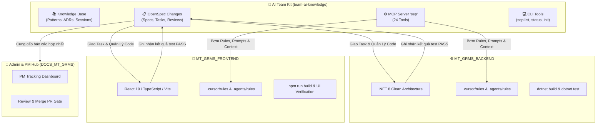

# AI Team Kit

Bộ công cụ AI điều phối trung tâm dùng chung cho nhóm SEP490 (Dự án MT-GRMS): Quản lý Knowledge Base, MCP Server và quy trình phát triển tính năng 6 bước (`/sep-spec` → `/sep-brainstorm` → `/sep-verify-spec` → `/sep-apply` → `/sep-test` → `/sep-archive`) hỗ trợ đa nền tảng **Cursor**, **Claude Code** và **Google Antigravity**.

---

## 🌐 Vai Trò & Kiến Trúc Kết Nối (Central Brain Architecture)

`ai-team-kit` đóng vai trò là **"Bộ Não Điều Phối Trung Tâm" (Central Governance Hub)** kết nối trực tiếp với 2 repository thực thi mã nguồn:



---

## 🔗 Chi Tiết Kết Nối Đến Backend & Frontend

### 1. Kết Nối Đến Backend ([`MT_GRMS_BACKEND`](../MT_GRMS_BACKEND))
- **Đường dẫn**: [`../MT_GRMS_BACKEND`](../MT_GRMS_BACKEND)
- **Công nghệ**: ASP.NET Core 8 Web API, Clean Architecture 4 tầng, EF Core Code-First.
- **Cơ chế kết nối**:
  1. **Tự động gắn Rules & Quy chuẩn (`sep init`)**:
     ```bash
     npm run sep -- init ../MT_GRMS_BACKEND
     ```
     Lệnh này tự động sinh các rule (`sep-kit-*.mdc` cho Cursor, `sep-kit-*.md` cho Antigravity) và cập nhật khối chỉ dẫn trong `AGENTS.md` của backend.
  2. **Kiểm soát kiến trúc qua Persona Review**:
     Khi backend chuẩn bị code, persona `sep-codebase` và `sep-skeptic` kiểm tra kỹ tính đóng gói Domain Entity, tầng Service chỉ nhận DTO và trả DTO, Fluent API chuẩn hóa, cùng bộ lọc đa người thuê `Global Query Filter`.
  3. **Kiểm thử nghiệm thu (`test-report.md`)**:
     Agent/Dev bắt buộc chạy `dotnet build` (0 lỗi, 0 cảnh báo) và `dotnet test` (100% Pass) trước khi cho phép mở PR.

---

### 2. Kết Nối Đến Frontend ([`MT_GRMS_FRONTEND`](../MT_GRMS_FRONTEND))
- **Đường dẫn**: [`../MT_GRMS_FRONTEND`](../MT_GRMS_FRONTEND)
- **Công nghệ**: React 19, TypeScript, Vite, Tailwind CSS v4, Ant Design.
- **Cơ chế kết nối**:
  1. **Tự động gắn Rules & Quy chuẩn (`sep init`)**:
     ```bash
     npm run sep -- init ../MT_GRMS_FRONTEND
     ```
     Sinh bộ rule kiểm soát UI chuẩn phong cách thương mại KiotViet.
  2. **Ràng buộc UI Design System qua Persona Review**:
     Persona `sep-codebase` kiểm tra quy chuẩn thiết kế: bo tròn Full Pill (`rounded-full`), Card bo góc 24-28px, phông chữ `Be Vietnam Pro`, màu chủ đạo Electric Blue `#0066FF`, và **nghiêm cấm tuyệt đối animation nhún nhảy vô tận / rung lắc**.
  3. **Đồng bộ API Contract với Backend**:
     Frontend tra cứu DTO và API Endpoint ngay trong `openspec/config.yaml` và các spec delta của Backend để tạo Service/Mock chính xác, không bị lệch hợp đồng.
  4. **Kiểm thử nghiệm thu (`test-report.md`)**:
     Agent/Dev bắt buộc chạy `npm run build` đạt 0 lỗi biên dịch TypeScript.

---

### 3. Đồng Bộ Chéo Dự Án & Hỗ Trợ Admin Merge Code
- **Phân chia theo từng người**: Mỗi thành viên được gán làm `assignee` cụ thể trong OpenSpec Change (ví dụ: Đức phụ trách Backend FE-02, Tâm phụ trách Frontend FE-01).
- **Admin kiểm soát tiến độ hợp nhất**:
  Admin chỉ cần đứng tại `team-ai-knowledge` và chạy:
  ```bash
  npm run sep -- list --all
  ```
  để biết được tính năng nào ở Backend đã xong, Frontend đã làm đến đâu, ai đang phụ trách phần việc nào.
- **Tiêu chí an toàn khi duyệt Merge PR**:
  Admin dùng lệnh:
  ```bash
  npm run sep -- status <tên-change>
  ```
  để kiểm tra 100% tasks trong `tasks.md` đã tick `[x]`, review đã duyệt và test report đạt `verdict: PASS` trước khi bấm nút Merge trên GitHub.

---

## 🚀 Hướng Dẫn Bắt Đầu & Kết Nối Nhanh

### Bước 1: Cài đặt công cụ môi trường
```bash
git clone https://github.com/SEP490-G84-MTGRMS/ai-team-kit.git
cd ai-team-kit/team-ai-knowledge
npm install
npm run sep -- install --user=<github-username> --push
npm run sep -- doctor
```

### Bước 2: Khởi tạo liên kết vào Backend và Frontend
```bash
npm run sep -- init ../MT_GRMS_BACKEND
npm run sep -- init ../MT_GRMS_FRONTEND
```

### Bước 3: Phát triển tính năng mới
Trong chat IDE (Cursor / Antigravity / Claude Code):
```bash
/sep-spec <Mô tả chức năng/lỗi cần làm>
```

---

## 📂 Cấu Trúc Thư Mục

| Thư mục | Nội dung |
|---|---|
| [`team-ai-knowledge/`](./team-ai-knowledge/) | Toàn bộ Knowledge Base, OpenSpec, MCP Server `sep`, bộ công cụ CLI |
| ├── [`openspec/`](./team-ai-knowledge/openspec/) | Quản lý vòng đời tính năng (changes, specs, tasks, reviews) |
| ├── [`projects/MT-GRMS/`](./team-ai-knowledge/projects/MT-GRMS/) | Ngữ cảnh nghiệp vụ, lịch sử phiên làm việc, báo cáo đánh giá dự án MT-GRMS |
| ├── [`sep-kit/`](./team-ai-knowledge/sep-kit/) | 7 Skills `/sep-*`, 4 Persona Review, Rules mẫu và Git hooks |
| └── [`docs/`](./team-ai-knowledge/docs/) | Tài liệu hướng dẫn chi tiết dành cho Admin và thành viên |

---

## 📖 Tài Liệu Tham Khảo Thêm
- [Hướng dẫn Admin Review & Merge Code](./team-ai-knowledge/docs/HUONG_DAN_ADMIN_REVIEW_MERGE_CODE.md)
- [Quy trình SEP 6 bước](./team-ai-knowledge/sep-kit/README.md)
- [Bản đồ Knowledge Base](./team-ai-knowledge/KNOWLEDGE_MAP.md)
