# Sổ Tay Toàn Tập: Quy Trình SEP (ai-team-kit) & Cơ Chế Hoạt Động

> **Dự án**: MT-GRMS (SEP490 Fall 2026)  
> **Hệ thống AI Kit**: `ai-team-kit` / `team-ai-knowledge` (Phiên bản v2.2.0)  
> **Cập nhật lần cuối**: 2026-11-08  

---

## 1. Tổng Quan Triết Lý & Kiến Trúc SEP

Quy trình **SEP (Software Engineering Process)** trong `ai-team-kit` được thiết kế nhằm chuẩn hóa việc phối hợp giữa lập trình viên và các trợ lý AI (Cursor, Antigravity, Claude Code). Hệ thống vận hành theo các nguyên tắc nền tảng:

1. **Spec-First & Delta Spec**: Mọi chức năng/sửa đổi đều phải có đặc tả trước khi gõ code. Đặc tả được lưu trữ dưới dạng Delta (`ADDED`, `MODIFIED`, `REMOVED Requirements`) gắn với kịch bản cụ thể (`Scenario: GIVEN / WHEN / THEN`).
2. **Karpathy Coding Rules**:
   - *Nghĩ trước khi code*: Nêu rõ giả định, không đoán mò các yêu cầu mơ hồ.
   - *Đơn giản trước*: Viết code tối thiểu giải quyết đúng yêu cầu. 50 dòng giải quyết được thì không viết 200 dòng.
   - *Phẫu thuật (Surgical)*: Chỉ can thiệp đúng phạm vi task, không tự tiện refactor hay đổi format code xung quanh.
   - *Xác minh bằng mục tiêu*: Chỉ báo hoàn thành khi đã có kết quả build, lint và test thật.
3. **Cơ chế Cổng Duyệt (Human-in-the-Loop Gate)**: AI không bao giờ được tự chuyển trạng thái hoặc tự duyệt bước. Mỗi bước (từ 1 đến 5) bắt buộc phải có xác nhận rõ ràng **Approve / Reject** từ con người.
4. **Bảo toàn Cấu trúc & Tối giản (Single Source of Truth)**:
   - Toàn bộ các Change nằm trực tiếp tại `openspec/changes/<tên-change>/`.
   - Không duy trì thư mục `openspec/specs/` baseline riêng biệt hay thư mục `openspec/archive/` tĩnh.
   - Khi change kết thúc bước 6 (`/sep-archive`), change được tự động đổi tên thêm hậu tố `-archived-YYYY-MM-DD` ngay tại `openspec/changes/`.

---

## 2. Sơ Đồ Toàn Cảnh Quy Trình 6 Bước

```mermaid
flowchart TD
    subgraph S1 ["Bước 1: /sep-spec"]
        A1["User yêu cầu /sep-spec"] --> A2["Route Schema & Chọn Capability"]
        A2 --> A3["MCP: sep_tao_change"]
        A3 --> A4["Viết proposal.md"]
        A4 --> A5{"Gate Spec: Approve?"}
        A5 -- Reject --> A4
    end

    subgraph S2 ["Bước 2: /sep-brainstorm"]
        A5 -- Approve --> B1["MCP: sep_duyet_buoc (spec)"]
        B1 --> B2["Viết exploration.md"]
        B2 --> B3["Viết design-brief.md (chỉ feature)"]
        B3 --> B4["Viết specs.md (Delta REQ)"]
        B4 --> B5{"Gate Brainstorm: Approve?"}
        B5 -- Reject --> B2
    end

    subgraph S3 ["Bước 3: /sep-verify-spec"]
        B5 -- Approve --> C1["MCP: sep_duyet_buoc (brainstorm)"]
        C1 --> C2["Multi-Agent Review: Skeptic (bắt buộc)"]
        C2 --> C3["Review Guardian / Advocate / Codebase"]
        C3 --> C4["Vòng lặp sửa các lỗi HIGH trong specs"]
        C4 --> C5["Lập tasks.md chi tiết"]
        C5 --> C6{"Gate Verify-Spec: Approve?"}
        C6 -- Reject --> C4
    end

    subgraph S4 ["Bước 4: /sep-apply"]
        C6 -- Approve --> D1["MCP: sep_duyet_buoc (verify-spec)"]
        D1 --> D2["MCP: sep_chuyen_trang_thai (apply)"]
        D2 --> D3["Code theo tasks.md"]
        D3 --> D4["Tick [x] từng task vào tasks.md"]
        D4 --> D5["Build / Lint kiểm chứng"]
        D5 --> D6{"Gate Apply: Approve?"}
        D6 -- Reject --> D3
    end

    subgraph S5 ["Bước 5: /sep-test"]
        D6 -- Approve --> E1["MCP: sep_duyet_buoc (apply) + db-sync"]
        E1 --> E2["Viết & Chạy Test theo Scenarios"]
        E2 --> E3["Lập test-report.md (verdict: PASS)"]
        E3 --> E4["Đồng bộ Excel / Google Sheets"]
        E4 --> E5{"Gate Test: Approve?"}
        E5 -- Reject --> E2
    end

    subgraph S6 ["Bước 6: /sep-archive"]
        E5 -- Approve --> F1["MCP: sep_duyet_buoc (test)"]
        F1 --> F2["MCP: sep_chuyen_trang_thai (archived)"]
        F2 --> F3["Đổi tên folder: <name>-archived-YYYY-MM-DD"]
        F3 --> F4["Thu hoạch: luu_bai_hoc & ADR"]
        F4 --> F5["Đóng Change hoàn tất 🎉"]
    end
```



---

## 3. Chi Tiết Từng Bước Trong Pipeline 6 Bước

### Bước 1: `/sep-spec <mô tả>` — Khởi Tạo Change & Đề Xuất (Proposal)

- **Mục tiêu**: Định nghĩa rõ bài toán nghiệp vụ, phạm vi (in-scope / out-of-scope) và tiêu chí thành công trước khi đi sâu vào kỹ thuật.
- **Lệnh thực thi**: `/sep-spec <mô tả chức năng>`
- **Các hành động chính**:
  1. **Route Schema**:
     - `feature`: Phát triển chức năng mới hoặc thay đổi hành vi có UI/API mới (mặc định).
     - `bug-fix`: Sửa lỗi phát sinh, sai lệch hành vi. Bỏ qua `design-brief.md`.
     - `refactor`: Tối ưu cấu trúc code, bảo toàn bất biến logic. Bỏ qua `design-brief.md`.
  2. **Chọn Capability**: Gọi `sep_tim_capability` để gắn với phân hệ tương ứng. Chỉ tạo mới khi có xác nhận.
  3. **Khởi tạo Change**: Gọi MCP `sep_tao_change` (chỉ duy nhất bước này được gọi tool này).
  4. **Tạo tài liệu `proposal.md`**:
     ```markdown
     # Proposal: <tên change>
     ## Vấn đề
     ## Mục tiêu
     ## Phạm vi
     - In scope: ...
     - Out of scope: ...
     ## Người dùng liên quan
     ## Tiêu chí thành công
     - [ ] ... (đo lường được)
     ```
- **Cổng duyệt (Gate)**: AI tóm tắt ngắn gọn (3-5 dòng) và hỏi user: *"Bạn có Approve hay Reject Proposal này?"*
  - Nếu **Approve**: Gọi `sep_duyet_buoc({ buoc: "spec", quyetDinh: "approve", tomTat: "..." })`.
  - Nếu **Reject**: Chỉnh sửa theo ý kiến, lưu lại và gọi `sep_duyet_buoc` với `quyetDinh: "reject"`.

---

### Bước 2: `/sep-brainstorm` — Khảo Sát, Thiết Kế & Đặc Tả Delta Specs

- **Mục tiêu**: Soạn thảo phương án kỹ thuật, thiết kế giao diện, luồng dữ liệu và danh sách Requirement dạng Delta. **Tuyệt đối không viết code trong bước này.**
- **Lệnh thực thi**: `/sep-brainstorm [tên-change]` (bỏ trống = change đang kích hoạt 📌).
- **Các artifact bắt buộc**:
  1. `exploration.md`:
     - Khảo sát hiện trạng code & tri thức từ KB (`xem_mau_thiet_ke`, `xem_quyet_dinh`).
     - Giả định (Assumptions) & Không làm (Non-Goals).
     - Đưa ra ít nhất 2 phương án kỹ thuật, phân tích Ưu / Nhược điểm và lý do lựa chọn.
     - Đánh giá rủi ro kỹ thuật.
  2. `design-brief.md` *(Bắt buộc với schema `feature`)*:
     - Luồng người dùng (User Flow), Wireframe / UI component.
     - Thiết kế Contract API (Method, Path, Request, Response).
     - Các trạng thái màn hình: Loading, Empty, Success, Error.
     - Thay đổi CSDL (Entity, Quan hệ, Khóa ngoại).
     - Phân quyền (Role/Permissions).
  3. `specs.md` *(Cấu trúc Delta chuẩn OpenSpec)*:
     ```markdown
     # Specs: <tên change>

     ## API / Contract
     | Method | Path | Request | Response | Lỗi |

     ## ADDED Requirements
     ### Requirement: REQ-01 <tên>
     Hệ thống MUST ...
     #### Scenario: <kịch bản chuẩn>
     - GIVEN ...
     - WHEN ...
     - THEN ...
     #### Scenario: <edge case / ngoại lệ>
     - GIVEN ...
     - WHEN ...
     - THEN ...

     ## MODIFIED Requirements
     ### Requirement: REQ-xx <tên>
     ...

     ## REMOVED Requirements
     ### Requirement: REQ-xx <tên>

     ## Acceptance checklist
     - [ ] REQ-01 ...
     ```
- **Cổng duyệt (Gate)**: AI tóm tắt phương án và các REQ cốt lõi. Chờ user duyệt trước khi gọi `sep_duyet_buoc({ buoc: "brainstorm", quyetDinh: "approve" })`.

---

### Bước 3: `/sep-verify-spec` — Phản Biện Đa Persona & Lập Tasks

- **Mục tiêu**: Đóng vai các chuyên gia độc lập để "soi lỗi" bản thiết kế, loại bỏ toàn bộ rủi ro trước khi code, sau đó phân rã thành danh sách công việc (`tasks.md`).
- **Lệnh thực thi**: `/sep-verify-spec [tên-change]`
- **Hệ thống 4 Personas Review**:
  | Persona | Trách nhiệm chính | Chiều đánh giá | File xuất ra |
  |---|---|---|---|
  | **Skeptic** *(Bắt buộc)* | Người phản biện độc lập, tìm lỗ hổng logic, edge case, mâu thuẫn | Chấm điểm D1–D5 (Completeness, Correctness, Coherence, Constraints, Blast Radius) | `review/skeptic.md` |
  | **Guardian** | Chuyên gia bảo mật: Auth, phân quyền RBAC, SQL Injection, Multi-tenant leak | Bảo mật, bảo vệ dữ liệu, phòng chống gian lận | `review/guardian.md` |
  | **Advocate** | Đại diện trải nghiệm người dùng: Luồng thao tác, độ rõ ràng thông báo lỗi | UX, UI feedback, trạng thái rỗng, tốc độ phản hồi | `review/advocate.md` |
  | **Codebase** | Kỹ sư trưởng đối chiếu repo: Tránh trùng lặp, tuân thủ Clean Architecture | Tái sử dụng service/component, tuân thủ convention | `review/codebase.md` |

- **Vòng lặp khắc phục (Correction Loop)**:
  - Tất cả vấn đề mức độ **HIGH** từ các reviewer bắt buộc phải được xử lý ngay trong `specs.md` và `design-brief.md`.
  - Tối đa 3 vòng lặp cho đến khi hết lỗi HIGH.
- **Tạo `tasks.md`**:
  - Phân bổ theo thứ tự: `## DB` ➔ `## Backend` ➔ `## Frontend` ➔ `## Test`.
  - Mỗi task là một checkbox `- [ ] Tn — Mô tả cụ thể (REQ-xx)`.
  - Ước lượng mỗi task không quá nửa ngày (<= 4 giờ làm việc).
- **Cổng duyệt (Gate)**: User duyệt `verify-spec` ➔ Mở khóa bước thực thi code.

---

### Bước 4: `/sep-apply` — Hiện Thực Hóa Code (Apply Code)

- **Mục tiêu**: Lập trình chính xác theo `tasks.md`, tuân thủ nguyên tắc phẫu thuật (surgical), kiểm thử tự động cục bộ và cập nhật tiến độ liên tục.
- **Lệnh thực thi**: `/sep-apply [tên-change]`
- **Quy trình triển khai**:
  1. Chuyển trạng thái change: Gọi `sep_chuyen_trang_thai({ trangThai: "apply" })`. Nếu các bước trước chưa xong hoặc chưa duyệt, MCP Server sẽ chặn cứng ⛔.
  2. Lần lượt thực hiện từng task:
     - Viết code tối giản, bám sát `specs.md`.
     - Tuân thủ cấu trúc của MT-GRMS: Backend (ASP.NET Core Clean Architecture, CQRS MediatR, EF Core) và Frontend (React, Vite, TypeScript, Tailwind, Lucide Icons).
     - Chạy build/lint kiểm tra (`dotnet build`, `npm run build`, `npm run lint`).
  3. Cập nhật `tasks.md`: Ngay sau khi hoàn thành một task, AI cập nhật `- [ ]` thành `- [x]` và lưu lại bằng `sep_luu_artifact`.
  4. Đồng bộ CSDL tự động (`db-sync`): Khi user Approve bước Apply, MCP server tự động quét các Entity mới trong DbContext và cập nhật tài liệu `projects/MT-GRMS/design/database-schema.md`.
- **Cổng duyệt (Gate)**: AI tóm tắt các file đã sửa, kết quả build/lint ➔ User Approve.

---

### Bước 5: `/sep-test` — Kiểm Thử Đa Tầng, Lập Báo Cáo & Xuất Matrix

- **Mục tiêu**: Kiểm chứng toàn diện chức năng dựa trên các kịch bản GIVEN/WHEN/THEN trong `specs.md`, xuất tài liệu kiểm thử chuẩn FPT SEP490 và báo cáo kết quả.
- **Lệnh thực thi**: `/sep-test [tên-change]`
- **Cấu trúc `test-report.md` (Unified Test Table)**:
  Bắt buộc có frontmatter `verdict: PASS` (chỉ khi 100% test case PASS).
  
  Bảng kịch bản kiểm thử hợp nhất:
  - **Mã Test Case** (VD: `TC-UT-FE01-01`, `TC-IT-01`, `TC-SYS-01`, `TC-SEC-01`, `TC-E2E-01`)
  - **Tên kịch bản** (gắn với `REQ-xx`)
  - **Tiêu chí của Cô**:
    - `Số liệu / Công thức`: Tính toán tiền tệ, thuế, công nợ, chiết khấu, tồn kho.
    - `Luồng nghiệp vụ`: Chuyển trạng thái chứng từ, chốt sổ ca, xuất nhập kho.
    - `Giao diện (UI)`: Form nhập liệu, modal, phím tắt POS, phân trang, toast.
    - `Security`: Phân quyền RBAC, mã hash kiểm toán `AuditHash`, chống gửi trùng `Idempotency`.
  - **Kiểm thử chéo (Cross-Testing)**: Người viết (Author) khác Người chạy (Runner).
  - **Phân loại Report Type**:
    - `5.1`: Unit Test
    - `5.2`: Integration Test
    - `5.3`: System Test FRs
    - `5.4`: System Test NFRs
    - `5.5`: Acceptance Test
- **Tài liệu kiểm thử FPT SEP490**:
  - Tự động xuất/đồng bộ vào bộ tài liệu 40 màn hình Excel tại `ai-team-kit/test_documents/screens/` và 5 tập Master: `Report-5.1` đến `Report-5.5`.
  - Chạy script kiểm thử:
    ```powershell
    python "ai-team-kit/team-ai-knowledge/scripts/generate_screen_test_docs.py"
    ```
  - Đồng bộ Google Sheets online: Gọi tool `sep_dong_bo_test_sheet`.
- **Cổng duyệt (Gate)**: User kiểm tra kết quả test và bấm Approve.

---

### Bước 6: `/sep-archive` — Lưu Trữ Change & Thu Hoạch Tri Thức

- **Mục tiêu**: Đóng change, đánh dấu đã hoàn thành và lưu giữ tri thức giá trị vào Knowledge Base.
- **Lệnh thực thi**: `/sep-archive [tên-change]`
- **Cơ chế Archive**:
  1. Kiểm tra điều kiện: Change bắt buộc phải có `test-report.md` với `verdict: PASS` và đã được Approve ở bước 5.
  2. Cập nhật `.status = archived` và lưu mốc thời gian `archivedAt`.
  3. **Tự động đổi tên thư mục**: Thư mục `openspec/changes/<name>` được đổi tên thành `openspec/changes/<name>-archived-YYYY-MM-DD/`.
  4. **Không tạo rác**: Không merge hay sinh file thừa vào `openspec/specs/` hay `openspec/archive/`.
  5. **Thu hoạch tri thức**:
     - Lưu bài học kinh nghiệm (`luu_bai_hoc`) nếu gặp bug hoặc bài toán hóc búa.
     - Lưu quyết định kiến trúc (`xem_quyet_dinh` / ADR) nếu có pattern mới.
     - Lưu phiên làm việc (`luu_phien_lam_viec`).

---

## 4. Các Lệnh Bổ Trợ Đặc Biệt

### 4.1 `/sep-status` — Xem Tiến Độ & Chuyển Đổi Change
- `/sep-status`: Xem danh sách change được gán cho bản thân (📌 biểu thị change đang làm việc).
- `/sep-status all`: Xem toàn bộ change của cả nhóm trong dự án.
- `/sep-status <tên-change>`: Xem chi tiết tiến độ, tình trạng từng file artifact và cổng duyệt của 1 change.
- `/sep-status chọn <tên-change>`: Chuyển sang làm việc với change khác (gọi MCP `sep_chon_change`).

### 4.2 `/sep-back [bước]` — Quay Lại Bước Trước (Safe Rollback)
- **Mục đích**: Khi đang ở bước sau nhưng phát hiện đặc tả hoặc thiết kế cần bổ sung.
- **Cách dùng**:
  - `/sep-back`: Lùi về 1 bước liền kề (VD: từ `apply` về `verify-spec`).
  - `/sep-back <tên-bước>`: Lùi về bước chỉ định (VD: `/sep-back brainstorm`).
- **Nguyên tắc an toàn**:
  - **Giữ nguyên 100% artifacts**: Toàn bộ file đã viết không bị xóa, người dùng chỉ cần mở ra chỉnh sửa phần thay đổi.
  - **Reset Gate**: Cổng duyệt của bước lùi về được mở lại để đảm bảo quy trình kiểm soát chặt chẽ sau khi chỉnh sửa.

### 4.3 `/sep-refactor <mô tả>` — Cập Nhật Trực Tiếp Specs Đang Mở
- **Mục đích**: Thay đổi/thêm/bớt requirement trên một change đang mở mà không cần chạy lại toàn bộ 6 bước từ đầu.
- **Nguyên tắc cốt lõi**:
  - Không gọi `sep_tao_change` (không tạo change mới).
  - Tìm chính xác Change mục tiêu thông qua `sep_tim_capability`.
  - Người dùng xác nhận đúng Change và Requirement ➔ AI soạn thảo Delta (`ADDED`, `MODIFIED`, `REMOVED`) ➔ User Approve ➔ Gọi `sep_cap_nhat_capability`.

---

## 5. Bảng Tổng Hợp Lệnh, Tool MCP & Artifacts

| Bước | Lệnh Skill | Tool MCP Thao Tác | Artifacts Bắt Buộc | Cổng Duyệt (Gate) |
|---|---|---|---|:---:|
| 1 | `/sep-spec` | `sep_tao_change`<br>`sep_luu_artifact`<br>`sep_duyet_buoc` | `.session.md`<br>`proposal.md` | User Approve Proposal |
| 2 | `/sep-brainstorm` | `sep_luu_artifact`<br>`sep_duyet_buoc` | `exploration.md`<br>`design-brief.md` *(feature)*<br>`specs.md` *(Delta)* | User Approve Design & Specs |
| 3 | `/sep-verify-spec` | `sep_xem_persona`<br>`sep_luu_artifact`<br>`sep_duyet_buoc` | `review/skeptic.md`<br>`tasks.md` | User Approve Review & Tasks |
| 4 | `/sep-apply` | `sep_chuyen_trang_thai`<br>`sep_luu_artifact`<br>`sep_duyet_buoc` | Code hoàn thiện<br>`tasks.md` (đã tick hết) | User Approve Code Diff |
| 5 | `/sep-test` | `sep_luu_artifact`<br>`sep_duyet_buoc`<br>`sep_dong_bo_test_sheet` | `test-report.md` (verdict: PASS)<br>Bộ 5 báo cáo Excel/Sheet | User Approve Test Results |
| 6 | `/sep-archive` | `sep_chuyen_trang_thai`<br>`luu_bai_hoc` | Đổi tên folder sang `-archived-YYYY-MM-DD` | Xác nhận đóng Change |

---

## 6. Checklist Dành Cho Lập Trình Viên Mới

- [ ] Chạy `npm run sep -- install` sau khi pull mã nguồn `team-ai-knowledge`.
- [ ] Chạy `npm run sep -- doctor` để xác nhận IDE đã nạp đủ công cụ MCP server.
- [ ] Khởi động lại Cursor / Antigravity sau khi cập nhật cấu hình.
- [ ] Luôn kiểm tra change đang kích hoạt bằng `/sep-status` trước khi chạy các lệnh kế tiếp.
- [ ] Tuyệt đối không tự ý sửa đổi file `.status` hoặc can thiệp thủ công vào thư mục `openspec/changes/`.
- [ ] Luôn để người dùng xác nhận Approve / Reject trước khi chuyển bước.
