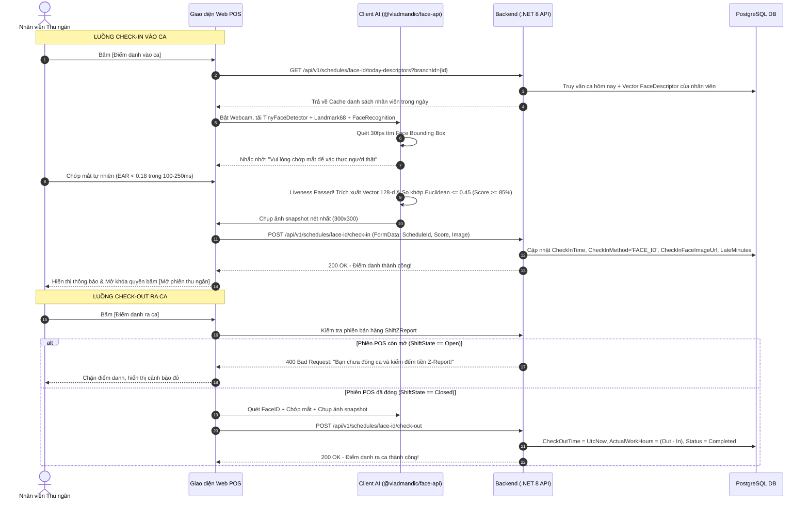

# Design Brief: attendance-faceid-checkin-checkout

## 1. Luồng Người dùng & Kiến trúc Giao diện (User Flows & UI Architecture)



---

## 2. Thiết kế Màn hình & Component Frontend

### 2.1. Component `FaceAttendanceModal.tsx` (Tích hợp tại Web POS)
- **Vị trí hiển thị:** Quầy POS thu ngân bán lẻ (`POSCheckoutPage.tsx`) và góc thao tác Bảng chấm công nhân viên.
- **Trạng thái hiển thị:**
  - `Loading`: Đang tải 3 mô hình AI (~6.8 MB) từ `/models/face-api/` (thanh progress bar tiến trình nạp mô hình).
  - `Streaming`: Hiển thị khung tròn camera webcam tỷ lệ 1:1, vẽ bounding box xanh khi phát hiện mặt.
  - `Liveness Pending`: Hiển thị thông báo nhấp nháy: *"Vui lòng chớp mắt để xác thực người thật..."*.
  - `Recognized`: Khung viền chuyển xanh lá, hiển thị tên nhân viên + Điểm tin cậy (Ví dụ: `Nguyễn Văn A - 91.5%`).
  - `Submitting`: Chụp snapshot, hiển thị spinner gửi request lên Backend.
  - `Error / Mismatch`: Cảnh báo *"Không nhận diện được khuôn mặt hoặc độ tương đồng < 85%"*, kèm nút bấm *"Báo sự cố chấm công"* chuyển sang `CreateScheduleRequestModal`.

### 2.2. Modal Chấm công thủ công 3 Tiêu chí `AttendanceDetailModal.tsx` (Dành cho Chủ cửa hàng)
- **Vị trí:** Màn hình Quản lý Bảng chấm công ([`AttendancePage.tsx`](file:///d:/FPT_uni/Sesmester_9_Fall_26/File/MT_GRMS_FRONTEND/src/features/employee/pages/AttendancePage.tsx)).
- **3 Tiêu chí lựa chọn:**
  1. **Đi làm (`Working`):** Cho phép sửa giờ vào/ra. Nếu để trống, hệ thống tự động gán mặc định khớp đúng ca gốc (`CheckInTime = PlannedStartTime`, `CheckOutTime = PlannedEndTime`). Trạng thái ca `Completed`, loại `WORKING`.
  2. **Nghỉ phép hưởng lương (`PaidLeave`):** Giờ vào/ra để trống, tự động bảo toàn giờ công $\text{ActualWorkHours} = \text{DurationHours}$, loại `PAID_LEAVE`.
  3. **Nghỉ không lương (`UnpaidLeave`):** Giờ công $\text{ActualWorkHours} = 0.00$, trạng thái `Cancelled`, loại `UNPAID_LEAVE`.

### 2.3. Modal Đăng ký khuôn mặt `RegisterFaceModal.tsx` (Hồ sơ nhân viên)
- Cho phép chụp trực tiếp từ webcam hoặc tải ảnh chân dung chính diện chất lượng cao.
- Client trích xuất vector 128 số thực `FaceDescriptor` và gửi lên lưu vào bảng `Employees`.

---

## 3. Thiết kế API Endpoints & DTOs Backend (.NET 8)

### 3.1. Danh mục Endpoints

| Method | Endpoint | Mô tả | Authorization |
|---|---|---|---|
| `GET` | `/api/v1/schedules/face-id/today-descriptors` | Lấy danh sách vector nhân viên có ca trong ngày tại chi nhánh | `Staff`, `StoreOwner` |
| `POST` | `/api/v1/schedules/face-id/check-in` | Chấm công vào ca bằng AI FaceID | `Staff`, `StoreOwner` |
| `POST` | `/api/v1/schedules/face-id/check-out` | Chấm công ra ca bằng AI FaceID (kiểm tra POS Closed) | `Staff`, `StoreOwner` |
| `POST` | `/api/v1/schedules/{id}/attendance` | Chủ cửa hàng chấm công thủ công 3 tiêu chí | `StoreOwner` |
| `POST` | `/api/v1/employees/{id}/face-descriptor` | Đăng ký/Cập nhật vector khuôn mặt cho nhân viên | `StoreOwner`, `Employee` |

### 3.2. Data Transfer Objects (DTOs)

```csharp
// Response danh sách vector nhân viên trong ngày
public record TodayStaffDescriptorDto(
    Guid ScheduleId,
    Guid EmployeeId,
    string EmployeeCode,
    string FullName,
    TimeSpan PlannedStartTime,
    TimeSpan PlannedEndTime,
    float[] FaceDescriptor,
    bool HasCheckedIn
);

// Request Check-in FaceID
public class FaceIdCheckInRequest
{
    public Guid ScheduleId { get; set; }
    public Guid EmployeeId { get; set; }
    public decimal FaceMatchScore { get; set; }
    public bool LivenessPassed { get; set; }
    public IFormFile SnapshotImage { get; set; } = null!;
}

// Request Check-out FaceID
public class FaceIdCheckOutRequest
{
    public Guid ScheduleId { get; set; }
    public Guid EmployeeId { get; set; }
    public decimal FaceMatchScore { get; set; }
    public bool LivenessPassed { get; set; }
    public IFormFile SnapshotImage { get; set; } = null!;
}

// Request Chấm công thủ công 3 tiêu chí
public record RecordManualAttendanceRequest(
    string AttendanceType, // "WORKING", "PAID_LEAVE", "UNPAID_LEAVE"
    DateTime? CheckInTime,
    DateTime? CheckOutTime,
    string? Note
);
```

---

## 4. Thiết kế Cơ sở dữ liệu (Database Schema)

- Tận dụng cấu trúc bảng hiện có trong `EmployeeSchedules` và `Employees`:
  - `EmployeeSchedules`: `CheckInTime`, `CheckInMethod`, `CheckInFaceImageUrl`, `FaceMatchScore`, `CheckOutTime`, `CheckOutMethod`, `CheckOutFaceImageUrl`, `LateMinutes`, `EarlyLeaveMinutes`, `ActualWorkHours`, `Status`, `ApprovalType`, `ApprovalStatus`.
  - `Employees`: Cột `FaceDescriptor` (Kiểu dữ liệu `text` lưu JSON mảng 128 float: `[0.123, -0.045, ...]`).
  - Index hỗ trợ truy vấn nhanh: `CREATE INDEX IF NOT EXISTS ix_employee_schedules_workdate_branch ON "EmployeeSchedules"("WorkDate", "BranchId");`.

---

## 5. Quy tắc Nghiệp vụ & Ràng buộc Bảo mật

1. **BR-ATT-01 (Dung sai & Kỷ luật giờ giấc):**
   - Áp dụng cấu hình `BranchAttendancePolicy`.
   - Nếu chi nhánh chưa có cấu hình (`policy == null`), tự động fallback: Dung sai = 0 phút, vào muộn tính `LateMinutes`, về sớm tính `EarlyLeaveMinutes`.
2. **BR-ATT-02 (Ràng buộc Đóng ca POS):**
   - Thu ngân chỉ được Check-out khi phiên ca bán hàng tương ứng trên két quầy `ShiftZReport` đã chuyển trạng thái `Closed`.
3. **BR-ATT-03 (Chống gian lận Liveness):**
   - Tỷ lệ co giãn mắt EAR bắt buộc giảm $< 0.18$ trong 100-250ms để xác nhận chớp mắt thật trước khi chụp ảnh snapshot.
4. **BR-ATT-04 (Bảo toàn công Nghỉ phép):**
   - Ca chấm `PAID_LEAVE` bắt buộc ghi nhận $\text{ActualWorkHours} = \text{DurationHours}$ và `ApprovalType = "PAID_LEAVE"` để được nạp đủ vào bảng lương tháng.
