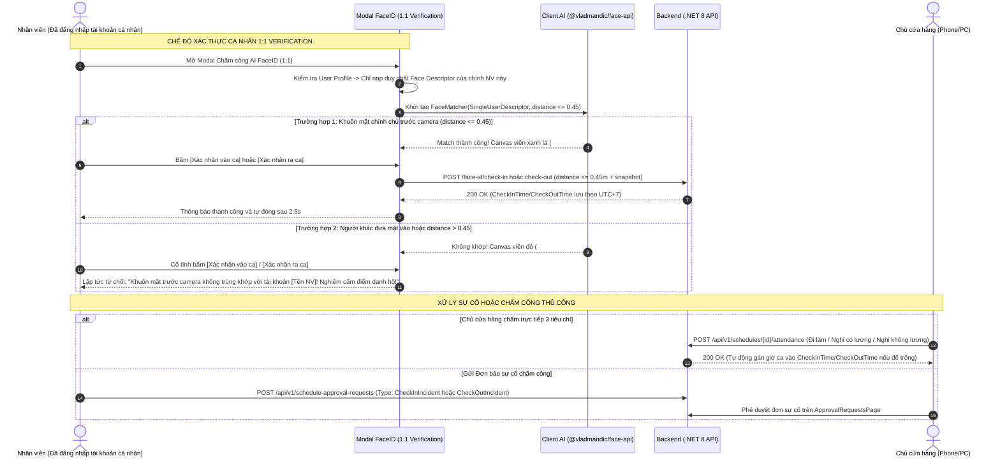

# Design Brief: attendance-faceid-checkin-checkout

## 1. Luồng Người dùng & Kiến trúc Giao diện (User Flows & UI Architecture)

---

## 2. Thiết kế Màn hình & Component Frontend

### 2.1. Component `FaceIdAttendanceModal.tsx` (Chế độ Cá nhân 1:1)
- **Vị trí hiển thị:** Góc thao tác Bảng chấm công nhân viên ([`AttendancePage.tsx`](file:///d:/FPT_uni/Sesmester_9_Fall_26/File/MT_GRMS_FRONTEND/src/features/employee/pages/AttendancePage.tsx)).
- **Quyền truy cập cá nhân:** Bắt buộc nhân viên đã đăng nhập tài khoản cá nhân (`useAuthStore`). Chưa đăng nhập bị chặn và yêu cầu đăng nhập.
- **Trạng thái hiển thị:**
  - `Loading`: Đang tải các mô hình AI Face-API từ `/models` và chuẩn bị dữ liệu khuôn mặt cá nhân 1:1.
  - `Recognized (Chính chủ)`: Khung canvas viền xanh lá (`#10B981`), hiển thị `[Tên Nhân Viên] (d: 0.xx)`. Badge dưới video hiển thị icon `UserCheck`, tên nhân viên, ca làm, khoảng cách $\le 0.45$.
  - `Mismatch / Người lạ`: Khung canvas viền đỏ (`#EF4444`), nhãn `Không khớp với [Tên Nhân Viên] (d: 0.xx)`. Badge dưới video cảnh báo không trùng khớp. Tuyệt đối không hiển thị tên người khác trên canvas.
  - `Hành động Xác nhận`: Nút "Xác nhận vào ca" / "Xác nhận ra ca" luôn hiển thị. Bấm khi không khớp sẽ lập tức từ chối và cảnh báo lỗi nghiêm cấm điểm danh hộ.

### 2.2. Modal Chấm công thủ công 3 Tiêu chí `AttendanceDetailModal.tsx` (Dành cho Chủ cửa hàng)
- **Vị trí:** Màn hình Quản lý Bảng chấm công ([`AttendancePage.tsx`](file:///d:/FPT_uni/Sesmester_9_Fall_26/File/MT_GRMS_FRONTEND/src/features/employee/pages/AttendancePage.tsx)).
- **3 Tiêu chí lựa chọn:**
  1. **Đi làm (`Working`):** Cho phép sửa giờ vào/ra. Nếu để trống, hệ thống tự động gán mặc định khớp đúng ca gốc (`CheckInTime = PlannedStartTime`, `CheckOutTime = PlannedEndTime`). Trạng thái ca `Completed`, loại `WORKING`.
  2. **Nghỉ phép hưởng lương (`PaidLeave`):** Giờ vào/ra để trống, tự động bảo toàn giờ công $\text{ActualWorkHours} = \text{DurationHours}$, loại `PAID_LEAVE`.
  3. **Nghỉ không lương (`UnpaidLeave`):** Giờ công $\text{ActualWorkHours} = 0.00$, trạng thái `Cancelled`, loại `UNPAID_LEAVE`.

---

## 3. Thiết kế API Endpoints & DTOs Backend (.NET 8)

| Method | Endpoint | Mô tả | Authorization |
|---|---|---|---|
| `GET` | `/api/v1/schedules/face-id/today-descriptors` | Lấy danh sách vector nhân viên có ca trong ngày tại chi nhánh | `Staff`, `StoreOwner` |
| `POST` | `/api/v1/schedules/face-id/check-in` | Chấm công vào ca bằng AI FaceID (kiểm tra khoảng cách $\le 0.45m$, lưu UTC+7) | `Staff`, `StoreOwner` |
| `POST` | `/api/v1/schedules/face-id/check-out` | Chấm công ra ca bằng AI FaceID (kiểm tra khoảng cách $\le 0.45m$, lưu UTC+7) | `Staff`, `StoreOwner` |
| `POST` | `/api/v1/schedules/{id}/attendance` | Chủ cửa hàng chấm công thủ công 3 tiêu chí | `StoreOwner` |
| `POST` | `/api/v1/employees/{id}/face-descriptor` | Đăng ký/Cập nhật vector khuôn mặt đa ảnh cho nhân viên | `StoreOwner`, `Employee` |

---

## 4. Chuẩn hóa Múi giờ & Quy tắc OT
1. **Chuẩn hóa UTC+7:** Toàn bộ thời gian vào/ra ca và cập nhật đều được ghi nhận theo múi giờ Việt Nam UTC+7 (`DateTime.UtcNow.AddHours(7)`).
2. **Quy tắc OT:** Chấm công ra ca không tự động tính OT. Bắt buộc có đơn xin OT (`ScheduleRequestType.Overtime`) được Chủ cửa hàng duyệt. Nếu chưa duyệt, `OvertimeMinutes = 0` và không được bù trừ giờ ở lại trễ để xóa lỗi đi muộn hoặc về sớm.
