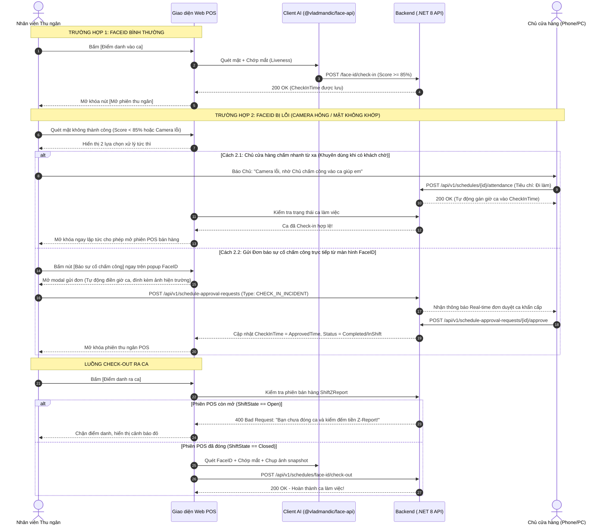

# Design Brief: attendance-faceid-checkin-checkout

## 1. Luồng Người dùng & Kiến trúc Giao diện (User Flows & UI Architecture)

---

## 2. Thiết kế Màn hình & Component Frontend

### 2.1. Component `FaceAttendanceModal.tsx` (Tích hợp tại Web POS)
- **Vị trí hiển thị:** Quầy POS thu ngân bán lẻ (`POSCheckoutPage.tsx`) và góc thao tác Bảng chấm công nhân viên.
- **Trạng thái hiển thị:**
  - `Loading`: Đang tải 3 mô hình AI (~6.8 MB) từ `/models/face-api/`.
  - `Streaming`: Khung tròn camera webcam tỷ lệ 1:1, vẽ bounding box xanh khi phát hiện mặt.
  - `Liveness Pending`: Thông báo nhấp nháy: *"Vui lòng chớp mắt để xác thực người thật..."*.
  - `Recognized`: Khung viền chuyển xanh lá, hiển thị tên nhân viên + Điểm tin cậy (Ví dụ: `Nguyễn Văn A - 91.5%`).
  - `Submitting`: Chụp snapshot, gửi request lên Backend.
  - `Error / Mismatch (Xử lý sự cố mở ca)`:
    - Khi không khớp mặt hoặc camera lỗi, popup hiển thị thông báo rõ ràng kèm 2 nút hành động:
      1. Nút **[Báo sự cố chấm công]**: Mở modal gửi đơn giải trình đính kèm ảnh chụp hiện trường để Chủ duyệt mở ca.
      2. Nút **[Nhờ Chủ cửa hàng xác nhận]**: Hướng dẫn liên hệ Chủ cửa hàng truy cập Bảng chấm công trên điện thoại bấm xác nhận 1 chạm (5 giây) để mở khóa POS ngay lập tức khi khách hàng đang chờ mua hàng.

### 2.2. Modal Chấm công thủ công 3 Tiêu chí `AttendanceDetailModal.tsx` (Dành cho Chủ cửa hàng)
- **Vị trí:** Màn hình Quản lý Bảng chấm công ([`AttendancePage.tsx`](file:///d:/FPT_uni/Sesmester_9_Fall_26/File/MT_GRMS_FRONTEND/src/features/employee/pages/AttendancePage.tsx)).
- **3 Tiêu chí lựa chọn:**
  1. **Đi làm (`Working`):** Cho phép sửa giờ vào/ra. Nếu để trống, hệ thống tự động gán mặc định khớp đúng ca gốc (`CheckInTime = PlannedStartTime`, `CheckOutTime = PlannedEndTime`). Trạng thái ca `Completed`, loại `WORKING`. Kích hoạt ngay lập tức quyền mở POS cho nhân viên.
  2. **Nghỉ phép hưởng lương (`PaidLeave`):** Giờ vào/ra để trống, tự động bảo toàn giờ công $\text{ActualWorkHours} = \text{DurationHours}$, loại `PAID_LEAVE`.
  3. **Nghỉ không lương (`UnpaidLeave`):** Giờ công $\text{ActualWorkHours} = 0.00$, trạng thái `Cancelled`, loại `UNPAID_LEAVE`.

---

## 3. Thiết kế API Endpoints & DTOs Backend (.NET 8)

| Method | Endpoint | Mô tả | Authorization |
|---|---|---|---|
| `GET` | `/api/v1/schedules/face-id/today-descriptors` | Lấy danh sách vector nhân viên có ca trong ngày tại chi nhánh | `Staff`, `StoreOwner` |
| `POST` | `/api/v1/schedules/face-id/check-in` | Chấm công vào ca bằng AI FaceID | `Staff`, `StoreOwner` |
| `POST` | `/api/v1/schedules/face-id/check-out` | Chấm công ra ca bằng AI FaceID (kiểm tra POS Closed) | `Staff`, `StoreOwner` |
| `POST` | `/api/v1/schedules/{id}/attendance` | Chủ cửa hàng chấm công thủ công 3 tiêu chí (Mở khóa POS tức thì) | `StoreOwner` |
| `POST` | `/api/v1/employees/{id}/face-descriptor` | Đăng ký/Cập nhật vector khuôn mặt cho nhân viên | `StoreOwner`, `Employee` |

---

## 4. Quy tắc Nghiệp vụ Mở ca POS khi có sự cố

1. **Điều kiện tiên quyết mở phiên thu ngân POS:** Bắt buộc `EmployeeSchedule.CheckInTime != null` (nhân viên đã được xác nhận bắt đầu ca làm việc).
2. **Cơ chế mở ca khi FaceID lỗi:**
   - **Ưu tiên 1 (Nhanh nhất - Không làm gián đoạn bán hàng):** Chủ cửa hàng truy cập Bảng chấm công từ điện thoại hoặc máy tính bấm [Chấm công] $\rightarrow$ chọn "Đi làm" (để trống giờ $\rightarrow$ hệ thống tự động lấy giờ ca ban đầu) $\rightarrow$ `CheckInTime` có giá trị $\rightarrow$ Màn hình POS mở khóa ngay lập tức.
   - **Ưu tiên 2 (Gửi đơn sự cố):** Nhân viên gửi đơn `CHECK_IN_INCIDENT` ngay tại popup FaceID $\rightarrow$ Chủ duyệt đơn trên trang `ApprovalRequestsPage` $\rightarrow$ hệ thống cập nhật `CheckInTime` $\rightarrow$ POS mở khóa.
