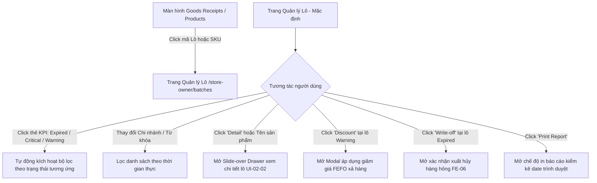

# Design Brief: batch-list (Quản lý Lô Sản Phẩm & Hạn Sử Dụng - FEFO Expiry Management)

## 1. Luồng trải nghiệm người dùng (User Flows)



### Luồng 1: Giám sát toàn chuỗi & Xử lý rủi ro date (Store Owner)
1. Chủ cửa hàng truy cập `/store-owner/batches` từ menu "Hàng hóa" -> "Kho & Hạn dùng (FEFO)".
2. Màn hình hiển thị 4 thẻ KPI tổng quan: số lượng lô Expired, Critical, Warning, Normal trên toàn hệ thống.
3. Chủ cửa hàng bấm trực tiếp vào thẻ **"☠️ Expired (≤ 0 Days)"** để lọc ngay các lô đã quá hạn -> Bấm nút **"🗑️ Write-off"** để tiến hành tiêu hủy.
4. Bấm vào thẻ **"⚠️ Warning (4 - 30 Days)"** -> Bấm **"🏷️ Discount"** để cấu hình mức giảm giá 15% - 30% xả hàng kích cầu trước khi hết hạn.

### Luồng 2: Tra cứu vị trí lô và đối soát quầy kệ (Store Staff / Thủ kho)
1. Nhân viên chi nhánh truy cập với phạm vi cố định tại chi nhánh mình (`BR-01`).
2. Nhập mã SKU hoặc quét barcode sản phẩm trên thanh tìm kiếm.
3. Bảng hiển thị danh sách các lô của sản phẩm, sắp xếp theo thứ tự FEFO (Hạn dùng sớm nhất lên đầu).
4. Bấm **"👁️ Detail"** để mở Drawer: xem chính xác vị trí quầy kệ (`Zone: Cold Storage`, `Shelf: C-B-01`), số lượng tồn thực tế và số phiếu nhập gốc `Original GRN No`.
5. Nhân viên ra quầy kệ lấy đúng lô đó để xuất bán hoặc trưng bày ra ngoài.

### Luồng 3: Điều hướng từ Phiếu nhập kho (Goods Receipts) sang Lô hàng
1. Người dùng đang ở màn hình Chi tiết phiếu nhập kho `grn-detail` (`/store-owner/goods-receipts/:id`).
2. Tại bảng danh sách hàng nhận, người dùng bấm vào liên kết mã lô (`batchCode: B26-1008`).
3. Hệ thống điều hướng sang `/store-owner/batches?batch=B26-1008&sku=DY-SC-02` và tự động lọc đúng lô vừa nhập.

---

## 2. Cấu trúc Giao diện & Component Tree

```
src/features/batch/
├── components/
│   ├── BatchKpiCards.tsx        # 4 Thẻ KPI phân loại hạn dùng (Clickable)
│   ├── BatchFilterBar.tsx       # Thanh bộ lọc hợp nhất: Chi nhánh, Trạng thái, Tìm kiếm, In
│   ├── BatchTable.tsx           # Bảng dữ liệu 11 cột, Days Left highlight, Badges, Actions
│   ├── BatchDetailDrawer.tsx    # Slide-over Drawer xem chi tiết lô (UI-02-02)
│   └── BatchDiscountModal.tsx   # Modal cấu hình giảm giá FEFO xả hàng
├── lib/
│   └── mockBatchData.ts         # Mock dataset 20+ lô hàng phong phú đa chi nhánh & trạng thái
├── pages/
│   └── BatchListPage.tsx        # Trang chủ quản lý lô kết hợp các component
├── types/
│   └── batch.types.ts           # Khai báo TypeScript types & DTOs
└── index.ts                     # Public export
```

### 2.1. BatchKpiCards
- 4 Thẻ chỉ số trực quan có trạng thái hover và click để toggle bộ lọc:
  - **☠️ Expired (≤ 0 Days)**: Border & nền đỏ nhạt (`bg-rose-50 border-rose-200 text-rose-800`), hiển thị số lượng lô và tổng giá trị tồn kho bị quá hạn.
  - **🚨 Critical (1 - 3 Days)**: Border & nền cam nhạt (`bg-amber-50 border-amber-200 text-amber-800`).
  - **⚠️ Warning (4 - 30 Days)**: Border & nền xanh dương nhạt (`bg-blue-50 border-blue-200 text-blue-800`).
  - **✅ Normal (> 30 Days)**: Border & nền ngọc bích (`bg-emerald-50 border-emerald-200 text-emerald-800`).

### 2.2. BatchFilterBar
- Cung cấp:
  - Dropdown chọn **Chi nhánh** (`All Branches`, `BR-01 Main Store`, `BR-02 Thu Duc Hub`).
  - Dropdown chọn **Trạng thái** (`Tất cả`, `Expired`, `Critical`, `Warning`, `Normal`).
  - Input tìm kiếm với biểu tượng kính lúp, hỗ trợ tìm kiếm nhanh theo Tên, SKU, Mã lô, Nhà cung cấp.
  - Nút **"🔍 Tìm kiếm"**, nút **"🔄 Đặt lại"**, và nút **"🖨️ In báo cáo"**.
  - Dòng thống kê kết quả lọc: `Hiển thị X trên tổng số Y lô hàng`.

### 2.3. BatchTable
- Bảng dữ liệu enterprise 11 cột:
  1. `#`: STT.
  2. `Tên sản phẩm`: Tên in đậm, có liên kết mở Drawer chi tiết.
  3. `Mã lô & SKU`: Hiển thị mã lô kèm SKU phụ.
  4. `Chi nhánh`: Badge chi nhánh (`BR-01`, `BR-02`).
  5. `Nhà cung cấp`: Tên nhà cung cấp giao lô hàng.
  6. `Hạn sử dụng`: DD/MM/YYYY.
  7. `Số ngày còn lại (Days Left)`: 
     - Âm: Chữ đỏ đậm kèm icon cảnh báo (`-11 ngày`).
     - 0 - 3 ngày: Chữ cam đậm (`1 ngày`).
     - 4 - 30 ngày: Chữ xanh dương (`9 ngày`).
     - > 30 ngày: Chữ xám thông thường (`50 ngày`).
  8. `Số lượng tồn`: Định dạng số in đậm kèm đơn vị (Chai, Hộp, Gói).
  9. `Đơn giá vốn`: VNĐ (ví dụ: `24,000 đ`).
  10. `Trạng thái`: Badge 4 màu chuẩn Design System.
  11. `Thao tác`:
      - 👁️ **Chi tiết**: Mở drawer.
      - 🏷️ **Giảm giá**: Mở modal giảm giá (chỉ hiện hoặc kích hoạt ở lô Warning/Critical).
      - 🗑️ **Xuất hủy**: Mở xác nhận tiêu hủy (nổi bật màu đỏ ở lô Expired).

### 2.4. BatchDetailDrawer (UI-02-02)
- Slide-over Drawer trượt từ bên phải:
  - Header: Tên sản phẩm, Mã lô, SKU, Chi nhánh, Badge trạng thái lớn.
  - Tab 1: **Thông tin Master & Hạn dùng** (NSX, HSD, Số ngày còn lại, Nhà cung cấp).
  - Tab 2: **Tồn kho & Vị trí kho kệ** (Số lượng nhập ban đầu, Tồn hiện tại, Đơn giá vốn, Tổng giá trị, Khu vực kho `Zone Area`, Kệ `Shelf Location`, Phiếu nhập gốc `Original GRN No` có link sang GRN Detail).
  - Tab 3: **Lịch sử luân chuyển (Movement History)** (Các giao dịch Nhập kho GRN, Bán lẻ POS, Điều chuyển liên kho, Khóa FEFO).
  - Footer actions: Nút "📍 Đổi vị trí kệ" và nút "🗑️ Tạo phiếu xuất hủy (FE-06)".

---

## 3. Trạng thái Giao diện (UI States)
- **Loading State**: Hiển thị Skeleton loading cho 4 thẻ KPI và 5 dòng của bảng.
- **Empty State**: Khi bộ lọc không có dữ liệu phù hợp, hiển thị minh họa trực quan "Không tìm thấy lô hàng nào phù hợp với điều kiện tìm kiếm" kèm nút "Đặt lại bộ lọc".
- **Print Layout**: Khi kích hoạt in báo cáo (`window.print()`), ẩn các thanh filter bar, sidebar, breadcrumb, căn chỉnh bảng dữ liệu vừa vặn khổ giấy A4 ngang với tiêu đề "BÁO CÁO KIỂM KÊ HẠN SỬ DỤNG VÀ LÔ HÀNG (FEFO)".

---

## 4. Dữ liệu & Quy tắc Nghiệp vụ (Business Rules)

### 4.1. Quy tắc tính toán & Phân loại rủi ro (BR-BATCH-01)
$$\text{DaysLeft} = \left\lceil \frac{\text{ExpiryDate} - \text{CurrentDate}}{86400000} \right\rceil$$
- Nếu $\text{DaysLeft} \le 0$: `Expired`
- Nếu $1 \le \text{DaysLeft} \le 3$: `Critical`
- Nếu $4 \le \text{DaysLeft} \le 30$: `Warning`
- Nếu $\text{DaysLeft} > 30$: `Normal`

### 4.2. Quy tắc phân quyền theo Role (BR-BATCH-02)
- **Role Store Owner**: Được xem và lọc toàn bộ chi nhánh trong chuỗi (`All Branches`), có quyền áp dụng giảm giá và duyệt xuất hủy lô.
- **Role Employee (Nhân viên / Thủ kho)**: Bị giới hạn xem tại chi nhánh được phân công làm việc, chỉ được cập nhật vị trí quầy kệ và đề xuất xuất hủy.

### 4.3. Quy tắc truy vết nguồn gốc (BR-BATCH-03)
- Mọi lô hàng hiển thị trên bảng bắt buộc phải gắn với chứng từ nhập kho gốc (`Original GRN No`). Người dùng có thể nhấp trực tiếp vào mã GRN để xem chi tiết đối soát khi nhập hàng.
