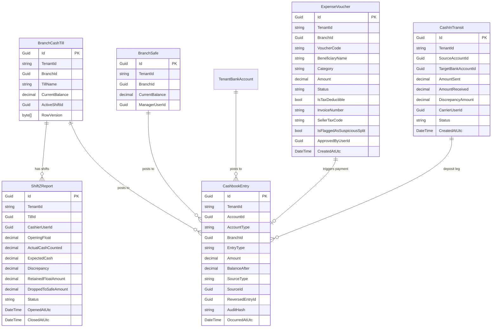

# Bản Thiết Kế Chi Tiết (Design Brief)
## Backend Phân Hệ Sổ Quỹ (FE-17) & Chi Phí Vận Hành (FE-07)

### 1. Thay Đổi Cơ Sở Dữ Liệu (Database Schema Changes)

- **Quy tắc Index & Constraint:**
  - `CashbookEntries`: Index `(TenantId, AccountId, OccurredAtUtc)` để truy vấn lịch sử nhanh; Unique Index trên `(TenantId, SourceType, SourceId)` ngăn tạo trùng bút toán tự động.
  - Cột tiền tệ: Định dạng cứng `DECIMAL(18, 2)` trên SQL Server cho toàn bộ các trường số tiền.

### 2. Danh Sách API Endpoints & Contracts (DTOs)

#### A. Sổ Quỹ & Ca Thu Ngân (`CashbookController`):
1. `POST /api/cashbook/shifts/open`
   - Header: `Idempotency-Key: <UUID>`
   - Body: `{ tillId: Guid, cashierUserId: Guid, countedFloat: decimal }`
   - Logic: Tự điền `OpeningFloat` từ `RetainedFloat` của ca trước. Nếu `countedFloat != OpeningFloat`, ghi nhận chênh lệch bàn giao `HandoverDiscrepancy`.
2. `POST /api/cashbook/shifts/close`
   - Header: `Idempotency-Key: <UUID>`
   - Body: `{ shiftId: Guid, actualCashCounted: decimal, retainedFloatAmount: decimal }`
   - Logic: Tính `ExpectedCash`, tính `Discrepancy`. Nếu chênh lệch nằm trong dung sai $\le 2000đ$, tự ghi vào `CASH_ROUNDING_VARIANCE`. Thừa tiền treo `CASH_OVER_SUSPENSE`; thiếu tiền trừ két ngay treo `CASH_SHORTAGE_PENDING`.
3. `POST /api/cashbook/cash-drop`
   - Body: `{ shiftId: Guid, amount: decimal, managerPin: string }`
   - Logic: Cần 2 chữ ký xác nhận (thu ngân và quản lý). Chuyển tiền từ `BranchCashTill` sang `BranchSafe`.
4. `POST /api/cashbook/deposits/bank` (Bước 1 nộp tiền ngân hàng)
   - Body: `{ sourceAccountId: Guid, targetBankAccountId: Guid, amount: decimal, carrierUserId: Guid }`
   - Logic: Trừ tiền `BranchSafe`, chuyển sang `CashInTransit` trạng thái `PENDING_BANK_CONFIRMATION`. Bắn notification cho chủ chuỗi.
5. `POST /api/cashbook/deposits/confirm` (Bước 2 xác nhận tiền vào ngân hàng)
   - Body: `{ transitId: Guid, actualReceivedAmount: decimal }`
   - Logic: Tăng tiền `TenantBankAccount`. Nếu nhận thiếu, chuyển phần thiếu thành biên bản chênh lệch bồi hoàn/tổn thất.

#### B. Chi Phí Vận Hành (`ExpensesController`):
1. `POST /api/expenses`
   - Body: `{ branchId: Guid, beneficiaryName: string, category: string, amount: decimal, isTaxDeductible: bool, invoiceNumber?: string, sellerTaxCode?: string }`
   - Logic: Thuật toán Anti-Splitting kiểm tra hạn mức đơn lẻ $\le 500k$ (`T1`), hạn mức ca $\le 1.5tr$ (`C1`), hạn mức ngày $\le 3tr$ (`C2`), và tần suất 3 phiếu trong 60 phút. Tự duyệt chuyển `APPROVED`, vượt hạn mức chuyển `PENDING_APPROVAL`.
2. `POST /api/expenses/{id}/approve`
   - Phân quyền: Quản lý duyệt khoản $\le 3tr$ (`T2`), Chủ chuỗi duyệt khoản $> 3tr$ hoặc chi từ ngân hàng.
3. `POST /api/expenses/{id}/disburse`
   - Body: `{ paymentSourceType: string, paymentSourceAccountId: Guid }`
   - Logic: Dùng khóa bi quan `UPDLOCK, ROWLOCK` kiểm tra số dư quỹ. Nếu đủ, sinh 1 `CashbookEntry` duy nhất và chuyển phiếu sang `PAID`. Nếu thiếu, chuyển sang `PAYMENT_FAILED` để đổi nguồn chi.

### 3. Phân Quyền (RBAC) & Ma Trận Truy Cập
- **Thu ngân:** Chỉ thấy Két quầy và ca làm việc của mình; chỉ được tự duyệt chi $\le 500k$ từ két quầy; không được xem số dư ngân hàng hay két sắt.
- **Quản lý chi nhánh:** Thấy toàn bộ két quầy và két sắt trong chi nhánh mình; duyệt chi $\le 3tr$; tạo lệnh nộp tiền ngân hàng; xác nhận cash drop.
- **Chủ chuỗi:** Toàn quyền trong Tenant; duyệt mọi khoản chi; xác nhận nhận tiền vào tài khoản ngân hàng; duyệt xử lý chênh lệch két thừa/thiếu; cấu hình tham số.
