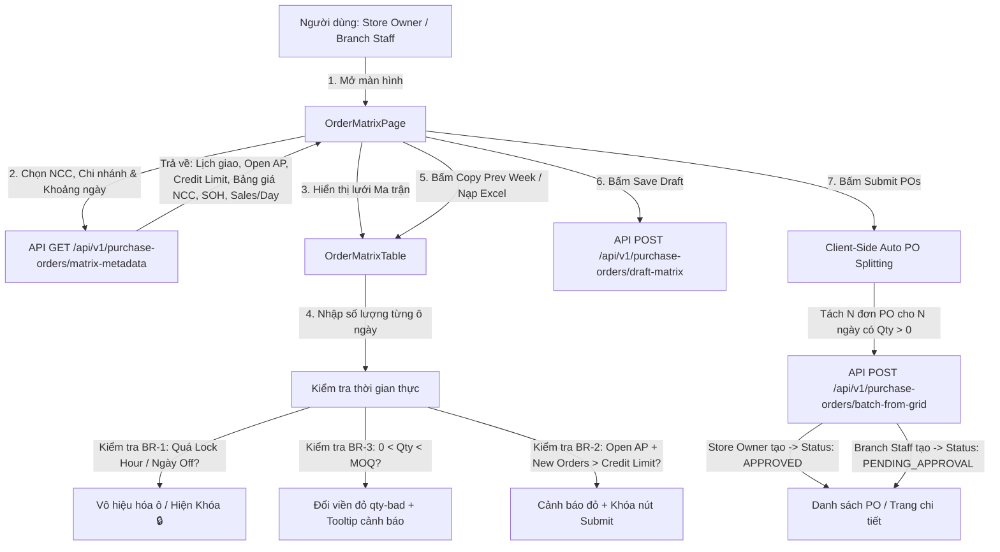

# Design Brief: Create Purchase Order — Order Matrix Grid (FE-PO-GRID)

## 1. User Flows & System Interaction



---

## 2. API Endpoints & DTO Contracts

| Method | Endpoint | Mô tả | Request Params / Body | Response Body | Mã lỗi |
|---|---|---|---|---|---|
| `GET` | `/api/v1/purchase-orders/matrix-metadata` | Lấy toàn bộ metadata dựng ma trận (Lịch giao NCC, Công nợ, Danh mục SP, SOH, Sales/Day) | `supplierId`, `branchId`, `fromDate`, `toDate`, `viewDays` | `OrderMatrixMetadataDto` | `200 OK`, `400 Bad Request`, `404 Not Found` |
| `POST` | `/api/v1/purchase-orders/batch-from-grid` | Tiếp nhận ma trận đã bóc tách, tạo danh sách đơn PO độc lập theo từng ngày giao | `CreateBatchPurchaseOrdersCommand` | `BatchPurchaseOrdersResultDto` | `201 Created`, `400 CreditLimitExceeded`, `400 LockHourExceeded`, `409 Conflict` |
| `GET` | `/api/v1/purchase-orders/draft-matrix` | Tải dữ liệu ma trận nháp đã lưu | `supplierId`, `branchId` | `DraftOrderMatrixDto` | `200 OK`, `404 Not Found` |
| `POST` | `/api/v1/purchase-orders/draft-matrix` | Lưu tạm dữ liệu ma trận nháp | `SaveDraftOrderMatrixCommand` | `{ success: bool, updatedAtUtc: string }` | `200 OK`, `400 Bad Request` |

### DTOs & Command Schemas

```typescript
// 1. Metadata dựng ma trận
export interface OrderMatrixMetadataDto {
  supplier: {
    id: string;
    code: string;
    name: string;
    creditLimit: number;
    openAp: number; // Dư nợ AP hiện tại
    leadDays: number;
    cutoffHour: string; // VD: "13:00"
    lockHour: string;   // VD: "15:00"
    activeDeliveryDays: number[]; // 0: CN, 1: T2, ..., 6: T7
    holidays: string[]; // YYYY-MM-DD
    deliveryNote?: string;
  };
  branch: {
    id: string;
    code: string;
    name: string;
  };
  products: Array<{
    productId: string;
    productName: string;
    sku: string;
    category: string;
    deliveryUoM: string;
    agreedPrice: number;
    moq: number;
    stockOnHand: number;
    salesPerDay: number;
  }>;
}

// 2. Command bóc tách đơn PO theo từng ngày giao
export interface CreateBatchPurchaseOrdersCommand {
  supplierId: string;
  branchId: string;
  orders: Array<{
    deliveryDate: string; // YYYY-MM-DD
    items: Array<{
      productId: string;
      quantity: number;
      agreedPrice: number;
    }>;
  }>;
}

// 3. Kết quả phát hành đơn PO
export interface BatchPurchaseOrdersResultDto {
  createdCount: number;
  purchaseOrders: Array<{
    id: string;
    orderCode: string; // PO-YYYYMMDD-XXX
    deliveryDate: string;
    totalQuantity: number;
    totalAmount: number;
    status: 'APPROVED' | 'PENDING_APPROVAL';
  }>;
}
```

---

## 3. Frontend UI Component Architecture

Phân tách các component độc lập theo quy tắc kiến trúc của dự án, đặt trong `src/features/purchase-order/`:

1. **`OrderMatrixPage` (`src/features/purchase-order/pages/OrderMatrixPage.tsx`)**:
   - Trang điều phối trung tâm: Quản lý state bộ lọc, state ma trận số lượng `qtyMap: Record<productId, Record<dateKey, number>>`, điều hướng và thông báo toast.
2. **`OrderMatrixHeader` (`src/features/purchase-order/components/matrix/OrderMatrixHeader.tsx`)**:
   - Tiêu đề trang "Đặt Hàng Theo Ma Trận (Order Matrix Grid)", trạng thái đơn (Draft / Safe), nút quay lại (Back).
3. **`OrderMatrixFilterBar` (`src/features/purchase-order/components/matrix/OrderMatrixFilterBar.tsx`)**:
   - Bộ chọn bắt buộc: Nhà cung cấp (*), Chi nhánh (*), Từ ngày, Đến ngày, Nút Áp dụng (Apply).
4. **`OrderMatrixCreditSummary` (`src/features/purchase-order/components/matrix/OrderMatrixCreditSummary.tsx`)**:
   - Hiển thị công thức trực quan: $\text{Dư nợ AP} + \text{Đơn mới} = \text{Tổng nợ} / \text{Hạn mức nợ NCC}$.
   - Badge trạng thái: Xanh lục `(Safe — Hợp lệ)` hoặc Đỏ rực `(⚠️ Vượt hạn mức nợ NCC — Bị chặn đặt đơn)`.
5. **`OrderMatrixSupplierInfo` (`src/features/purchase-order/components/matrix/OrderMatrixSupplierInfo.tsx`)**:
   - Hiển thị Lead Time, Cutoff Time, Lock Hour và ghi chú lịch giao hàng của NCC đang chọn.
6. **`OrderMatrixToolbar` (`src/features/purchase-order/components/matrix/OrderMatrixToolbar.tsx`)**:
   - View Mode: Chọn 7 ngày (1 tuần) hoặc 14 ngày (2 tuần).
   - Lọc Ngành hàng, Ô tìm kiếm Tên/SKU, Checkbox [ ] MOQ Failures, Checkbox [ ] Ordered Items, Checkbox [ ] Show Stock (SOH) & Sales/Day.
   - Thao tác: Nút Prev/This/Next Week, Nút Copy Prev Week, Excel Download / Upload, Nút Tóm tắt trạng thái (Order Status).
7. **`OrderMatrixTable` (`src/features/purchase-order/components/matrix/OrderMatrixTable.tsx`)**:
   - Khung cuộn `max-height: 520px` với tiêu đề `sticky`.
   - Cột ngày hiển thị Thứ, Ngày/Tháng và trạng thái: `— Off`, `(Khóa)`, `(Mở)`.
   - Các ô nhập liệu: Ô ngày Off hiển thị `—`, ô khóa hiển thị input disabled, ô hợp lệ cho phép nhập số lượng.
   - Nếu $0 < Qty < MOQ$: Áp dụng class `qty-bad` (viền đỏ nổi bật) + tooltip chỉ dẫn.
   - Hỗ trợ phím tắt bàn phím: Di chuyển mượt mà giữa các ô bằng phím mũi tên (↑ ↓ ← →) và phím Enter.
   - Tính toán trực tiếp hàng Subtotal theo ngành hàng và hàng Daily Total Qty theo cột ngày.
8. **`OrderMatrixFooter` (`src/features/purchase-order/components/matrix/OrderMatrixFooter.tsx`)**:
   - Hiển thị `Grand Total Qty`, `Total Amount`, `Credit Status`.
   - Nút Hủy (Cancel), Nút Lưu nháp (Save Draft), Nút Gửi đơn (Submit POs). Khóa nút Submit khi vượt hạn mức hoặc tổng số lượng = 0.

---

## 4. Database Schema Changes (EF Core 8 Code-First)

### 4.1. Bảng cấu hình giao hàng NCC: `SupplierDeliveryConfigs`
```sql
CREATE TABLE [SupplierDeliveryConfigs] (
    [Id] UNIQUEIDENTIFIER NOT NULL PRIMARY KEY,
    [TenantId] UNIQUEIDENTIFIER NOT NULL,
    [SupplierId] UNIQUEIDENTIFIER NOT NULL FOREIGN KEY REFERENCES [Suppliers]([Id]),
    [LeadTimeDays] INT NOT NULL DEFAULT 1,
    [CutoffHour] NVARCHAR(5) NOT NULL DEFAULT '13:00',
    [LockHour] NVARCHAR(5) NOT NULL DEFAULT '15:00',
    [ActiveDeliveryDaysJson] NVARCHAR(50) NOT NULL DEFAULT '[1,2,3,4,5,6]', -- Mảng JSON ngày giao trong tuần
    [HolidaysJson] NVARCHAR(MAX) NULL, -- Mảng JSON ngày nghỉ lễ YYYY-MM-DD
    [DeliveryNote] NVARCHAR(500) NULL,
    [CreatedAtUtc] DATETIME2 NOT NULL,
    [UpdatedAtUtc] DATETIME2 NULL,
    [IsDeleted] BIT NOT NULL DEFAULT 0
);

CREATE UNIQUE INDEX [IX_SupplierDeliveryConfigs_TenantId_SupplierId] 
ON [SupplierDeliveryConfigs]([TenantId], [SupplierId]) 
WHERE [IsDeleted] = 0;
```

### 4.2. Bảng Đơn mua hàng: `PurchaseOrders`
```sql
CREATE TABLE [PurchaseOrders] (
    [Id] UNIQUEIDENTIFIER NOT NULL PRIMARY KEY,
    [TenantId] UNIQUEIDENTIFIER NOT NULL,
    [OrderCode] NVARCHAR(30) NOT NULL, -- PO-YYYYMMDD-XXX
    [SupplierId] UNIQUEIDENTIFIER NOT NULL FOREIGN KEY REFERENCES [Suppliers]([Id]),
    [BranchId] UNIQUEIDENTIFIER NOT NULL FOREIGN KEY REFERENCES [Branches]([Id]),
    [DeliveryDate] DATE NOT NULL,
    [OrderDate] DATETIME2 NOT NULL,
    [TotalQuantity] INT NOT NULL,
    [TotalAmount] DECIMAL(18,2) NOT NULL,
    [Status] INT NOT NULL DEFAULT 1, -- 1: Draft, 2: PendingApproval, 3: Approved, 4: Sent, 5: Completed, 6: Cancelled
    [CreatedByRole] NVARCHAR(50) NOT NULL, -- 'StoreOwner' | 'BranchStaff'
    [Note] NVARCHAR(500) NULL,
    [RowVersion] ROWVERSION NOT NULL,
    [CreatedAtUtc] DATETIME2 NOT NULL,
    [CreatedBy] NVARCHAR(100) NULL,
    [UpdatedAtUtc] DATETIME2 NULL,
    [UpdatedBy] NVARCHAR(100) NULL,
    [IsDeleted] BIT NOT NULL DEFAULT 0
);

CREATE INDEX [IX_PurchaseOrders_TenantId_SupplierId_DeliveryDate] 
ON [PurchaseOrders]([TenantId], [SupplierId], [DeliveryDate]);
```

### 4.3. Bảng Chi tiết Đơn mua hàng: `PurchaseOrderDetails`
```sql
CREATE TABLE [PurchaseOrderDetails] (
    [Id] UNIQUEIDENTIFIER NOT NULL PRIMARY KEY,
    [TenantId] UNIQUEIDENTIFIER NOT NULL,
    [PurchaseOrderId] UNIQUEIDENTIFIER NOT NULL FOREIGN KEY REFERENCES [PurchaseOrders]([Id]),
    [ProductId] UNIQUEIDENTIFIER NOT NULL FOREIGN KEY REFERENCES [Products]([Id]),
    [Barcode] NVARCHAR(50) NOT NULL,
    [Sku] NVARCHAR(50) NOT NULL,
    [ProductName] NVARCHAR(250) NOT NULL,
    [DeliveryUoM] NVARCHAR(50) NOT NULL,
    [AgreedPrice] DECIMAL(18,2) NOT NULL,
    [OrderedQuantity] INT NOT NULL,
    [LineAmount] DECIMAL(18,2) NOT NULL, -- OrderedQuantity * AgreedPrice
    [CreatedAtUtc] DATETIME2 NOT NULL,
    [IsDeleted] BIT NOT NULL DEFAULT 0
);
```

---

## 5. Quy Tắc Nghiệp Vụ Cốt Lõi (BR-1 đến BR-5)

1. **BR-1: Lịch giao hàng, Lead Time & Giờ khóa sửa đơn**:
   - Ngày giao sớm nhất có thể đặt = $\text{Hôm nay} + \text{LeadTimeDays}$.
   - Các ngày NCC không giao (không thuộc `ActiveDeliveryDays` hoặc thuộc `Holidays`): Ô hiển thị `—`, nền xám, disabled.
   - Các ngày đã quá `LockHour` của ngày chốt trước ngày giao: Ô hiển thị nhãn `(Khóa) 🔒`, disabled không cho sửa.
2. **BR-2: Kiểm soát Hạn Mức Tín Dụng NCC (Credit Limit)**:
   - Điều kiện gửi đơn: $\text{Open AP} + \text{Tổng giá trị các đơn mới trong đợt phát hành} \le \text{CreditLimit}$.
   - Nếu vượt: Hiển thị cảnh báo màu đỏ, nút "Submit POs" bị vô hiệu hóa (`disabled = true`). Cung cấp chỉ dẫn thanh toán nợ cũ (FE-17) hoặc xin nâng hạn mức.
3. **BR-3: Ràng buộc Số Lượng Đặt Tối Thiểu (MOQ)**:
   - Nếu người dùng nhập $0 < Qty < MOQ$: Ô nhập hiển thị viền đỏ nổi bật (`qty-bad`), kèm tooltip báo lỗi. Nút Submit POs bị khóa cho đến khi sửa đạt MOQ hoặc xóa về 0.
   - Cung cấp checkbox `[ ] MOQ Failures` để lọc ngay các dòng vi phạm.
4. **BR-4: Gợi ý Đặt Hàng & Hiển Thị Tồn Kho (SOH & Sales/Day)**:
   - Khi bật tùy chọn `[x] Show Stock (SOH) & Sales/Day`, lưới hiển thị thêm 2 cột:
     - `Stock (SOH)`: Tồn kho thực tế tại chi nhánh nhận.
     - `Sales/Day`: Doanh số bán trung bình ngày của sản phẩm.
   - Hỗ trợ người dùng nhận biết mặt hàng nào sắp cạn kiệt để kịp thời lên lịch đặt hàng.
5. **BR-5: Đơn Giá Thỏa Thuận & Tự Động Bóc Tách Đơn (Auto PO Splitting)**:
   - Đơn giá mua tuyệt đối lấy từ `SupplierProducts.AgreedPrice`.
   - $\text{LineAmount} = Qty \times \text{AgreedPrice}$.
   - Khi bấm Submit POs: Duyệt qua từng ngày trong khoảng thời gian đã chọn, mỗi ngày có tổng số lượng $> 0$ sẽ được tự động tách thành 1 phiếu PO riêng biệt tương ứng với ngày giao đó.
