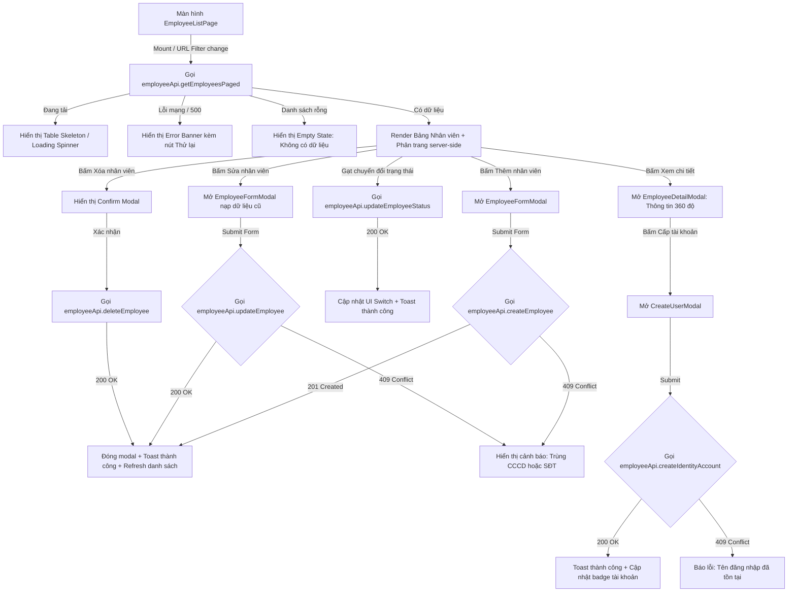

# Design Brief: employee-fe-integration

## 1. Luồng trải nghiệm người dùng & Tương tác API (User & API Flows)



## 2. Thiết kế Component & Trạng thái Giao diện

### `EmployeeListPage.tsx`
- **Loading State**: Khi đang fetch danh sách, hiển thị hiệu ứng skeleton mượt mà cho 5 hàng dữ liệu bảng để tránh giật lag layout.
- **Empty State**: Khi danh sách rỗng (do chưa có dữ liệu hoặc do bộ lọc không tìm thấy kết quả), hiển thị biểu tượng `UserX` kèm thông điệp: "Không tìm thấy nhân viên nào phù hợp. Thử thay đổi từ khóa tìm kiếm hoặc bộ lọc."
- **Pagination Component**: Điều khiển phân trang server-side hiển thị `Trang X / Y (Tổng cộng Z nhân viên)`, các nút Previous/Next và số trang.
- **Search & Filter**: Input tìm kiếm tích hợp debounce 300ms tự động kích hoạt query API mới. Bộ lọc chi nhánh và trạng thái cập nhật query params.

### `EmployeeFormModal.tsx`
- Nhận prop `onSave` bất đồng bộ: Hiển thị loading spinner trên nút **[Lưu thông tin]** khi đang gửi request.
- Thông báo lỗi tại chỗ: Nếu backend trả về lỗi 409 Conflict hoặc 400 Validation, hiển thị Alert banner màu đỏ ngay phía trên form:
  + *"Số CCCD đã tồn tại trong hệ thống."*
  + *"Số điện thoại đã được đăng ký cho nhân viên khác."*
  + Không đóng modal để người dùng dễ dàng chỉnh sửa lại trường dữ liệu bị trùng.

### `CreateUserModal.tsx`
- Quản lý submit bất đồng bộ, nút [Cấp tài khoản] hiển thị trạng thái đang xử lý.
- Bắt lỗi 409 khi username đã tồn tại và hiển thị thông báo lỗi trực tiếp dưới ô nhập Username.

---

## 3. Cấu trúc Hợp đồng DTOs & Mapper

Tạo file `src/features/employee/api/employeeApi.ts` và mappers trong `src/features/employee/lib/employeeMapper.ts`:

### Backend DTOs tương ứng:
```typescript
export interface EmployeeBackendSummaryDto {
  id: string;
  employeeCode: string;
  fullName: string;
  phone: string;
  email?: string;
  branchId: string;
  branchName: string;
  jobTitle?: string;
  status: string; // "active" | "inactive"
  salaryType: string;
  baseRate: number;
  userId?: string;
  userName?: string;
  createdAt: string;
}

export interface EmployeeBackendDetailDto {
  id: string;
  employeeCode: string;
  fullName: string;
  citizenId: string;
  dateOfBirth?: string;
  gender?: string;
  phone: string;
  email?: string;
  avatarUrl?: string;
  jobTitle?: string;
  branchId: string;
  branchName: string;
  userId?: string;
  userName?: string;
  role?: string;
  salaryType: string;
  baseRate: number;
  lunchAllowance: number;
  travelAllowance: number;
  debtAmount: number;
  status: string;
  bankAccountNumber?: string;
  bankName?: string;
  bankAccountHolder?: string;
  createdAt: string;
  updatedAt?: string;
}

export interface CreateEmployeePayload {
  fullName: string;
  citizenId: string;
  phone: string;
  branchId: string;
  email?: string;
  jobTitle?: string;
  dateOfBirth?: string;
  gender?: string;
  salaryType: string;
  baseRate: number;
  lunchAllowance: number;
  travelAllowance: number;
  bankAccountNumber?: string;
  bankName?: string;
  bankAccountHolder?: string;
  avatarUrl?: string;
}

export interface UpdateEmployeePayload extends CreateEmployeePayload {}

export interface CreateIdentityAccountPayload {
  username: string;
  password: string;
  role: string;
}
```

### Mapper Functions:
- `mapBackendSummaryToEmployee(dto: EmployeeBackendSummaryDto): Employee`: Chuyển đổi DTO phẳng từ backend thành model `Employee` của frontend với cấu trúc `salaryConfig` và `workingBranchNames` đầy đủ.
- `mapBackendDetailToEmployee(dto: EmployeeBackendDetailDto): Employee`: Ánh xạ chi tiết tài khoản ngân hàng, phụ cấp và tài khoản liên kết.
- `mapFormToCreatePayload(formData: any): CreateEmployeePayload`: Chuẩn hóa dữ liệu form gửi lên backend.

---

## 4. API Endpoints Map

| Thao tác trên UI | Endpoint Backend | Method | Xử lý phản hồi |
|---|---|---|---|
| Tải danh sách | `/api/v1/employees` | `GET` | Phân trang, map thành `Employee[]` |
| Lấy chi tiết | `/api/v1/employees/{id}` | `GET` | Map thành `Employee` chi tiết |
| Thêm mới nhân viên | `/api/v1/employees` | `POST` | Trả về `Employee` mới với mã `NVxxxx` |
| Cập nhật hồ sơ | `/api/v1/employees/{id}` | `PUT` | Trả về `Employee` đã cập nhật |
| Đổi trạng thái | `/api/v1/employees/{id}/status` | `PATCH` | Cập nhật toggle switch |
| Cấp tài khoản | `/api/v1/employees/{id}/identity-account` | `POST` | Cập nhật `userId` & `userName` |
| Xóa nhân viên | `/api/v1/employees/{id}` | `DELETE` | Xóa khỏi bảng danh sách |
