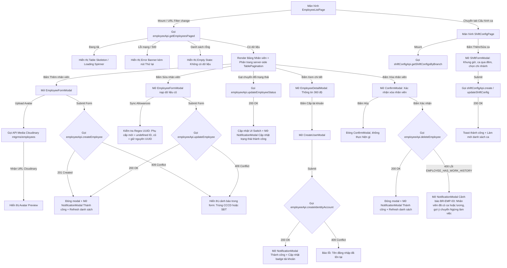

# Design Brief: employee-fe-integration

## 1. Luồng trải nghiệm người dùng & Tương tác API (User & API Flows)



## 2. Thiết kế Component & Trạng thái Giao diện

### `EmployeeListPage.tsx`
- **Loading State**: Khi đang fetch danh sách, hiển thị hiệu ứng skeleton mượt mà cho 5 hàng dữ liệu bảng để tránh giật lag layout.
- **Empty State**: Khi danh sách rỗng, hiển thị biểu tượng `UserX` kèm thông điệp phù hợp.
- **Pagination Component**: Điều khiển phân trang server-side tích hợp component chung `TablePagination` (`src/components/common/TablePagination.tsx`).
- **Search & Filter**: Input tìm kiếm tích hợp debounce 300ms tự động kích hoạt query API mới. Bộ lọc chi nhánh và trạng thái cập nhật query params.
- **Modals Tích hợp**: Kết nối `NotificationModal` (cho phản hồi create/update/delete/status) và `ConfirmModal` (cho thao tác xác nhận xóa).

### `EmployeeFormModal.tsx`
- Nhận prop `onSave` bất đồng bộ: Hiển thị loading spinner trên nút **[Lưu thông tin]** khi đang gửi request.
- Thông báo lỗi tại chỗ: Nếu backend trả về lỗi 409 Conflict hoặc 400 Validation, hiển thị Alert banner màu đỏ ngay phía trên form:
  + *"Số CCCD đã tồn tại trong hệ thống."*
  + *"Số điện thoại đã được đăng ký cho nhân viên khác."*
- Đồng bộ phụ cấp: Phụ cấp mới tạo từ UI mang ID tạm `al_timestamp` được mapper chuyển thành `id: undefined` trước khi gửi lên API Backend để tránh lỗi `DbUpdateConcurrencyException`.

### `CreateUserModal.tsx`
- Quản lý submit bất đồng bộ, nút [Cấp tài khoản] hiển thị trạng thái đang xử lý.
- Bắt lỗi 409 khi username đã tồn tại và hiển thị thông báo lỗi trực tiếp dưới ô nhập Username.

### `ConfirmModal.tsx` & `NotificationModal.tsx` (`src/components/common/`)
- **ConfirmModal**: Modal xác nhận hành động nguy hiểm (như Xóa nhân viên), hỗ trợ backdrop blur, icon cảnh báo, các biến thể `danger` / `warning` / `primary`, có spinner trên nút xác nhận khi đang xử lý.
- **NotificationModal**: Popup thông báo kết quả tức thì (Thành công, Thất bại, Cảnh báo nghiệp vụ `BR-EMP-03`, Thông tin), có icon trực quan, tự động đóng hoặc bấm "Đã hiểu". Dùng chung cho toàn hệ thống (Employee, Product, v.v.).

---

## 3. Cấu trúc Hợp đồng DTOs & Mapper

Tạo file `src/features/employee/api/employeeApi.ts` và mappers trong `src/features/employee/lib/employeeMapper.ts`:

### Backend DTOs tương ứng:
```typescript
export interface EmployeeBackendSummaryDto {
  id: string;
  employeeCode: string;
  fullName: string;
  phone: string;
  email?: string;
  avatarUrl?: string;
  address?: string;
  startDate?: string;
  note?: string;
  branchId: string;
  branchName: string;
  status: string; // "active" | "inactive"
  salaryType: string;
  baseRate: number;
  otWeekday?: string;
  otSunday?: string;
  debtAmount?: number;
  userId?: string;
  userName?: string;
  createdAt: string;
}

export interface EmployeeBackendDetailDto {
  id: string;
  employeeCode: string;
  fullName: string;
  citizenId: string;
  dateOfBirth?: string;
  gender?: string;
  phone: string;
  email?: string;
  avatarUrl?: string;
  address?: string;
  startDate?: string;
  note?: string;
  otWeekday?: string;
  otSunday?: string;
  branchId: string;
  branchName: string;
  userId?: string;
  userName?: string;
  role?: string;
  salaryType: string;
  baseRate: number;
  allowances?: Array<{ id?: string; name: string; amount: number }>;
  debtAmount: number;
  status: string;
  bankAccountNumber?: string;
  bankName?: string;
  bankAccountHolder?: string;
  createdAt: string;
  updatedAt?: string;
}
```

### ShiftConfig API DTOs (`src/features/employee/api/shiftConfigApi.ts`):
```typescript
export interface ShiftConfigDto {
  id: string;
  branchId: string;
  branchIds?: string[];
  shiftCode: string;
  shiftName: string;
  startTime: string; // "17:00:00"
  endTime: string;   // "21:00:00"
  durationHours: number;
  allowedCheckInStart: string; // "14:00:00"
  allowedCheckInEnd: string;   // "00:00:00"
  isCheckInNextDay?: boolean;
  description?: string | null;
  isActive: boolean;
  createdAt: string;
  updatedAt?: string | null;
  branchName?: string | null;
  branchNames?: string[] | null;
}
```
