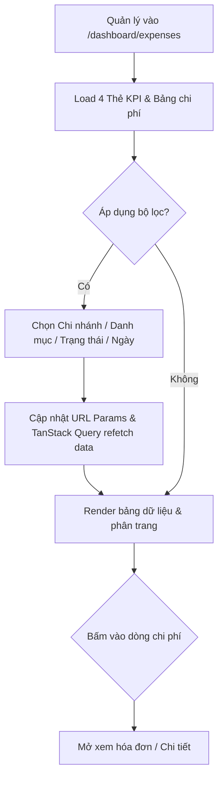
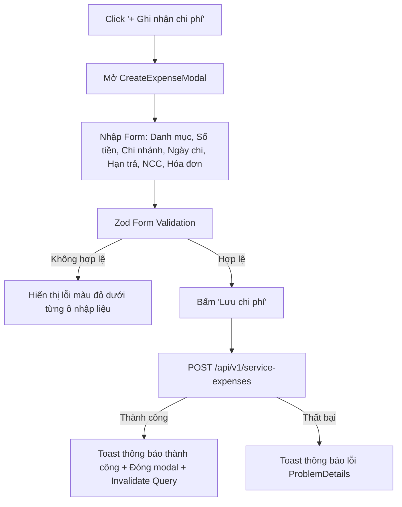

# Design Brief: Giao Diện Frontend Quản Lý Chi Phí Dịch Vụ & Vận Hành (FE-07)

## 1. Luồng Người Dùng (User Flows)

### Flow 1: Tra cứu, Thống kê & Lọc Danh Sách Chi Phí


### Flow 2: Ghi Nhận Chi Phí Vận Hành Mới


### Flow 3: Xác Nhận Thanh Toán & Đồng Bộ Sổ Quỹ (FE-17)
```mermaid
flowchart TD
    A[Bấm 'Thanh toán' tại khoản chi Pending] --> B[Mở PayExpenseModal]
    B --> C[Xem tóm tắt số tiền & nhà cung cấp]
    C --> D[Chọn Phương thức: Tiền mặt / Chuyển khoản]
    D --> E[Tick 'Tự động tạo phiếu chi Sổ quỹ (FE-17)']
    E --> F[Bấm 'Xác nhận thanh toán']
    F --> G[POST /api/v1/service-expenses/{id}/pay]
    G -- Thành công --> H[Chuyển trạng thái sang Paid + Gán CashBookID + Cập nhật KPI]
```

---

## 2. Cấu Trúc Component & Thư Mục (Feature Architecture)
Toàn bộ mã nguồn được tổ chức theo Feature-based pattern tại `src/features/service-expenses/`:
```
src/features/service-expenses/
├── api/
│   └── expenseApi.ts                  # Axios API calls với httpClient
├── components/
│   ├── BillPreviewModal.tsx           # Modal xem trước ảnh chứng từ/hóa đơn
│   ├── CreateExpenseModal.tsx         # Modal ghi nhận chi phí với Zod validation
│   ├── ExpenseFilterBar.tsx           # Bộ lọc tìm kiếm, chi nhánh, danh mục, trạng thái
│   ├── ExpenseKpiCards.tsx            # 4 Thẻ KPI thống kê số liệu chi phí
│   ├── ExpenseStatusBadge.tsx         # Badge trạng thái bo tròn Pill chuẩn KiotViet
│   ├── ExpenseTable.tsx               # Bảng hiển thị danh sách chi phí & phân trang
│   └── PayExpenseModal.tsx            # Modal xác nhận thanh toán & liên kết Sổ quỹ
├── hooks/
│   └── useServiceExpenses.ts          # Custom hooks React Query (useExpenses, useExpenseKpis, useCreateExpense, usePayExpense)
├── pages/
│   └── ServiceExpensesPage.tsx        # Trang chủ quản lý chi phí vận hành
└── types/
    └── expense.types.ts               # TypeScript interfaces, DTOs & Zod schemas
```

---

## 3. Quy Chuẩn Thiết Kế Giao Diện (KiotViet Design System)
- **Màu sắc & Tokens**:
  - Primary Action Button: Nền `--blue-primary` (`#0066FF`), hover `--blue-hover` (`#0052cc`), chữ trắng, bo tròn Full Pill (`rounded-full`), padding `px-5 py-2.5`, font chữ đậm vừa (`font-medium`).
  - Container / Card: Nền trắng, viền `--border-subtle` (`#e5edf8`), bo góc `--radius-lg` (`rounded-[24px]`), bóng đổ mềm `shadow-[0_10px_30px_rgba(0,50,150,0.06)]`.
  - Font chữ: `Be Vietnam Pro`, tiêu đề rõ ràng, số liệu tiền tệ căn phải (`text-right`) và bôi đậm (`font-semibold`).
- **Trạng thái Giao diện**:
  - **Loading State**: Hiển thị bảng dạng Skeleton Shimmer mượt mà, giữ nguyên layout 8 cột để tránh giật lag layout.
  - **Empty State**: Khi không có dữ liệu, hiển thị biểu tượng `ReceiptText` của Lucide kích thước 48px màu xám xanh, tiêu đề "Chưa có khoản chi phí nào", mô tả thân thiện, và nút CTA "+ Ghi nhận khoản chi đầu tiên".
  - **Error State**: Hiển thị khung cảnh báo màu đỏ dịu (`bg-red-50 text-red-700 border-red-200`) kèm nút "Thử tải lại".

---

## 4. API Endpoints & Data Contracts (DTOs)

### Endpoints
1. `GET /api/v1/service-expenses`:
   - Query: `page`, `pageSize`, `branchId`, `category`, `status`, `fromDate`, `toDate`, `keyword`.
   - Response: `ApiResponse<PagedResult<ServiceExpenseDto>>`.
2. `GET /api/v1/service-expenses/summary`:
   - Query: `branchId`, `month`, `year`.
   - Response: `ApiResponse<ExpenseSummaryDto>`.
3. `POST /api/v1/service-expenses`:
   - Body: `CreateExpenseRequest`.
   - Response: `ApiResponse<ServiceExpenseDto>`.
4. `POST /api/v1/service-expenses/{id}/pay`:
   - Body: `PayExpenseRequest`.
   - Response: `ApiResponse<ServiceExpenseDto>`.
5. `PUT /api/v1/service-expenses/{id}/cancel`:
   - Body: `{ reason: string }`.
   - Response: `ApiResponse<boolean>`.

### Data Transfer Objects (DTOs)
```typescript
export type ExpenseStatus = 'Pending' | 'Paid' | 'Cancelled';

export type ExpenseCategory = 
  | 'Electricity'    // Tiền điện
  | 'Water'          // Tiền nước
  | 'Rent'           // Thuê mặt bằng
  | 'Internet'       // Internet & Phần mềm
  | 'Maintenance'    // Bảo dưỡng & Sửa chữa
  | 'Sanitation'     // Vệ sinh & Môi trường
  | 'Other';         // Chi phí khác

export interface ServiceExpenseDto {
  expenseId: string;
  branchId: string;
  branchName?: string;
  category: ExpenseCategory;
  amount: number;
  status: ExpenseStatus;
  expenseDate: string; // ISO date
  dueDate: string;     // ISO date
  vendorName: string;
  cashBookId?: string | null;
  attachedBillUrl?: string | null;
  note?: string | null;
  createdAt: string;
}

export interface ExpenseSummaryDto {
  totalExpenseThisMonth: number;
  totalPendingAmount: number;
  totalPaidAmount: number;
  overdueCount: number;
}

export interface CreateExpenseRequest {
  branchId: string;
  category: ExpenseCategory;
  amount: number;
  expenseDate: string;
  dueDate: string;
  vendorName: string;
  attachedBillUrl?: string;
  note?: string;
}

export interface PayExpenseRequest {
  paymentMethod: 'Cash' | 'BankTransfer';
  createCashBookEntry: boolean;
  paymentDate: string;
  note?: string;
}
```

---

## 5. Quy Tắc Nghiệp Vụ & Phân Quyền UI
1. **Phân quyền vai trò**:
   - `StoreOwner` & `StoreManager`: Xem đầy đủ, tạo mới, chỉnh sửa, thanh toán, hủy khoản chi.
   - `Cashier` & `InventoryStaff`: Bị ẩn nút "Ghi nhận chi phí" và nút "Thanh toán".
2. **Khóa chỉnh sửa/hủy**:
   - Khoản chi đã ở trạng thái `Paid` hoặc `Cancelled` thì không thể bấm nút "Thanh toán" hoặc "Hủy".
3. **Cảnh báo quá hạn (Overdue Warning)**:
   - Nếu khoản chi có `status === 'Pending'` và `dueDate < today`, hiển thị nhãn cảnh báo màu đỏ "Quá hạn" kèm số ngày quá hạn để thu hút sự chú ý của quản lý.
