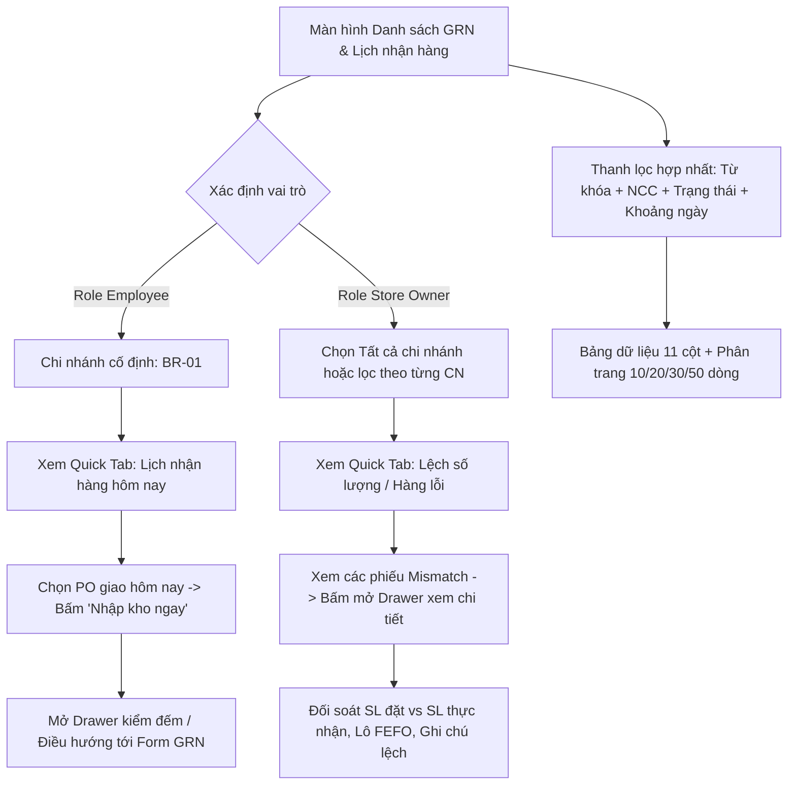

# Design Brief: grn-list

## 1. Luồng Người Dùng (User Flows)



### Luồng 1: Nhân viên chi nhánh tiếp nhận hàng hôm nay (Role Employee)
1. Nhân viên kho đăng nhập vào hệ thống, truy cập màn hình Danh sách phiếu nhập kho.
2. Hệ thống tự động nhận diện chi nhánh của nhân viên (ví dụ `BR-01`), khóa dropdown chi nhánh và chỉ nạp dữ liệu của `BR-01`.
3. Nhân viên bấm tab **"🚚 Lịch nhận hàng hôm nay"**: Danh sách hiển thị các đơn PO có lịch giao trong ngày (ví dụ `PO-20261009-001`, `TuoiSach`, 08:00 sáng).
4. Khi xe giao hàng tới, nhân viên bấm **"📥 Nhập kho ngay"** để mở Drawer kiểm hàng nhanh hoặc chuyển vào phiếu kiểm đếm.

### Luồng 2: Chủ cửa hàng giám sát & xử lý sai lệch toàn chuỗi (Role Store Owner)
1. Chủ cửa hàng truy cập phân hệ Nhập kho -> Danh sách phiếu nhập kho GRN.
2. Dropdown chi nhánh mặc định là **"-- Tất cả chi nhánh --"**, cho phép xem toàn bộ các điểm bán (`BR-01`, `BR-02`, `DC-01`,...).
3. Chủ cửa hàng bấm tab **"⚠️ Lệch số lượng / Hàng lỗi (Mismatch)"**:
   - Hệ thống hiển thị ngay các phiếu có ghi nhận chênh lệch số lượng hoặc phát sinh biên bản hàng lỗi.
4. Bấm vào mã phiếu (ví dụ `GRN-20261007-02`): Drawer trượt mở ra từ bên phải, hiển thị trực quan:
   - Số lượng đặt theo PO (vd: 50 thùng) vs Số lượng thực nhận (vd: 45 thùng) -> Lệch: **-5 thùng**.
   - Lý do lệch: "Nhà cung cấp giao thiếu 5 thùng, đã lập biên bản xác nhận tại chỗ".
   - Nút hành động: "Xử lý lệch", "Xem biên bản", "Liên hệ NCC".

---

## 2. Cấu Trúc Giao Diện & Component Tree

```
src/features/goods-receipt/
├── types/
│   └── grn.types.ts             // Kiểu dữ liệu TypeScript: GoodsReceiptListItem, GrnItemDetail, GrnFilterState
├── lib/
│   └── mockGrnData.ts           // 12 bản ghi mẫu đa dạng trạng thái TODAY, DRAFT, CONFIRMED, MISMATCH, CANCELED
├── components/
│   ├── GrnQuickTabs.tsx         // Thanh tab chuyển nhanh 4 trạng thái (Tất cả, Lịch hôm nay, Chờ duyệt, Lệch hàng)
│   ├── GrnFilterBar.tsx         // Thanh lọc hợp nhất po-unified-bar (Từ khóa, Chi nhánh, NCC, Trạng thái, Ngày)
│   ├── GrnTable.tsx             // Bảng 11 cột, sticky header, badge màu semantic, sortable, pagination footer
│   └── GrnDetailDrawer.tsx      // Slide-over drawer trượt bên phải hiển thị chi tiết mặt hàng, số lượng, đối soát PO
├── pages/
│   └── GoodsReceiptListPage.tsx // Container page kết nối toàn bộ logic state, phân quyền và hiển thị toast
└── index.ts                     // Public export interface của module
```

---

## 3. Thiết Kế Trực Quan (Design Tokens & Semantic Styling)

- **Quick View Tabs**:
  - `Tất cả`: Nút chuẩn border slate.
  - `Lịch nhận hôm nay`: Nền xanh dương nhạt `#e6f7ff`, chữ `#0050b3`, viền `#91d5ff`, icon xe tải `Truck`.
  - `Chờ xác nhận (Draft)`: Nền vàng nhạt `#fffbe6`, chữ `#d48806`, viền `#ffe58f`, icon đồng hồ `Clock`.
  - `Lệch số lượng (Mismatch)`: Nền đỏ nhạt `#fff2f0`, chữ `#cf1322`, viền `#ffccc7`, icon cảnh báo `AlertTriangle`.
- **Trạng thái bảng (Table Status Badges)**:
  - `TODAY`: Badge xanh dương nhạt với chữ đậm `CHỜ GIAO HÔM NAY`.
  - `DRAFT`: Badge vàng cam `Draft (Kiểm đếm)`.
  - `CONFIRMED`: Badge xanh lá `Confirmed (Đã nhập kho)`.
  - `MISMATCH`: Badge đỏ tươi `Mismatch (Lệch SL)`.
  - `CANCELED`: Badge xám `Đã hủy`.
- **Định dạng tiền tệ**:
  - Tiền tệ VNĐ căn phải, định dạng font `tabular-nums` tránh nhảy số khi cuộn, có ký hiệu `₫` chuẩn.
- **Thao tác dòng (Contextual Actions)**:
  - Dòng `TODAY`: Nút nổi bật màu xanh Primary `📥 Nhập kho ngay`.
  - Dòng `DRAFT`: Nút `Duyệt nhập kho` và liên kết `Sửa`.
  - Dòng `MISMATCH`: Nút cảnh báo đỏ `Xử lý lệch` và liên kết `Chi tiết`.
  - Dòng `CONFIRMED`: Liên kết `Xem lô Batch` và `In phiếu`.

---

## 4. Xử Lý Các Trạng Thái Giao Diện (State Handling)

- **Loading State**: Hiển thị spinner biểu tượng tải trang mượt mà hoặc bảng skeleton mờ.
- **Empty State**: Khi không có bản ghi nào thỏa mãn bộ lọc:
  - Hiển thị icon `PackageOpen`, thông báo: *"Không tìm thấy phiếu nhập kho hoặc lịch nhận hàng nào phù hợp với bộ lọc."*
  - Nút bấm *"Đặt lại bộ lọc tìm kiếm"* để nhanh chóng quay lại danh sách mặc định.
- **Role Switcher**:
  - Bổ sung nút chuyển đổi góc nhìn (View as Store Owner / View as Employee) ngay trên tiêu đề trang hoặc hỗ trợ URL query `?role=employee&branch=BR-01` để trải nghiệm tức thì cả hai vai trò.
