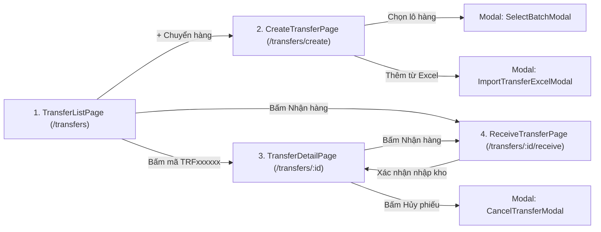

# Design Brief: inter-branch-transfer-ui (FE-15 Inter-Branch Inventory Transfer)

- Change ID: `inter-branch-transfer-ui`
- Capability: `transfer`
- Project: MT-GRMS
- Date: 2026-10-13

---

## 1. Kiến trúc Giao diện & Luồng màn hình (UI Flow)

### 1.1. Sơ đồ Điều hướng Màn hình

### 1.2. Danh sách Màn hình & Tác vụ

| Màn hình | Route | Vai trò Actor | Tác vụ chính |
|---|---|---|---|
| **TransferListPage** | `/dashboard/transfers` `/store-owner/transfers` | Store Owner / Staff | Xem danh sách phân trang, tìm kiếm mã phiếu `TRFxxxxxx`, bộ lọc chi nhánh gửi/nhận, trạng thái (`Phiếu tạm`, `Đang chuyển`, `Đã nhận`, `Đã hủy`), lọc thời gian, tình trạng khớp/lệch; xuất/nhập Excel; in phiếu. |
| **CreateTransferPage** | `/dashboard/transfers/create` `/store-owner/transfers/create` | Kho gửi / Owner | Chọn chi nhánh nhận, quét barcode/tìm SKU, chọn ĐVT quy đổi, chọn Lô/Date FEFO, kiểm tra tồn khả dụng, lưu `Draft` hoặc xuất chuyển `In-Transit`. |
| **ReceiveTransferPage** | `/dashboard/transfers/:id/receive` `/store-owner/transfers/:id/receive` | Kho nhận / Owner | Kiểm đếm dỡ hàng thực tế, nút "Nhận đủ tất cả 100%", nhập số lượng thực nhận, nhập ghi chú giải trình chênh lệch hư hỏng, xác nhận nhập kho chuyển sang `Received`. |
| **TransferDetailPage** | `/dashboard/transfers/:id` `/store-owner/transfers/:id` | Mọi người dùng liên quan | Xem chi tiết 360 độ: Timeline vận chuyển, chi tiết từng mặt hàng, đối soát số lượng gửi vs nhận, nút tác vụ ngữ cảnh (Nhận hàng, Hủy phiếu, In biên bản). |
| **SelectBatchModal** | Popup trong CreateTransfer | Kho gửi | Tìm kiếm số lô, hiển thị hạn sử dụng và tồn kho thực tế của lô, cảnh báo đỏ lô hết hạn, chọn số lượng xuất. |
| **CancelTransferModal** | Popup trong Detail/List | Kho gửi / Owner | Xác nhận hủy phiếu, bắt buộc nhập lý do hủy, cảnh báo tự động hoàn tác (Rollback) tồn kho về lại kho gửi. |
| **ImportTransferExcelModal**| Popup trong CreateTransfer | Kho gửi | Tải file Excel mẫu và tải lên danh sách hàng chuyển hàng loạt. |

---

## 2. Thiết kế API / Contract DTOs

### 2.1. Endpoints
- `GET /api/transfers`: Danh sách phiếu chuyển hàng (Query: `page`, `pageSize`, `searchCode`, `fromBranchId`, `toBranchId`, `status`, `timeRange`, `recvStatus`).
- `GET /api/transfers/{id}`: Chi tiết phiếu chuyển hàng theo ID.
- `POST /api/transfers`: Tạo phiếu chuyển mới (`Draft` hoặc `In-Transit`).
- `PUT /api/transfers/{id}`: Cập nhật phiếu nháp (`Draft`).
- `POST /api/transfers/{id}/dispatch`: Xuất chuyển hàng (chuyển sang `In-Transit`, trừ kho gửi).
- `POST /api/transfers/{id}/receive`: Xác nhận nhận hàng (chuyển sang `Received`, cộng kho nhận, ghi nhận hao hụt).
- `POST /api/transfers/{id}/cancel`: Hủy phiếu chuyển (chuyển sang `Cancelled`, rollback tồn kho về kho gửi).

### 2.2. DTO Schemas
- `TransferOrderDto`: `{ id, transferCode, fromBranchId, fromBranchName, toBranchId, toBranchName, createdBy, transferDate, receiveDate, status, totalAmount, note, discrepancyNote, cancelReason, items: TransferItemDto[] }`
- `TransferItemDto`: `{ id, productId, productCode, productName, unitName, onHandSender, onHandReceiver, sentQty, receivedQty, unitPrice, amount, batchNumber, expiryDate, note }`
- `ConfirmReceiptDto`: `{ transferId, receivedItems: { itemId, receivedQty }[], discrepancyNote?: string }`
- `CancelTransferDto`: `{ transferId, cancelReason: string }`

---

## 3. Quy tắc Bảo mật & Phân quyền (RBAC & Business Rules)
- **[BR-SEC-02](file:///d:/FPT_uni/Sesmester_9_Fall_26/Doc/Report-3_Software%20Requirement%20Specification.docx.md#L4765):** Nhân viên chi nhánh chỉ xem các phiếu có `fromBranchId == currentBranchId` hoặc `toBranchId == currentBranchId`. Store Owner xem toàn bộ chi nhánh.
- **[BR-TRF-01](file:///d:/FPT_uni/Sesmester_9_Fall_26/Doc/Report-3_Software%20Requirement%20Specification.docx.md#L4766):** Trừ tồn kho chi nhánh gửi ngay khi chuyển sang `In-Transit`.
- **[BR-TRF-02](file:///d:/FPT_uni/Sesmester_9_Fall_26/Doc/Report-3_Software%20Requirement%20Specification.docx.md#L4767):** Bảo toàn Lô/Date FEFO trong suốt quá trình vận chuyển.
- **[BR-TRF-03](file:///d:/FPT_uni/Sesmester_9_Fall_26/Doc/Report-3_Software%20Requirement%20Specification.docx.md#L4768):** Chỉ ghi tăng tồn kho chi nhánh nhận theo số lượng thực nhận (`ReceivedQty`).
- **[BR-TRF-04](file:///d:/FPT_uni/Sesmester_9_Fall_26/Doc/Report-3_Software%20Requirement%20Specification.docx.md#L4769):** Số lượng chênh lệch hư hỏng được ghi vào sổ hao hụt vận chuyển.
- **[BR-TRF-05](file:///d:/FPT_uni/Sesmester_9_Fall_26/Doc/Report-3_Software%20Requirement%20Specification.docx.md#L4770):** Hoàn trả 100% tồn kho và số lô về kho gửi khi hủy phiếu.
- **[BR-TRF-06](file:///d:/FPT_uni/Sesmester_9_Fall_26/Doc/Report-3_Software%20Requirement%20Specification.docx.md#L4771):** Kiểm tra thẩm quyền hủy (chặn kho nhận tự ý hủy phiếu của kho gửi).
