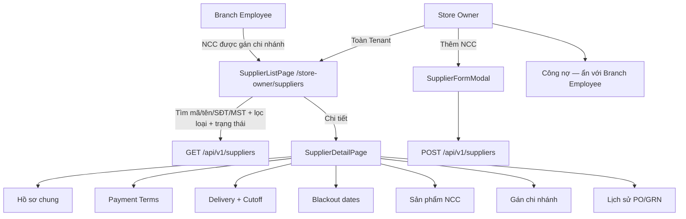

# Design Brief: Master Supplier Management (FE-09) — căn chỉnh 2 role

## 1. User Flows & System Interaction



---

## 2. API Endpoints & DTO Contracts

| Method | Endpoint | Description | Request / Query | Response | Error |
|---|---|---|---|---|---|
| `GET` | `/api/v1/suppliers` | List phạm vi role; search Code/Name/Phone/TaxCode; filter Type+Status | `SearchTerm`, `SupplierType`, `Status`, `PageIndex`, `PageSize` | `PagedResult<SupplierSummaryDto>` gồm `ContactPerson`, `Phone`; `CurrentDebt`/`OverdueDebt` chỉ Store Owner | `401` |
| `GET` | `/api/v1/suppliers/{id}` | Chi tiết; Branch Employee 404 nếu NCC không gán chi nhánh | — | `SupplierDetailDto` | `404` |
| `POST` | `/api/v1/suppliers` | Tạo NCC — Store Owner | `CreateSupplierCommand` | `SupplierDetailDto` | `400`, `403` |
| `PUT` | `/api/v1/suppliers/{id}` | Cập nhật — không sửa Code | `UpdateSupplierCommand` | `SupplierDetailDto` | `400`, `403`, `404` |
| `PATCH` | `/api/v1/suppliers/{id}/status` | Active/Inactive; cảnh báo PO mở; không tự hủy PO | `UpdateSupplierStatusRequest` | `SupplierDetailDto` + `openPurchaseOrderCount` | `400`, `403` |
| `GET/PUT` | `/api/v1/suppliers/{id}/delivery-config` | `LeadTimeDays`, `CutoffDayOffset`, `OrderCutoffTime`, `DeliveryDays` | DTO delivery | DTO | `400`, `403` |
| `GET/PUT` | `/api/v1/suppliers/{id}/branches` | Gán chi nhánh cùng Tenant; rỗng = dùng chung | `branchIds[]` | `SupplierBranchAssignmentDto` | `400`, `403` |
| `GET` | `/api/v1/suppliers/{id}/transactions` | Lịch sử PO + GRN theo phạm vi chi nhánh | page, branchId | paged history | `403`, `404` |
| `GET` | `/api/v1/suppliers/{id}/ap/summary` | Tổng phải trả, đã trả, số dư, đến hạn — Store Owner | — | `SupplierOutstandingBalanceDto` | `403` |

API AP ledger ghi giao dịch và Dual-role giữ nguyên như nền tảng nội bộ; không là thao tác chính trên list FE-09.

---

## 3. Frontend UI Component Design

Chuẩn KiotViet Brand Blue (`#0066FF`, `#F7FAFF`), font `Be Vietnam Pro` + `JetBrains Mono`, pill badge, card 24px, không animation nhún.

### `SupplierListPage` (`/store-owner/suppliers`)
- Header: "Quản lý Nhà Cung Cấp".
- Store Owner: nút **Thêm Nhà Cung Cấp**. Branch Employee: ẩn nút thêm/sửa/status.
- Ẩn nút **Xuất Excel** stub và **Trả** stub (không thuộc FE-09).
- Filter: search mã/tên/SĐT/MST; Loại NCC (Goods/Service/Both); Trạng thái Active/Inactive. Bỏ filter công nợ AP và phân loại ngành khỏi list FE-09.01.
- Bảng: Mã NCC, Tên, Người liên hệ, SĐT, Trạng thái, Hành động (Chi tiết; Sửa chỉ Store Owner).
- Cột hạn nợ / đang nợ / quá hạn: chỉ Store Owner, tùy chọn phụ — mặc định ẩn khỏi list chính theo FE-09.01.
- Phân trang server-side 10/20/30/50.
- Loading / empty / error banner. **Cấm fallback mock** khi API lỗi.

### `SupplierFormModal`
- Tab 1 Cơ bản: Tên (*), Loại, MST, tên pháp lý, địa chỉ, người liên hệ, SĐT, email. Mã NCC tự sinh, disabled khi sửa.
- Tab 2 Điều khoản: Payment Terms, Payment Due Days (>=0), Credit Limit (>=0).
- Tab 3 Ngân hàng: Bank Name, Account Number, Account Name.
- Validate bắt buộc tên; không nhận giá trị tài chính âm.

### `SupplierDetailPage`
- Tabs: Hồ sơ chung | Điều khoản TT | Giao hàng & Cutoff | Ngày không giao | Sản phẩm | Chi nhánh | Lịch sử | Công nợ (Store Owner).
- Delivery: `DeliveryDays`, `LeadTimeDays`, `CutoffDayOffset`, `OrderCutoffTime`. Ví dụ: giao T4, offset 1, 17:00 → hạn chót 17:00 ngày trước.
- Branch assignment: multi-select chi nhánh cùng Tenant; empty = dùng chung.
- History: mã PO, chi nhánh, ngày đặt, ngày giao, trạng thái, GRN, tổng giá trị nếu được xem. Branch Employee chỉ dòng chi nhánh mình.
- Dữ liệu từ API thật; bỏ caption "Minh họa bố cục".

---

## 4. Database Schema Changes

Giữ bảng đã có (`Suppliers`, `SupplierCategories`, `SupplierDeliveryConfigs`, `SupplierBlackoutDates`, `SupplierAPLedgers`). Migration mới:

### `SupplierBranchAssignments`
```sql
CREATE TABLE [SupplierBranchAssignments] (
    [Id] UNIQUEIDENTIFIER NOT NULL PRIMARY KEY,
    [TenantId] UNIQUEIDENTIFIER NOT NULL,
    [SupplierId] UNIQUEIDENTIFIER NOT NULL,
    [BranchId] UNIQUEIDENTIFIER NOT NULL,
    [CreatedAtUtc] DATETIME2 NOT NULL
);
CREATE UNIQUE INDEX [IX_SupplierBranch_Tenant_Supplier_Branch]
  ON [SupplierBranchAssignments]([TenantId], [SupplierId], [BranchId]);
```
Không có dòng nào = NCC dùng chung mọi chi nhánh cùng Tenant.

### `SupplierDeliveryConfigs` — cột thêm
- `LeadTimeDays` INT NOT NULL DEFAULT 1
- `CutoffDayOffset` INT NOT NULL DEFAULT 1
- `OrderCutoffTime` NVARCHAR(5) NOT NULL DEFAULT '17:00'
Giữ `LeadTimeHours`/`CutoffTime` cũ nếu đã có; ưu tiên đọc field mới. Không được sửa migration cũ.

---

## 5. Business Rules & RBAC

- **BR-S01**: Mã NCC duy nhất trong Tenant; hệ thống tự sinh; không sửa mã đã phát hành.
- **BR-S03 (cập nhật FE-09.05)**: Không xóa cứng NCC đã có lịch sử. Inactive không chọn cho PO mới. Ngừng hoạt động không xóa PO/GRN/công nợ. Còn PO đang xử lý → cảnh báo, không tự hủy đơn đã xác nhận. Cho phép Inactive kể khi còn dư nợ (cảnh báo).
- **BR-S07**: Không thu hẹp `SupplierType` nếu đã có giao dịch loại bị loại.
- **BR-S08**: AP ledger idempotent.
- **BR-S11**: Dual-role không tự cấn trừ AR/AP.
- **BR-S12 (cập nhật FE-09.07)**: Cutoff theo `Asia/Ho_Chi_Minh`. Tại/sau `OrderCutoffTime` của ngày chốt (`deliveryDate - CutoffDayOffset`) không tạo/sửa đơn thường cho ngày giao đó. `LeadTimeDays` chỉ mô tả thời gian dự kiến, không thay cutoff. Đổi cấu hình không sửa PO đã gửi/xác nhận.
- **BR-S13**: Loại blackout khỏi ngày giao hợp lệ đơn mới; không tự đổi ngày giao đơn đã xác nhận.
- **BR-S14**: Credit Limit là cấu hình; không mặc định chặn PO khi vượt hạn mức.
- **BR-S15**: Giá/MOQ/điều khoản mới không áp ngược chứng từ đã phát sinh.
- **BR-S16**: Gán chi nhánh chỉ cùng Tenant; đổi gán không xóa lịch sử.

### RBAC
- **Store Owner**: toàn quyền Tenant — CRUD NCC, status, payment, delivery, blackout, products, gán chi nhánh, xem lịch sử toàn Tenant, xem công nợ tổng hợp.
- **Branch Employee**: xem list/detail NCC được phép tại chi nhánh; xem lịch sử thuộc chi nhánh; không tạo/sửa/status; không xem công nợ tổng hợp Tenant.
