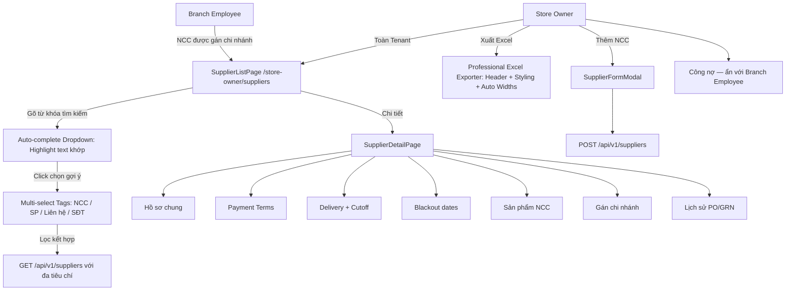

# Design Brief: Master Supplier Management (FE-09) — căn chỉnh 2 role & Tìm kiếm đa thực thể / Xuất Excel

## 1. User Flows & System Interaction

---

## 2. API Endpoints & DTO Contracts

| Method | Endpoint | Description | Request / Query | Response | Error |
|---|---|---|---|---|---|
| `GET` | `/api/v1/suppliers` | List phạm vi role; search đa tiêu chí; filter Type+Status | `SearchTerm`, `SupplierType`, `Status`, `SupplierIds`, `ProductIds`, `ContactPersons`, `Phones`, `PageIndex`, `PageSize` | `PagedResult<SupplierSummaryDto>` gồm `ContactPerson`, `Phone`; `CurrentDebt`/`OverdueDebt` chỉ Store Owner | `401` |
| `GET` | `/api/v1/suppliers/search-suggestions` | Gợi ý đa thực thể kèm khớp từ khóa | `query`, `limit` | `SupplierSearchSuggestionsDto` (Suppliers, Products, ContactPersons, Phones) | `401` |
| `GET` | `/api/v1/suppliers/{id}` | Chi tiết; Branch Employee 404 nếu NCC không gán chi nhánh | — | `SupplierDetailDto` | `404` |
| `POST` | `/api/v1/suppliers` | Tạo NCC — Store Owner | `CreateSupplierCommand` | `SupplierDetailDto` | `400`, `403` |
| `PUT` | `/api/v1/suppliers/{id}` | Cập nhật — không sửa Code | `UpdateSupplierCommand` | `SupplierDetailDto` | `400`, `403`, `404` |
| `PATCH` | `/api/v1/suppliers/{id}/status` | Active/Inactive; cảnh báo PO mở; không tự hủy PO | `UpdateSupplierStatusRequest` | `SupplierDetailDto` + `openPurchaseOrderCount` | `400`, `403` |
| `GET/PUT` | `/api/v1/suppliers/{id}/delivery-config` | `LeadTimeDays`, `CutoffDayOffset`, `OrderCutoffTime`, `DeliveryDays` | DTO delivery | DTO | `400`, `403` |
| `GET/PUT` | `/api/v1/suppliers/{id}/branches` | Gán chi nhánh cùng Tenant; rỗng = dùng chung | `branchIds[]` | `SupplierBranchAssignmentDto` | `400`, `403` |
| `GET` | `/api/v1/suppliers/{id}/transactions` | Lịch sử PO + GRN theo phạm vi chi nhánh | page, branchId | paged history | `403`, `404` |
| `GET` | `/api/v1/suppliers/{id}/ap/summary` | Tổng phải trả, đã trả, số dư, đến hạn — Store Owner | — | `SupplierOutstandingBalanceDto` | `403` |

---

## 3. Frontend UI Component Design

Chuẩn KiotViet Brand Blue (`#0066FF`, `#F7FAFF`), font `Be Vietnam Pro` + `JetBrains Mono`, pill badge, card 24px, không animation nhún.

### `SupplierListPage` (`/store-owner/suppliers`)
- Header: "Quản lý Nhà Cung Cấp".
- Nút **Xuất Excel** chuyên nghiệp (Store Owner & Admin): Xuất bảng dữ liệu có Header trang trọng, viền kẻ ô, màu thương hiệu và kích thước cột vừa vặn tự động.
- Nút **Thêm Nhà Cung Cấp** (Store Owner). Branch Employee: ẩn nút thêm/sửa/status.
- **Thanh tìm kiếm nâng cao Multi-Entity Autocomplete**:
  - Khi gõ từ khóa: xuất hiện dropdown nhóm kết quả (Nhà cung cấp, Sản phẩm, Người liên hệ, Số điện thoại).
  - Ký tự trùng khớp được highlight nổi bật (`<mark>` hoặc class highlight màu xanh/vàng).
  - Chọn gợi ý để thêm vào danh sách Tag Chips (có badge phân loại màu sắc).
  - Hỗ trợ chọn đồng thời nhiều NCC, nhiều sản phẩm, nhiều người liên hệ, nhiều SĐT.
  - Hỗ trợ xóa từng tag hoặc nút "Xóa tất cả".
- Bảng: Mã NCC, Tên, Người liên hệ, SĐT, Trạng thái, Hành động (Chi tiết; Sửa chỉ Store Owner).
- Cột hạn nợ / đang nợ / quá hạn: chỉ Store Owner.
- Phân trang server-side 10/20/30/50.
- Loading / empty / error banner. **Cấm fallback mock** khi API lỗi.

### `SupplierFormModal`
- Tab 1 Cơ bản: Tên (*), Loại, MST, tên pháp lý, địa chỉ, người liên hệ, SĐT, email. Mã NCC tự sinh, disabled khi sửa.
- Tab 2 Điều khoản: Payment Terms, Payment Due Days (>=0), Credit Limit (>=0).
- Tab 3 Ngân hàng: Bank Name, Account Number, Account Name.
- Validate bắt buộc tên; không nhận giá trị tài chính âm.

### `SupplierDetailPage`
- Tabs: Hồ sơ chung | Điều khoản TT | Giao hàng & Cutoff | Ngày không giao | Sản phẩm | Chi nhánh | Lịch sử | Công nợ (Store Owner).
- Dữ liệu từ API thật; bỏ caption "Minh họa bố cục".
