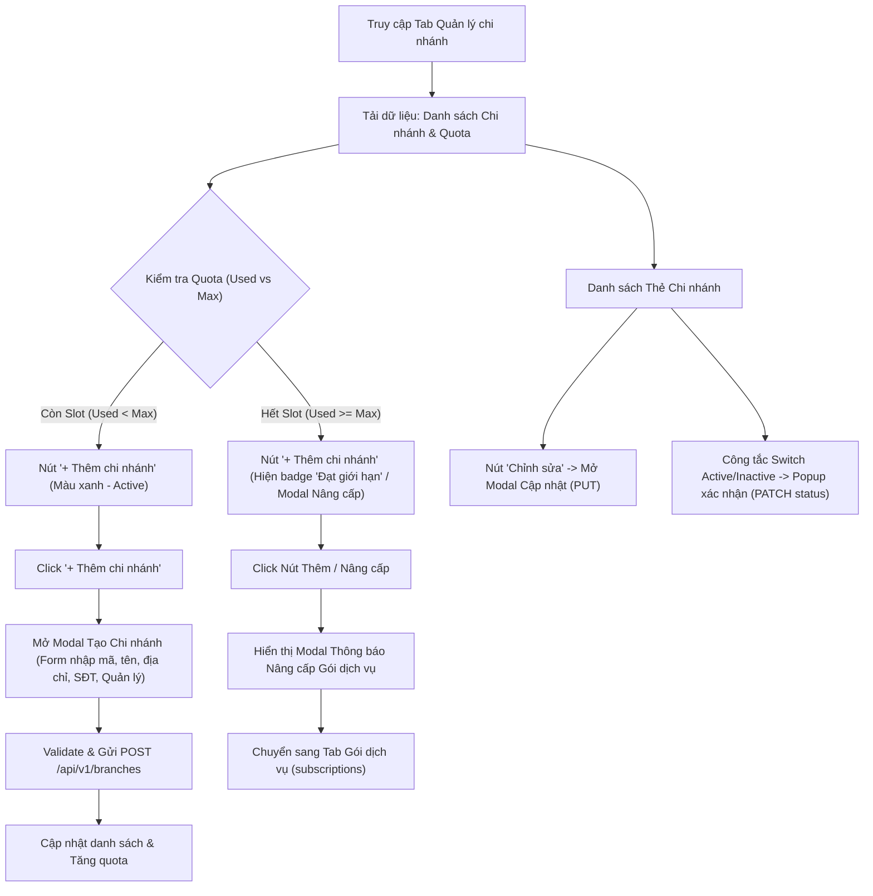

# Design Brief: Multi-Branch Management (Quản lý đa chi nhánh)

## 1. Điểm chạm Người dùng & Vị trí Nút / Điều hướng (Touchpoints & Buttons)

Hệ thống bổ sung 3 điểm truy cập thuận tiện nhất cho người dùng:
1. **Dropdown Menu "Cửa hàng" (TopNav)**:
   - Mục: `Chi nhánh & Điểm bán` -> Trỏ đến `/store-owner/subscriptions?tab=branches`.
2. **Widget "Số chi nhánh" (StoreTopStatusBar)**:
   - Biến thẻ thông số tĩnh `Số chi nhánh: 2` thành thẻ tương tác.
   - Hiển thị quota dạng: `2 / 3 chi nhánh` (Gói Pro).
   - Click vào thẻ sẽ tự động kích hoạt Tab `Quản lý chi nhánh`.
3. **Sidebar Điều hướng (StoreSidebarNav)**:
   - Thêm tab mới `Quản lý chi nhánh` (Icon `GitFork` / `Network` / `MapPin`) nằm ngay dưới `Thông tin gian hàng`.

## 2. Luồng Người dùng (User Flows)



## 3. Thành phần Giao diện (UI Components)

- **`BranchesTab.tsx`**: Component cha chứa toàn bộ giao diện quản lý chi nhánh.
  - **`BranchQuotaBanner.tsx`**:
    - Progress bar trực quan: `Đang sử dụng 2/3 chi nhánh (Gói Doanh Nghiệp - Toàn Năng)`.
    - Nút `+ Thêm chi nhánh mới` (Primary CTA).
    - Nút `Nâng cấp gói` (Secondary CTA nếu gần hoặc đã chạm trần).
  - **`BranchFilterBar.tsx`**: Tìm kiếm theo tên/mã chi nhánh, lọc trạng thái (Tất cả, Đang hoạt động, Tạm dừng).
  - **`BranchCardGrid.tsx` / `BranchTable.tsx`**: Hiển thị từng chi nhánh:
    - Huy hiệu mã chi nhánh: `CN-01`
    - Tên chi nhánh: `MT-Mart Quận 1 (Trụ sở chính)`
    - Địa chỉ và số điện thoại liên hệ
    - Quản lý phụ trách: `Nguyễn Văn Hùng`
    - Trạng thái: Toggle Switch (Active/Inactive)
    - Hành động: Nút `Sửa thông tin`, Nút `Xem kho hàng`
  - **`BranchFormModal.tsx`**: Modal nhập liệu có validation đầy đủ:
    - Mã chi nhánh (viết hoa tự động, max 20 ký tự, regex alphanumeric)
    - Tên chi nhánh (bắt buộc, max 150 ký tự)
    - Địa chỉ cụ thể, Tỉnh/Thành phố
    - Số điện thoại liên hệ (regex chuẩn SĐT Việt Nam)
    - Cửa hàng trưởng phụ trách
  - **`BranchUpgradeModal.tsx`**: Modal thông báo giới hạn quota và nút dẫn sang nâng cấp gói.

### Trạng thái Giao diện:
- **Loading**: Skeleton placeholder cho Quota bar và các card chi nhánh.
- **Empty**: Minh họa đồ họa "Chưa có chi nhánh nào" kèm nút bấm tạo chi nhánh đầu tiên.
- **Error**: Alert thông báo lỗi kèm nút `Thử lại (Retry)`.

## 4. API & Hợp đồng Dữ liệu (Backend Endpoints)

| Endpoint | Method | Role | Mô tả |
|---|---|---|---|
| `/api/v1/branches/quota` | `GET` | StoreOwner, Admin | Trả về thông tin quota: `usedBranches`, `maxBranches`, `planName`, `canAddMore` |
| `/api/v1/branches` | `GET` | StoreOwner, Admin, Manager | Lấy danh sách chi nhánh có phân trang, tìm kiếm |
| `/api/v1/branches/{id}` | `GET` | StoreOwner, Admin, Manager | Xem chi tiết chi nhánh |
| `/api/v1/branches` | `POST` | StoreOwner, Admin | Tạo chi nhánh mới (kiểm tra quota & trùng mã) |
| `/api/v1/branches/{id}` | `PUT` | StoreOwner, Admin | Cập nhật thông tin chi nhánh |
| `/api/v1/branches/{id}/status` | `PATCH` | StoreOwner, Admin | Kích hoạt hoặc tạm dừng chi nhánh |

### DTOs:
```csharp
public class CreateBranchRequest
{
    public string BranchCode { get; set; } = string.Empty;
    public string Name { get; set; } = string.Empty;
    public string? Address { get; set; }
    public string? Phone { get; set; }
    public string? ManagerName { get; set; }
}

public class UpdateBranchRequest
{
    public string Name { get; set; } = string.Empty;
    public string? Address { get; set; }
    public string? Phone { get; set; }
    public string? ManagerName { get; set; }
}

public class UpdateBranchStatusRequest
{
    public bool IsActive { get; set; }
}

public class BranchQuotaDto
{
    public int UsedBranches { get; set; }
    public int MaxBranches { get; set; }
    public string PlanName { get; set; } = string.Empty;
    public bool CanAddMore => UsedBranches < MaxBranches;
}
```

## 5. Thiết kế Cơ sở dữ liệu (Database Schema)
- Bảng `Branches`:
  - `Id` (uuid, PK)
  - `TenantId` (varchar(50), FK Tenants)
  - `BranchCode` (varchar(20), Not Null)
  - `Name` (varchar(150), Not Null)
  - `Address` (text, Nullable)
  - `Phone` (varchar(20), Nullable)
  - `ManagerName` (varchar(100), Nullable)
  - `IsActive` (boolean, default true)
  - `Latitude`, `Longitude` (decimal(9,6), Nullable)
  - `CheckinRadiusMeters` (int, default 100)
  - `CreatedAt`, `UpdatedAt` (timestamp with time zone)
- Ràng buộc Index:
  - `CREATE UNIQUE INDEX IX_Branches_TenantId_BranchCode ON "Branches" ("TenantId", "BranchCode");`

## 6. Phân quyền & Quy tắc Nghiệp vụ
- **Quy tắc Quota**:
  1. Khi người dùng gửi request `POST /api/v1/branches`, Service sẽ đếm tổng số chi nhánh hiện tại của Tenant.
  2. So sánh với `MaxBranches` của gói thuê bao tương ứng.
  3. Nếu `count >= maxBranches`, trả về lỗi HTTP 400 Bad Request kèm mã lỗi `QUOTA_EXCEEDED` và message giải thích rõ ràng.
- **Quy tắc Mã duy nhất**:
  - `BranchCode` là duy nhất trong cùng một chuỗi (`TenantId`), không được trùng.
- **Quy tắc Không xóa cứng**:
  - Không hỗ trợ xóa vĩnh viễn (Hard Delete) chi nhánh để bảo toàn toàn vẹn dữ liệu đơn hàng và kiểm kê. Chỉ hỗ trợ tắt trạng thái (`IsActive = false`).
