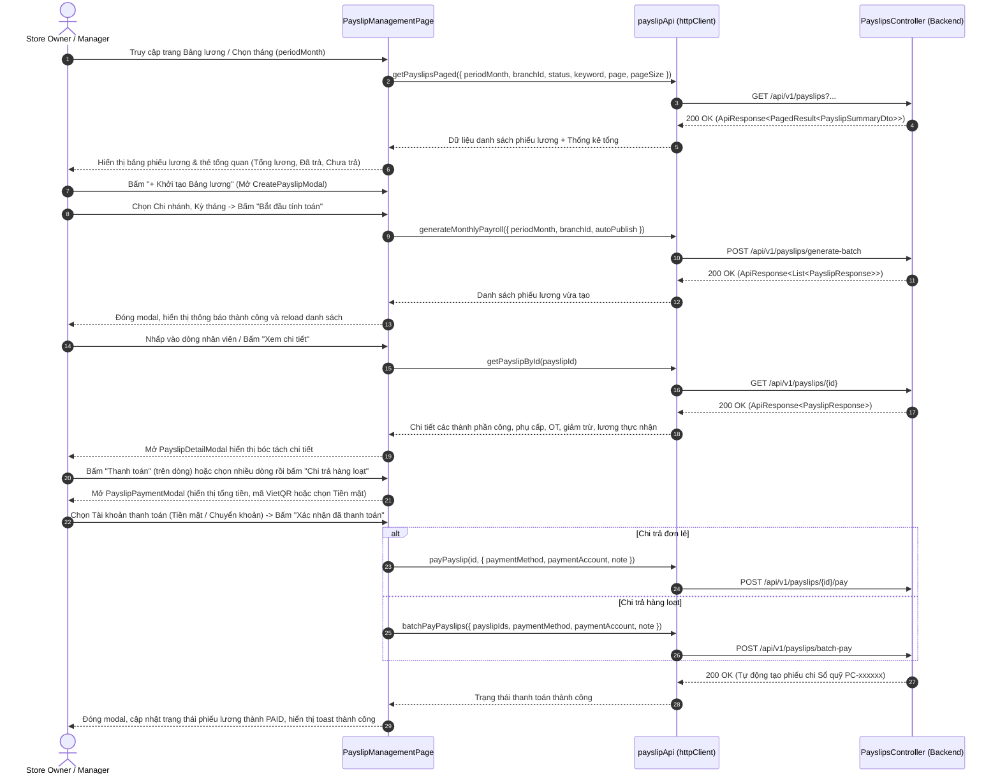

# Bản Thiết Kế Giao Diện Bảng Lương (Design Brief: Payroll Management UI)

## 1. Luồng Người Dùng (User Flows)



---

## 2. Thiết Kế Màn Hình & Trạng Thái Giao Diện (UI Components & States)

### 2.1. Trang Chính: `PayslipManagementPage.tsx`
- **Bộ lọc & Điều hướng:**
  - Bộ chọn tháng dạng Navigator: `[<] Tháng MM/YYYY [>]` (mặc định tháng hiện tại, tự động chuyển đổi sang chuỗi `YYYY-MM`).
  - Thanh tìm kiếm theo tên hoặc mã nhân viên (`keyword`).
  - Dropdown lọc Chi nhánh: lấy danh sách chi nhánh thực qua `employeeApi.getBranches()`.
  - Bộ lọc Trạng thái: 3 tabs `Tất cả` (`ALL`), `Chưa thanh toán` (`UNPAID`), `Đã thanh toán` (`PAID`).
- **Thẻ tóm tắt chỉ số tài chính (Summary Cards):**
  - **Tổng quỹ lương:** Tổng `netSalary` của toàn bộ phiếu lương trong kỳ.
  - **Đã thanh toán:** Tổng số tiền của các phiếu lương trạng thái `PAID`.
  - **Còn phải trả:** Tổng số tiền còn lại chưa chi trả (`UNPAID`).
  - **Tổng nhân sự:** Số lượng nhân viên có phiếu lương trong kỳ.
- **Bảng dữ liệu (Payslips Table):**
  - Cột: Checkbox chọn nhiều, Mã phiếu, Nhân viên (Tên + Mã NV + Avatar), Chi nhánh, Ngày công chuẩn / thực tế, Lương cơ bản, Phụ cấp, Tăng ca (OT), Giảm trừ (Tạm ứng/BHXH), Lương thực lĩnh (`NetSalary`), Trạng thái (`badge PAID / UNPAID`), Thao tác (`Chi tiết`, `Thanh toán`).
- **Trạng thái Giao diện:**
  - *Loading State:* Hiển thị spinner hoặc Antd Skeleton khi đang gọi API.
  - *Empty State:* Hiển thị icon `Inbox` kèm thông báo *"Chưa có dữ liệu bảng lương cho kỳ này. Hãy bấm 'Khởi tạo Bảng lương' để bắt đầu."*
  - *Error State:* Hiển thị banner lỗi hoặc Antd Notification với thông điệp từ `ProblemDetails`.

### 2.2. Modal Khởi Tạo Bảng Lương: `CreatePayslipModal.tsx`
- Chọn Kỳ tính lương (`YYYY-MM`).
- Chọn Chi nhánh áp dụng (hoặc `Tất cả chi nhánh`).
- Checkbox: *"Tự động gửi thông báo cho nhân viên sau khi tạo"*.
- Nút bấm: `[Hủy]` và `[Bắt đầu tính lương]` (kèm trạng thái loading khi đang xử lý).

### 2.3. Modal Chi Tiết Phiếu Lương: `PayslipDetailModal.tsx`
- Gọi API `getPayslipById` để đảm bảo dữ liệu mới nhất.
- Bóc tách minh bạch:
  1. **Thông tin nhân sự & ca làm việc:** Mã NV, Họ tên, Chi nhánh, Chức danh, Hình thức lương.
  2. **Chi tiết ngày công & giờ làm:** Số ngày chuẩn, Số ngày làm thực tế, Giờ làm thực tế, Giờ làm thêm (OT ngày thường / OT Chủ nhật).
  3. **Thu nhập (Earnings):** Lương theo công làm việc, Tiền làm thêm giờ, Các khoản phụ cấp (ăn trưa, trách nhiệm, độc hại...), Tiền thưởng.
  4. **Giảm trừ (Deductions):** Tạm ứng lương, Bảo hiểm xã hội, Phạt vi phạm.
  5. **Thực lĩnh (Net Salary):** Hiển thị cỡ chữ lớn, màu xanh lá nổi bật.
  6. **Lịch sử thanh toán:** Ngày chi trả, Phương thức thanh toán, Mã phiếu chi Sổ quỹ liên kết.

### 2.4. Modal Thanh Toán: `PayslipPaymentModal.tsx`
- Hỗ trợ cả 2 kịch bản: Chi trả đơn lẻ (1 phiếu) và Chi trả theo lô (danh sách ID đã chọn).
- Lựa chọn phương thức thanh toán:
  - **Chuyển khoản Ngân hàng (VietQR NAPAS 247):** Hiển thị QR Code động thanh toán tự động, thông tin người thụ hưởng, số tài khoản, ngân hàng và nội dung chuyển khoản.
  - **Tiền mặt (Cash):** Chọn quỹ chi trả (Két thu ngân / Két sắt chi nhánh).
- Ghi chú giao dịch chi trả (`Note`).
- Nút bấm: `[Hủy]` và `[Xác nhận đã chi trả]`.

---

## 3. Đặc Tả Tầng API Client (`src/features/employee/api/payslipApi.ts`)

```typescript
import { httpClient } from '../../../api/httpClient';
import type { ApiResponse, PagedResult } from '../../../api/types';

// DTOs & Interfaces
export interface PayslipSummaryDto {
  id: string;
  payslipCode: string;
  employeeId: string;
  employeeCode: string;
  fullName: string;
  branchName: string;
  periodMonth: string;
  salaryType: 'Monthly' | 'Hourly' | 'Shift' | 'Fixed';
  standardDays: number;
  workedDays: number;
  actualWorkHours: number;
  otHours: number;
  baseSalaryEarned: number;
  overtimePay: number;
  allowanceAmount: number;
  bonusAmount: number;
  totalEarnings: number;
  advanceDeduction: number;
  socialInsurance: number;
  violationDeduction: number;
  totalDeductions: number;
  netSalary: number;
  paidAmount: number;
  status: 'Unpaid' | 'Paid' | 'Partial';
  paidAt?: string;
  paymentMethod?: string;
}

export interface PayslipResponse extends PayslipSummaryDto {
  tenantId: string;
  branchId: string;
  avatarUrl?: string;
  bankAccountNumber?: string;
  bankName?: string;
  bankAccountHolder?: string;
  paymentNote?: string;
  cashbookVoucherCode?: string;
  createdAt: string;
}

export interface PayslipQueryFilter {
  keyword?: string;
  periodMonth?: string;
  branchId?: string;
  status?: 'Unpaid' | 'Paid' | 'Partial';
  page?: number;
  pageSize?: number;
}

export interface GeneratePayrollBatchRequest {
  periodMonth: string;
  branchId?: string;
  autoPublish?: boolean;
}

export interface PayPayslipRequest {
  paymentMethod: string;
  paymentAccount?: string;
  note?: string;
}

export interface BatchPayPayslipsRequest {
  payslipIds: string[];
  paymentMethod: string;
  paymentAccount?: string;
  note?: string;
}

export interface BatchPayResultDto {
  totalRequested: number;
  successCount: number;
  failedCount: number;
  totalAmountPaid: number;
  createdVoucherCodes: string[];
}

// API methods
export const payslipApi = {
  getPayslipsPaged: (filter: PayslipQueryFilter) =>
    httpClient.get<ApiResponse<PagedResult<PayslipSummaryDto>>>('/api/v1/payslips', { params: filter }),

  getPayslipById: (id: string) =>
    httpClient.get<ApiResponse<PayslipResponse>>(`/api/v1/payslips/${id}`),

  generateMonthlyPayroll: (request: GeneratePayrollBatchRequest) =>
    httpClient.post<ApiResponse<PayslipResponse[]>>('/api/v1/payslips/generate-batch', request),

  payPayslip: (id: string, request: PayPayslipRequest) =>
    httpClient.post<ApiResponse<PayslipResponse>>(`/api/v1/payslips/${id}/pay`, request),

  batchPayPayslips: (request: BatchPayPayslipsRequest) =>
    httpClient.post<ApiResponse<BatchPayResultDto>>('/api/v1/payslips/batch-pay', request),
};
```

---

## 4. Quy Tắc Nghiệp Vụ & Phân Quyền (Business Rules & Permissions)
- **BR-PAY-01 (Cô lập dữ liệu Tenant & Phân quyền Chi nhánh):** Mọi request gửi lên backend đều được backend tự động gắn ngữ cảnh `TenantId` qua JWT Claim. Quản lý chi nhánh chỉ có quyền xem và chi trả cho nhân viên tại chi nhánh của mình.
- **BR-PAY-02 (Tự động sinh phiếu chi Sổ quỹ):** Khi chi trả phiếu lương (đơn lẻ hoặc theo lô), backend tự động tạo phiếu chi `PC-xxxxxx` trong `CashbookTransactions`. Phía frontend sau khi gọi API thanh toán thành công phải làm mới danh sách để cập nhật trạng thái phiếu và số dư quỹ.
- **BR-PAY-03 (Chống trùng lặp thanh toán):** Các phiếu lương đã có trạng thái `Paid` sẽ bị disable nút thanh toán và không được phép chọn trong thao tác chi trả hàng loạt.
