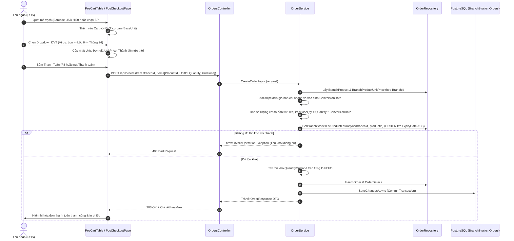

# Design Brief: pos-branch-pricing-and-fefo

## 1. Luồng Nghiệp Vụ & Tương Tác Hệ Thống (Workflows)



---

## 2. Đặc Tả Thay Đổi Dữ Liệu & DTO (Data Contract & Schema)

### 2.1. Backend DTO (`OrderDtos.cs`)
```csharp
public record OrderItemCreateDto(
    Guid ProductId,
    decimal Quantity,
    decimal UnitPrice,
    decimal? DiscountAmount = null,
    string? ProductName = null,
    Guid? UnitId = null,         // ĐVT quy đổi (NULL = BaseUnit)
    string? UnitName = null      // Tên ĐVT hiển thị
);
```

### 2.2. Logic Phân Giải Đơn Giá & Trừ Kho FEFO (`OrderService.cs`)
1. **Phân giải đơn giá bán**:
   - Nếu `UnitId != null`:
     - Ưu tiên 1: `BranchProductUnitPrice.SellingPriceOverride` tại chi nhánh nếu có và $> 0$.
     - Ưu tiên 2: `ProductUnit.Price` cấu hình sẵn trên đơn vị quy đổi.
     - Ưu tiên 3: `(BranchProduct.SellingPriceOverride ?? Product.SellingPrice) * ProductUnit.ConversionRate`.
   - Nếu `UnitId == null` (Đơn vị cơ bản):
     - `BranchProduct.SellingPriceOverride ?? Product.SellingPrice`.
2. **Quy đổi số lượng cơ sở**:
   - `conversionRate = (UnitId != null ? unit.ConversionRate : 1.00m)`.
   - `requiredBaseQty = item.Quantity * conversionRate`.
3. **Trừ kho FEFO**:
   - Duyệt danh sách `BranchStocks` đã sắp xếp theo `ExpiryDate ASC`.
   - Trừ lần lượt `QuantityOnHand` của các lô cho đến khi `remainingToDeduct == 0`.
4. **Lưu hóa đơn**:
   - `Order.TotalAmount`, `DiscountAmount`, `FinalAmount`, `PaymentMethod`.
   - `OrderDetail`: `ProductId`, `Qty = item.Quantity`, `UnitPrice = resolvedPrice`, `CostPriceAtSale = firstStock.LandedCostPerUnit`, `AppliedVatRate`.

---

## 3. Đặc Tả Giao Diện POS Frontend (`MT_GRMS_FRONTEND`)

### 3.1. Thành phần `PosCartTable.tsx`
- Cột **ĐVT** (thay thế thẻ text tĩnh):
  - Nếu sản phẩm có danh sách `unitPrices && unitPrices.length > 1`: Hiển thị dropdown `<select className="pos-unit-select">`.
  - Dropdown bao gồm:
    - Đơn vị cơ bản: `{product.baseUnit} - {formatPrice(product.basePrice)}`
    - Các đơn vị quy đổi: `{u.unitName} - {formatPrice(u.price)}`
  - Sự kiện `onChange`: Gọi callback `onUpdateItemUnit(item.id, selectedUnitName, selectedPrice)`.
  - Nếu sản phẩm chỉ có 1 đơn vị tính: Hiển thị badge text thông thường.

### 3.2. Cập nhật `PosCheckoutPage.tsx`
- Thêm hàm `handleUpdateItemUnit(id: string, unitName: string, unitPrice: number)`:
  - Cập nhật dòng giỏ hàng: `unit = unitName`, `unitPrice = unitPrice`, `actualPrice = unitPrice - discount`, `totalAmount = actualPrice * quantity`.

---

## 4. Dữ Liệu Mẫu Kiểm Thử (Seed Data for An Nhiên)

- **Tenant**: `tenant_an_nhien_02` (Trần Quốc An - Chủ tiệm An Nhiên).
- **Chi nhánh**: `b1000000-0000-0000-0000-000000000001` (An Nhiên Mart - Chi nhánh Ba Đình).
- **Danh sách 4 sản phẩm kiểm thử**:

| # | Sản phẩm | Barcode | ĐVT Cơ bản | Giá Cơ bản | ĐVT Quy đổi (Tỷ lệ & Giá) | Lô FEFO mẫu |
|---|---|---|---|---|---|---|
| 1 | Cà phê hòa tan G7 3in1 | `8935024122310` | Hộp | 58.000 đ | Thùng (x24): 1.350.000 đ | Lô G7-2026-A (HSD: +30 ngày, SL: 50)<br>Lô G7-2026-B (HSD: +180 ngày, SL: 100) |
| 2 | Bánh Orion Choco-Pie | `8936036020380` | Hộp | 55.000 đ | Thùng (x8): 420.000 đ | Lô CP-2026-A (HSD: +45 ngày, SL: 40)<br>Lô CP-2026-B (HSD: +200 ngày, SL: 80) |
| 3 | Muối chấm Hảo Hảo tôm chua cay | `8934563065249` | Hũ | 16.000 đ | Lốc (x6): 90.000 đ<br>Thùng (x30): 430.000 đ | Lô HH-2026-01 (HSD: +60 ngày, SL: 60)<br>Lô HH-2026-02 (HSD: +240 ngày, SL: 120) |
| 4 | Bia Hà Nội Sleek 330ml | `8936000440824` | Lon | 14.000 đ | Lốc (x6): 82.000 đ<br>Thùng (x24): 320.000 đ | Lô BIA-2026-A (HSD: +20 ngày, SL: 48)<br>Lô BIA-2026-B (HSD: +120 ngày, SL: 120) |

---

## 5. Ma Trận Kiểm Thử Unit Test Backend (`PosOrderServiceTests.cs`)

1. `CreateOrder_WithBranchProductPriceOverride_UsesBranchPrice`: Kiểm chứng bán đơn vị cơ bản nhận đúng giá override chi nhánh `BranchProduct`.
2. `CreateOrder_WithConvertedUnit_UsesBranchUnitPriceOverride`: Bán đơn vị quy đổi (Lốc/Thùng) nhận đúng giá override của đơn vị đó.
3. `CreateOrder_WithConvertedUnit_DeductsCorrectBaseQuantityFefo`: Bán 1 Thùng (x24 lon) trừ đúng 24 lon cơ bản từ `BranchStocks`.
4. `CreateOrder_DeductsAcrossMultipleBatches_FefoOrder`: Trừ hết lô cận date trước, phần còn thiếu tự động trừ sang lô tiếp theo.
5. `CreateOrder_InsufficientStockForConvertedUnit_ThrowsException`: Bán vượt tổng tồn kho quy đổi báo lỗi và không tạo đơn.
6. `CancelOrder_RestoresBranchStockQuantity_Successfully`: Hủy đơn hàng hoàn trả chính xác số lượng về tồn kho `BranchStocks`.
