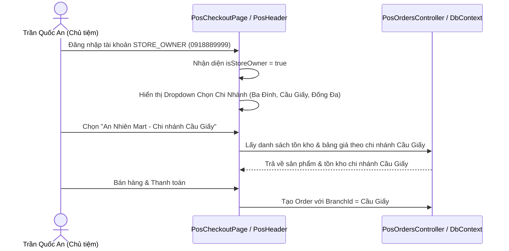
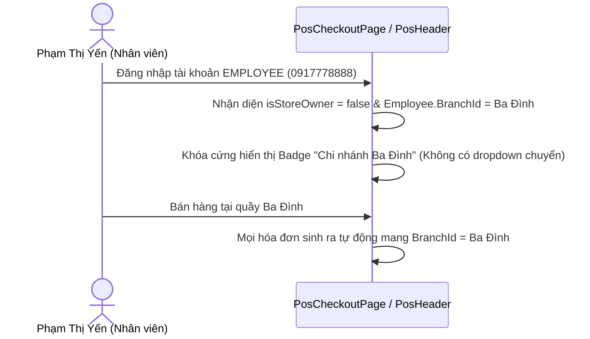

# Design Brief: Đa Chi Nhánh, Phân Quyền Vai Trò POS & Tối Ưu Tra Cứu FEFO

## 1. Luồng Người Dùng (User Flows)

### Luồng 1: Bán Hàng & Chuyển Chi Nhánh (Chủ Cửa Hàng - STORE_OWNER)

### Luồng 2: Bán Hàng Khóa Cố Định Chi Nhánh (Nhân Viên - EMPLOYEE)

### Luồng 3: Quản Lý Đơn Hàng & Phân Quyền Hủy Đơn vs Đổi Trả (`InvoiceManagementPage`)
- **Chủ cửa hàng (`STORE_OWNER`)**:
  - Dropdown lọc chi nhánh: Cho phép chọn "Tất cả chi nhánh" hoặc từng chi nhánh cụ thể.
  - Danh sách hóa đơn: Hiển thị cả 2 nút **"Đổi trả hàng"** và **"Hủy hóa đơn"** (màu đỏ với modal xác nhận hủy).
- **Nhân viên (`EMPLOYEE`)**:
  - Dropdown lọc chi nhánh: Bị khóa cứng theo chi nhánh được gán (chỉ xem được đơn của chi nhánh mình).
  - Nút **"Đổi trả hàng"**: Hiển thị đầy đủ để nhân viên linh hoạt đổi hàng hỏng/lỗi cho khách tại quầy.
  - Nút **"Hủy hóa đơn"**: Ẩn hoàn toàn (hoặc hiển thị disabled kèm chú thích rõ "Chỉ Chủ cửa hàng mới có quyền hủy hóa đơn").

### Luồng 4: Tra Cứu Tồn Kho & Lô FEFO Nhanh (Quick Option Modal)
- Nút bấm **"Tra cứu Lô & Hạn dùng"** tích hợp trực tiếp trên `PosHeader` hoặc thanh công cụ POS.
- Khi bấm: Mở `PosInventoryLookupModal` ngay trên màn hình bán hàng, không cần rời giỏ hàng.
- Cho phép:
  1. Quét mã vạch (Barcode) hoặc gõ tên sản phẩm.
  2. Hiển thị tồn khả dụng tại chi nhánh hiện tại.
  3. Hiển thị bảng đối chiếu tồn kho tại các chi nhánh khác (Ba Đình, Cầu Giấy, Đống Đa).
  4. Hiển thị danh sách các lô hàng (`Batches`) kèm số lượng tồn và ngày hết hạn xếp theo thứ tự FEFO (cận date nhất lên đầu).

---

## 2. Thiết Kế Màn Hình & Thành Phần Giao Diện (UI Components)

### 2.1. `PosHeader.tsx`
- **Props mở rộng**:
  - `branches: Array<{ id: string; name: string; address?: string }>`
  - `selectedBranchId: string`
  - `onSelectBranch: (branchId: string) => void`
  - `onOpenInventoryLookup: () => void`
- **Render Chi Nhánh**:
  - Nếu `isStoreOwner`: Render `<select>` dạng pill cao cấp với icon `Store`, hiển thị tên các chi nhánh của An Nhiên Mart, border xanh emerald tinh tế.
  - Nếu `!isStoreOwner`: Render `
` badge tĩnh với icon `MapPin` và text tên chi nhánh cố định của nhân viên.
- **Nút Tra Cứu FEFO**:
  - Đặt cạnh nút "Đơn đặt trước" và "Quản lý hóa đơn", icon `Search` / `Layers`, nhãn: "Tra cứu Lô FEFO".

### 2.2. `PosInventoryLookupModal.tsx` (Component Mới Tinh Gọn)
- Header: "Tra Cứu Tồn Kho & Lô Hạn Dùng FEFO" + nút đóng (✕ / ESC).
- Ô tìm kiếm: Tích hợp scanner listener + input gợi ý tên/barcode.
- Khối thông tin sản phẩm:
  - Thẻ tóm tắt: Tên sản phẩm, Đơn vị tính, Tổng tồn kho toàn chuỗi.
  - Bảng 1: Phân bổ tồn kho theo Chi nhánh (Ba Đình, Cầu Giấy, Đống Đa).
  - Bảng 2: Danh sách các Lô hàng (Số lô, Hạn sử dụng, Số ngày còn lại, Trạng thái date: An toàn / Cận date, Tồn lô).

### 2.3. `InvoiceManagementPage.tsx`
- `branchFilter`:
  - Khởi tạo giá trị mặc định theo vai trò đăng nhập.
  - Nếu là `EMPLOYEE`, disable selector lọc chi nhánh hoặc ẩn dropdown, cố định ở chi nhánh nhân viên.
- Bảng hóa đơn:
  - Cột thao tác: Kiểm tra `isStoreOwner` trước khi render nút Hủy hóa đơn.
  - Nút Đổi trả hàng luôn sẵn sàng cho cả 2 vai trò.

---

## 3. Cập Nhật CSDL & Dữ Liệu Mẫu (`DbInitializer.cs`)
- Tenant An Nhiên Mart (`tenant_an_nhien_02`):
  - **Chi nhánh 1**: `BR-AN-01` (`An Nhiên Mart - Chi nhánh Ba Đình`, 120 Hoàng Hoa Thám).
  - **Chi nhánh 2**: `BR-AN-02` (`An Nhiên Mart - Chi nhánh Cầu Giấy`, 268 Cầu Giấy).
  - **Chi nhánh 3**: `BR-AN-03` (`An Nhiên Mart - Chi nhánh Đống Đa`, 85 Chùa Bộc).
- Nhân sự:
  - `usr_owner_annhien_02` (`0918889999`): Gán vai trò `STORE_OWNER`, quản lý toàn bộ chi nhánh.
  - `usr_employee_annhien_02` (`0917778888` - Phạm Thị Yến): Gán vai trò `EMPLOYEE`, gắn `BranchId` = `BR-AN-01`.
  - `usr_employee_annhien_03` (`0916667777` - Lê Hoàng Nam): Gán vai trò `EMPLOYEE`, gắn `BranchId` = `BR-AN-02`.
- Tồn kho & Lô hàng:
  - Khởi tạo `BranchStock` và `Batches` cho các sản phẩm tại cả 3 chi nhánh để kiểm thử tra cứu chéo chi nhánh và chuyển đổi POS.
