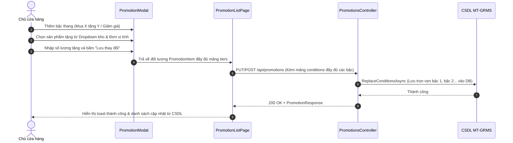
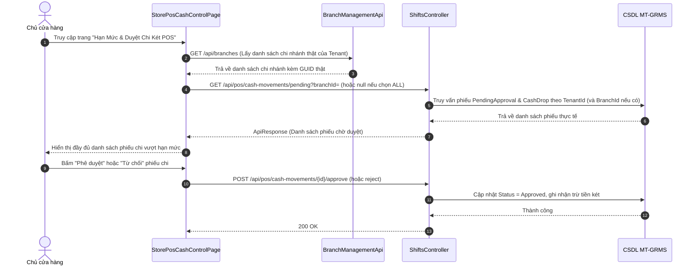

# Design Brief: pos-promotions-gift-db-and-cash-approval-sync

## 1. Luồng Người Dùng & Tương Tác Tuần Tự (User Flows)

### Flow 1: Cấu hình Khuyến mại Bậc thang & Quà tặng thực tế


### Flow 2: Kiểm soát & Phê duyệt Chi két POS đa chi nhánh


---

## 2. Thiết Kế Màn Hình & Giao Diện (Frontend UI)

### 1. `PromotionModal.tsx`: Bộ chọn Sản phẩm Tặng kèm & Đơn vị tính
- **Danh sách sản phẩm**: Nạp danh sách sản phẩm từ kho (`productApi` hoặc danh mục cache).
- **Trường quà tặng**: Thay thế text input bằng dropdown tìm kiếm sản phẩm:
  - Chọn sản phẩm (lưu `productId`, `productName`).
  - Dropdown chọn đơn vị tính (`unit`: Gói, Lon, Thùng, Chai...).
  - Input số lượng tặng (`giftQty`).
- **Bậc thang**: Mỗi bậc thang lưu `tierLevel`, `minOrderValue` (hoặc `requiredQty`), `giftProductId`, `giftProductName`, `giftUnit`, `giftQty`, `discountType`, `discountValue`.

### 2. `PromotionListPage.tsx`: Gửi đầy đủ mảng Conditions
- Trong `handleSavePromo`:
  - Map toàn bộ `savedPromo.tiers` thành mảng `PromotionConditionDto`:
    ```ts
    const conditions: PromotionConditionDto[] = savedPromo.tiers.map((t) => ({
      productId: t.giftProductId || '00000000-0000-0000-0000-000000000000',
      productName: t.giftProductName,
      productRole: savedPromo.type === 'BUY_X_GET_Y' ? 'GIFT' : 'DISCOUNT',
      minQty: t.requiredQty || t.giftQty || 1,
      discountValue: t.discountValue,
      note: t.giftUnit ? `ĐVT: ${t.giftUnit}` : undefined,
    }));
    ```
  - Truyền `conditions` vào body request của cả `createPromotion` và `updatePromotion`.
  - Khởi tạo state bằng `[]` (bỏ fallback mock `INITIAL_PROMOTIONS`).

### 3. `StorePosCashControlPage.tsx`: Chi nhánh CSDL & Xem Toàn bộ (`ALL`)
- Gọi `branchManagementApi.getBranches()` để nạp danh sách chi nhánh thực tế của Tenant.
- Khi `selectedBranchId === 'ALL'`, gọi `posShiftApi.getPendingMovements('')` (không truyền `branchId` mock).
- Hiển thị nhãn tên chi nhánh rõ ràng trên từng dòng phiếu chờ duyệt.

### 4. `VoucherBatchTable.tsx`: Tự động tải mã code thật
- Khi người dùng bấm mở chi tiết đợt voucher (`isExpanded = true`):
  - Kiểm tra nếu `batch.codes` chưa được nạp, tự động gọi `promotionApi.getVoucherCodes(batch.id)`.
  - Hiển thị danh sách mã thật, trạng thái (UNUSED, USED, EXPIRED) và thông tin khách hàng đã dùng.

### 5. `PosHeader.tsx`: Lối tắt Dashboard cho Nhân viên
- Trong menu hamburger:
  - Nếu `isStoreOwner = true`: Hiển thị *"Về Dashboard Chủ Cửa Hàng"*.
  - Nếu `!isStoreOwner`: Hiển thị *"Về Dashboard Nhân Viên"* (chuyển hướng tới `/employee/schedule` hoặc `/pos/cashier-shift`).
- Thêm icon nút nhanh cạnh thông tin ca để nhân viên có thể bấm trực tiếp.

---

## 3. Thiết Kế Backend API & DTOs

### Endpoint `GET /api/pos/cash-movements/pending` trong `ShiftsController.cs`
- Cho phép `[FromQuery] Guid? branchId = null`.
- Trong `ShiftRepository.GetPendingMovementsAsync(Guid? branchId)`:
  - Lọc theo `m.Shift.TenantId == _tenantContext.CurrentTenantId`.
  - Nếu `branchId.HasValue && branchId.Value != Guid.Empty`, lọc thêm `m.Shift.BranchId == branchId.Value`.
  - Nếu không truyền `branchId`, trả về tất cả phiếu chờ duyệt của toàn bộ chi nhánh thuộc Tenant.
