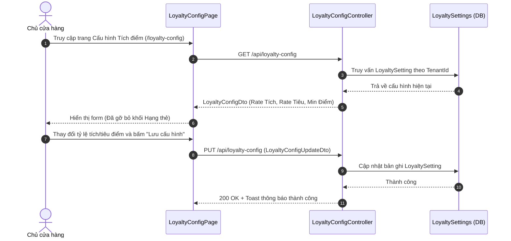
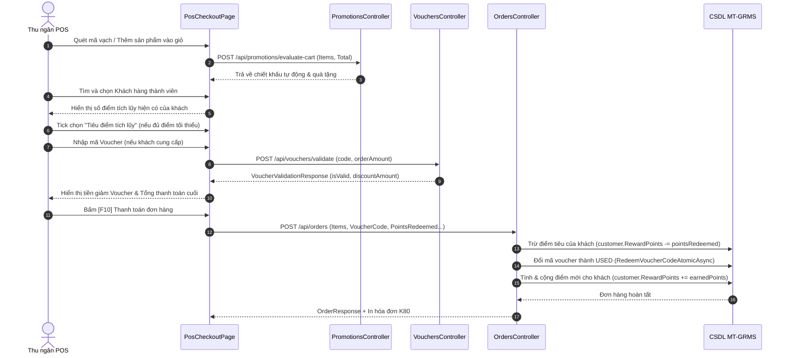

# Design Brief: pos-promotions-vouchers-loyalty-integration

## 1. Luồng Người Dùng (User Flows)

### Flow 1: Chủ cửa hàng cấu hình Tích điểm & Đổi thưởng


### Flow 2: Bán hàng POS tích hợp Khuyến mãi, Voucher & Tiêu điểm


---

## 2. Thiết Kế Màn Hình & Thành Phần UI (Frontend Components)

### 1. `LoyaltyConfigForm.tsx` (Dọn dẹp triệt để)
- **Giữ lại**:
  - `Card 1`: Trạng thái kích hoạt hệ thống tích điểm (Toggle Switch).
  - `Card 2`: Quy tắc Tích điểm (Cứ mỗi `X` VNĐ chi tiêu tích lũy được `Y` điểm thưởng).
  - `Card 3`: Quy tắc Tiêu điểm (Mỗi `1` điểm tương ứng `Z` VNĐ tiền mặt; Số điểm tối thiểu để bắt đầu tiêu là `MinRedemptionPoints`).
- **Xóa bỏ**:
  - Khối Card 3 cũ: `#membership-tiers-section` (Bảng 4 Hạng thẻ Đồng, Bạc, Vàng, Kim Cương, hệ số nhân và mức chi tiêu).
  - Loại bỏ các state và hàm xử lý `handleUpdateTierMultiplier`, `handleUpdateTierMinSpending`.

### 2. `PosPaymentPanel.tsx` (Dọn dẹp nhãn hạng)
- Dòng thông tin khách hàng:
  - Trước đây: `Điểm: 150 điểm (Bạc)`
  - Cập nhật: `Điểm tích lũy: 150 điểm` (Quy đổi: `150.000 đ`)
  - Checkbox tiêu điểm: `[ ] Dùng điểm tích lũy (-X đ)` kèm gợi ý nếu chưa đủ điểm tối thiểu (`Tối thiểu 20 điểm`).

### 3. `PosCheckoutPage.tsx` (Khép kín luồng API)
- Khi gọi `createOrder`:
  - `voucherCode`: Mã voucher đã áp dụng thành công.
  - `pointsRedeemed`: Số điểm khách hàng đã tick chọn tiêu.

---

## 3. Thiết Kế Backend API & DTOs

### 1. Endpoint Tích điểm: `LoyaltyConfigController`
- `GET /api/loyalty-config`: Lấy cấu hình của Tenant hiện tại.
- `PUT /api/loyalty-config`: Cập nhật cấu hình tích điểm.
  - Request DTO:
    ```csharp
    public record LoyaltyConfigUpdateDto(
        bool IsEnabled,
        decimal EarningRateAmount,
        int EarningPoints,
        int RedemptionRatePoints,
        decimal RedemptionRateAmount,
        int MinRedemptionPoints,
        bool AllowPointsWithPromotions
    );
    ```

### 2. Endpoint Khuyến mãi & Voucher:
- `POST /api/promotions/evaluate-cart`: Đánh giá khuyến mãi tự động cho giỏ hàng.
- `POST /api/vouchers/validate`: Thẩm định tính hợp lệ của mã voucher.
- `POST /api/orders`: Tạo đơn hàng POS, tiếp nhận `PointsRedeemed` và `VoucherCode`.

---

## 4. Quy Tắc Nghiệp Vụ (Business Rules)
1. **Quy tắc tích điểm**:
   - Chỉ áp dụng tích điểm cho đơn hàng gắn với Khách hàng (`CustomerId != null`).
   - Khách vãng lai ("Khách lẻ") không tích điểm.
   - Điểm tích lũy = $\lfloor \text{Số tiền thanh toán thực tế} / \text{EarningRateAmount} \rfloor \times \text{EarningPoints}$.
2. **Quy tắc tiêu điểm**:
   - Khách hàng phải có số điểm khả dụng $\ge$ `MinRedemptionPoints`.
   - Tiền giảm từ điểm không được vượt quá số tiền của đơn hàng.
3. **Quy tắc Voucher**:
   - Mỗi đơn hàng chỉ áp dụng 1 mã voucher duy nhất.
   - Khi đơn hàng hoàn tất, mã voucher đổi trạng thái thành `USED` và gắn với `OrderId`.
