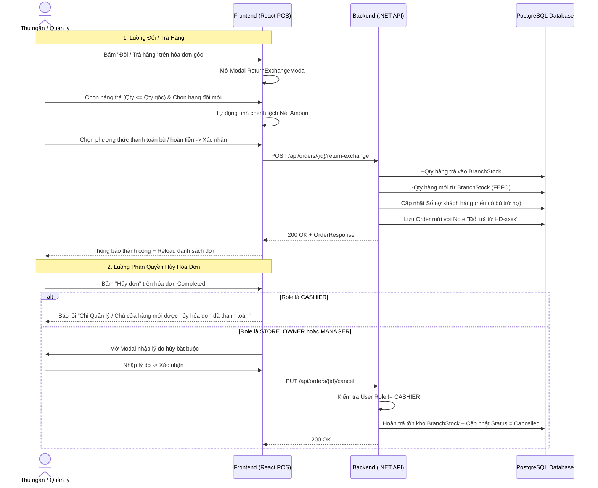

# Design Brief: Thiết Kế Nghiệp Vụ Đổi Trả Hàng, Phân Quyền Hủy Đơn & Ràng Buộc Pre-Order

## 1. Kiến Trúc & Luồng Nghiệp Vụ (User Flows)



## 2. Thiết Kế Màn Hình & Giao Diện (Frontend Components)

### 2.1. Modal Đổi / Trả Hàng (`ReturnExchangeModal.tsx`)
* **Vị trí**: Mở từ nút "Đổi / Trả hàng" trong `InvoiceManagementPage.tsx` hoặc chi tiết hóa đơn.
* **Cấu trúc 3 khối**:
  1. **Khối Hàng Khách Trả**:
     * Bảng danh sách các sản phẩm từ hóa đơn gốc.
     * Cột: Tên SP, Đơn giá đã mua, Số lượng đã mua, Số lượng muốn trả (input number từ 0 đến số lượng đã mua).
     * Tổng giá trị hàng trả ($T_{return}$).
  2. **Khối Hàng Khách Đổi Mới**:
     * Ô tìm kiếm/quét mã vạch sản phẩm catalog.
     * Bảng danh sách sản phẩm lấy mới: Tên SP, Tồn kho hiện có, Số lượng lấy, Đơn giá.
     * Tổng giá trị hàng mới ($T_{new}$).
  3. **Khối Tổng Kết Bù Trừ Chênh Lệch**:
     * Chênh lệch: $\Delta = T_{new} - T_{return}$.
     * Nếu $\Delta > 0$: "Khách cần thanh toán thêm $\Delta$ VNĐ" $\rightarrow$ Lựa chọn: Tiền mặt, VietQR, Bán nợ (nếu khách được phép nợ).
     * Nếu $\Delta < 0$: "Cửa hàng cần hoàn lại $|\Delta|$ VNĐ" $\rightarrow$ Lựa chọn: Hoàn tiền mặt, Trừ vào sổ nợ của khách.
     * Nếu $\Delta == 0$: "Chênh lệch: 0 VNĐ (Đổi ngang)".

### 2.2. Kiểm Soát Quyền Hủy Hóa Đơn (`InvoiceManagementPage.tsx`)
* Nút "Hủy hóa đơn" kiểm tra role của user hiện tại (`useAuthStore`).
* Nếu `user.role === 'CASHIER'`: Ẩn nút hủy đối với các hóa đơn có trạng thái `Completed`, chỉ hiển thị thông báo tooltip hoặc modal nhắc nhở liên hệ quản lý.
* Nếu là `STORE_OWNER`, `MANAGER`, `ADMIN`: Hiển thị nút Hủy màu đỏ kèm modal nhập lý do hủy.

### 2.3. Ràng Buộc Đơn Đặt Trước Giữ Kho (Pre-Order)
* Form tạo đơn đặt trước kiểm tra điều kiện:
  $$\text{Tiền đặt cọc} \ge 10\% \times \text{Tổng tiền đơn hàng}$$
* Nếu nhập số tiền cọc $< 10\%$, hiển thị cảnh báo đỏ và vô hiệu hóa nút "Lưu đơn đặt trước".
* Hiển thị nhãn thông tin: `Chi nhánh giữ kho & nhận hàng: [Tên chi nhánh hiện tại]`.

## 3. Thiết Kế API & DTOs (Backend)

### 3.1. DTOs
```csharp
public record ReturnExchangeRequest
{
    public List<ReturnItemDto> ReturnedItems { get; init; } = new();
    public List<ExchangeItemDto> NewItems { get; init; } = new();
    public string SettlementMethod { get; init; } = "CASH"; // CASH, VIETQR, DEBT, REFUND_CASH, REDUCE_DEBT
    public string? Note { get; init; }
}

public record ReturnItemDto(Guid ProductId, decimal Quantity, decimal UnitPrice);
public record ExchangeItemDto(Guid ProductId, decimal Quantity, decimal UnitPrice);
```

### 3.2. Endpoints
* `POST /api/orders/{id}/return-exchange`:
  * Xử lý giao dịch đổi trả:
    1. Kiểm tra hóa đơn gốc tồn tại, trạng thái `Completed`.
    2. Kiểm tra số lượng trả $\le$ số lượng đã mua.
    3. Hoàn tồn kho `BranchStocks` cho các món trả lại.
    4. Kiểm tra và trừ tồn kho `BranchStocks` theo FEFO cho các món đổi mới.
    5. Xử lý dòng tiền chênh lệch (nộp thêm hoặc thối tiền/trừ nợ).
    6. Tạo hóa đơn liên kết lưu vào DB.
* `PUT /api/orders/{id}/cancel`:
  * Bổ sung kiểm tra Role: Nếu người thực hiện là `CASHIER`, trả về `403 Forbidden` kèm thông điệp: "Thu ngân không có quyền hủy hóa đơn đã thanh toán. Vui lòng liên hệ Quản lý / Chủ cửa hàng."
* `POST /api/orders/pre-orders`:
  * Bổ sung kiểm tra cọc: Nếu `request.DepositAmount < 0.10m * finalAmount`, ném `InvalidOperationException("Tiền đặt cọc tối thiểu phải bằng 10% tổng giá trị đơn hàng.")`.
