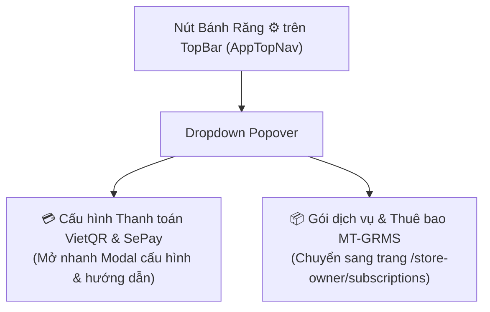

# Thiết Kế Kỹ Thuật (Design Brief): Tối Ưu Nút Bánh Răng & Mockup SePay Trực Quan (pos-sepay-ui-and-nav-refinement)

## 1. Thiết Kế Dropdown Nút Bánh Răng Trên TopBar (`AppTopNav.tsx`)



### Chi tiết tương tác:
* Khi bấm vào icon Bánh Răng: Mở menu dropdown thả xuống phía dưới nút.
* Menu có 2 mục lớn, mỗi mục có tiêu đề và mô tả ngắn gọn giúp người dùng lựa chọn đúng nhu cầu:
  1. **Thiết lập thanh toán SePay (VietQR)**: Icon `CreditCard` màu xanh ngọc, bấm vào mở trực tiếp `PaymentConfigModal`.
  2. **Gói dịch vụ & Gian hàng**: Icon `Boxes` màu xanh dương, bấm vào chuyển hướng sang `/store-owner/subscriptions`.

---

## 2. Thiết Kế Tab Mới Trong Trang Quản Trị Gian Hàng (`StoreSettingsHubPage.tsx`)

### Mở rộng `StoreSidebarNav.tsx`:
* Thêm tab key: `'payment-config'`.
* Đặt trong nhóm "Gian hàng & Thanh toán":
  ```tsx
  <button className={`store-sidebar-item ${activeTab === 'payment-config' ? 'active' : ''}`}>
    <CreditCard size={18} />
    <span>Tài khoản thanh toán VietQR</span>
  </button>
  ```
* Trong `StoreSettingsHubPage.tsx`:
  * Render giao diện thiết lập tài khoản ngân hàng và SePay trực tiếp trong tab này, giúp chủ tiệm quản lý tập trung bên cạnh thông tin gian hàng và gói dịch vụ.

---

## 3. Thiết Kế Mockup Giao Diện SePay Trực Quan (`PaymentConfigModal.tsx`)

Thay vì các đoạn chữ mô tả thông thường, Tab 2 "Hướng dẫn đăng ký SePay" được nâng cấp với **2 Khung Mockup UI SePay chân thực**:

### Khung Mockup 1: Bảng Điều Khiển SePay - Màn Hình Lấy API Key
* Thiết kế mô phỏng giao diện web `my.sepay.vn`:
  - **Header SePay**: Logo SePay màu xanh lam, tên tài khoản chủ quán.
  - **Menu bên trái SePay**: Đánh dấu nổi bật mục **Tích hợp Web → API Key**.
  - **Nội dung chính**:
    * Nút màu xanh dương: `+ Tạo API Key`.
    * Thẻ hiển thị mã API Key: `sepay_apikey_••••••••••••x8k2` kèm nút `Sao chép`.
    * **Hộp Callout Mũi tên Vàng/Đỏ nổi bật**: `👉 BƯỚC 3: Bấm nút 'Sao chép' mã này rồi quay lại Tab 'Cấu hình' dán vào ô SePay API Key!`.

### Khung Mockup 2: Bảng Điều Khiển SePay - Màn Hình Cấu Hình Webhook
* Mô phỏng form tạo Webhook của SePay:
  - Menu được chọn: **Tích hợp Web → Webhooks**.
  - Form nhập liệu:
    * Ô nhập **URL Webhook**: Hiển thị đường dẫn link của cửa hàng kèm huy hiệu `👉 BƯỚC 4: Dán đường dẫn Webhook của MT-Mart vào đây`.
    * Checkbox sự kiện: Chọn `[x] Giao dịch nhận tiền (Receive money)`.
    * Nút bấm: `💾 Thêm Webhook`.
* Giúp người dùng nhìn qua một lần là nhận diện ngay các vị trí cần bấm trên trang SePay thật mà không bị nhầm lẫn.
