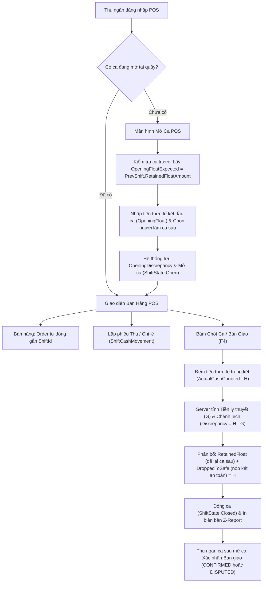

# Bản Thiết Kế Chi Tiết (Design Brief): Quản Lý Ca POS & Thu Chi Két

## 1. Luồng Nghiệp Vụ Người Dùng (User Flows)

## 2. Thiết Kế Cơ Sở Dữ Liệu (Database Schema)

### A. Thực thể mẹ: `ShiftZReports` (Cập nhật)
| Cột | Kiểu | Ràng buộc | Diễn giải |
|---|---|---|---|
| `Id` | Guid | PK | Mã định danh Z-Report |
| `TenantId` | string | FK | Phân lập tenant đa cửa hàng |
| `BranchId` | Guid | FK, Not Null | Chi nhánh quầy bán hàng (Ba Đình, Cầu Giấy...) |
| `TillId` | Guid | Not Null | Mã quầy thu ngân (Quầy #01) |
| `ShiftCode` | string | Not Null | Mã ca (VD: CA-20261106-01) |
| `ShiftName` | string | Not Null | Tên ca (Ca Sáng, Ca Chiều, Ca Tối) |
| `CashierUserId` | Guid/string | Not Null | Thu ngân chịu trách nhiệm mở ca |
| `ReceiverUserId` | string | Nullable | Nhân viên dự kiến nhận bàn giao ca sau |
| `PrevShiftId` | Guid? | FK, Nullable | Ca liền trước để khép kín chuỗi tiền két |
| `OpenedAtUtc` | DateTime | Not Null | Thời điểm mở ca |
| `ClosedAtUtc` | DateTime? | Nullable | Thời điểm đóng ca |
| `OpeningFloatExpected` | decimal | Not Null, Default 0 | Số tiền ca trước để lại (`prevShift.RetainedFloatAmount`) |
| `OpeningFloat` | decimal | Not Null | Số tiền thực đếm khi mở ca |
| `OpeningDiscrepancy` | decimal | Not Null, Default 0 | Chênh lệch mở ca (`OpeningFloat - OpeningFloatExpected`) |
| `TotalCashIn` | decimal | Not Null, Default 0 | Tổng các khoản nạp tiền lẻ / thu tiền vào ($C$) |
| `TotalCashOut` | decimal | Not Null, Default 0 | Tổng các khoản chi vặt / rút két nộp chủ ($D$) |
| `TotalBankRevenue` | decimal | Not Null, Default 0 | Doanh thu VietQR/Chuyển khoản (không tính vào két tiền mặt) |
| `TotalOrdersCount` | int | Not Null, Default 0 | Tổng số hóa đơn phát sinh trong ca |
| `ExpectedCash` | decimal | Not Null, Default 0 | Tiền mặt lý thuyết hệ thống tính ($G$) |
| `ActualCashCounted` | decimal? | Nullable | Tiền mặt thực tế đếm cuối ca ($H$) |
| `Discrepancy` | decimal? | Nullable | Chênh lệch chốt ca ($H - G$) |
| `RetainedFloatAmount` | decimal | Not Null, Default 0 | Tiền mặt giữ lại két cho ca kế tiếp |
| `DroppedToSafeAmount` | decimal | Not Null, Default 0 | Tiền mặt rút nộp vào két an toàn của chủ shop |
| `HandoverStatus` | string | Not Null, Default 'PENDING' | Trạng thái bàn giao (`PENDING`, `CONFIRMED`, `DISPUTED`) |
| `Status` | ShiftState | Not Null | `Open`, `Closing`, `Closed`, `ForceClosed` |
| `Notes` | string? | Nullable | Ghi chú ca làm việc / giải trình chênh lệch |

### B. Thực thể con: `ShiftCashMovements` (Bảng mới)
| Cột | Kiểu | Ràng buộc | Diễn giải |
|---|---|---|---|
| `Id` | Guid | PK | Mã định danh phiếu thu chi |
| `TenantId` | string | FK | Phân lập tenant |
| `ShiftId` | Guid | FK, Not Null | Khóa ngoại liên kết `ShiftZReports.Id` |
| `MovementType` | string | Not Null | `IN` (Tiền vào) hoặc `OUT` (Tiền ra) |
| `Category` | string | Not Null | `EXPENSE` (Chi vặt), `CASH_DRAW` (Rút nộp chủ), `CASH_DEPOSIT` (Nạp tiền lẻ), `DEBT_COLLECT` (Thu nợ) |
| `Amount` | decimal | Not Null (> 0) | Số tiền giao dịch |
| `Reason` | string | Not Null | Lý do thu/chi cụ thể |
| `CreatedBy` | string? | Nullable | Tên/ID thu ngân thực hiện phiếu |
| `OccurredAtUtc` | DateTime | Not Null | Thời điểm phát sinh giao dịch |

### C. Thực thể bán lẻ: `Orders` (Cập nhật)
- Bổ sung cột: `ShiftId` (`Guid?`, Nullable, FK trỏ `ShiftZReports.Id`).
- Khi thanh toán POS: Tự động gán `ShiftId = currentActiveShift.Id`.

## 3. Thiết Kế Endpoints & DTOs

### Endpoints
1. `GET /api/pos/shifts/current?branchId={branchId}&tillId={tillId}`: Lấy thông tin ca đang mở của quầy.
2. `POST /api/pos/shifts/open`: Mở ca mới.
   - Body: `{ branchId, tillId, shiftName, openingFloat, notes }`
3. `POST /api/pos/shifts/{id}/cash-movements`: Thêm phiếu thu / chi tiền mặt.
   - Body: `{ movementType: "IN"|"OUT", category, amount, reason }`
4. `POST /api/pos/shifts/{id}/close`: Chốt ca làm việc.
   - Body: `{ actualCashCounted, retainedFloatAmount, droppedToSafeAmount, receiverUserId, notes }`
5. `POST /api/pos/shifts/{id}/confirm-handover`: Người ca sau xác nhận tiền bàn giao.
   - Body: `{ status: "CONFIRMED"|"DISPUTED", disputeReason }`
6. `GET /api/pos/shifts/{id}/z-report`: Xem chi tiết biên bản Z-Report và danh sách thu chi.

## 4. Quy Tắc Nghiệp Vụ & Ràng Buộc Khắt Khe
1. **Ràng buộc duy nhất 1 ca mở**: Mỗi quầy thu ngân (`BranchId`, `TillId`) tại một thời điểm chỉ cho phép tối đa 1 ca ở trạng thái `Open`.
2. **Khép kín chuỗi tiền**: Ca mở mới tự động lấy `prevShift = GetLatestClosedShift(branchId, tillId)`.
   - `OpeningFloatExpected = prevShift.RetainedFloatAmount`.
   - `OpeningDiscrepancy = OpeningFloat - OpeningFloatExpected`.
3. **Công thức tính tiền lý thuyết chốt ca ($G$)**:
   $$G = \text{OpeningFloat} + \text{CashSalesRevenue} + \text{TotalCashIn} - \text{TotalCashOut} - \text{RefundCashAmount}$$
4. **Ràng buộc phân bổ tiền chốt ca**:
   $$\text{RetainedFloatAmount} + \text{DroppedToSafeAmount} = \text{ActualCashCounted}$$
   Nếu không khớp, API lập tức từ chối với lỗi HTTP 400 Bad Request.
