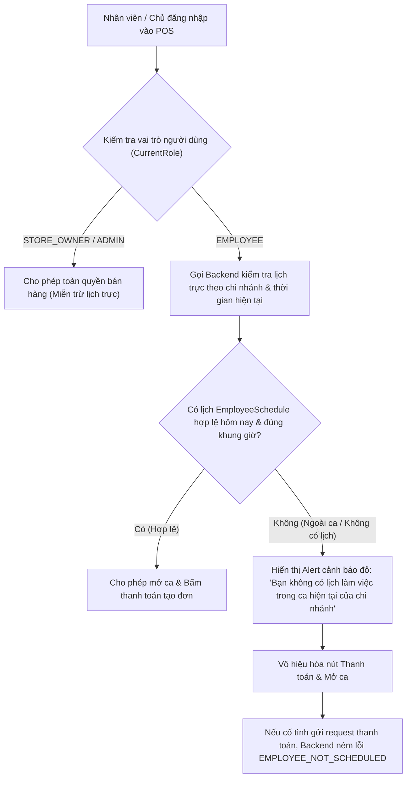

# Thiết Kế Chi Tiết (Design Brief): Cơ Chế Chặn Cứng Nhân Viên Không Có Lịch Trực Vào Bán Hàng POS

## 1. Luồng Người Dùng (User Flows)



---

## 2. Thiết Kế Backend API & Service Layer

### 2.1. Service Xác Thực: `IShiftService` / `IScheduleService`
Thêm hàm nghiệp vụ:
```csharp
Task<CashierShiftEligibilityDto> CheckCashierShiftEligibilityAsync(
    Guid branchId,
    Guid userId,
    string? userRole,
    CancellationToken cancellationToken = default);
```

#### Quy tắc nghiệp vụ (Business Rules):
1. **Kiểm tra quyền miễn trừ**:
   - Nếu `userRole` thuộc `{ "STORE_OWNER", "OWNER", "ADMIN" }` $\rightarrow$ Trả về `IsAllowed = true, IsExempt = true, Reason = null`.
2. **Tìm kiếm hồ sơ nhân viên (`Employee`)**:
   - Tìm kiếm `Employee` theo `UserId == userId.ToString()` hoặc `Id == userId`.
   - Nếu không tìm thấy $\rightarrow$ `IsAllowed = false, Reason = "Tài khoản chưa được liên kết với hồ sơ nhân viên tại chi nhánh."`.
3. **Đối soát Lịch làm việc (`EmployeeSchedule`)**:
   - Lấy thời gian hiện tại theo múi giờ Việt Nam (`DateTime.UtcNow.AddHours(7)`):
     - `currentLocalDate = nowVn.Date`
     - `currentTimeOfDay = nowVn.TimeOfDay`
   - Tìm danh sách `EmployeeSchedule` trong ngày:
     - `TenantId == currentTenantId`
     - `BranchId == branchId`
     - `EmployeeId == employee.Id`
     - `WorkDate == currentLocalDate`
     - `Status != ScheduleStatus.Cancelled`
   - **Xác định khung giờ hợp lệ kèm dung sai 30 phút**:
     - $\text{TimeWindowStart} = \text{PlannedStartTime} - 30\text{ phút}$ (hoặc `AllowedCheckInStart` nếu đã thiết lập)
     - $\text{TimeWindowEnd} = \text{PlannedEndTime} + 30\text{ phút}$ (hoặc `AllowedCheckInEnd` nếu đã thiết lập)
     - **Ca thông thường (trong ngày)**:
       $$\text{TimeWindowStart} \le \text{currentTimeOfDay} \le \text{TimeWindowEnd}$$
     - **Ca qua đêm (`IsCheckInNextDay == true`)**:
       $$\text{currentTimeOfDay} \ge \text{TimeWindowStart} \quad\text{HOẶC}\quad \text{currentTimeOfDay} \le \text{TimeWindowEnd}$$
4. **Kết luận**:
   - Nếu tìm thấy ít nhất 1 ca thỏa mãn $\rightarrow$ `IsAllowed = true, ActiveSchedule = schedule`.
   - Nếu không thỏa mãn ca nào $\rightarrow$ `IsAllowed = false, Reason = "Bạn không có lịch làm việc trong ca hiện tại của chi nhánh."`.

### 2.2. Kiểm Tra Chặn Cứng Tại `OrderService.CreateOrderAsync`
- Ngay sau bước kiểm tra chi nhánh và ca đang mở (`activeShift`), gọi hàm xác thực tính đủ điều kiện bán hàng:
  ```csharp
  var eligibility = await _shiftService.CheckCashierShiftEligibilityAsync(
      branchId,
      _tenantContext.CurrentUserId,
      _tenantContext.CurrentRole,
      cancellationToken);

  if (!eligibility.IsAllowed)
  {
      throw new BusinessException(
          "EMPLOYEE_NOT_SCHEDULED",
          eligibility.Reason ?? "Bạn không có lịch làm việc trong ca hiện tại của chi nhánh.");
  }
  ```

### 2.3. Endpoint Mới Trong `ShiftsController.cs`
- `GET /api/shifts/cashier-eligibility?branchId={branchId}`
- **Response DTO (`CashierShiftEligibilityDto`)**:
  ```json
  {
    "isAllowed": true,
    "isExempt": false,
    "role": "EMPLOYEE",
    "employeeName": "Phạm Thị Yến",
    "reason": null,
    "activeShift": {
      "shiftCode": "CA_SANG",
      "shiftName": "Ca Sáng",
      "plannedStartTime": "08:00:00",
      "plannedEndTime": "12:00:00"
    }
  }
  ```

---

## 3. Thiết Kế Frontend UI (`PosCheckoutPage.tsx`)

### 3.1. Gọi API Kiểm Tra Điều Kiện Khi Tải Màn Hình
- Khi trang `PosCheckoutPage` tải (hoặc khi người dùng thay đổi chi nhánh), trigger gọi API `shiftApi.checkCashierEligibility(branchId)`.
- Lưu state: `cashierEligibility: CashierShiftEligibilityDto | null`.

### 3.2. Hiển Thị Banner Cảnh Báo (Ant Design `Alert`)
- Nếu `cashierEligibility && !cashierEligibility.isAllowed`:
  - Hiển thị `Alert` cố định ngay dưới header POS:
    - `type="error"`
    - `showIcon`
    - `message="Không đủ quyền bán hàng trong ca hiện tại"`
    - `description="Bạn không có lịch làm việc trong ca hiện tại của chi nhánh này. Vui lòng liên hệ Quản lý / Chủ cửa hàng nếu có sự thay đổi ca trực."`
- Nút **"Thanh toán (F9)"**:
  - `disabled={!cashierEligibility.isAllowed}`
  - Tooltip: *"Bị khóa do bạn không có lịch trực ca hiện tại"*

---

## 4. Thiết Kế Cơ Sở Dữ Liệu & Migration
- **Không cần tạo bảng mới**: Bảng `EmployeeSchedules` đã có sẵn đầy đủ các cột:
  - `TenantId`, `BranchID`, `EmployeeID`, `WorkDate`, `PlannedStartTime`, `PlannedEndTime`, `AllowedCheckInStart`, `AllowedCheckInEnd`, `IsCheckInNextDay`, `Status`.
- **Chỉ cần bổ sung seed data**: Tạo các ca trực mẫu ngày hôm nay và tương lai cho nhân viên Ba Đình trong `DbInitializer.cs` để hỗ trợ kiểm thử.
