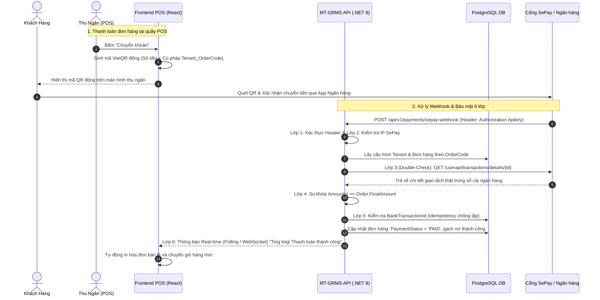

# Thiết Kế Kỹ Thuật (Design Brief): Tích Hợp Thanh Toán VietQR Tự Động & Cổng SePay (pos-vietqr-sepay-payment-and-settings)

## 1. Tổng Quan Kiến Trúc & Luồng Dữ Liệu (Architecture Overview)



---

## 2. Thiết Kế Giao Diện Người Dùng (UI / UX Components)

### Component 1: `PaymentConfigModal` (Modal Cấu hình & Hướng dẫn SePay)
* **Vị trí kích hoạt:**
  - Nút Bánh răng Settings trên thanh Header POS (`PosHeader.tsx`) dành cho `STORE_OWNER`.
  - Tab "Cài đặt thanh toán chuyển khoản" trong `StoreSettingsHubPage.tsx`.
* **Cấu trúc 2 Tab:**
  1. **Tab 1: Thiết Lập Tài Khoản Ngân Hàng**
     * Chọn Ngân hàng thụ hưởng: Dropdown hỗ trợ các ngân hàng lớn (MBBank, Vietcombank, Vietinbank, BIDV, Techcombank, ACB, TPBank, VPBank, Sacombank, OCB...).
     * Số tài khoản: Ô nhập số tài khoản ngân hàng của Chủ tiệm.
     * Tên chủ tài khoản: Tự động viết hoa không dấu.
     * SePay API Key: Ô nhập có toggle ẩn/hiện, tự động che dạng `sepay_apikey_••••••••••••`.
     * Đường dẫn Webhook hệ thống: Ô text chỉ đọc kèm nút "Sao chép Webhook URL" 1 chạm (`https://api.mtmart.vn/api/v1/payments/sepay-webhook`).
     * Công tắc: "Kích hoạt nhận diện thanh toán tự động".
  2. **Tab 2: Hướng Dẫn Đăng Ký SePay (5 Bước A-Z)**
     * Hướng dẫn trực quan từng bước: Truy cập `sepay.vn` $\rightarrow$ Thêm tài khoản ngân hàng $\rightarrow$ Tạo API Key $\rightarrow$ Dán Webhook URL $\rightarrow$ Quét thử mã QR.
     * Có các lưu ý quan trọng về bảo mật: Quyền Read-only không rút tiền được, hoàn toàn an tâm.

### Component 2: `VietQrPaymentModal` (Modal Quét Mã QR Động Tại Quầy POS)
* **Hiển thị:**
  - Hình ảnh mã VietQR động sinh chuẩn Napas 247:
    `https://img.vietqr.io/image/{bankCode}-{accountNo}-compact2.png?amount={finalAmount}&addInfo={tenantPrefix}_{orderCode}`
  - Khối thông tin đối chiếu: Số tiền cần chuyển (VND), Số tài khoản, Chủ tài khoản, Nội dung chuyển khoản.
  - Vòng xoay Pulse trạng thái: "Đang chờ khách quét mã thanh toán...".
  - Nút thao tác dự phòng:
    * "Kiểm tra thanh toán ngay" (Trigger gọi API đối soát thủ công nếu khách vừa bấm chuyển xong).
    * "Xác nhận đã nhận tiền mặt/chuyển khoản ngoài" (Thu ngân xác nhận thủ công nếu mạng ngân hàng chậm).

---

## 3. Thiết Kế API & DTO (Backend Contracts)

### Endpoint 1: Lấy cấu hình thanh toán của Cửa hàng
* **URL:** `GET /api/v1/payments/config`
* **Quyền:** `STORE_OWNER`
* **Response DTO:**
  ```json
  {
    "statusCode": 200,
    "success": true,
    "data": {
      "tenantId": "tenant_an_nhien_02",
      "bankCode": "MB",
      "bankName": "MBBank - Ngân hàng Quân Đội",
      "bankAccountNumber": "0918889999",
      "bankAccountName": "NGUYEN AN NHIEN",
      "sepayApiKeyMasked": "sepay_apikey_••••••••••••9999",
      "webhookUrl": "https://api.mtmart.vn/api/v1/payments/sepay-webhook",
      "isActive": true
    }
  }
  ```

### Endpoint 2: Cập nhật cấu hình thanh toán
* **URL:** `POST /api/v1/payments/config`
* **Quyền:** `STORE_OWNER`
* **Request DTO:**
  ```json
  {
    "bankCode": "MB",
    "bankAccountNumber": "0918889999",
    "bankAccountName": "NGUYEN AN NHIEN",
    "sepayApiKey": "sepay_apikey_abcdef1234567890",
    "isActive": true
  }
  ```

### Endpoint 3: Webhook tiếp nhận thanh toán từ SePay
* **URL:** `POST /api/v1/payments/sepay-webhook`
* **Header:** `Authorization: Apikey <SepayApiKey>`
* **Payload SePay gửi:**
  ```json
  {
    "id": 128491,
    "gateway": "MBBank",
    "transactionDate": "2026-11-02 16:30:00",
    "accountNumber": "0918889999",
    "subAccount": null,
    "amountIn": 250000.00,
    "amountOut": 0.00,
    "accumulated": 5420000.00,
    "code": null,
    "transactionContent": "AN02_HD1005 Thanh toan don rau cu",
    "referenceNumber": "FT263068899011",
    "body": "..."
  }
  ```

---

## 4. Thiết Kế Cơ Sở Dữ Liệu (Database Schema)

### Entity `StorePaymentConfig`
* `Id` (Guid, PK)
* `TenantId` (string, Unique Index, FK -> Tenant)
* `BankCode` (string, max 20)
* `BankAccountNumber` (string, max 50)
* `BankAccountName` (string, max 100)
* `SepayApiKeyEncrypted` (string, TEXT - lưu AES-256)
* `SepayWebhookSecret` (string, max 100)
* `IsActive` (bool, default true)
* `CreatedAt`, `UpdatedAt` (DateTime UTC)

### Entity `PaymentTransaction`
* `Id` (Guid, PK)
* `TenantId` (string, Index)
* `OrderId` (Guid, Index, FK -> Orders)
* `BankTransactionId` (string, Unique Index - mã giao dịch SePay/Ngân hàng)
* `Gateway` (string, max 50)
* `AmountIn` (decimal 18,2)
* `TransactionContent` (string, max 500)
* `ReferenceNumber` (string, max 100)
* `TransactionDate` (DateTime UTC)
* `VerifiedBySepayApi` (bool)
* `CreatedAt` (DateTime UTC)

---

## 5. Quy Tắc Nghiệp Vụ & Phân Quyền (Business Rules & RBAC)
1. **Phân quyền chặt chẽ:** Chỉ có vai trò `STORE_OWNER` mới có quyền xem, sửa cấu hình tài khoản và API Key SePay. Thu ngân (`EMPLOYEE` / `CASHIER`) chỉ có quyền tạo mã QR và xem thông báo thanh toán đơn hàng.
2. **Quy tắc phân lập hóa đơn Multi-Tenant:** Nội dung chuyển khoản bắt buộc bắt đầu bằng tiền tố định danh của Tenant (VD: `AN02_HD1005` cho An Nhiên Mart, `MT01_HD1005` cho MT-Mart). Nhờ đó, Backend bóc tách ngay được cửa hàng nhận tiền và đơn hàng tương ứng.
3. **Cơ chế Fallback Offline-First:** Nếu không kết nối được Backend, Frontend vẫn cho phép hiển thị mã VietQR động từ thông tin cấu hình local của cửa hàng và cho phép thu ngân xác nhận hoàn tất đơn hàng thủ công.
