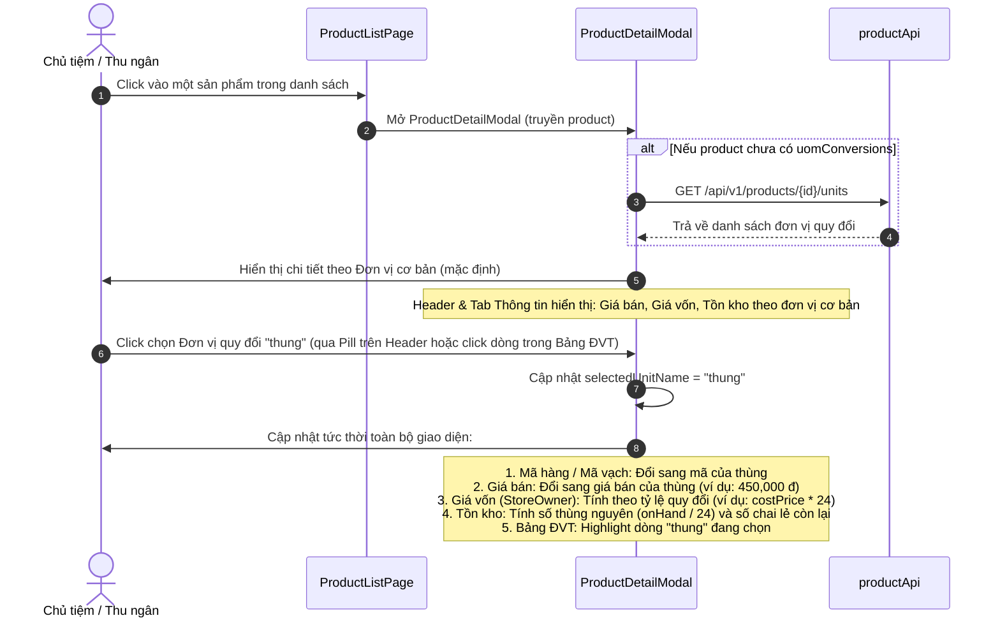

# Design Brief: product-management-ui
## Giao diện Danh sách Hàng hóa, Bộ lọc & Xem Chi tiết Sản phẩm theo Đơn vị tính

## 1. Luồng Tương tác Người dùng

---

## 2. Kiến trúc Giao diện & Trạng thái Component (`ProductDetailModal.tsx`)

### 2.1 Vị trí Bộ chọn Đơn vị tính (Unit Switcher)
1. **Thanh Header tổng quan**:
   - Bên cạnh tên sản phẩm, hiển thị dải nút bấm chọn đơn vị (Segmented Pills):
     - `[ chai (Cơ bản) ]` (active: màu nền `#0F766E`, chữ trắng)
     - `[ thung ]` (inactive: nền `#F1F5F9`, chữ `#475569`, hover nền `#E2E8F0`)
   - Nếu sản phẩm không có đơn vị quy đổi: Chỉ hiển thị nhãn đơn vị cơ bản không có pill chuyển đổi.
2. **Bảng "Đơn vị tính & Quy đổi giá" (Tab Thông tin)**:
   - Các dòng trong bảng có thể click được (`cursor: pointer`).
   - Dòng đơn vị đang được kích hoạt sẽ có:
     - Nền xanh nhạt `#F0FDFA`.
     - Chữ in đậm và có huy hiệu (Badge) `Đang xem` màu xanh ngọc `#0F766E`.

### 2.2 Các Chỉ số Thay đổi theo Đơn vị Tính

| Chỉ số | Khi chọn Đơn vị cơ bản | Khi chọn Đơn vị quy đổi ($K = \text{conversionRate}$) | Ghi chú bảo mật & Nghiệp vụ |
|---|---|---|---|
| **Mã hàng (Product Code)** | `product.productCode` | `uom.productCode || product.productCode` | Đơn vị quy đổi có thể có mã quản lý SKU riêng |
| **Mã vạch (Barcode)** | `product.barcode` | `uom.barcode || '—'` | Đơn vị quy đổi có thể có mã vạch riêng (ví dụ: mã vạch thùng) |
| **Giá bán (Selling Price)** | `product.sellingPrice` | `uom.price` | Hiển thị cả ở Header và Tab Thông tin |
| **Giá vốn (Cost Price)** | `product.costPrice` | `product.costPrice * K` | **BR-SEC-01**: Chỉ hiển thị nếu `userRole === 'StoreOwner'` |
| **Tồn kho hiện tại** | `{product.onHand} {product.baseUnit}` | `{Math.floor(onHand / K)} {uom.unitName}` | Kèm dòng phụ: `(Còn dư {onHand % K} {product.baseUnit})` nếu số lẻ $> 0$ |
| **Tên hiển thị** | `{product.productName}` | `{product.productName} - {uom.unitName}` | Giúp người dùng phân biệt rõ đơn vị đang xem |

---

## 3. Quy tắc Nghiệp vụ (Business Rules)
1. **REQ-08 (Switch Đơn vị tính trong ProductDetailModal)**:
   - Cho phép người dùng chuyển đổi đơn vị tính mượt mà.
   - Toàn bộ thông tin hiển thị (Mã hàng, Mã vạch, Giá bán, Giá vốn, Tồn kho) phải đồng bộ tức thời với đơn vị được chọn.
2. **BR-SEC-01 (Bảo mật Giá vốn)**:
   - Nghiêm cấm hiển thị giá vốn quy đổi cho người dùng có vai trò `Cashier` hoặc `Staff`.
3. **Quy đổi Tồn kho chuẩn xác**:
   - Tồn kho theo đơn vị quy đổi làm tròn xuống số nguyên: $\lfloor \text{onHand} / K \rfloor$.
   - Hiển thị rõ số lượng lẻ theo đơn vị cơ bản để nhân viên kho và thu ngân kiểm kê chính xác.
