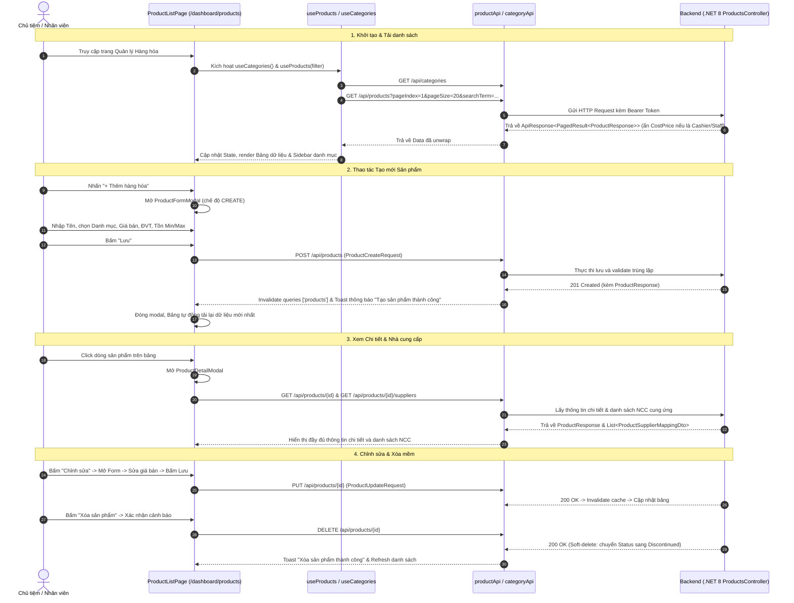

# Design Brief: product-management-ui
## Hoàn thiện Giao diện Quản lý Hàng hóa (Product Catalog Management UI) kết nối Backend Thực tế

## 1. Luồng Người dùng & Tuần tự Tương tác (Sequence Diagram)



---

## 2. Kiến trúc Module Frontend (`src/features/product/`)

Module được cấu trúc chuẩn Clean UI và tuân thủ các quy tắc trong codebase:

```
src/features/product/
├── api/
│   ├── productApi.ts                 # Gọi HTTP client tới /api/products (CRUD, Paging, Suppliers)
│   └── categoryApi.ts                # Gọi HTTP client tới /api/categories (Flat List)
├── types/
│   └── index.ts                      # Interfaces đồng bộ 100% với DTOs C# (ProductResponse, Create/Update/Filter)
├── hooks/
│   ├── useProducts.ts                # React Query hook lấy danh sách có phân trang và debounced search
│   ├── useProductDetail.ts           # React Query hook lấy chi tiết sản phẩm và danh sách nhà cung cấp
│   ├── useCategories.ts              # React Query hook lấy danh mục phẳng
│   └── useProductMutations.ts        # React Query mutations (create, update, delete)
├── components/
│   ├── CategorySidebar.tsx           # Sidebar hiển thị danh mục phẳng kèm số lượng sản phẩm, nút chọn "Tất cả"
│   ├── ProductTable.tsx              # Bảng sản phẩm phân trang, render có điều kiện cột Giá vốn (BR-SEC-01)
│   ├── ProductFormModal.tsx          # Modal Thêm/Sửa sản phẩm với form validation chuẩn
│   ├── ProductDetailModal.tsx        # Modal xem chi tiết sản phẩm 360 độ và tab Nhà cung cấp liên kết
│   └── CategoryModal.tsx             # Modal tạo nhanh danh mục mới nếu cần
├── pages/
│   └── ProductListPage.tsx           # Trang tổng hợp: Header, FilterBar, CategorySidebar, ProductTable, Modals
├── product.css                       # Styles bổ trợ giao diện
└── index.ts                          # Export public của feature
```

---

## 3. Bảng Ánh xạ API Endpoints & UI Components

| UI Component | Tác vụ Người dùng | Endpoint Backend | Request Payload | Response Data |
|---|---|---|---|---|
| `ProductListPage` | Tải danh sách sản phẩm | `GET /api/products` | `ProductQueryFilter` (searchTerm, categoryId, status, pageIndex, pageSize) | `ApiResponse<PagedResult<ProductResponse>>` |
| `CategorySidebar` | Tải danh sách nhóm hàng | `GET /api/categories` | Không | `ApiResponse<IReadOnlyList<CategoryDto>>` |
| `ProductFormModal` | Thêm mới sản phẩm | `POST /api/products` | `ProductCreateRequest` (name, categoryId, sellingPrice, baseUnit, costPrice, minStock, maxStock, vatRate...) | `ApiResponse<ProductResponse>` |
| `ProductFormModal` | Cập nhật sản phẩm | `PUT /api/products/{id}` | `ProductUpdateRequest` (name, categoryId, sellingPrice, costPrice, minStock, maxStock, status...) | `ApiResponse<ProductResponse>` |
| `ProductDetailModal` | Xem chi tiết sản phẩm | `GET /api/products/{id}` | Không | `ApiResponse<ProductResponse>` |
| `ProductDetailModal` | Tra cứu nhà cung cấp | `GET /api/products/{id}/suppliers` | Query: `onlyActive=false` | `ApiResponse<IReadOnlyList<ProductSupplierMappingDto>>` |
| `ProductTable` / Action | Xóa sản phẩm | `DELETE /api/products/{id}` | Không | `ApiResponse<object>` (Soft delete) |

---

## 4. Xử lý Quy tắc Nghiệp vụ & Bảo mật (Business Rules Implementation)

### 4.1. Phân quyền Giá vốn COGS ([BR-SEC-01](file:///d:/FPT_uni/Sesmester_9_Fall_26/File/doc/Report/Report-3_Software%20Requirement%20Specification.docx.md#L4759))
- **Nguyên tắc:** Nhân viên thu ngân (`Cashier`, `Staff`) tuyệt đối không được xem hoặc chỉnh sửa giá vốn.
- **Frontend Thực thi:**
  - Kiểm tra vai trò người dùng từ auth store: `const canViewCostPrice = user?.role === 'StoreOwner' || user?.role === 'Admin'`.
  - Trên `ProductTable`: Ẩn cột **"Giá vốn"** và không hiển thị số tiền lãi dự tính.
  - Trên `ProductFormModal`: Nếu `!canViewCostPrice`, ẩn ô nhập `Giá vốn (CostPrice)`.
  - Trên `ProductDetailModal`: Ẩn thông tin giá vốn tài chính.

### 4.2. Bất biến Đơn vị tính cơ sở ([BR-PROD-01](file:///d:/FPT_uni/Sesmester_9_Fall_26/File/doc/Report/Report-3_Software%20Requirement%20Specification.docx.md#L4760))
- Khi ở chế độ chỉnh sửa (`isEditMode = true`):
  - Khóa (disabled) trường `BaseUnit` nếu sản phẩm đã phát sinh giao dịch tồn kho/bán hàng (hoặc hiển thị cảnh báo giải thích).

### 4.3. Bảo toàn Dữ liệu Lịch sử & Xóa mềm ([BR-DATA-01](file:///d:/FPT_uni/Sesmester_9_Fall_26/File/doc/Report/Report-3_Software%20Requirement%20Specification.docx.md#L4763))
- Khi người dùng bấm xóa sản phẩm, hiển thị hộp thoại xác nhận rõ ràng: "Sản phẩm sẽ được chuyển sang trạng thái Ngừng kinh doanh (Discontinued) để bảo lưu lịch sử giao dịch".
- Gọi `DELETE /api/products/{id}` -> Backend cập nhật `Status = 'Discontinued'`.

---

## 5. Trạng thái Giao diện (UI States)

- **Loading State:**
  - Danh sách bảng hiển thị Skeleton loader hoặc hiệu ứng mờ kèm spinner.
  - Các nút hành động trong Modal hiển thị trạng thái `isSubmitting` / `isPending` để chống double submit.
- **Empty State:**
  - Khi chưa có sản phẩm hoặc bộ lọc không tìm thấy kết quả: Hiển thị hình minh họa trống kèm thông điệp "Không tìm thấy hàng hóa phù hợp" và nút gợi ý "+ Thêm hàng hóa mới".
- **Error Handling & Feedback:**
  - Lỗi mạng hoặc lỗi server: Hiển thị Alert đỏ thông báo lỗi và nút "Thử lại".
  - Lỗi Validation từ backend (trùng mã vạch, thiếu trường bắt buộc): Toast lỗi hoặc hiển thị text cảnh báo màu đỏ ngay dưới ô nhập liệu.
  - Thành công: Hiển thị Toast thông báo xanh và tự động làm mới dữ liệu.
