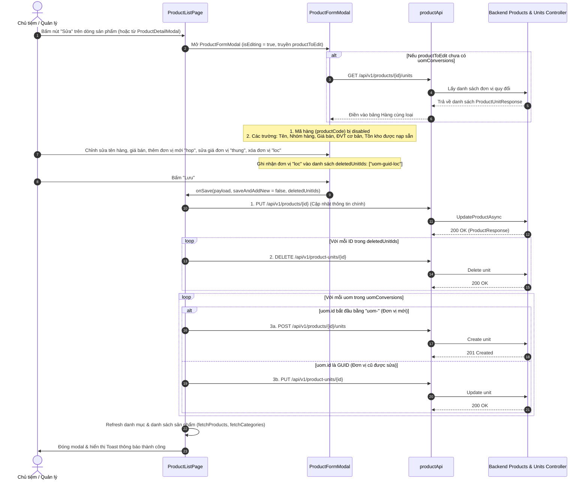

# Design Brief: product-management-ui
## Giao diện Danh sách Hàng hóa, Bộ lọc, Chi tiết & Cập nhật Hàng hóa (Update Product)

## 1. Luồng Tương tác Cập nhật Hàng hóa (Sequence Diagram)

---

## 2. Kiến trúc Giao diện Cập nhật trong `ProductFormModal.tsx`

### 2.1 Trạng thái các trường dữ liệu ở chế độ Chỉnh sửa (`isEditing = true`)
1. **Tiêu đề Modal**:
   - Chuyển thành `Chỉnh sửa hàng hóa: {productToEdit.productName}` kèm huy hiệu `Mã: {productToEdit.productCode}`.
2. **Mã hàng (`productCode`)**:
   - `disabled = true`, nền xám nhẹ `#F1F5F9`, chữ xám `#64748B`.
   - Tooltip/Ghi chú: "Mã hàng hóa không thể thay đổi sau khi tạo."
3. **Mã vạch (`barcode`)**:
   - Cho phép chỉnh sửa (kiểm tra unique từ backend).
4. **Tên hàng hóa & Nhóm hàng**:
   - Cho phép chỉnh sửa.
5. **Giá vốn (`costPrice`)**:
   - Nếu `userRole === 'StoreOwner'`: Cho phép chỉnh sửa.
   - Nếu `userRole === 'Cashier'`: Ẩn hoàn toàn (BR-SEC-01).
6. **Giá bán & Thuế VAT**:
   - Cho phép chỉnh sửa.
7. **Đơn vị cơ bản & Bảng Hàng cùng loại**:
   - Hiển thị đầy đủ đơn vị cơ bản và các đơn vị quy đổi đã lưu.
   - Cho phép sửa tỷ lệ quy đổi, mã vạch, giá bán của từng đơn vị quy đổi.
   - Nút Xóa `Trash2`: Khi xóa đơn vị quy đổi đã có trong DB, tự động ghi nhận ID vào `deletedUnitIds`.

---

## 3. Quy tắc Nghiệp vụ (Business Rules)
1. **REQ-09 (Cập nhật Hàng hóa & Đơn vị tính)**:
   - Hệ thống MUST hỗ trợ chỉnh sửa thông tin hàng hóa hiện có và đồng bộ toàn diện với các đơn vị tính quy đổi.
   - Đơn vị quy đổi mới được tạo mới (`POST`), đơn vị đã có được cập nhật (`PUT`), đơn vị bị xóa được gỡ bỏ khỏi backend (`DELETE`).
2. **Bất biến Mã hàng**: Mã hàng (`productCode`) là khóa định danh duy nhất của sản phẩm, không được phép thay đổi sau khi tạo.
3. **BR-SEC-01 (Bảo mật Giá vốn)**: Quyền chỉnh sửa giá vốn chỉ cấp cho `StoreOwner`.
