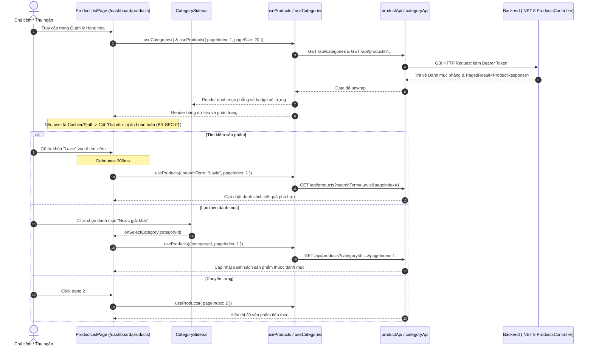

# Design Brief: product-management-ui (Cụm 1)
## Giao diện Danh sách Hàng hóa & Bộ lọc (Product List & Category Filter)

## 1. Luồng Tương tác Người dùng (Sequence Diagram)



---

## 2. Kiến trúc Component Cụm 1

```
src/features/product/
├── api/
│   ├── productApi.ts          # getProducts(filter: ProductQueryFilter)
│   └── categoryApi.ts         # getCategories()
├── types/
│   └── index.ts               # ProductResponse, ProductListItem, ProductQueryFilter, CategoryDto
├── hooks/
│   ├── useProducts.ts         # React Query hook lấy danh sách sản phẩm phân trang
│   └── useCategories.ts       # React Query hook lấy danh mục phẳng
├── components/
│   ├── CategorySidebar.tsx    # Sidebar danh mục phẳng, lọc theo CategoryId
│   └── ProductTable.tsx       # Bảng danh sách sản phẩm, ẩn cột Giá vốn theo role (BR-SEC-01)
├── pages/
│   └── ProductListPage.tsx    # Trang danh sách chính kết nối API, phân trang, debounced search
├── product.css                # Style tùy chỉnh
└── index.ts                   # Export components
```

---

## 3. Endpoints Backend sử dụng trong Cụm 1

| Endpoint | Method | Tham số | Dữ liệu trả về | Mục đích |
|---|---|---|---|---|
| `/api/products` | `GET` | `searchTerm`, `categoryId`, `status`, `pageIndex`, `pageSize` | `ApiResponse<PagedResult<ProductResponse>>` | Lấy danh sách sản phẩm phân trang và tìm kiếm |
| `/api/categories` | `GET` | Không | `ApiResponse<IReadOnlyList<CategoryDto>>` | Lấy danh sách danh mục phẳng |

---

## 4. Quy tắc Nghiệp vụ trong Cụm 1
- **BR-SEC-01 (Data Privilege Segregation):**
  - Thu ngân (`Cashier`) và Nhân viên (`Staff`) chỉ xem giá bán (`SellingPrice`), tuyệt đối không thấy giá vốn (`CostPrice`).
  - Giao diện kiểm tra `canViewCostPrice`: chỉ hiển thị cột "Giá vốn" khi người dùng là `StoreOwner` hoặc `Admin`.
- **Phân trang & Trạng thái Rỗng:**
  - Hiển thị Skeleton loading khi đang tải.
  - Hiển thị Empty state nếu không tìm thấy kết quả sau khi tìm kiếm hoặc lọc.
  - Reset `pageIndex = 1` mỗi khi đổi từ khóa tìm kiếm hoặc đổi danh mục.
