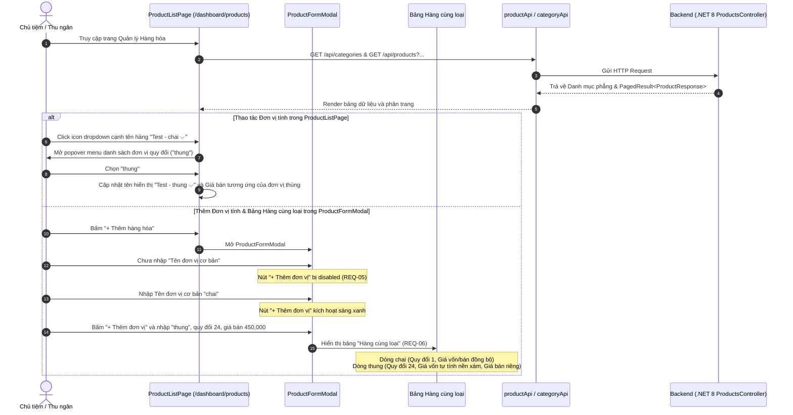

# Design Brief: product-management-ui
## Giao diện Danh sách Hàng hóa, Bộ lọc & Quản lý Đơn vị tính (Hàng cùng loại)

## 1. Luồng Tương tác Người dùng

---

## 2. Kiến trúc & Mockup Giao diện

### 2.1 Bảng "Hàng cùng loại" trong Modal Thêm hàng hóa (`ProductFormModal.tsx`)
- Vị trí: Hiển thị ngay dưới phần Đơn vị tính khi `uomConversions.length > 0`.
- Các cột:
  - `Đơn vị`: Dòng 1: `baseUnit` (text), Dòng 2+: `uom.unitName` (text).
  - `Quy đổi`: Dòng 1: `1` (disabled, bg xám), Dòng 2+: input tỷ lệ quy đổi.
  - `Mã hàng`: Dòng 1: `productCode` / `Tự động`, Dòng 2+: input mã hàng.
  - `Mã vạch`: Dòng 1: `barcode` chính, Dòng 2+: `uom.barcode`.
  - `Giá vốn`: Dòng 1: `costPrice`, Dòng 2+: `costPrice * conversionRate` (readonly, bg xám).
  - `Giá bán`: Dòng 1: `sellingPrice`, Dòng 2+: `uom.price`.
  - `Tồn kho`: Dòng 1: `initialStock`, Dòng 2+: `initialStock / conversionRate` (readonly, bg xám).
  - Nút Xóa: Dòng 1 ẩn/disabled, Dòng 2+ có icon Trash2 xóa đơn vị.

### 2.2 Dropdown Đơn vị tính trong Danh sách Hàng hóa (`ProductListPage.tsx`)
- Cột "Tên hàng hóa":
  - Nếu có đơn vị quy đổi: Hiển thị `[Tên SP] - [Đơn vị] ⌵`.
  - Click vào mở popover hiển thị danh sách đơn vị.
  - Khi người dùng click chọn đơn vị: Đổi đơn vị hiển thị và cập nhật giá bán hiển thị trên cột "Giá bán" tương ứng.

---

## 3. Quy tắc Nghiệp vụ (Business Rules)
1. **REQ-05**: Bắt buộc nhập tên đơn vị cơ bản trước khi thêm đơn vị quy đổi.
2. **REQ-06**: Hiển thị bảng Hàng cùng loại đồng bộ 2 chiều với dữ liệu đơn vị tính.
3. **REQ-07**: Cho phép xem giá và thông tin theo từng đơn vị quy đổi ngay trên bảng danh sách hàng hóa.
