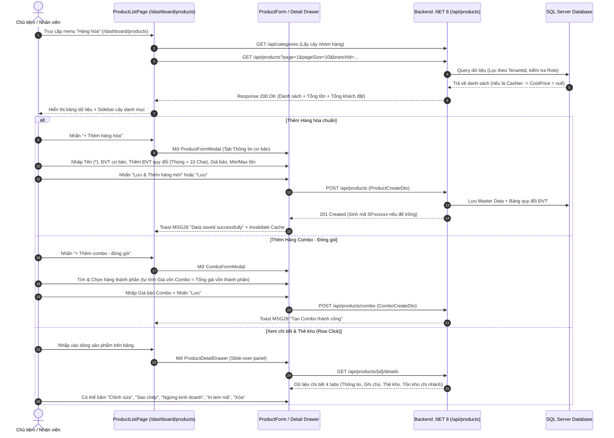

# Design Brief: product-management-ui
## Phân hệ FE-01: Quản lý Danh mục Hàng hóa (Product Catalog Management UI)

## 1. Luồng Người dùng (User Flow)



---

## 2. Kiến trúc Component & Giao diện (Ant Design + Tailwind CSS)

Bám sát 100% nguyên mẫu thiết kế tại [Screen Design/Product Management](file:///d:/FPT_uni/Sesmester_9_Fall_26/tham%20khao/Screen%20Design/Product%20Management):

### 2.1. Cấu trúc Component Frontend (`src/features/products/`)
```
src/features/products/
├── pages/
│   └── ProductListPage.tsx                # Trang chính chứa Sidebar và Bảng dữ liệu
├── components/
│   ├── ProductTable.tsx                   # Bảng dữ liệu sản phẩm + Hàng tổng cộng (Tổng tồn, Tổng đặt)
│   ├── ProductSidebarFilter.tsx           # Sidebar bộ lọc (Cây nhóm hàng, Tồn kho, Ngày tạo, Nhà cung cấp)
│   ├── ProductToolbar.tsx                 # Thanh header (Tìm kiếm, Thêm hàng, Thêm combo, Import/Export)
│   ├── ProductFormModal.tsx               # Modal thêm/sửa hàng chuẩn (ĐVT đa cấp, hình ảnh, min/max)
│   ├── ComboFormModal.tsx                 # Modal thêm combo (Bảng hàng thành phần, tự tính giá vốn)
│   ├── ProductDetailDrawer.tsx            # Slide-over Drawer 360 độ (Tabs: Thông tin, Ghi chú, Thẻ kho, Tồn kho)
│   ├── CategoryModal.tsx                  # Modal tạo/sửa nhóm hàng cây phân cấp
│   └── BarcodePrintModal.tsx              # Modal thiết kế và in tem mã vạch
├── hooks/
│   ├── useProducts.ts                     # React Query hook lấy danh sách sản phẩm phân trang
│   ├── useProductDetail.ts                # React Query hook lấy chi tiết sản phẩm 360 độ
│   ├── useCategories.ts                   # React Query hook lấy cây nhóm hàng
│   └── useProductMutations.ts             # React Query mutations (Create, Update, Delete, Discontinue)
└── types/
    └── product.types.ts                   # TypeScript interfaces (ProductDto, UnitConversion, ComboComponent...)
```

### 2.2. Trạng thái Giao diện (UI States)
- **Loading State:**
  - Bảng danh sách: Sử dụng Ant Design `Skeleton.Table` hoặc `Spin` overlay giữ nguyên layout bảng.
  - Cây danh mục: `Skeleton.Input` cho ô tìm kiếm và `Skeleton.Node` cho các nhánh nhóm hàng.
  - Modal form: Nút Lưu chuyển trạng thái `loading={isSubmitting}` ngăn chặn double-click.
- **Empty State:**
  - Bảng trống: Ant Design `<Empty description="Chưa có hàng hóa nào phù hợp" />` kèm nút gợi ý "+ Thêm hàng hóa mới".
  - Tìm kiếm không thấy: In-line text `MSG29: "No search results."`
- **Error State:**
  - Lỗi mạng/Server 500: Hiển thị `<Alert type="error" message="Không thể tải danh mục hàng hóa" showIcon />` kèm nút "Thử lại".
  - Validation lỗi: Tooltip/In-line message đỏ bên dưới input (`MSG26: "The * field is required"`).
  - Bán dưới giá vốn: Modal cảnh báo `MSG12: "Warning: Selling price is below cost. Do you want to proceed?"`.

---

## 3. Endpoints API & DTOs (Backend .NET 8)

### 3.1. Danh sách Endpoints RESTful
| Method | Endpoint | Quyền hạn | Mục đích |
|---|---|---|---|
| `GET` | `/api/products` | Owner, Cashier | Lấy danh sách hàng hóa phân trang, tìm kiếm, lọc (Cashier không nhận trường `CostPrice`) |
| `GET` | `/api/products/{id}` | Owner, Cashier | Lấy chi tiết thông tin sản phẩm và bảng quy đổi ĐVT |
| `GET` | `/api/products/{id}/stock-card` | Owner | Lấy lịch sử Thẻ kho (Stock Ledger) theo chứng từ |
| `GET` | `/api/products/{id}/branch-stock` | Owner, Cashier | Lấy tồn kho chi tiết các chi nhánh và danh sách lô hạn dùng FEFO |
| `POST` | `/api/products` | Store Owner | Tạo mới hàng hóa chuẩn (hỗ trợ tự sinh mã SKU `SPxxxxxx`) |
| `PUT` | `/api/products/{id}` | Store Owner | Cập nhật thông tin hàng hóa (khóa Base UOM nếu đã phát sinh giao dịch) |
| `POST` | `/api/products/combo` | Store Owner | Tạo hàng Combo - Đóng gói kèm danh sách hàng thành phần |
| `PATCH` | `/api/products/{id}/discontinue` | Store Owner | Ngừng kinh doanh hoặc Cho phép kinh doanh trở lại |
| `DELETE` | `/api/products/{id}` | Store Owner | Xóa hàng hóa (Soft Delete nếu có giao dịch; Hard Delete nếu chưa giao dịch) |
| `GET` | `/api/categories` | Owner, Cashier | Lấy cây phân cấp nhóm hàng kèm số lượng sản phẩm `Count` |
| `POST` | `/api/categories` | Store Owner | Tạo nhóm hàng mới (mã tự sinh `CAT-xxx`, kiểm tra trùng lặp) |
| `POST` | `/api/products/import-excel` | Store Owner | Import danh sách hàng hóa hàng loạt từ file Excel |
| `GET` | `/api/products/export-excel` | Store Owner | Xuất danh sách hàng hóa đã lọc ra file Excel |

### 3.2. Cấu trúc Data Transfer Objects (DTOs)
```typescript
// Product List Item DTO
export interface ProductListItemDto {
  id: string;
  sku: string;
  barcode?: string;
  name: string;
  categoryName: string;
  categoryId: string;
  thumbnailUrl?: string;
  sellingPrice: number;
  costPrice?: number | null; // Null đối với Cashier (BR-SEC-01)
  baseUnit: string;
  hasConversions: boolean;
  onHandStock: number;
  availableStock: number;
  committedStock: number;
  isFavorite: boolean;
  status: 'Active' | 'Discontinued';
  createdAt: string;
}

// Bảng quy đổi ĐVT DTO
export interface UnitConversionDto {
  id?: string;
  unitName: string;         // Tên ĐVT quy đổi (Lốc, Thùng)
  conversionRate: number;   // Tỷ lệ quy đổi (Ví dụ: 1 Thùng = 10 Chai)
  sellingPrice: number;     // Giá bán quy đổi riêng
  barcode?: string;         // Mã vạch riêng của đơn vị quy đổi
}

// Tạo hàng hóa chuẩn DTO
export interface CreateProductDto {
  sku?: string;             // Để trống hệ thống tự sinh SPxxxxxx
  barcode?: string;
  name: string;
  categoryId: string;
  images?: string[];
  costPrice: number;
  sellingPrice: number;
  baseUnit: string;
  unitConversions?: UnitConversionDto[];
  minStock?: number;
  maxStock?: number;
  initialStock?: number;
  vatRate: number;          // 0%, 5%, 8%, 10%
  description?: string;
  internalNote?: string;
}

// Tạo Combo DTO
export interface CreateComboDto {
  sku?: string;
  barcode?: string;
  name: string;
  categoryId: string;
  images?: string[];
  sellingPrice: number;
  components: {
    productId: string;
    quantity: number;
  }[];
  description?: string;
}
```

---

## 4. Thay đổi Cơ sở dữ liệu (Database Schema & EF Core Migration)

Dự án áp dụng EF Core 8 Code-First trên SQL Server, kế thừa `TenantEntity`:
- **Bảng `Products`:**
  - `Id` (Guid, PK)
  - `TenantId` (Guid, Indexed, Multi-tenant)
  - `Sku` (nvarchar(50), Unique per Tenant)
  - `Barcode` (nvarchar(100), Indexed per Tenant)
  - `Name` (nvarchar(255), Not Null)
  - `CategoryId` (Guid, FK -> `Categories`)
  - `BaseUnit` (nvarchar(50), Not Null)
  - `CostPrice` (decimal(18,2), Not Null, Default 0)
  - `SellingPrice` (decimal(18,2), Not Null)
  - `VatRate` (decimal(5,2), Default 0)
  - `MinStock` (int, Default 0)
  - `MaxStock` (int, Default 999999999)
  - `IsCombo` (bit, Default 0)
  - `IsFavorite` (bit, Default 0)
  - `Status` (nvarchar(20), Default 'Active') - 'Active', 'Discontinued', 'Deleted'
  - `Description`, `InternalNote`, `ImagesJson`
- **Bảng `ProductUnitConversions`:**
  - `Id` (Guid, PK), `TenantId` (Guid)
  - `ProductId` (Guid, FK -> `Products`)
  - `UnitName` (nvarchar(50), Not Null)
  - `ConversionRate` (decimal(18,4), Not Null)
  - `SellingPrice` (decimal(18,2), Not Null)
  - `Barcode` (nvarchar(100))
- **Bảng `ComboComponents`:**
  - `Id` (Guid, PK), `TenantId` (Guid)
  - `ComboId` (Guid, FK -> `Products`)
  - `ComponentProductId` (Guid, FK -> `Products`)
  - `Quantity` (decimal(18,4), Not Null)
- **Bảng `Categories`:**
  - `Id` (Guid, PK), `TenantId` (Guid)
  - `CategoryCode` (nvarchar(50), Unique per Tenant, Default 'CAT-xxx')
  - `CategoryName` (nvarchar(255), Not Null)
  - `ParentId` (Guid, Nullable, FK tự tham chiếu cho cây danh mục)
- **Indices:** `IX_Products_TenantId_Sku`, `IX_Products_TenantId_Barcode`, `IX_Categories_TenantId_ParentId`.

---

## 5. Quy tắc Nghiệp vụ & Ma trận Phân quyền (RBAC Matrix)

| Chức năng | Store Owner (Chủ tiệm) | Store Manager (Quản lý) | Cashier / Staff (Thu ngân) | Quy tắc nghiệp vụ kiểm soát |
|---|:---:|:---:|:---:|---|
| **Xem danh sách hàng hóa** | Toàn quyền | Toàn quyền | Xem (Ẩn giá vốn) | **BR-SEC-01**: Nhân viên không thấy cột Giá vốn |
| **Xem chi tiết 360 độ** | Toàn quyền | Toàn quyền | Xem (Ẩn giá vốn) | **BR-SEC-01**: Ẩn giá vốn trên modal/drawer |
| **Xem Thẻ kho (Stock Ledger)** | Toàn quyền | Toàn quyền | Không có quyền | Chỉ Store Owner được xem kiểm toán xuất nhập tồn |
| **Thêm hàng hóa chuẩn** | Cho phép | Cho phép | Bị khóa | Mã tự sinh `SPxxxxxx`, validation bắt buộc tên/giá |
| **Thêm hàng Combo** | Cho phép | Cho phép | Bị khóa | Tự động tính giá vốn từ thành phần; chặn tạo PO nhập |
| **Sửa hàng hóa** | Cho phép | Cho phép | Bị khóa | **BR-PROD-01**: Khóa bất biến Base UOM nếu đã có giao dịch |
| **Ngừng kinh doanh (Discontinue)** | Cho phép | Cho phép | Bị khóa | Tạm ẩn khỏi màn hình POS, giữ lịch sử giao dịch |
| **Xóa sản phẩm** | Cho phép | Bị khóa | Bị khóa | **BR-DATA-01**: Chỉ Hard Delete khi chưa có giao dịch; chặn xóa khi vướng chuyển kho dang dở hoặc là thành phần Combo |
| **Quản lý Nhóm hàng** | Toàn quyền | Cho phép | Chỉ đọc | **BR-CAT-01**: Mã/tên duy nhất trong nhánh; chặn xóa nhóm có hàng |
| **Import / Export Excel** | Toàn quyền | Cho phép | Bị khóa | Kiểm tra trùng lặp và validate dòng dữ liệu |
