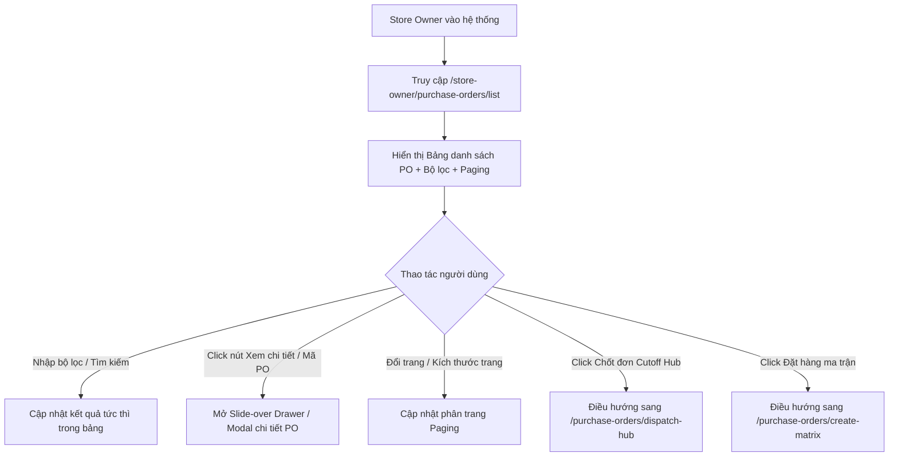

# Design Brief: store-owner-po-list (Màn hình Danh sách Đơn mua hàng PO)

## 1. Luồng người dùng (User Flow)



## 2. Kiến trúc Component Frontend (`src/features/purchase-order`)

```
src/features/purchase-order/
├── components/
│   ├── po-list/
│   │   ├── PoListFilterBar.tsx        # Thanh lọc hợp nhất: Chi nhánh, NCC, Trạng thái, Từ ngày - Đến ngày, Keyword
│   │   ├── PoListTable.tsx            # Bảng dữ liệu PO 9 cột chuẩn Enterprise, sticky header, sort, footer paging
│   │   └── PoDetailDrawer.tsx         # Slide-over Drawer xem chi tiết mặt hàng, đơn giá, tổng tiền, timeline PO
│   └── ...
├── pages/
│   └── StoreOwnerPurchaseOrderListPage.tsx # Page container chính
├── types/
│   └── po-list.types.ts               # Interface cho PO List Item, Filter State, PO Detail Sku
├── lib/
│   └── mockPoListData.ts              # Mock data phong phú đầy đủ trạng thái SENT, CONFIRMED, PARTIALLY_RECEIVED, RECEIVED, CANCELLED
└── purchase-order.css                 # Bổ sung styling đồng bộ
```

## 3. Data Contract & DTO

### Interface `PurchaseOrderListItem`:

```typescript
export type PurchaseOrderStatus =
  | "SENT" // Đã gửi NCC
  | "CONFIRMED" // NCC đã chốt đơn
  | "PARTIALLY_RECEIVED" // Đã nhận một phần
  | "RECEIVED" // Đã nhập kho xong
  | "CANCELLED"; // Đã hủy

export interface PurchaseOrderItemDetail {
  id: string;
  name: string;
  sku: string;
  unit: string;
  orderedQty: number;
  receivedQty?: number;
  price: number;
  total: number;
}

export interface PurchaseOrderListItem {
  id: string;
  poCode: string; // VD: PO-20261008-001
  storeRefCode: string; // VD: STR-01, DC-01
  supplierId: string;
  supplierCode: string; // VD: SUP-001
  supplierName: string; // VD: CÔNG TY THỰC PHẨM TƯƠI SỐNG HƯƠNG QUÊ
  branchId: string;
  branchCode: string; // VD: BR-01
  branchName: string; // VD: BR-01 CH Nguyễn Trãi
  createdSource: string; // VD: NV. Nguyễn Văn A (Nhập Grid), Chủ cửa hàng (Dispatch Hub)
  lastUpdated: string; // VD: 08/10/2026 17:15
  expectedDelivery: string; // VD: 09/10/2026
  itemCount: number; // Số mặt hàng (SKU)
  totalAmount: number; // Tổng tiền đơn hàng (VNĐ)
  status: PurchaseOrderStatus;
  note?: string;
  items: PurchaseOrderItemDetail[];
}
```

### Interface `PoListFilterState`:

```typescript
export interface PoListFilterState {
  branchId: string; // 'all' | ID cụ thể
  supplierId: string; // 'all' | ID cụ thể
  status: "all" | PurchaseOrderStatus;
  dateFrom: string; // YYYY-MM-DD
  dateTo: string; // YYYY-MM-DD
  keyword: string;
  pageIndex: number;
  pageSize: number;
}
```

## 4. Đặc tả Giao diện & Trạng thái UI

### 4.1. Page Header

- Tiêu đề: `<h1>Danh sách đơn mua hàng (PO)</h1>`
- Cụm nút chuyển hướng nhanh bên phải:
  - Nút Outline: `[⚡ Chốt đơn với NCC]` -> chuyển sang `/store-owner/purchase-orders/dispatch-hub`
  - Nút Outline: `[▦ Bảng lưới đặt hàng]` -> chuyển sang `/store-owner/purchase-orders/create-matrix`

### 4.2. Unified Filter Bar

- Hàng 1 (hoặc dải liên tục):
  - Ô tìm kiếm: `🔍 Tìm kiếm Mã PO, NCC, Chi nhánh, Tên SP, Người nhập...` (width ~260px)
  - Select box `Chi nhánh nhận:` (Tất cả chi nhánh, BR-01, BR-02, BR-03, DC1...)
  - Select box `Nhà cung cấp:` (Tất cả NCC, SUP-001, SUP-002...)
  - Select box `Trạng thái PO:` (Tất cả trạng thái, SENT, CONFIRMED, PARTIALLY_RECEIVED, RECEIVED, CANCELLED)
  - Date inputs: `Từ ngày:` (`dateFrom`), `Đến ngày:` (`dateTo`)
  - Cụm nút: `[Tìm kiếm]` (solid xanh `#0f766e`) và `[Đặt lại]` (outline ghost).

### 4.3. Data Table Layout

- Cấu trúc bảng có Sticky Header, 9 cột chính:
  1. **Mã PO & Mã cửa hàng:** Dòng 1: `PO-20261008-001` (font-mono, link xanh). Dòng 2: `STR-01` (badge xám).
  2. **Nhà cung cấp:** Tên NCC in đậm + badge mã NCC (`SUP-001`).
  3. **Chi nhánh nhận:** Tên chi nhánh nhận hàng.
  4. **Nguồn tạo / Người tạo:** VD `NV. Nguyễn Văn A (Nhập Grid)`.
  5. **Ngày sửa cuối:** `DD/MM/YYYY HH:mm`.
  6. **Dự kiến giao:** `DD/MM/YYYY` (kèm icon xe tải nhỏ).
  7. **Số mặt hàng:** Căn giữa, badge xám nhẹ `5 mặt hàng`.
  8. **Tổng tiền:** Căn phải, in đậm, font monospace tabular nums (VD: `3.450.000 đ`).
  9. **Trạng thái:** Badge bo góc mềm:
     - `SENT`: Vàng hổ phách (`#fef3c7`, text `#b45309`, border `#fde68a`) - "Đã gửi NCC"
     - `CONFIRMED`: Xanh lá nhạt (`#dcfce7`, text `#15803d`, border `#86efac`) - "NCC đã chốt"
     - `PARTIALLY_RECEIVED`: Tím/Indigo (`#e0e7ff`, text `#4338ca`, border `#c7d2fe`) - "Đã nhận một phần"
     - `RECEIVED`: Xanh dương (`#e0f2fe`, text `#0369a1`, border `#bae6fd`) - "Đã nhập kho xong"
     - `CANCELLED`: Đỏ pastel (`#fee2e2`, text `#b91c1c`, border `#fca5a5`) - "Đã hủy"
  10. **Thao tác:**
      - Nút ghost `[Xem chi tiết]` (Eye icon): mở Drawer chi tiết.
      - Nút `[Sửa]` (hoặc menu phụ nếu PO ở trạng thái SENT/nhận).

### 4.4. Footer Phân trang (Paging)

- Trái: `Hiển thị X - Y trên Z đơn mua hàng PO` + Chọn `Bản ghi/trang: 10, 20, 30, 50`.
- Phải: Nút `[Trước]`, nhãn `Trang 1 / 1`, nút `[Sau]`.

### 4.5. Slide-over Drawer Chi tiết PO

- Mở từ cạnh phải khi click dòng hoặc nút "Xem chi tiết".
- Header: Mã PO, Trạng thái badge, Chi nhánh nhận, NCC, nút đóng [X].
- Body: Bảng danh sách SKU chi tiết (STT, Tên SP, SKU, ĐVT, SL đặt, SL đã nhận, Đơn giá, Thành tiền).
- Footer: Ghi chú đơn hàng + Tổng cộng tiền PO.

## 5. Trạng thái Loading / Empty / Error

- **Loading:** Skeleton rows hoặc spinner chuẩn hệ thống.
- **Empty Filtered:** Icon Layers/Inbox rỗng + Thông báo `"Không tìm thấy đơn mua hàng nào phù hợp với bộ lọc"`, kèm nút `"Đặt lại bộ lọc"`.
