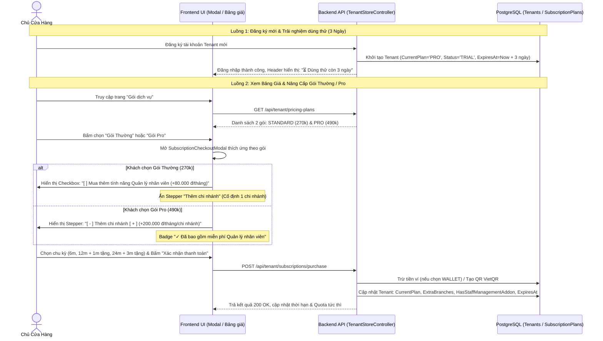

# Design Brief: Tái Cấu Trúc Hệ Thống Gói Cước SaaS MT-GRMS

## 1. Luồng Người Dùng (User Flows)



---

## 2. Giao Diện & Trạng Thái Màn Hình (UI Components & States)

### A. Thẻ Bảng Giá (`SubscriptionPricingCards.tsx`):
- **Hiển thị 2 Thẻ đối xứng**:
  1. **Gói Thường (270.000 đ/tháng)**:
     - Badge: "Tiêu chuẩn - 1 Cửa hàng".
     - Đặc điểm: 1 Chi nhánh độc lập (Bán hàng & Kho tại chỗ).
     - Quản lý nhân viên: Tùy chọn mua thêm (+80k/tháng).
     - Không hỗ trợ quản lý chuỗi.
  2. **Gói Pro (490.000 đ/tháng)** - *Highlight viền xanh / vương miện*:
     - Badge: "Khuyên dùng - Chuỗi bán lẻ".
     - Đặc điểm: **Mặc định sẵn 2 Chi nhánh**.
     - **Đã bao gồm sẵn tính năng Quản lý & Phân quyền nhân viên**.
     - Mua thêm chi nhánh: +200.000 đ/chi nhánh/tháng.
- **Trạng thái**:
  - *Loading*: Skeleton loading 2 thẻ.
  - *Current Plan Badge*: Thẻ gói khách hàng đang sử dụng sẽ có badge "✓ Gói hiện tại đang dùng".

### B. Cửa Sổ Thanh Toán (`SubscriptionCheckoutModal.tsx`):
- **Bỏ hoàn toàn**: Stepper "Kho phụ (+150k)".
- **Động theo gói cước**:
  - Khi `planCode == 'STANDARD'`:
    - Hiện checkbox: `[ ] Mua thêm tính năng Quản lý & Phân quyền nhân viên (+80.000 đ/tháng)`.
  - Khi `planCode == 'PRO'`:
    - Hiện stepper: `Số chi nhánh mua thêm: [ - ] {extraBranches} [ + ] (+200.000 đ/tháng/chi nhánh)`.
    - Dòng ghi chú: *"Mặc định gói đã bao gồm sẵn 2 chi nhánh và toàn bộ tính năng nhân viên"*.
- **Phương thức thanh toán**:
  - *Ví gian hàng (Wallet)*: Tự động so sánh số dư `walletBalance` với `grandTotal`. Nếu thiếu tiền hiện alert đỏ và chặn submit.
  - *Quét mã VietQR*: Hiển thị mã VietQR động kèm cú pháp chuyển khoản tự động.

---

## 3. Thay Đổi Database (Schema & Migration)

### A. Bảng `Tenants` (Entity: `MT_GRMS.Domain.Entities.SaaS.Tenant`):
| Tên cột | Kiểu dữ liệu | Mặc định | Ý nghĩa |
| :--- | :--- | :--- | :--- |
| `ExtraBranches` | `int` | `0` | Số chi nhánh mua thêm (áp dụng cho Gói Pro) |
| `HasStaffManagementAddon` | `bool` | `false` | Cờ mua thêm tính năng Quản lý nhân viên (Gói Thường) |
| `SubscriptionStatus` | `varchar(20)` | `'TRIAL'` | Trạng thái: `'TRIAL'`, `'ACTIVE'`, `'EXPIRED'`, `'SUSPENDED'` |

### B. Bảng `SubscriptionPlans` (Seed Data trong `DbInitializer.cs`):
```csharp
// 1. Gói Thường
new SubscriptionPlan
{
    Id = "plan_standard",
    PlanCode = "STANDARD",
    PlanName = "Gói Thường (Cửa Hàng Độc Lập)",
    PriceMonthly = 270000.00m,
    PriceYearly = 2700000.00m,
    MaxBranches = 1,
    MaxStaff = 1, // Chủ shop; mở thêm qua addon
    EnabledModulesJson = "[\"Catalog\",\"Pos\",\"Inventory\",\"Finance\"]",
    IsActive = true
};

// 2. Gói Pro
new SubscriptionPlan
{
    Id = "plan_pro",
    PlanCode = "PRO",
    PlanName = "Gói Pro (Chuỗi Cửa Hàng)",
    PriceMonthly = 490000.00m,
    PriceYearly = 4900000.00m,
    MaxBranches = 2, // Mặc định sẵn 2 chi nhánh
    MaxStaff = 100, // Đã bao gồm nhân viên
    EnabledModulesJson = "[\"Catalog\",\"Pos\",\"Inventory\",\"Supplier\",\"Finance\",\"HR\",\"Tax\",\"MultiBranch\"]",
    IsActive = true
};
```

---

## 4. API Endpoints & Request/Response Contracts

### A. `GET /api/tenant/pricing-plans`
- **Response**: Trả về danh sách gói hoạt động (`STANDARD` và `PRO`).

### B. `POST /api/tenant/subscriptions/purchase`
- **Request Body DTO**:
  ```csharp
  public record PurchaseSubscriptionRequest(
      string PlanCode,
      int Months,
      int ExtraBranches = 0,
      bool HasStaffManagementAddon = false,
      string PaymentMethod = "WALLET"
  );
  ```
- **Logic Tính Tiền**:
  ```csharp
  var basePrice = plan.PriceMonthly * months;
  var branchAddonPrice = request.ExtraBranches * 200000m * months;
  var staffAddonPrice = (plan.PlanCode == "STANDARD" && request.HasStaffManagementAddon)
      ? 80000m * months
      : 0m;
  var subTotal = basePrice + branchAddonPrice + staffAddonPrice;
  var vatAmount = Math.Round(subTotal * 0.1m, 0);
  var grandTotal = subTotal + vatAmount;
  ```
- **Logic Cập Nhật Tenant**:
  ```csharp
  tenant.CurrentPlan = plan.PlanCode;
  tenant.SubscriptionExpiresAt = newExpiresAt;
  tenant.SubscriptionStatus = "ACTIVE";
  if (plan.PlanCode == "PRO")
  {
      tenant.ExtraBranches += request.ExtraBranches;
      tenant.HasStaffManagementAddon = true;
  }
  else
  {
      if (request.HasStaffManagementAddon)
          tenant.HasStaffManagementAddon = true;
  }
  ```

### C. `GET /api/branches/quota` (Tại `BranchService.cs`)
- **Công thức tính hạn mức mới**:
  ```csharp
  var maxBranches = plan.MaxBranches + tenant.ExtraBranches;
  var canAddMore = usedBranches < maxBranches;
  ```
