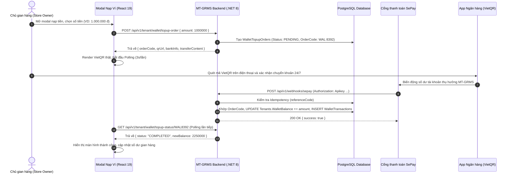

# Thiết kế Kỹ thuật (Design Brief): Cổng thanh toán SePay & Ví gian hàng MT-GRMS

## 1. Luồng Người dùng & Kiến trúc Tổng thể (User Flow & System Architecture)



---

## 2. Giao diện & Component (Frontend Specification)

### 2.1. Cải tiến Component `StoreWalletTopupModal.tsx`
- **Hệ màu chuẩn Deep Teal**:
  - Màu nhấn chính (Primary): `#0F766E` (Teal 700), hover `#115E59` (Teal 800).
  - Màu nền nhẹ (Surface Light): `#F0FDFA` (Teal 50), viền `#CCFBF1` (Teal 100).
  - Phông chữ: `Be Vietnam Pro` (`var(--font-sans)`), số tiền dùng `font-mono` hoặc `tabular-nums`.
- **Thành phần & Trạng thái**:
  1. **Trạng thái Khởi tạo / Thay đổi số tiền**:
     - Các nút chọn nhanh: `500.000 đ`, `1.000.000 đ`, `2.000.000 đ`, `5.000.000 đ` (bo góc 14px, viền active Teal).
     - Ô nhập số tiền tùy chọn: format VNĐ tự động (`1.500.000 đ`), giới hạn tối thiểu `50.000 đ`.
     - Debounce 400ms: Khi số tiền thay đổi, tự động tạo mới hoặc cập nhật `topup-order`.
  2. **Khung VietQR Chuyển khoản Thông minh**:
     - Hiển thị ảnh QR VietQR động thật (`img` src từ SePay QR URL: `https://qr.sepay.vn/img?acc={acc}&bank={bank}&amount={amt}&des={content}`).
     - Huy hiệu `VIETQR · NAPAS247` sắc nét.
     - Ô hiển thị Ngân hàng thụ hưởng, Số tài khoản, Tên tài khoản, Nội dung chuyển khoản.
     - Nút copy nhanh 1 chạm cho Số tài khoản và Nội dung kèm tooltip visual feedback (Icon Check xanh).
  3. **Trạng thái Chờ thanh toán (Waiting / Polling)**:
     - Tự động gọi `GET /api/v1/tenant/wallet/topup-status/{orderCode}` mỗi 3 giây (tối đa 100 lần = 5 phút).
     - Nút "Xác nhận đã chuyển khoản" cho phép kiểm tra ngay lập tức (hiển thị spinner "Đang xác thực giao dịch...").
  4. **Trạng thái Thành công (Success View)**:
     - Icon CheckCircle2 xanh ngọc rực rỡ, hiển thị số tiền đã cộng vào ví và số dư mới.
     - Tự động đóng sau 2.5 giây hoặc bấm "Xong".
     - Callback cập nhật số dư trên thanh header và tab "Thanh toán & Ví".

### 2.2. Đồng bộ `WalletLedgerTab.tsx`
- Hiển thị 3 thẻ tóm tắt:
  - Thẻ 1: Số dư ví khả dụng (`Tenants.WalletBalance`) + Nút Nạp tiền.
  - Thẻ 2: Tổng tiền đã nạp vào ví.
  - Thẻ 3: Tổng chi mua gói dịch vụ & tiện ích.
- Bảng lịch sử biến động số dư (`WalletTransactions`):
  - Cột: Mã giao dịch, Thời gian, Nội dung, Số tiền (+ xanh / - đỏ), Số dư sau GD, Phương thức, Trạng thái.
  - Bộ lọc: Tất cả / Nạp tiền / Mua gói / Hoàn tiền.

---

## 3. Thiết kế Cơ sở Dữ liệu (Database Changes)

### 3.1. Bảng `Tenants` (Sửa đổi)
- Thêm cột:
  ```sql
  ALTER TABLE "Tenants" ADD COLUMN IF NOT EXISTS "WalletBalance" numeric(18,2) NOT NULL DEFAULT 0;
  ```

### 3.2. Bảng `WalletTopupOrders` (Tạo mới)
Theo dõi các lệnh yêu cầu nạp ví tạo ra từ giao diện:
```sql
CREATE TABLE IF NOT EXISTS "WalletTopupOrders" (
    "Id" varchar(50) NOT NULL PRIMARY KEY,
    "TenantId" varchar(50) NOT NULL,
    "OrderCode" varchar(50) NOT NULL UNIQUE,
    "Amount" numeric(18,2) NOT NULL,
    "TransferContent" varchar(100) NOT NULL,
    "BankCode" varchar(30) NOT NULL,
    "AccountNumber" varchar(50) NOT NULL,
    "AccountName" varchar(150) NOT NULL,
    "QrUrl" varchar(500) NOT NULL,
    "Status" varchar(30) NOT NULL DEFAULT 'PENDING', -- PENDING, COMPLETED, EXPIRED, CANCELLED
    "ExpiresAt" timestamp with time zone NOT NULL,
    "CompletedAt" timestamp with time zone NULL,
    "CreatedAt" timestamp with time zone NOT NULL DEFAULT CURRENT_TIMESTAMP,
    CONSTRAINT "FK_WalletTopupOrders_Tenants" FOREIGN KEY ("TenantId") REFERENCES "Tenants"("Id") ON DELETE CASCADE
);

CREATE INDEX IF NOT EXISTS "IX_WalletTopupOrders_TenantId" ON "WalletTopupOrders"("TenantId");
CREATE INDEX IF NOT EXISTS "IX_WalletTopupOrders_OrderCode" ON "WalletTopupOrders"("OrderCode");
CREATE INDEX IF NOT EXISTS "IX_WalletTopupOrders_Status" ON "WalletTopupOrders"("Status");
```

### 3.3. Bảng `WalletTransactions` (Tạo mới)
Sổ cái kế toán biến động số dư bất biến (Immutable Ledger):
```sql
CREATE TABLE IF NOT EXISTS "WalletTransactions" (
    "Id" varchar(50) NOT NULL PRIMARY KEY,
    "TenantId" varchar(50) NOT NULL,
    "TransactionCode" varchar(50) NOT NULL UNIQUE,
    "Type" varchar(40) NOT NULL, -- TOPUP, PURCHASE_PLAN, PURCHASE_ADDON, REFUND
    "Amount" numeric(18,2) NOT NULL,
    "BalanceBefore" numeric(18,2) NOT NULL,
    "BalanceAfter" numeric(18,2) NOT NULL,
    "Description" varchar(255) NOT NULL,
    "PaymentMethod" varchar(50) NOT NULL, -- VietQR, WALLET, BANK_TRANSFER
    "Status" varchar(30) NOT NULL DEFAULT 'SUCCESS', -- SUCCESS, PENDING, FAILED
    "ReferenceCode" varchar(100) NULL, -- Mã giao dịch từ SePay / Ngân hàng (ft...)
    "CreatedAt" timestamp with time zone NOT NULL DEFAULT CURRENT_TIMESTAMP,
    CONSTRAINT "FK_WalletTransactions_Tenants" FOREIGN KEY ("TenantId") REFERENCES "Tenants"("Id") ON DELETE CASCADE
);

CREATE INDEX IF NOT EXISTS "IX_WalletTransactions_TenantId" ON "WalletTransactions"("TenantId");
CREATE INDEX IF NOT EXISTS "IX_WalletTransactions_ReferenceCode" ON "WalletTransactions"("ReferenceCode");
```

---

## 4. Đặc tả API Contracts & DTOs

### 4.1. `POST /api/v1/tenant/wallet/topup-order`
- **Quyền**: `Authorize(Roles = "STORE_OWNER,STORE_MANAGER")`
- **Request Body**:
  ```json
  {
    "amount": 1000000
  }
  ```
- **Response Success (200 OK)**:
  ```json
  {
    "success": true,
    "data": {
      "orderCode": "WAL9281",
      "amount": 1000000,
      "bankCode": "MBBank",
      "bankName": "MB Bank (Ngân hàng Quân Đội)",
      "accountNumber": "190065228888",
      "accountName": "CONG TY TNHH PHAN MEM MT-GRMS",
      "transferContent": "WAL 9281",
      "qrUrl": "https://qr.sepay.vn/img?acc=190065228888&bank=MBBank&amount=1000000&des=WAL%209281",
      "expiresAt": "2026-11-04T16:00:00Z"
    },
    "message": "Tạo đơn nạp ví thành công."
  }
  ```

### 4.2. `GET /api/v1/tenant/wallet/topup-status/{orderCode}`
- **Quyền**: `Authorize(Roles = "STORE_OWNER,STORE_MANAGER")`
- **Response Success (200 OK)**:
  ```json
  {
    "success": true,
    "data": {
      "orderCode": "WAL9281",
      "status": "COMPLETED", // PENDING, COMPLETED, EXPIRED
      "amount": 1000000,
      "newBalance": 2250000,
      "completedAt": "2026-11-04T15:35:10Z"
    }
  }
  ```

### 4.3. `POST /api/v1/webhooks/sepay`
- **Quyền**: Public / Xác thực qua Header `Authorization: Apikey {SEPAY_API_KEY}`
- **Request Payload từ SePay**:
  ```json
  {
    "id": 839218,
    "gateway": "MBBank",
    "transactionDate": "2026-11-04 15:35:00",
    "accountNumber": "190065228888",
    "subAccount": null,
    "code": null,
    "content": "WAL 9281 nap vi gian hang",
    "transferType": "in",
    "description": "Thanh toan don nap",
    "transferAmount": 1000000,
    "referenceCode": "FT2430889123891",
    "accumulated": 15000000
  }
  ```
- **Xử lý**:
  1. Kiểm tra API Key SePay: nếu cấu hình `SePay:ApiKey` khác rỗng và không khớp với header -> trả về `401 Unauthorized`.
  2. Bỏ qua giao dịch chi tiền (`transferType != "in"`).
  3. Kiểm tra trùng lặp: Tìm trong `WalletTransactions` xem `ReferenceCode == referenceCode` đã tồn tại chưa. Nếu có -> trả `200 OK` (Idempotent).
  4. Trích xuất mã đơn nạp từ `content` bằng Regex: `(?:WAL|wal)\s*([0-9A-Za-z]+)`.
  5. Tìm `WalletTopupOrders` có `OrderCode` tương ứng hoặc tìm `Tenants` có `Code` khớp.
  6. Mở Transaction database:
     - Cập nhật số dư `tenant.WalletBalance += transferAmount`.
     - Thêm bản ghi `WalletTransactions` (`Type = "TOPUP"`, `ReferenceCode = referenceCode`).
     - Đổi trạng thái `WalletTopupOrders` -> `COMPLETED`.
  7. Trả về `200 OK`: `{ "success": true, "message": "Giao dịch SePay đã được ghi nhận." }`.

### 4.4. `GET /api/v1/tenant/wallet/balance` & `GET /api/v1/tenant/wallet/transactions`
- Lấy số dư hiện tại và danh sách giao dịch phân trang để cấp dữ liệu cho `WalletLedgerTab`.

---

## 5. Cấu hình Cổng thanh toán (Configuration)
Lưu trong `appsettings.json` và `appsettings.Development.json`:
```json
"SePay": {
  "ApiKey": "SEPAY_API_KEY_SECRET",
  "BankCode": "MBBank",
  "BankName": "MB Bank (Ngân hàng Quân Đội)",
  "AccountNumber": "190065228888",
  "AccountName": "CONG TY TNHH PHAN MEM MT-GRMS"
}
```
Mọi thông tin tài khoản được quản lý tập trung từ cấu hình backend, không hardcode phía client.
