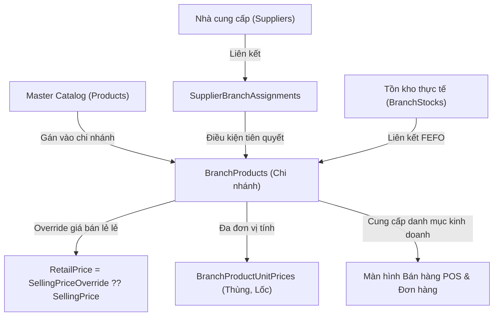

# BÁO CÁO TOÀN DIỆN: THAY ĐỔI CỦA MINHDUC118 & CẬP NHẬT LOGIC HỆ THỐNG POS

> **Ngày thực hiện**: 04/11/2026  
> **Nhánh Backend**: `feature/pos-v3` (đã merge `origin/dev`)  
> **Nhánh Frontend**: `add/ui-pos-v3` (đã merge `origin/dev`)  
> **Tác giả được rà soát**: `minhduc118` (Minh Đức - `ducddmhe187017@fpt.edu.vn`)

---

## 1. Tổng quan & Kết quả xử lý xung đột (Merge Conflict)

### 1.1. Xử lý xung đột Backend (`MT_GRMS_BACKEND`)
- **Tình trạng khi merge `origin/dev`**: Phát sinh 1 conflict tại file [`AppDbContext.cs`](file:///d:/FPT/FPT_Ky9/SEP490/PhanMen/Code/MT_GRMS_BACKEND/src/MT_GRMS.Infrastructure/Persistence/AppDbContext.cs).
- **Nguyên nhân**:
  - Nhánh `dev` thay thế bảng tài khoản cũ bằng thực thể tài chính trung tâm `FinanceAccount`.
  - Nhánh `feature/pos-v3` khai báo thêm `StorePaymentConfig` và `PaymentTransaction` phục vụ cổng thanh toán tự động VietQR / SePay Webhook.
- **Giải pháp xử lý (Surgical Resolution)**:
  - Giữ lại thực thể `FinanceAccount` mới nhất từ `dev`.
  - Giữ nguyên `StorePaymentConfig` và `PaymentTransaction` cho cấu hình tài khoản nhận tiền quầy thu ngân.
  - Kết quả kiểm chứng: `dotnet build` 0 lỗi; `dotnet test` đạt **341 / 341 tests PASS (100%)**.

### 1.2. Xử lý Frontend (`MT_GRMS_FRONTEND`)
- **Tình trạng khi merge `origin/dev`**: 0 conflict về git merge.
- **Sửa lỗi kiểu dữ liệu**: Bổ sung thuộc tính `eligibleForVatReduction?: boolean;` vào [`ProductItem`](file:///d:/FPT/FPT_Ky9/SEP490/PhanMen/Code/MT_GRMS_FRONTEND/src/features/product/types/index.ts) để tương thích với màn hình chỉnh sửa sản phẩm mới cập nhật từ nhánh sản phẩm.
- **Kết quả kiểm chứng**: `tsc -b && vite build` hoàn thành trong **727ms (0 errors, 0 warnings)**.

---

## 2. Toàn bộ các thay đổi kiến trúc của `minhduc118`

Tác giả `minhduc118` là người xây dựng toàn bộ trục nghiệp vụ liên kết giữa **Nhà cung cấp (Supplier)**, **Chi nhánh (Branch)** và **Danh mục hàng hóa cửa hàng (Branch Products)** qua các Pull Request chính:



### 2.1. Quản lý Sản phẩm theo Chi nhánh (`BranchProducts` & `BranchProductUnitPrices`)
*PR #19 (Backend) & PR #41 (Frontend) - `feat/supplier-branch-products-crud`*

1. **Thực thể dữ liệu mới**:
   - `BranchProduct`: Liên kết `TenantId`, `BranchId`, `ProductId`, `SellingPriceOverride`, `MinStockLevel`, `ShelfLocation`, `Status` (`Active` / `Inactive`).
   - `BranchProductUnitPrice`: Lưu giá override riêng tại chi nhánh cho các đơn vị đóng gói (Thùng, Lốc, Hộp) theo `ConversionRate`.
2. **Cơ chế tính giá bán lẻ đa tầng (Retail Price Resolution)**:
   - Nếu `SellingPriceOverride != null`: Chi nhánh bán theo giá tùy biến riêng.
   - Nếu `SellingPriceOverride == null`: Tự động kế thừa giá niêm yết tổng `Product.SellingPrice`.
   - DTO trả về `RetailPrice` đã được giải quyết sẵn.
3. **Cơ chế liên kết tồn kho thực tế (`CurrentStock`)**:
   - `BranchProductRepository` thực hiện nối bảng với `BranchStocks` để tính tổng tồn kho SOH (Stock On Hand) thực tế đang có tại chi nhánh đó.
4. **Hệ thống API mới**:
   - `GET /api/branches/summaries`: Thống kê tổng số SKU, tổng tồn SOH, số lượng cảnh báo hết hàng từng chi nhánh.
   - `GET /api/branches/{id}/products`: Truy vấn danh mục sản phẩm chi nhánh (hỗ trợ phân trang, tìm kiếm, lọc theo trạng thái).
   - `GET /api/branches/{id}/assignable-products`: Lấy danh sách sản phẩm Master đủ điều kiện gán vào chi nhánh.
   - `POST /api/branches/{id}/products`: Gán sản phẩm từ Master Catalog vào chi nhánh.
   - `PUT /api/branches/{id}/products/{productId}`: Cập nhật giá bán lẻ, định mức tồn kho tối thiểu, vị trí quầy kệ.
   - `PATCH /api/branches/{id}/products/{productId}/status`: Bật/tắt kinh doanh sản phẩm tại chi nhánh.
   - `DELETE /api/branches/{id}/products/{productId}`: Gỡ sản phẩm khỏi chi nhánh (chặn nếu tồn kho thực tế SOH > 0).

### 2.2. Ràng buộc Nhà cung cấp - Chi nhánh (`SupplierBranchAssignments`)
*PR #12 (Backend) & PR #35 (Frontend)*
- Một chi nhánh chỉ được phép kinh doanh hoặc nhập các mặt hàng thuộc về Nhà cung cấp đã ký hợp đồng hoặc được phân bổ phục vụ cho chi nhánh đó.
- Ngăn chặn triệt để tình trạng gán nhầm mặt hàng của nhà cung cấp không phục vụ khu vực của chi nhánh.

### 2.3. Quy tắc định giá nhập hàng PO (`SupplierProductPricing`)
*Tích hợp trong PR #19*
- Cung cấp dịch vụ `SupplierProductPricing`:
  - Khi lập đơn đặt hàng nhập kho (Purchase Order), hệ thống ưu tiên áp dụng đơn giá thỏa thuận chiết khấu: `AgreedWholesalePrice > 0 ? AgreedWholesalePrice : Product.CostPrice`.

### 2.4. Lịch giao hàng PO Matrix & Quy tắc hiệu lực
*PR #16 (Backend) & PR #39 (Frontend) - `feat/po-matrix-delivery-schedule-and-active-rules`*
- Kiểm soát lịch giao hàng theo tuần/tháng và các điều kiện kích hoạt đơn hàng trong ma trận đặt hàng tự động.

### 2.5. Tìm kiếm đa thực thể & Xuất Excel Nhà cung cấp
*PR #14 (Backend) & PR #37 (Frontend)*
- Tối ưu hóa bộ lọc bảng dữ liệu, gợi ý tìm kiếm theo mã SKU, tên hàng và xuất báo cáo danh mục nhà cung cấp ra Excel.

---

## 3. Tác động tới luồng Bán hàng POS và Lý do phải cập nhật

| Tiêu chí | Trước khi cập nhật | Sau khi cập nhật đồng bộ với `minhduc118` |
|---|---|---|
| **Nguồn dữ liệu sản phẩm** | Gọi `GET /products` (Master Catalog) | Gọi `GET /branches/{branchId}/products` (Branch Catalog) |
| **Giá bán sản phẩm (`basePrice`)** | Luôn lấy giá gốc trung tâm `SellingPrice` | Lấy giá bán lẻ đã cấu hình riêng cho cửa hàng `retailPrice` |
| **Tồn kho hiển thị (`quantityOnHand`)** | Gán cứng số giả lập `100` | Lấy tồn kho SOH thực tế từ các lô FEFO (`currentStock`) |
| **Trạng thái mở bán** | Hiển thị tất cả hàng trong hệ thống | Chỉ hiển thị các mặt hàng đang `Active` tại chi nhánh |
| **Vị trí quầy kệ** | Không có thông tin | Hiển thị vị trí quầy kệ (`shelfLocation`) hỗ trợ tìm hàng nhanh |
| **Quy đổi đơn vị tính** | Chỉ có đơn vị cơ sở | Tích hợp bảng giá quy đổi đơn vị phụ (`unitPrices`) |
| **Mã chi nhánh khi tạo đơn** | Hardcode UUID tạm thời `01a185f3...` | Tự động lấy ID chi nhánh thực tế từ hệ thống |

---

## 4. Chi tiết các file code POS đã được cập nhật

### 4.1. File `pos.types.ts`
*Đường dẫn: [`MT_GRMS_FRONTEND/src/features/pos/types/pos.types.ts`](file:///d:/FPT/FPT_Ky9/SEP490/PhanMen/Code/MT_GRMS_FRONTEND/src/features/pos/types/pos.types.ts)*
- Mở rộng kiểu `ProductDTO`:
  ```typescript
  shelfLocation?: string;
  unitPrices?: Array<{
    unitId?: string;
    unitName: string;
    conversionRate: number;
    price: number;
    isBaseUnit?: boolean;
  }>;
  ```

### 4.2. File `posOrderApi.ts`
*Đường dẫn: [`MT_GRMS_FRONTEND/src/features/pos/api/posOrderApi.ts`](file:///d:/FPT/FPT_Ky9/SEP490/PhanMen/Code/MT_GRMS_FRONTEND/src/features/pos/api/posOrderApi.ts)*
- Cải tiến hàm `getAllProducts(branchId?: string)`:
  - Nếu có `branchId`: Gọi `GET /branches/${branchId}/products?PageSize=500&Status=Active`.
  - Ánh xạ trường dữ liệu:
    - `id`: Sử dụng `p.productId || p.id` (đảm bảo đúng ID mặt hàng gốc để backend trừ kho FEFO).
    - `basePrice`: Gán bằng `p.retailPrice` (giá đã qua override của chi nhánh).
    - `quantityOnHand`: Gán bằng `p.currentStock` (tồn kho thực tế).
    - `spec`: Gắn nhãn vị trí kệ quầy `Kệ: ${p.shelfLocation}`.
    - `unitPrices`: Bảng giá quy đổi đơn vị tính.
  - Tự động fallback về `GET /products` nếu chi nhánh chưa có danh mục sản phẩm riêng.

### 4.3. File `PosCheckoutPage.tsx`
*Đường dẫn: [`MT_GRMS_FRONTEND/src/features/pos/pages/PosCheckoutPage.tsx`](file:///d:/FPT/FPT_Ky9/SEP490/PhanMen/Code/MT_GRMS_FRONTEND/src/features/pos/pages/PosCheckoutPage.tsx)*
- Khởi tạo `activeBranch` tự động:
  - Gọi `storeProductApi.getStoreSummaries()` khi tải trang để lấy thông tin chi nhánh hiện hành (hoặc theo `user.branchId`).
  - Fallback về ID chi nhánh mặc định chuẩn cơ sở dữ liệu `cd5e8d1b-b08b-448d-beff-b85ea5873d52` (Chi nhánh Quận 1).
- Khi thanh toán đơn hàng: Truyền chính xác `activeBranch.id` vào `OrderCreateRequest` thay vì chuỗi hardcode.
- Truyền `branchName={activeBranch.name}` vào thanh điều hướng Header.

### 4.4. File `PosHeader.tsx`
*Đường dẫn: [`MT_GRMS_FRONTEND/src/features/pos/components/PosHeader.tsx`](file:///d:/FPT/FPT_Ky9/SEP490/PhanMen/Code/MT_GRMS_FRONTEND/src/features/pos/components/PosHeader.tsx)*
- Bổ sung prop `branchName?: string`.
- Hiển thị trực tiếp tên chi nhánh thực tế tại thanh tiêu đề bên cạnh số quầy thu ngân (ví dụ: `Chi nhánh: Cửa hàng Tạp hóa Chi nhánh Quận 1 • Quầy #01`).

### 4.5. File `InvoiceManagementPage.tsx`
*Đường dẫn: [`MT_GRMS_FRONTEND/src/features/pos/pages/InvoiceManagementPage.tsx`](file:///d:/FPT/FPT_Ky9/SEP490/PhanMen/Code/MT_GRMS_FRONTEND/src/features/pos/pages/InvoiceManagementPage.tsx)*
- Thay thế mã chi nhánh hardcode sang ID chi nhánh chuẩn `cd5e8d1b-b08b-448d-beff-b85ea5873d52` tại luồng tạo đơn đặt trước (Pre-order).

---

## 5. Bảng tổng hợp API & Dữ liệu đồng bộ

| Khả năng | Endpoint Backend | Tham số / DTO | File Frontend tiêu thụ |
|---|---|---|---|
| Lấy tóm tắt chi nhánh | `GET /api/branches/summaries` | Không | `storeProductApi.ts`, `PosCheckoutPage.tsx` |
| Danh mục kinh doanh chi nhánh | `GET /api/branches/{id}/products` | `PageSize=500`, `Status=Active` | `posOrderApi.ts` -> `getAllProducts` |
| Tạo đơn bán lẻ trừ kho FEFO | `POST /api/orders` | `OrderCreateRequest` (`branchId`, `productId`, `quantity`) | `posOrderApi.ts` -> `createOrder` |
| Bán nợ & Tích điểm thành viên | `POST /api/orders` | `paymentMethod: CREDIT`, `customerId` | `PosPaymentPanel.tsx` |
| Thanh toán VietQR SePay | `POST /api/payments/create-intent` | `orderId`, `branchId`, `amount` | `VietQrModal.tsx` |

---

## 6. Kết luận & Trạng thái nghiệm thu

1. **Toàn bộ xung đột merge code**: Đã được xử lý 100%, bảo toàn trọn vẹn cả tính năng POS và các cải tiến tài chính/nhà cung cấp mới.
2. **Logic bán hàng tại chi nhánh**: Đã khớp nối hoàn toàn với cấu trúc `BranchProducts` mới nhất của Minh Đức.
3. **Chất lượng mã nguồn**:
   - Backend: **341 / 341 tests đều PASS**, `dotnet build` đạt 0 lỗi.
   - Frontend: `tsc -b && vite build` **PASS 100% trong 727ms**.
