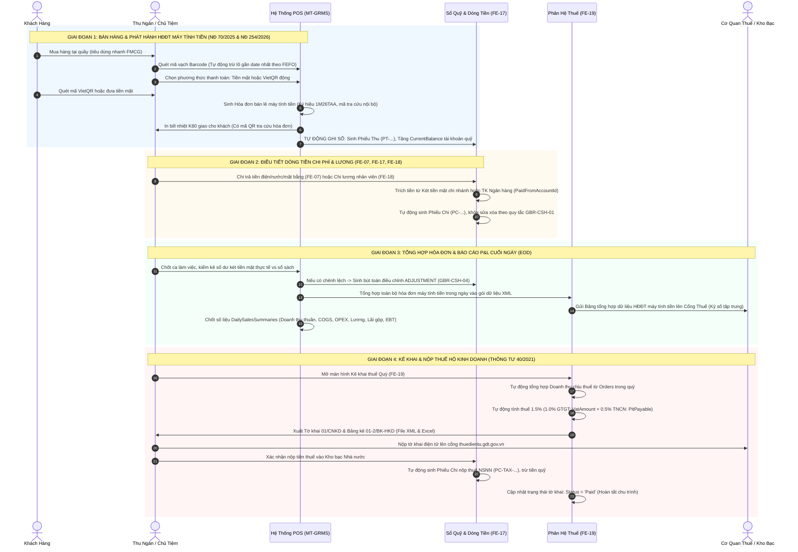

# 🏛️ QUY TRÌNH CHUYÊN SÂU: TÀI CHÍNH, THUẾ & HÓA ĐƠN ĐIỆN TỬ
## DỰ ÁN: MULTI-TENANT GROCERY RETAIL MANAGEMENT SYSTEM (MT-GRMS)
### *(Chuẩn hóa pháp lý 2026: NĐ 70/2025/NĐ-CP, NĐ 254/2026/NĐ-CP, TT 40/2021/TT-BTC & TT 88/2021/TT-BTC)*

---

## I. TỔNG QUAN QUY TRÌNH: AS-IS (HIỆN TRẠNG) vs TO-BE (ĐỀ XUẤT)

### 1. Hiện trạng (As-Is Process) tại các cửa hàng tạp hóa / bán lẻ
* **Bán hàng & Hóa đơn**: Bán hàng không xuất hóa đơn. Chỉ dùng máy tính bỏ túi Casio cộng tiền, đọc mồm số tiền hoặc viết mẩu giấy nháp. Không có chứng từ tra cứu.
* **Quản trị dòng tiền (Cashflow)**: 
  * Tiền mặt bán hàng đút chung vào ngăn kéo hoặc túi quần chủ tiệm.
  * Chi tiêu cá nhân/gia đình (mua rau, đóng tiền học, ăn sáng) rút trực tiếp từ tiền két bán hàng, không ghi chép.
  * Thu nợ khách quen bằng cách mở sổ tay gạch dòng nợ; trả tiền nhà phân phối bằng tiền mặt đếm tay tại chỗ.
  * Cuối ngày mất 1 - 2 tiếng đếm tiền lẻ, đối chiếu SMS ngân hàng, thường xuyên lệch từ vài chục đến vài trăm nghìn đồng.
* **Thuế & Sổ sách**: 
  * 90% nộp **Thuế Khoán** cố định vài trăm nghìn đến 1-2 triệu đồng/tháng.
  * Không mở 7 mẫu sổ kế toán theo Thông tư 88/2021/TT-BTC (S1-HKD, S6-HKD...).
  * Khách chuyển khoản VietQR vào tài khoản cá nhân quá nhiều (doanh số thực vài trăm triệu đến vài tỷ/năm), đối mặt với rủi ro cực lớn bị Cơ quan Thuế hậu kiểm, ấn định thuế và truy thu phạt nặng.

### 2. Mô hình tương lai (To-Be Process) trong MT-GRMS
* **Bán hàng & Hóa đơn điện tử máy tính tiền**: Xuất hóa đơn bán lẻ tức thì (< 3 giây) có dải ký hiệu **`1M26...`** và mã tra cứu; in bill nhiệt K80 thay thế chứng từ hợp pháp; cuối ngày tự động ký số tập trung.
* **Dòng tiền khép kín (Closed-Loop Cashflow)**:
  * Tách biệt 100% dòng tiền kinh doanh và chi tiêu gia đình.
  * Mọi biến động tiền (Bán hàng POS, Thu nợ CRM, Chi trả NCC, Chi phí điện nước OPEX, Chi lương nhân viên) đều tự động sinh Phiếu Thu/Phiếu Chi trong Sổ quỹ (`LedgerTransactions`), không để thất thoát một đồng.
* **Tuân thủ thuế tự động (Automated Tax Compliance)**:
  * Tự động tính thuế Hộ kinh doanh 1.5% (`1% GTGT + 0.5% TNCN`) theo Thông tư 40/2021/TT-BTC.
  * Tự động kết xuất **Sổ chi tiết doanh thu (S1-HKD)**, **Sổ quỹ tiền mặt (S6-HKD)** và **Tờ khai thuế 01/CNKD & Phụ lục 01-2/BK-HKD** định dạng Excel/XML để nộp qua cổng điện tử.

---

## II. SƠ ĐỒ QUY TRÌNH TO-BE CHI TIẾT (MERMAID SWIMLANE BPMN)

---

## III. CHI TIẾT 3 MẮT XÍCH TRỌNG TÂM: TÀI CHÍNH - THUẾ - HÓA ĐƠN ĐIỆN TỬ

### 1. Phân hệ Hóa Đơn Điện Tử Khởi Tạo Từ Máy Tính Tiền
* **Căn cứ pháp lý**: Nghị định số 70/2025/NĐ-CP & Nghị định số 254/2026/NĐ-CP (sửa đổi NĐ 123/2020/NĐ-CP); Thông tư số 32/2025/TT-BTC.
* **Đối tượng**: Hộ kinh doanh bán lẻ hàng tiêu dùng có doanh thu từ 1 tỷ đồng/năm trở lên (hoặc chuỗi siêu thị mini có sử dụng máy tính tiền).
* **Nguyên tắc kỹ thuật sống còn của MT-GRMS**:
  1. **Không ký số trên từng đơn hàng bán lẻ**: Thu ngân quét barcode, in bill cho khách trong < 3 giây. Tránh nghẽn hàng giờ cao điểm.
  2. **Cấu trúc số hóa đơn máy tính tiền**: Mang ký hiệu đặc trưng có chữ **`M`** (Ví dụ: `1M26TAA` - trong đó `1`: HĐĐT GTGT, `M`: Khởi tạo từ máy tính tiền, `26`: Năm 2026, `T`: Doanh nghiệp/HKD đăng ký, `AA`: Ký hiệu tự đặt).
  3. **Khả năng Offline Mode**: Khi đứt mạng Internet, POS vẫn xuất hóa đơn và in bill nhiệt K80 bình thường dựa trên dải số được cấp trước. Khi có mạng trở lại, hệ thống tự động đồng bộ.
  4. **Ký số tập trung cuối ngày (End-of-Day Batch)**: Cuối ngày, hệ thống tự động đóng gói toàn bộ các hóa đơn trong ngày thành 1 file XML chuẩn của Tổng cục Thuế, thực hiện ký số 1 lần duy nhất để gửi lên cơ quan thuế.

### 2. Phân hệ Quản Lý Sổ Kế Toán Hộ Kinh Doanh (Thông Tư 88/2021/TT-BTC)
Dành cho các hộ kinh doanh bán lẻ quy mô vừa và nhỏ (kể cả nhóm nộp thuế khoán hoặc doanh thu dưới 1 tỷ):
* **Mẫu S1-HKD (Sổ chi tiết doanh thu bán hàng hóa, dịch vụ)**: Tự động trích xuất từ bảng `Orders`, tổng hợp theo từng ngày, từng nhóm ngành hàng (thực phẩm, đồ uống, hóa mỹ phẩm, đồ gia dụng).
* **Mẫu S2-HKD (Sổ chi tiết vật liệu, dụng cụ, sản phẩm, hàng hóa)**: Tự động ghi nhận số lượng và giá trị Nhập (từ `PurchaseOrders`), Xuất (từ `Orders`), và Tồn kho cuối kỳ theo phương pháp FIFO.
* **Mẫu S6-HKD (Sổ quỹ tiền mặt)**: Tự động trích xuất từ `LedgerTransactions` của tài khoản tiền mặt (`CashAccounts.AccountType = 'CASH'`), theo dõi chi tiết Thu - Chi - Tồn quỹ hàng ngày.
* **Mẫu S7-HKD (Sổ tiền gửi ngân hàng)**: Theo dõi biến động tài khoản ngân hàng số thụ hưởng tiền VietQR và chi trả tiền nhập hàng.

### 3. Phân hệ Kê Khai & Nộp Thuế Hộ Kinh Doanh (Thông Tư 40/2021/TT-BTC)
* **Phương pháp tính thuế**: Tính theo tỷ lệ phần trăm trên doanh thu thực tế phát sinh:
  $$\text{Thuế GTGT phải nộp} = \text{Doanh thu tính thuế} \times 1.0\%$$
  $$\text{Thuế TNCN phải nộp} = \text{Doanh thu tính thuế} \times 0.5\%$$
  $$\Rightarrow \text{Tổng nghĩa vụ thuế HKD} = \text{Doanh thu tính thuế} \times 1.5\%$$
* **Chu kỳ kê khai**: Kê khai theo **Quý** (Hạn chót ngày cuối cùng của tháng đầu quý tiếp theo: Q1 hạn 30/04, Q2 hạn 31/07, Q3 hạn 31/10, Q4 hạn 31/01 năm sau).
* **Bộ chứng từ nộp thuế hệ thống xuất ra (Export 1-Click)**:
  1. **Tờ khai thuế mẫu số 01/CNKD**: Tự động điền đầy đủ thông tin định danh hộ kinh doanh, doanh thu chịu thuế, và số thuế GTGT/TNCN phải nộp.
  2. **Bảng kê hoạt động kinh doanh mẫu số 01-2/BK-HKD**: Thống kê chi tiết doanh thu và giá trị hàng hóa nhập xuất tồn trong kỳ.
  3. **Định dạng kết xuất**: Hỗ trợ 2 định dạng:
     - **File XML**: Đúng chuẩn cấu trúc XSD của Tổng cục Thuế để upload trực tiếp lên cổng *thuedientu.gdt.gov.vn*.
     - **File Excel / PDF**: Đầy đủ mẫu biểu chuẩn của Bộ Tài Chính để chủ tiệm in ra kẹp hồ sơ lưu trữ khi cán bộ thuế xuống thanh tra.

---

## IV. BẢNG ĐỐI CHIẾU THỰC THI DATABASE & GIAO DIỆN PHẦN MỀM

| Nghiệp Vụ Trong Quy Trình | Thực Thể Database Đảm Nhiệm | Màn Hình / Component Giao Diện (FE) |
|---|---|---|
| **Bán hàng & Xuất hóa đơn máy tính tiền** | `Orders`, `OrderItems`, `CashAccounts` | `POSPage.tsx`, In bill nhiệt `ReceiptPrintTemplate.tsx` (Ký hiệu `1M26...`) |
| **Ghi nhận phiếu thu tiền bán hàng** | `LedgerTransactions` (`Type='RECEIPT'`, `Ref='POS_ORDER'`) | `CashbookManagementPage.tsx` (Badge tự động `POS`, khóa sửa xóa) |
| **Thu nợ khách hàng gối đầu qua VietQR** | `CustomerDebtLedgers`, `LedgerTransactions` | `CustomerDebtLedgerDrawer.tsx`, `DebtCollectionModal.tsx` (Tự gạch nợ) |
| **Chi tiền điện/nước/mặt bằng & Chi phí định kỳ** | `ServiceExpenses` (`IsRecurring=1`, `PaidFromAccountId`) | `OperatingCostsPage.tsx`, `ExpensePaymentModal.tsx` (Tự sinh Phiếu Chi) |
| **Chi trả tiền lương nhân viên** | `PayrollPeriods`, `Payslips` (`PaidFromAccountId`) | `PayrollManagementPage.tsx`, `PayslipPaymentModal.tsx` (Tự sinh Phiếu Chi) |
| **Đóng ca & Điều chỉnh lệch quỹ kiểm kê** | `CashReconciliations`, `LedgerTransactions` (`Type='ADJUSTMENT'`) | `CashReconciliationModal.tsx` (Bắt buộc ghi lý do giải trình `GBR-CSH-04`) |
| **Kê khai thuế Quý theo Thông tư 40** | `TaxSnapshots` (`TaxRateVat=1%`, `TaxRatePit=0.5%`) | `TaxDeclarationPage.tsx` (Thẻ tóm tắt thuế, nút Export XML/Excel) |
| **Trích tiền nộp thuế vào Kho bạc Nhà nước** | `TaxSnapshots` (`CashTransactionId`), `LedgerTransactions` | `TaxPaymentModal.tsx` (Chọn quỹ chi nộp NSNN, tự sinh Phiếu Chi thuế) |
| **Báo cáo Lợi nhuận ròng sau thuế thực nhận (P&L)** | `DailySalesSummaries` (`NetProfitAfterTax`) | `FinancialDashboardPage.tsx` (Thẻ Doanh thu, Chi phí, Thuế 1.5%, Lãi ròng) |
