# 📊 BÁO CÁO PHÂN TÍCH CHUYÊN SÂU MA TRẬN MÓC NỐI TÍNH NĂNG
## CÁC PHÂN HỆ TÀI CHÍNH, VẬN HÀNH & THUẾ: FE-07, FE-08, FE-10, FE-17, FE-19
### *(Dưới lăng kính kép: Nhà Phân Tích Thị Trường Bán Lẻ FMCG & Nhà Quản Trị Tài Chính Doanh Nghiệp)*

---

## 1. BỐI CẢNH THỊ TRƯỜNG & ĐẶC THÙ NGÀNH BÁN LẺ TẠP HÓA

Trong mô hình chuỗi tạp hóa và siêu thị mini hiện đại tại Việt Nam (**MT-GRMS**), 5 phân hệ **FE-07, FE-08, FE-10, FE-17, FE-19** tạo thành vòng tuần hoàn tài chính - vận hành khép kín:

```mermaid
flowchart TD
    POS["🛒 Bán lẻ tại Quầy POS (FE-12 / FE-13)"]
    
    POS -->|"Thanh toán tiền mặt / VietQR"| CASHBOOK["💰 Sổ Quỹ & Dòng Tiền (FE-17)"]
    POS -->|"Mua chịu / Ghi sổ nợ"| CRM["👥 Khách Hàng & Công Nợ AR (FE-08)"]
    CRM -->|"Thu nợ tiền mặt / VietQR"| CASHBOOK
    
    CASHBOOK -->|"Thanh toán Điện, Nước, Mặt bằng"| OPEX["⚡ Chi Phí Vận Hành (FE-07)"]
    
    POS -->|"Doanh thu thuần & COGS FEFO"| PNL["📈 Báo Cáo Lãi / Lỗ P&L (FE-10)"]
    OPEX -->|"Chi phí vận hành OpEx"| PNL
    
    POS -->|"Căn cứ Doanh thu thực tế Quý"| TAX["📑 Kê Khai Thuế HKD TT40 (FE-19)"]
    TAX -->|"Chi nộp thuế Ngân sách Nhà nước"| CASHBOOK
    TAX -.->|"Hạch toán Thuế 1.5% sau Lãi gộp"| PNL
```

### 1.1. Góc nhìn Nhà Phân tích Thị trường Bán lẻ (Retail Market Analyst)
1. **Biên lợi nhuận mỏng (Thin Margin: 12% - 22%) & Tốc độ quay vòng vốn cao:**
   - Tiệm tạp hóa sống bằng vòng quay tiền nhanh (Cash Turnover) chứ không phải biên lãi dày.
   - Nếu không hạch toán chính xác **Giá vốn hàng bán FEFO (FE-10)** thì hàng cận date hết hạn (FE-06) sẽ âm thầm "ăn mòn" sạch lợi nhuận.
2. **Tập quán mua chịu dân cư (Informal Neighborhood Credit):**
   - 30% - 40% doanh thu tiệm tạp hóa đến từ khách quen ghi sổ mua chịu.
   - Nếu **FE-08** không kiểm soát chặt trần nợ (`DebtLimit`) và không có giải pháp thu nợ tức thì bằng **Dynamic VietQR**, chủ cửa hàng rất dễ rơi vào tình trạng "lãi trên giấy nhưng rỗng túi tiền mặt", không có tiền quay vòng trả nhà cung cấp.
3. **Áp lực minh bạch hóa dữ liệu Thuế (Thông tư 40/2021/TT-BTC & Hóa đơn điện tử POS):**
   - Nhà nước đã bãi bỏ cơ chế thuế khoán thuần túy cho các hộ kinh doanh lớn, chuyển sang phương pháp kê khai tỷ lệ 1.5% (1.0% VAT + 0.5% TNCN) trên doanh thu thực tế phát sinh.
   - Nếu số liệu giữa **Doanh thu POS (FE-12)**, **Dòng tiền vào Sổ quỹ (FE-17)** và **Tờ khai thuế (FE-19)** lệch nhau, hộ kinh doanh sẽ đối mặt với rủi ro bị cơ quan thuế thanh tra và truy thu phạt nặng.

### 1.2. Góc nhìn Nhà Quản trị Tài chính Doanh nghiệp (CFO / Financial Manager)
1. **Phân định rạch ròi giữa Kế toán Dồn tích (Accrual) và Kế toán Dòng tiền (Cash):**
   - **FE-10 (P&L):** Hoạt động theo *nguyên tắc dồn tích*. Doanh thu ghi nhận ngay khi giao hàng cho khách (kể cả khách mua nợ). Chi phí ghi nhận ngay khi phát sinh hóa đơn (kể cả chưa đến hạn đóng tiền điện).
   - **FE-17 (Cashbook):** Hoạt động theo *nguyên tắc dòng tiền thực*. Tiền chỉ tăng khi thực thu vào két/tài khoản, tiền chỉ giảm khi thực chi.
2. **Quy tắc Kiểm soát Két tiền mặt (Internal Cash Controls):**
   - Tiền mặt tại quầy là nơi dễ xảy ra gian lận, thất thoát và nhầm lẫn nhất.
   - Quy trình **Kiểm kê két cuối ca (Z-Report)** ở FE-17 kết hợp với điểm danh ca kíp của thu ngân là chốt chặn phòng ngừa gian lận sống còn.

---

## 2. MA TRẬN MÓC NỐI TÍNH NĂNG (INTEGRATION MATRIX)

Bảng phân tích toàn diện 23 tính năng của MT-GRMS móc nối với 5 phân hệ trọng tâm:

| Phân hệ nguồn | Phân hệ đích | Dữ liệu / Nghiệp vụ móc nối | Cơ chế kích hoạt (Trigger Event) | Đánh giá hiện trạng | Đánh giá rủi ro |
|---|---|---|---|---|---|
| **FE-12: Bán hàng POS** | **FE-17: Sổ quỹ** | Tiền mặt / VietQR thu từ hóa đơn bán lẻ | Tự động ghi nhận Phiếu Thu bán hàng vào Két quầy / TK Ngân hàng | Đã quy định trong luồng chuẩn BF-02 | 🟢 Chuẩn |
| **FE-12: Bán hàng POS** | **FE-08: Khách hàng** | Đơn hàng bán nợ (Ghi sổ / Công nợ AR) | Tăng nợ `currentDebtAR`, kiểm tra `DebtLimit`, chặn xuất hàng nếu vượt hạn mức | FE-08 có API nợ, cần link POS checkout | 🟡 Cần hoàn thiện link POS |
| **FE-12: Bán hàng POS** | **FE-10: Báo cáo P&L** | Doanh thu thuần & COGS xuất theo FEFO | Tổng hợp doanh số bán lẻ trừ chiết khấu và giá vốn từng lô hàng | FE-10 đang dùng mock tính toán | 🟡 Cần query data thật |
| **FE-12: Bán hàng POS** | **FE-19: Thuế HKD** | Doanh thu bán lẻ chịu thuế theo Quý | Quét các đơn hàng đã thanh toán trong Quý để nhân biểu thuế 1.5% | FE-19 có `useTaxSnapshotPreview` quét orders | 🟢 Tốt |
| **FE-08: Khách hàng (Thu nợ)** | **FE-17: Sổ quỹ** | Tiền khách trả nợ (Tiền mặt / VietQR) | Khi bấm "Thu nợ", tự động sinh Phiếu Thu nợ khách hàng vào Sổ quỹ | Đang độc lập, chưa tự sinh phiếu thu | 🔴 **GÃY LUỒNG DÒNG TIỀN** |
| **FE-07: Chi phí vận hành** | **FE-17: Sổ quỹ** | Tiền chi trả điện, nước, mặt bằng, sửa chữa | Khi bấm "Thanh toán", tự động sinh Phiếu Chi dịch vụ vận hành vào Sổ quỹ | Đang độc lập, chưa tự sinh phiếu chi | 🔴 **GÃY LUỒNG DÒNG TIỀN** |
| **FE-07: Chi phí vận hành** | **FE-10: Báo cáo P&L** | Chi phí vận hành phát sinh trong kỳ (OpEx) | Đưa vào dòng "Chi phí dịch vụ ngoài" để trừ khỏi Lợi nhuận gộp | FE-10 có mục này nhưng chưa query từ FE-07 | 🟡 Cần liên kết API dồn tích |
| **FE-05: Mua hàng PO & Nhập kho** | **FE-10: Báo cáo P&L** | Giá nhập và chi phí vận chuyển phân bổ (Landed Cost) | Cấu thành đơn giá vốn của từng Lô hạn (Batch Cost) phục vụ tính COGS | Phân hệ PO đã có data matrix | 🟢 Chuẩn |
| **FE-05: Mua hàng PO & Nhập kho** | **FE-17: Sổ quỹ** | Tiền thanh toán nhà cung cấp (Công nợ AP) | Tự động sinh Phiếu Chi mua hàng giảm quỹ | Thuộc luồng Chi phí mua hàng | 🟡 Cần hook chung với Sổ quỹ |
| **FE-06: Hao hụt / Hàng hủy** | **FE-10: Báo cáo P&L** | Giá trị hàng hỏng, hết date bị hủy bỏ | Ghi nhận vào dòng "Tổn thất & hao hụt kho" làm giảm Lợi nhuận ròng | FE-10 đã có dòng này trên giao diện | 🟢 Tốt |
| **FE-18: Ca làm việc & Lương** | **FE-17: Sổ quỹ** | Bàn giao ca: Tiền đầu ca, tiền cuối ca, chênh lệch két | Khởi tạo số dư két đầu ca; chốt số dư cuối ca tại `UC-17.4` | FE-17 đã có chức năng Kiểm kê két | 🟢 Tốt |
| **FE-18: Ca làm việc & Lương** | **FE-10: Báo cáo P&L** | Chi phí quỹ lương nhân viên theo tháng | Trừ vào Lợi nhuận vận hành trên bảng P&L | FE-10 có dòng Chi phí nhân công | 🟢 Tốt |
| **FE-19: Thuế HKD (Chốt nộp)** | **FE-17: Sổ quỹ** | Tiền nộp thuế GTGT & TNCN vào Kho bạc Nhà nước | Khi trạng thái chuyển sang `Paid`, tự động sinh Phiếu Chi nộp thuế ngân sách | Chưa có phiếu chi nộp thuế tự động | 🔴 **GÃY LUỒNG DÒNG TIỀN** |
| **FE-19: Thuế HKD** | **FE-10: Báo cáo P&L** | Khoản nghĩa vụ thuế 1.5% phát sinh trên doanh thu | Hạch toán dòng Chi phí thuế HKD để ra Lợi nhuận ròng sau thuế | FE-10 đang thiếu dòng Thuế HKD | 🔴 **THIẾU SÓT LOGIC P&L** |

---

## 3. PHÂN TÍCH ĐÁNH GIÁ 5 PHÂN HỆ TRỌNG TÂM

### 3.1. FE-07: Quản Lý Chi Phí Dịch Vụ & Vận Hành (Service Expenses)
* **Bố cục & Số liệu:**
  - 4 Thẻ KPI: Tổng chi phí tháng, Chờ thanh toán, Đã thanh toán, Khoản chi quá hạn.
  - Bộ lọc: Tháng, Chi nhánh, Danh mục chi, Trạng thái.
  - Bảng danh sách: Phân loại theo Điện, Nước, Thuê mặt bằng, Bảo dưỡng; kèm hạn thanh toán và cờ cảnh báo quá hạn đỏ rực rỡ.
* **Đánh giá nghiệp vụ:**
  - Thiết kế rất thực tế với cửa hàng bán lẻ (tiền điện, tiền nước, tiền mặt bằng là 3 khoản chi lớn nhất).
  - Có đính kèm ảnh hóa đơn thực tế (`attachedBillUrl`) giúp đối soát chứng từ.
* **Điểm yếu / Gãy luồng:**
  - ❌ **Khi bấm Thanh toán:** Hệ thống chỉ cập nhật trạng thái `Paid` tại chỗ. Người dùng không được chọn nguồn tiền chi (Két tiền mặt hay Tài khoản ngân hàng), và không tự động đẩy dòng chi này sang **FE-17 (Sổ quỹ)**.
  - ❌ **Thiếu chi phí lặp lại định kỳ (Recurring Expenses):** Hóa đơn tiền nhà hoặc internet có chu kỳ lặp lại cố định mỗi tháng, hiện tại chủ tiệm phải tự nhớ tạo tay từng tháng.

---

### 3.2. FE-08: Quản Lý Khách Hàng, Thành Viên & Công Nợ AR (Customer CRM)
* **Bố cục & Số liệu:**
  - 4 Thẻ KPI: Tổng khách hàng, Công nợ phải thu (AR), Vượt hạn mức nợ, Tổng điểm thưởng.
  - Bảng danh sách: Tên khách, SĐT, Hạng thẻ (VIP/Gold/Silver/Standard), Thanh progress bar theo dõi mức nợ so với hạn mức, Nút thu nợ VietQR động.
* **Đánh giá nghiệp vụ:**
  - Giải quyết xuất sắc bài toán khách quen mua chịu ở tiệm tạp hóa dân cư.
  - Tính năng **VietQR động** cho phép thu nợ chính xác từng đồng không cần đối soát tay.
* **Điểm yếu / Gãy luồng:**
  - ❌ **Khi thu nợ thành công:** Số nợ trên FE-08 giảm, nhưng **Sổ quỹ FE-17 không tăng tiền tương ứng**. Dòng tiền vào bị "bốc hơi" khỏi sổ quỹ.
  - ❌ **Thiếu Sổ chi tiết biến động nợ:** Chỉ có 1 con số dư nợ tổng hợp `currentDebtAR`, thiếu lịch sử khách mua nợ đơn hàng nào và trả nợ ngày nào để giải thích khi khách thắc mắc.

---

### 3.3. FE-10: Dashboard KPIs & Báo Cáo Lãi / Lỗ (P&L & COGS FEFO)
* **Bố cục & Số liệu:**
  - 3 Tab lớn: Toàn cảnh All-in-one, KPIs & Biểu đồ, Bảng P&L Chi Tiết.
  - Bộ lọc Chi nhánh và Kỳ báo cáo linh hoạt (Hôm nay, 7 ngày, Tháng này, Quý này).
  - 3 Thẻ KPI chính: Doanh thu thuần, Lợi nhuận gộp (kèm biên lãi gộp %), Lợi nhuận ròng (kèm biên lãi ròng %).
* **Đánh giá nghiệp vụ:**
  - Bám sát cấu trúc kế toán bán lẻ: $Doanh\ thu\ thuần - COGS\ (FEFO) - OpEx\ (FE-07) - Hao\ hụt = Lợi\ nhuận$.
  - Biểu đồ phân bổ cơ cấu chi phí và Top sản phẩm sinh lời giúp chủ tiệm ra quyết định nhập hàng thông minh.
* **Điểm yếu / Gãy luồng:**
  - ❌ **Bỏ quên dòng Thuế Hộ kinh doanh (1.5% TT 40):** Bảng P&L kết thúc ở Lợi nhuận ròng vận hành trước thuế. Đối với hộ kinh doanh cá thể, thuế 1.5% là nghĩa vụ bắt buộc tính trực tiếp trên doanh thu, không được trừ chi phí. Nếu P&L không trừ dòng thuế này, chủ tiệm sẽ thấy số lãi ảo cao hơn tiền thực nhận sau khi nộp thuế.
  - ❌ **Chưa có đối soát Doanh thu P&L vs Doanh thu Kê khai thuế (FE-19):** Cần có thẻ so sánh để chủ tiệm nắm chắc số liệu trước khi nộp tờ khai quý.

---

### 3.4. FE-17: Sổ Quỹ & Quản Lý Dòng Tiền (Cashbook Ledger & Cashflow)
* **Bố cục & Số liệu:**
  - Khối tài khoản nguồn: Thẻ Két tiền mặt các chi nhánh (Két Q1, Két Q7) và Thẻ Tài khoản ngân hàng (Vietcombank, MBBank).
  - Hành động nhanh: Lập Phiếu Thu, Lập Phiếu Chi, Xuất & In Sổ Quỹ, Kiểm kê két.
  - Bảng nhật ký giao dịch đầy đủ cột: Thời gian, Mã phiếu, Loại Thu/Chi, Danh mục, Tài khoản nguồn, Số tiền, Người thực hiện, Trạng thái.
* **Đánh giá nghiệp vụ:**
  - Tách bạch rõ ràng giữa Két tiền mặt tại quầy và Tài khoản ngân hàng số.
  - Chức năng **Kiểm kê két (`UC-17.4`)** giúp kiểm soát chênh lệch tiền mặt cuối ca cực kỳ hiệu quả, hạn chế tối đa thất thoát tại quầy thu ngân.
* **Điểm yếu / Gãy luồng:**
  - ❌ **Thiếu Nhãn Nguồn Giao Dịch (Source Reference Badge):** Các giao dịch tự động sinh ra từ Bán hàng POS, Thu nợ khách hàng, Chi phí vận hành, Nộp thuế cần được gắn nhãn phân loại rõ ràng (ví dụ: `POS_INVOICE`, `DEBT_RECOVERY`, `SERVICE_EXPENSE`, `TAX_PAYMENT`) và khóa quyền chỉnh sửa tay để chống gian lận.
  - ❌ **Chưa có chức năng Chuyển quỹ nội bộ (Fund Transfer):** Rút tiền mặt từ két nộp vào tài khoản ngân hàng hoặc ngược lại giữa các tài khoản quỹ.

---

### 3.5. FE-19: Kế Toán & Kê Khai Thuế Hộ Kinh Doanh (Tax Snapshot)
* **Bố cục & Số liệu:**
  - Banner cảnh báo trần doanh thu Thông tư 40: Doanh thu an toàn nhóm 2 (Lũy kế 1.41 tỷ / Ngưỡng trần 3.00 tỷ VNĐ).
  - 4 Thẻ KPI: Doanh thu chịu thuế, Thuế GTGT (1%), Thuế TNCN (0.5%), Tổng nghĩa vụ thuế (1.5%).
  - 4 Tab nghiệp vụ: Tờ khai mẫu Form 01/CNKD, Lịch sử kỳ tính thuế, Biểu đồ phân tích 4 Quý, Biểu thuế suất HKD theo luật.
  - Drawer chi tiết: Bảng tính thuế, audit log và bảng kê danh sách từng hóa đơn bán lẻ POS cấu thành doanh thu.
* **Đánh giá nghiệp vụ:**
  - Chuẩn hóa 100% theo quy định pháp luật Việt Nam, giải phóng chủ tiệm khỏi áp lực kê khai thuế phức tạp.
  - Bảng đối soát liên thông 3 bên nội bộ (COGS FE-10, Chi phí FE-07, Số dư sổ quỹ FE-17) tạo sự tin cậy tuyệt đối về số liệu tài chính.
* **Điểm yếu / Gãy luồng:**
  - ❌ **Khi nộp thuế xong (trạng thái `Paid`):** Chưa tự động ghi nhận phiếu chi nộp ngân sách sang **FE-17 (Sổ quỹ)**.
  - ❌ **Cần cơ chế Đóng băng dữ liệu (Period Locking):** Sau khi kỳ tính thuế đã chốt số liệu hoặc nộp thuế, các hóa đơn POS thuộc Quý đó phải bị khóa, không được phép sửa đổi hoặc hủy để tránh làm sai lệch hồ sơ thuế.

---

## 4. DANH MỤC 8 ĐIỂM GÃY LUỒNG & LỘ TRÌNH KHẮC PHỤC (ACTIONABLE ROADMAP)

| Mã lỗi | Vấn đề gãy luồng / Phi logic | Phân hệ liên quan | Giải pháp chuẩn hóa (Recommendation) | Mức độ ưu tiên |
|---|---|---|---|---|
| **GAP-01** | Thanh toán chi phí ở FE-07 không giảm số dư tiền ở FE-17 | FE-07 $\rightarrow$ FE-17 | Thêm trường chọn Tài khoản nguồn khi bấm Thanh toán; tự động ghi nhận Phiếu Chi `SERVICE_EXPENSE` trong Sổ quỹ | 🔴 **CRITICAL** |
| **GAP-02** | Thu nợ khách hàng ở FE-08 không tăng tiền Sổ quỹ FE-17 | FE-08 $\rightarrow$ FE-17 | Khi thu nợ (tiền mặt / VietQR), tự động ghi nhận Phiếu Thu `DEBT_COLLECTION` trong Sổ quỹ tương ứng | 🔴 **CRITICAL** |
| **GAP-03** | Xác nhận nộp thuế ở FE-19 không ghi nhận chi tiền ở FE-17 | FE-19 $\rightarrow$ FE-17 | Khi đổi trạng thái sang `Paid`, tự động sinh Phiếu Chi `TAX_PAYMENT` nộp ngân sách nhà nước | 🔴 **CRITICAL** |
| **GAP-04** | Báo cáo P&L (FE-10) bỏ quên dòng chi phí Thuế HKD (1.5%) | FE-10 $\leftrightarrow$ FE-19 | Thêm dòng "Nghĩa vụ Thuế HKD (1.5% TT 40)" vào cấu trúc P&L để tính Lợi nhuận ròng sau thuế thực tế | 🟡 **HIGH** |
| **GAP-05** | Thiếu mã nguồn tham chiếu (Origin Reference) trên Sổ quỹ | FE-17 | Thêm cột "Nguồn giao dịch" (POS, Chi phí, Thu nợ, Thuế) và khóa quyền sửa tay với phiếu sinh tự động | 🟡 **HIGH** |
| **GAP-06** | Thiếu nghiệp vụ Chuyển tiền nội bộ giữa các quỹ (Fund Transfer) | FE-17 | Bổ sung nút "Chuyển quỹ nội bộ" (từ Két mặt sang Ngân hàng và ngược lại) | 🟢 **MEDIUM** |
| **GAP-07** | Thiếu chi phí định kỳ lặp lại hàng tháng (Recurring OpEx) | FE-07 | Thêm checkbox "Khoản chi định kỳ hàng tháng" (Mặt bằng, Internet) để hệ thống tự sinh hóa đơn chờ | 🟢 **MEDIUM** |
| **GAP-08** | Thiếu sổ chi tiết biến động công nợ từng hóa đơn của khách | FE-08 | Thêm Drawer xem Lịch sử mua hàng nợ & các lần thanh toán nợ chi tiết của từng khách hàng | 🟢 **MEDIUM** |

---

## 5. KẾT LUẬN & GIÁ TRỊ LƯU TRỮ NGỮ CẢNH (CONTEXT VALUE)

1. **Một nguồn chân lý (Single Source of Truth):**
   - Doanh thu xuất kho POS là gốc cho cả Báo cáo P&L (FE-10) và Kê khai Thuế (FE-19).
   - Mọi luồng tiền thực tế (Bán hàng, Thu nợ, Trả tiền điện, Trả tiền hàng NCC, Nộp thuế) đều phải quy tụ tự động về Sổ quỹ (FE-17).
2. **Loại bỏ hoàn toàn nhập liệu kép (Zero Double Data-Entry):**
   - Chủ tiệm chỉ cần thao tác 1 lần duy nhất tại nơi phát sinh nghiệp vụ.
3. **Sẵn sàng cho Kiểm toán & Tuân thủ Thuế:**
   - Số liệu rõ ràng, minh bạch, có bằng chứng chứng từ đối soát nội bộ và hồ sơ nộp thuế theo đúng Thông tư 40/2021/TT-BTC của Bộ Tài Chính.
