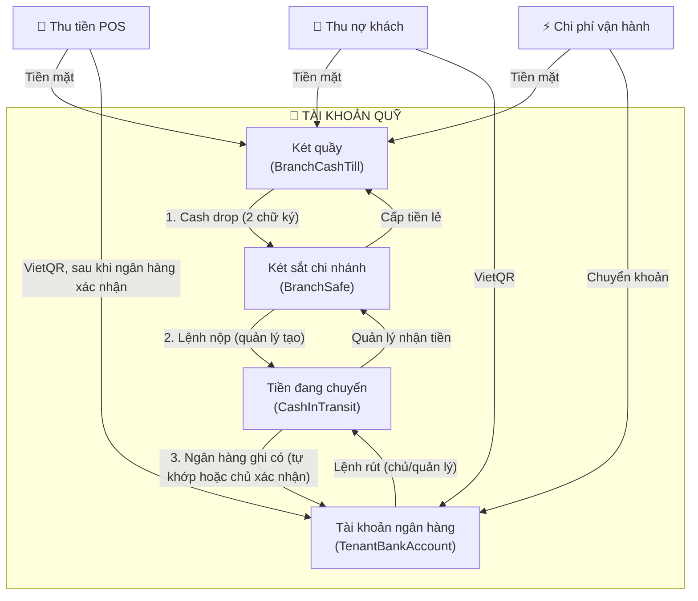
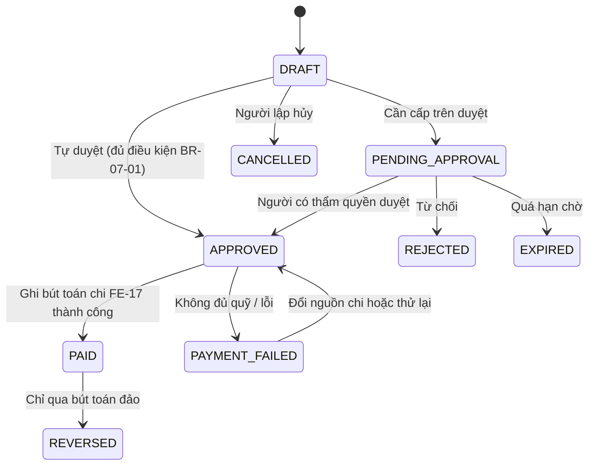
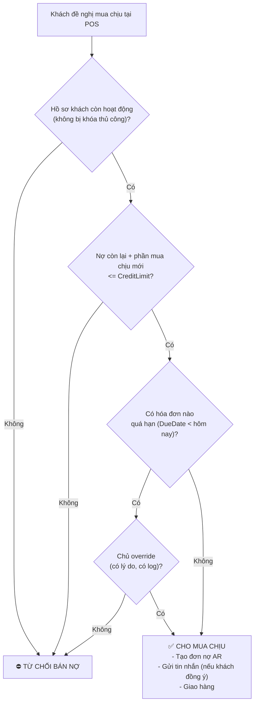
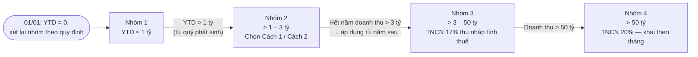

---
id: CTX-MT-GRMS-FIN-003
title: "Bản Đặc Tả Quy Tắc Nghiệp Vụ Tài Chính Toàn Diện v3.0 (FE-07, FE-08, FE-10, FE-17, FE-19)"
date: "2026-10-26"
author: "Nguyễn Trường An"
project: "MT-GRMS"
tags: [financial, cashbook, credit, expenses, pnl, tax, tt152, nd141]
---
# 📘 BẢN ĐẶC TẢ QUY TẮC NGHIỆP VỤ TÀI CHÍNH (FINANCIAL BUSINESS RULES SPECIFICATION)
## HỆ THỐNG QUẢN LÝ BÁN LẺ TẠP HÓA ĐA CHI NHÁNH & ĐA KHÁCH HÀNG (MT-GRMS)

> **Sinh viên thực hiện:** Nguyễn Trường An  
> **Mã phân hệ phụ trách:** `FE-07` (Chi phí vận hành), `FE-08` (Công nợ & Tín dụng AR), `FE-17` (Sổ quỹ & Quản lý dòng tiền), `FE-10` (Báo cáo Lợi nhuận P&L), `FE-19` (Thuế HKD & Sổ kế toán hộ kinh doanh)  
> **Phiên bản:** 3.0 (bản sửa đổi từ 2.0)  
> **Cập nhật:** 26/10/2026 — Trạng thái: chờ phê duyệt  
> **Căn cứ pháp lý đối chiếu đến 26/10/2026:** Thông tư 152/2025/TT-BTC (thay Thông tư 88/2021/TT-BTC từ 01/01/2026); Nghị định 68/2026/NĐ-CP (05/3/2026) đã được sửa đổi bởi Nghị định 141/2026/NĐ-CP (29/4/2026); Luật Quản lý thuế 108/2025/QH15; Luật Thuế thu nhập cá nhân 109/2025/QH15; Luật Kế toán 2015. Các điểm cần đối chiếu lại với văn bản gốc được liệt kê ở **Phụ lục D**.

---

## MỤC LỤC
0. [PHẠM VI, THUẬT NGỮ & VAI TRÒ](#0-phạm-vi-thuật-ngữ--vai-trò)
1. [NGUYÊN TẮC BẤT BIẾN (INVARIANTS)](#1-nguyên-tắc-bất-biến-invariants)
2. [FE-17: SỔ QUỸ & QUẢN TRỊ DÒNG TIỀN](#2-fe-17-sổ-quỹ--quản-trị-dòng-tiền)
3. [FE-07: CHI PHÍ VẬN HÀNH](#3-fe-07-chi-phí-vận-hành)
4. [FE-08: BÁN CHỊU & CÔNG NỢ KHÁCH HÀNG](#4-fe-08-bán-chịu--công-nợ-khách-hàng)
5. [FE-10: BÁO CÁO LỢI NHUẬN P&L](#5-fe-10-báo-cáo-lợi-nhuận-pl)
6. [FE-19: THUẾ HỘ KINH DOANH & SỔ KẾ TOÁN](#6-fe-19-thuế-hộ-kinh-doanh--sổ-kế-toán)
7. [MA TRẬN NGOẠI LỆ (EDGE CASES)](#7-ma-trận-ngoại-lệ-edge-cases)
8. [TIÊU CHUẨN KIỂM THỬ](#8-tiêu-chuẩn-kiểm-thử)
- [Phụ lục A: Yêu cầu kỹ thuật](#phụ-lục-a-yêu-cầu-kỹ-thuật-nfr)
- [Phụ lục B: Bảng tham số cấu hình](#phụ-lục-b-bảng-tham-số-cấu-hình)
- [Phụ lục C: Nhật ký thay đổi so với v2.0](#phụ-lục-c-nhật-ký-thay-đổi-so-với-v20)
- [Phụ lục D: Điểm cần đối chiếu văn bản gốc](#phụ-lục-d-điểm-cần-đối-chiếu-văn-bản-gốc)

---

# 0. PHẠM VI, THUẬT NGỮ & VAI TRÒ

### 0.1 Phạm vi và giả định
1. **Tenant = một hộ kinh doanh (HKD)** của một chủ sở hữu. Các chi nhánh là các địa điểm kinh doanh của cùng HKD; doanh thu để xác định nhóm thuế được **cộng gộp toàn tenant**.
2. Nếu tenant là doanh nghiệp (công ty), chế độ thuế và sổ kế toán của HKD ở mục 6 **không áp dụng** (thuộc phạm vi phiên bản sau). Hệ thống lưu thuộc tính `TenantType` để chặn kích hoạt FE-19 sai đối tượng.
3. Đơn vị tiền tệ: VND. Múi giờ nghiệp vụ: `Asia/Ho_Chi_Minh` (UTC+7) — ngày, ca, kỳ, quý, năm tính theo giờ này; dữ liệu lưu UTC.
4. Việc đăng ký nhiều địa điểm của một HKD và việc chuyển lên doanh nghiệp khi quy mô lớn nằm ngoài phạm vi spec; cần tư vấn pháp lý khi triển khai thực tế.
5. Mọi con số ngưỡng/thời hạn trong spec là **giá trị mặc định đề xuất** và phải là tham số cấu hình theo tenant (xem Phụ lục B), không gán cứng trong mã.

### 0.2 Thuật ngữ

| Thuật ngữ | Định nghĩa |
|---|---|
| **Két quầy (`BranchCashTill`)** | Ngăn kéo tiền của một máy POS (`CashDrawer`). Một chi nhánh có ≥ 1 két quầy. |
| **Két sắt (`BranchSafe`)** | Nơi giữ tiền mặt dôi dư của chi nhánh, do quản lý chi nhánh chịu trách nhiệm. |
| **Ca (`Shift`)** | Một lần mở–chốt của **một két quầy**, do một thu ngân phụ trách. Mỗi két có tối đa một ca đang mở. |
| **Tiền lẻ đầu ca (`OpeningFloat`)** | Tiền nhận bàn giao để thối tiền; không phải doanh thu. |
| **Tiền lẻ giữ lại (`RetainedFloat`)** | Phần tiền thu ngân để lại két cho ca sau; bằng `OpeningFloat` của ca kế tiếp. |
| **Cash drop** | Chuyển phần tiền dôi dư từ két quầy sang két sắt khi hoặc trước khi chốt ca. |
| **`CashInTransit`** | Tài khoản trung gian cho tiền đang di chuyển giữa két và ngân hàng (mỗi lệnh một khoản). |
| **Chủ chuỗi (Owner)** | Chủ hộ kinh doanh, có toàn quyền trong tenant. |
| **Doanh thu tính thuế** | Xem BR-19-05. |
| **YTD** | Doanh thu lũy kế từ 01/01 đến thời điểm xét, theo năm dương lịch. |

### 0.3 Ma trận vai trò (mặc định, tenant có thể điều chỉnh)

| Hành động | Thu ngân | Quản lý chi nhánh | Chủ chuỗi |
|---|:-:|:-:|:-:|
| Mở/chốt ca của két mình | ✔ | ✔ | ✔ |
| Chi tự duyệt ≤ `T1` | ✔ | ✔ | ✔ |
| Duyệt chi `T1 < x ≤ T2` | ✖ | ✔ | ✔ |
| Duyệt chi `> T2`, chi từ tài khoản ngân hàng | ✖ | ✖ | ✔ (hoặc người được ủy quyền) |
| Xác nhận cash drop sang két sắt | ✖ | ✔ | ✔ |
| Tạo lệnh nộp/rút ngân hàng | ✖ | ✔ | ✔ |
| Xác nhận lệnh nộp/rút ngân hàng | ✖ | ✖ (với lệnh nộp) / ✔ (nhận tiền rút về) | ✔ |
| Xác nhận thủ công thanh toán QR | ✔ (≤ `ManualQrVerifyMaxAmount`) | ✔ | ✔ |
| Hoàn tiền mặt đơn trả hàng | ✖ | ✔ | ✔ |
| Đặt/đổi hạn mức tín dụng | ✖ | ✔ (≤ trần quản lý) | ✔ |
| Override khóa nợ quá hạn | ✖ | ✖ | ✔ |
| Xóa nợ xấu | ✖ | ✖ | ✔ |
| Xử lý chênh lệch két (thừa/thiếu) | ✖ | đề xuất | ✔ duyệt |
| Bút toán đảo | ✖ | ✔ (kỳ mở, trong chi nhánh) | ✔ |
| Cấu hình tham số, chọn phương pháp thuế | ✖ | ✖ | ✔ |

---

# 1. NGUYÊN TẮC BẤT BIẾN (INVARIANTS)

Mọi chức năng tài chính phải tuân thủ 5 nguyên tắc dưới đây. Chi tiết triển khai kỹ thuật (kiểu dữ liệu, EF Core, khóa đồng thời, mã băm) nằm ở **Phụ lục A**.

### [INV-01] Chính xác tiền tệ
- Cấm dùng số thực dấu phẩy động cho tiền và tỷ lệ.
- Số tiền giao dịch là số nguyên đồng. Kết quả tính toán trung gian (thuế, phân bổ chi phí) làm tròn đến đồng theo quy tắc **nửa lên (AwayFromZero)**, không dùng làm tròn banker's.
- Mọi phép **phân bổ** (chi phí chung, chia theo tỷ lệ) phải bảo đảm **tổng các phần bằng đúng tổng gốc**: phần dư chia cho các phần có số dư lớn nhất (largest remainder).

### [INV-02] Sổ cái bất biến, có khóa kỳ
1. `CashbookEntries` và `AccountingLedger` chỉ **thêm mới**. Cấm xóa và cấm sửa các trường giá trị (số tiền, loại bút toán, tài khoản, tenant, chi nhánh, thời điểm).
2. Sửa sai bằng **bút toán đảo** tham chiếu bản ghi gốc (`ReversedEntryId`), ghi đủ lý do, người thực hiện, thời điểm. Bút toán đảo **không được đảo lại**; muốn sửa tiếp phải tạo bút toán mới.
3. **Khóa kỳ:** sau khi chủ chốt kỳ (tháng/quý), không được ghi hoặc đảo bút toán vào kỳ đã khóa. Sai sót phát hiện sau đó được điều chỉnh bằng bút toán ở kỳ hiện tại, tham chiếu bút toán gốc; mở lại kỳ chỉ chủ chuỗi làm được và phải ghi log.
4. Quyền đảo bút toán theo ma trận 0.3.

### [INV-03] Phân lập dữ liệu
- Dữ liệu tách tuyệt đối theo tenant. Hồ sơ khách hàng, danh sách nợ xấu **không chia sẻ giữa các tenant**.
- Trong tenant, thu ngân chỉ thao tác trên két và ca của chi nhánh mình; quản lý chỉ thấy chi nhánh được phân công; chủ thấy toàn bộ.

### [INV-04] Chống trùng lặp
- Mọi thao tác làm thay đổi tiền, nợ hoặc trạng thái phiếu chỉ được thực hiện **một lần cho mỗi yêu cầu**, kể cả khi client gửi lại do mất mạng hoặc POS hoạt động offline rồi đồng bộ.
- Danh sách thao tác bắt buộc: bán hàng/thanh toán POS, tạo phiếu thu/chi, **duyệt chi**, thu nợ, trả hàng, mở/chốt ca, cash drop, tạo lệnh nộp/rút ngân hàng, **xác nhận nhận tiền**, xử lý chênh lệch két, xóa nợ.
- Cùng khóa nhưng nội dung khác → bị từ chối là xung đột (không xử lý ngầm). Cơ chế chi tiết ở Phụ lục A.

### [INV-05] Phân định ba tầng: dòng tiền – doanh thu – thuế

```
       ┌────────────────────────────────────────────────────────┐
       │                GIAO DỊCH PHÁT SINH                     │
       └──────────────────────────┬─────────────────────────────┘
                                  │
         ┌────────────────────────┼────────────────────────┐
         ▼                        ▼                        ▼
   [FE-17 Sổ Quỹ]           [FE-10 P&L]              [FE-19 Thuế HKD]
   Dòng tiền thực vào/ra    Doanh thu ghi nhận       Doanh thu tính thuế
   (theo tiền thực tế)      theo hóa đơn bán hàng    (theo quy định thuế)
```

Bảng định tuyến bắt buộc cho từng loại giao dịch:

| # | Giao dịch | Sổ quỹ FE-17 | Công nợ FE-08 | P&L FE-10 | Doanh thu tính thuế FE-19 |
|---|---|---|---|---|---|
| 1 | Bán tiền mặt / QR | Tăng (QR: chỉ khi ngân hàng xác nhận) | — | + Doanh thu | + Doanh thu |
| 2 | Bán chịu | — | + Nợ | + Doanh thu | + Doanh thu (theo hóa đơn) |
| 3 | Thu nợ | Tăng | − Nợ | — | — |
| 4 | Trả hàng đơn nợ chưa thu | — | − Nợ | − Doanh thu (− giá vốn nếu nhập lại kho) | − Doanh thu (kèm hóa đơn điều chỉnh) |
| 5 | Trả hàng đơn đã thu tiền | Giảm nếu hoàn tiền; không đổi nếu ghi trả trước | Ghi trả trước (nếu có) | − Doanh thu | − Doanh thu |
| 6 | Nạp vốn chủ sở hữu | Tăng | — | — | — |
| 7 | Rút vốn chủ sở hữu | Giảm | — | — | — |
| 8 | Vay / trả gốc vay | Tăng / giảm | — | — (lãi vay là chi phí) | — |
| 9 | Chuyển nội bộ (két ↔ két sắt ↔ đang chuyển ↔ ngân hàng) | Chuyển giữa tài khoản, tổng không đổi | — | — | — |
| 10 | Chi phí vận hành | Giảm | — | + Chi phí | Chi phí được trừ nếu hợp lệ (chỉ khi dùng phương pháp thu nhập tính thuế) |
| 11 | Thừa quỹ khi chốt ca | Tăng, đối ứng tài khoản chờ xử lý | — | Chỉ thành thu nhập khác sau khi chủ duyệt | Không tính là doanh thu bán hàng |
| 12 | Thiếu quỹ khi chốt ca | Giảm (bút toán điều chỉnh) | — | Chi phí tổn thất khi chủ duyệt (hoặc phải thu nhân viên) | Không phải chi phí được trừ theo mặc định |
| 13 | Xóa nợ xấu | — | − Nợ | + Chi phí nợ xấu | Doanh thu đã tính không điều chỉnh; chi phí mặc định không được trừ |
| 14 | Phí ngân hàng / phí QR | Giảm | — | + Chi phí | Được trừ nếu có chứng từ |

---

# 2. FE-17: SỔ QUỸ & QUẢN TRỊ DÒNG TIỀN

`FE-17` là **nguồn sự thật duy nhất** cho tiền mặt và tiền gửi của hệ thống.



### [BR-17-01] Tài khoản quỹ và quy tắc chống âm
1. Bốn loại tài khoản quỹ: `BranchCashTill`, `BranchSafe`, `CashInTransit` (mỗi lệnh một khoản), `TenantBankAccount` (một hoặc nhiều tài khoản của hộ kinh doanh).
2. Số dư mỗi tài khoản **bằng tổng các bút toán** của nó. Bảng số dư chỉ là bản sao cập nhật trong cùng giao dịch với bút toán và được đối chiếu định kỳ.
3. **Chống âm:** trước khi ghi bút toán giảm tiền của Két quầy, Két sắt hoặc Tài khoản ngân hàng, hệ thống kiểm tra, trong cùng giao dịch có khóa chống đua:
   $$\text{SốDưHiệnTại} - \text{SốTiềnChi} \ge 0$$
   Nếu $< 0$ → từ chối, ném `InsufficientFundsException`. Tài khoản ngân hàng chỉ được âm nếu tenant bật `AllowBankOverdraft` (mặc định tắt).
4. Hệ thống chỉ ngăn **số liệu** bị âm, không thể kiểm soát tiền thật. Nếu két thực tế có tiền mà sổ chưa đủ, phải ghi nhận khoản thu còn thiếu (ví dụ nạp tiền lẻ, cash drop ngược) rồi mới chi.
5. Mọi chuyển tiền giữa hai tài khoản là một **cặp bút toán ra–vào** cùng `TransferId`; tổng bằng 0.

### [BR-17-02] Ca thu ngân, tiền lẻ và chốt ca
**1. Mở ca**
- `OpeningFloat` được **tự điền** từ `RetainedFloat` của ca trước trên cùng két. Thu ngân đếm thực tế và xác nhận.
- Nếu số đếm khác số tự điền → ghi `HandoverDiscrepancy` thuộc ca trước, xử lý theo cùng quy trình chênh lệch ở mục 4 bên dưới; ca mới bắt đầu bằng số đếm thực tế.
- Két mới hoặc lần đầu: tiền lẻ được cấp bằng cash drop ngược từ két sắt hoặc `EQUITY_INJECTION` bằng tiền mặt.
- `OpeningFloat` ở trạng thái `HELD_FLOAT`, không tính vào doanh thu hay dòng tiền thu trong ca.

**2. Trong ca:** mọi thu/chi tiền mặt đi qua Két quầy của ca đó.

**3. Chốt ca (Z-Report)**

$$\text{ExpectedCash} = \text{OpeningFloat} + \sum \text{CashIn} - \sum \text{CashOut}$$
$$\text{Discrepancy} = \text{ActualCashCounted} - \text{ExpectedCash}$$

- `CashIn`: bán tiền mặt, thu nợ tiền mặt, nạp vốn tiền mặt, tiền cấp vào từ két sắt hoặc ngân hàng.
- `CashOut`: chi phí, hoàn tiền trả hàng, rút vốn, cash drop, tiền chuyển ra ngân hàng.

**4. Xử lý chênh lệch**
- $|\text{Discrepancy}| \le$ `CashToleranceAmount`: tự động ghi vào `CASH_ROUNDING_VARIANCE` (có log), không cần duyệt.
- **Thừa tiền ($>$ dung sai):** két được ghi tăng, đối ứng tài khoản **`CASH_OVER_SUSPENSE` (thừa quỹ chờ xử lý)**. Trong `SuspenseResolveDays`, chủ chọn một trong ba: (a) chuyển thành *thu nhập khác* (`OTHER_INCOME`); (b) phát hiện lỗi ghi sổ → điều chỉnh/đảo; (c) hoàn trả khách. Chưa được xử lý thì không tính vào P&L.
- **Thiếu tiền ($>$ dung sai):** két được ghi giảm **ngay** bằng bút toán điều chỉnh, đối ứng `CASH_SHORTAGE_PENDING`, đồng thời sinh biên bản kiểm kê. Chủ chọn: (a) **bồi hoàn** — ghi phải thu nhân viên hoặc khấu trừ lương qua `FE-18`, mức khấu trừ không vượt `MaxSalaryDeductionPercent` theo pháp luật lao động; (b) ghi **chi phí tổn thất** `EXPENSE_CASH_SHORTAGE` (`IsTaxDeductible = false` theo mặc định); (c) lỗi ghi sổ → điều chỉnh/đảo.

**5. Giữ lại tiền lẻ và cash drop**
- Thu ngân giữ `RetainedFloatAmount` (ví dụ 1.000.000đ) trong két cho ca sau.
- Phần dôi dư được chuyển bằng **cash drop** Két quầy → Két sắt, **xác nhận bởi hai người** (thu ngân và quản lý). Ca chỉ chốt hoàn tất khi cash drop đã được quản lý xác nhận.
- Từ lúc xác nhận, tiền do quản lý chi nhánh chịu trách nhiệm trong Két sắt.

### [BR-17-03] Nộp tiền mặt vào ngân hàng (2 bước)
Mục tiêu: phân định trách nhiệm trong lúc mang tiền và **không để số dư ngân hàng tăng trước khi ngân hàng thực sự ghi có**. (Cơ chế này không ngăn được mất tiền; nó giữ cho số liệu trung thực và xác định đúng người chịu trách nhiệm.)

1. **Bước 1 — Tạo lệnh `DepositToBank`** (quản lý chi nhánh): chọn nguồn (Két sắt, hoặc Két quầy khi có quyền), số tiền, tài khoản ngân hàng đích, **người mang tiền** (`CarrierUserId`).
   - Tài khoản nguồn giảm ngay; số tiền chuyển sang `CashInTransit`; trạng thái `PENDING_BANK_CONFIRMATION`. Chủ chuỗi nhận thông báo ngay khi lệnh được tạo.
2. **Bước 2 — Xác nhận:**
   - **Tự động:** giao dịch ngân hàng (webhook/sao kê) khớp số tiền, mã tham chiếu và khung giờ → `COMPLETED`.
   - **Thủ công:** chủ chuỗi xem ứng dụng ngân hàng, nhập `ReceivedAmount` thực tế và xác nhận.
   - `ReceivedAmount = Amount` → tiền chuyển `CashInTransit` → `TenantBankAccount`, `COMPLETED`.
   - `ReceivedAmount < Amount` → phần nhận được vào ngân hàng; phần thiếu giữ ở `CashInTransit` trạng thái `DISCREPANCY`, xử lý như thiếu quỹ (biên bản, bồi hoàn hoặc tổn thất). Nếu `>` thì xử lý như thừa quỹ.
3. **Hủy lệnh:** trước khi ngân hàng ghi có, quản lý được hủy kèm lý do; tiền trở về tài khoản nguồn. Sau cảnh báo trễ, chỉ chủ chuỗi được hủy.
4. **Cảnh báo trễ:** sau `TransitAlertMinutes` (mặc định 120 phút, tính theo giờ làm việc của ngân hàng đã cấu hình; nộp ngoài giờ thì tính từ giờ mở cửa kế tiếp) chưa hoàn tất → thông báo khẩn cho chủ. Sau `TransitEscalateHours` (mặc định 24 giờ) → trạng thái `OVERDUE`, leo thang cho chủ và kế toán.
5. **Tổn thất trên đường:** chủ lập biên bản; khoản `CashInTransit` chuyển sang `LOSS_IN_TRANSIT` rồi xử lý như thiếu quỹ (phải thu nhân viên hoặc chi phí tổn thất).

### [BR-17-04] Rút tiền từ ngân hàng về két và chuyển nội bộ
1. **Rút ngân hàng về chi nhánh:** chủ hoặc quản lý tạo lệnh `WithdrawFromBank` (vượt `WithdrawApprovalThreshold` thì cần chủ duyệt). Ngân hàng giảm → `CashInTransit` → khi quản lý chi nhánh **xác nhận đã nhận đủ tiền** thì Két sắt (hoặc Két quầy) tăng.
2. **Cấp tiền lẻ Két sắt → Két quầy, chuyển Két quầy ↔ Két quầy:** cần hai chữ ký (người giao và người nhận).
3. Mọi thao tác trên đều tuân thủ BR-17-01 (chống âm) và INV-04 (chống trùng).

### [BR-17-05] Đối soát ngân hàng và thanh toán QR
1. Mỗi giao dịch QR tạo `PaymentIntent` có mã tham chiếu duy nhất. **Bút toán thu vào tài khoản ngân hàng chỉ được ghi** khi nhận webhook hợp lệ (đã xác thực chữ ký) hoặc khi khớp sao kê. Webhook trùng (cùng mã giao dịch ngân hàng) bị bỏ qua.
2. **Webhook chậm/mất mạng:** đơn chuyển `PENDING_RECONCILIATION`. Được phép **xác nhận thủ công** để khách đi, với ràng buộc:
   - số tiền ≤ `ManualQrVerifyMaxAmount` (đề xuất 500.000đ) thu ngân tự làm; vượt mức cần quản lý nhập mã PIN;
   - tối đa `ManualQrVerifyMaxPerShift` lần mỗi ca;
   - ghi rõ người xác nhận, thời điểm, ảnh chụp màn hình (tùy chọn).
3. **Không ghi số dư ngân hàng** cho đến khi ngân hàng xác nhận. Doanh thu vẫn ghi nhận ở P&L theo hóa đơn; khoản chưa về hiển thị ở mục "chờ đối soát".
4. Webhook/sao kê về trong `ReconcileWindowHours` (mặc định 24 giờ): khớp đơn tự động, ghi thu **một lần**, không tạo phiếu thu thứ hai. Hết hạn chưa khớp → `UNMATCHED`, báo chủ quyết định: coi như chưa thu (xử lý trách nhiệm người xác nhận) hoặc xác nhận tiền đã về tài khoản khác.
5. **Đối soát định kỳ:** nhập sao kê hằng ngày/tuần; liệt kê chênh lệch. Phí ngân hàng, phí QR, lãi tiền gửi ghi nhận từ sao kê (chi phí / thu nhập tài chính). Số dư ngân hàng trên hệ thống phải bằng số dư sao kê trừ/cộng các khoản đang chờ đối soát được liệt kê rõ.

---

# 3. FE-07: CHI PHÍ VẬN HÀNH

`FE-07` quản lý các khoản chi phục vụ hoạt động cửa hàng (điện, nước, internet, thuê mặt bằng, sửa chữa, túi ni-lông, văn phòng phẩm...). Mọi khoản chi **phải có `BranchId`** (hoặc `NULL` cho chi phí chung toàn chuỗi), độc lập với nguồn tiền dùng để chi.

### [BR-07-01] Phân cấp duyệt chi
Các mức `T1`, `T2`, `C1`, `C2` là tham số (Phụ lục B).

| Giá trị phiếu chi | Người duyệt | Ghi chú |
|---|---|---|
| ≤ `T1` (đề xuất 500.000đ) | Tự duyệt (thu ngân) | Chỉ chi từ két quầy, và còn trong hạn mức lũy kế |
| `T1` < x ≤ `T2` (đề xuất 3.000.000đ) | Quản lý chi nhánh | Người lập ≠ người duyệt |
| > `T2` | Chủ chuỗi | Thông báo đẩy; chỉ chi sau khi chủ duyệt |
| Bất kỳ giá trị, chi từ tài khoản ngân hàng | Chủ chuỗi hoặc người được ủy quyền | Nhân viên không tự chi từ tài khoản ngân hàng |

1. **Hạn mức lũy kế tự duyệt:** tổng phiếu tự duyệt trong một ca của một két ≤ `C1` (đề xuất 1.500.000đ); tổng trong ngày của chi nhánh ≤ `C2` (đề xuất 3.000.000đ). Khi một phiếu làm vượt hạn mức, phiếu **không bị từ chối** mà chuyển lên cấp duyệt kế tiếp.
2. **Ủy quyền:** chủ có thể ủy quyền duyệt cho một người trong một khoảng thời gian xác định; mọi lần duyệt ghi người duyệt thực tế.
3. **Hết hạn chờ duyệt:** phiếu `PENDING_APPROVAL` quá `ApprovalExpireHours` (đề xuất 24 giờ) chuyển `EXPIRED` và báo lại cho người lập.

### [BR-07-02] Chống tách nhỏ hóa đơn (Anti-Splitting)
1. **Gộp theo đối tượng:** các phiếu có cùng `(BranchId, nhà cung cấp/đối tượng chuẩn hóa hoặc hạng mục chi, ngày)` trong `SplitWindowHours` (đề xuất: cùng ngày) được cộng gộp. Khi tổng gộp vượt `T1`, phiếu làm vượt và các phiếu sau trong nhóm **không được tự duyệt**, chuyển lên cấp duyệt tương ứng với tổng gộp; các phiếu trước đó được gắn cờ và đưa vào báo cáo nghi vấn.
2. **Mẫu hình đáng ngờ:** cùng một nhân viên lập ≥ `SplitCount` (đề xuất 3) phiếu tự duyệt trong 60 phút, mỗi phiếu ≥ 60% `T1` → phiếu thứ `SplitCount` trở đi bị chuyển lên quản lý duyệt.
3. Phiếu gốc không bao giờ bị xóa; mọi cờ nghi vấn có log và hiển thị cho chủ.

### [BR-07-03] Vòng đời phiếu chi và liên động Sổ quỹ



1. **Tự duyệt:** kiểm tra số dư két ngay khi tạo phiếu. Không đủ quỹ → từ chối tại chỗ (EXC-01), không tạo phiếu `APPROVED` nhưng chưa chi.
2. **Duyệt sau:** khi cấp trên duyệt, hệ thống kiểm tra quỹ tại thời điểm chi. Thiếu → `PAYMENT_FAILED` và thông báo; người duyệt có thể đổi nguồn chi (két khác hoặc ngân hàng).
3. **Chỉ phiếu `PAID` mới có bút toán FE-17.** Mỗi phiếu chi có đúng **một** bút toán chi (`SourceType = 'EXPENSE'`, `SourceId = expense.Id`, ràng buộc duy nhất). Sửa hoặc hủy sau khi `PAID` chỉ bằng bút toán đảo liên kết.
4. Bút toán sinh tự động bị **khóa chỉnh sửa** tại màn hình Sổ quỹ.
5. **Kỳ ghi nhận chi phí** ở P&L theo `ExpenseDate` (kỳ phát sinh theo chứng từ), không theo ngày chi tiền. Khoản trả trước/trả sau cho nhiều kỳ có thể khai báo `PeriodFrom`–`PeriodTo` để phân bổ đều theo ngày.

### [BR-07-04] Phân loại chi phí và khả năng được trừ khi tính thuế (một sổ, hai góc nhìn)
1. **Nguyên tắc trung thực:** hệ thống ghi **100% doanh thu và 100% chi phí thực tế**. Không có chức năng nào cho phép ẩn hoặc loại bỏ doanh thu hay chi phí khỏi sổ. Khác biệt giữa báo cáo quản trị (FE-10) và số liệu tính thuế (FE-19) chỉ đến từ cờ **được trừ / không được trừ**, không từ việc có hai bộ sổ.
2. Cờ `IsTaxDeductible` mặc định `false`. Chỉ đặt `true` khi khoản chi đáp ứng điều kiện chứng từ hợp lệ theo quy định hiện hành (ví dụ hóa đơn có thông tin người mua là hộ kinh doanh; hợp đồng thuê và chứng từ điện nước hợp lệ; bảng kê mua hàng không có hóa đơn theo mẫu và điều kiện hiện hành).
3. Cờ này **chỉ có tác dụng khi hộ tính TNCN theo thu nhập tính thuế**: Nhóm 2 chọn Cách 2, Nhóm 3 và Nhóm 4. Với hộ tính theo tỷ lệ % trên doanh thu, chi phí không ảnh hưởng số thuế (nhưng vẫn được ghi để quản trị và để sẵn dữ liệu nếu phải chuyển phương pháp).
4. Danh mục hạng mục chi, trạng thái được trừ mặc định (`DefaultDeductible`) và chứng từ bắt buộc (`RequiredEvidence`) là **dữ liệu cấu hình**, không gán cứng; phải đối chiếu quy định hiện hành (Phụ lục D). Các nhóm thường không được trừ: chi cho mục đích cá nhân của chủ hộ, tiền phạt, tổn thất thiếu quỹ chưa có đủ hồ sơ.
5. Chứng từ đính kèm lưu theo phiếu chi: ảnh/tệp, số hóa đơn, mã số thuế người bán. Trùng số hóa đơn + người bán → cảnh báo.

---

# 4. FE-08: BÁN CHỊU & CÔNG NỢ KHÁCH HÀNG

`FE-08` cho phép bán chịu cho khách quen và **giảm** rủi ro nợ xấu, tranh chấp (không loại bỏ hoàn toàn).



### [BR-08-01] Thẩm định tín dụng hai khóa
**Hồ sơ khách:** tên, số điện thoại, địa chỉ, người bảo lãnh (tùy chọn), xác nhận đồng ý lưu dữ liệu cá nhân và nhận tin nhắn. `CreditLimit` do quản lý (trong trần của quản lý) hoặc chủ đặt; mọi lần đổi hạn mức ghi log (người, thời điểm, giá trị cũ/mới). Chủ có thể khóa tín dụng thủ công.

Khi chọn "Ghi nợ (Mua chịu)":
1. **Khóa 1 — Hạn mức:** 
   $$\text{NợCònLại} + \text{PhầnMuaChịuMới} \le \text{CreditLimit}$$
   `PhầnMuaChịuMới` = giá trị đơn trừ phần trả ngay và phần cấn trừ từ số dư trả trước (nếu khách đồng ý).
2. **Khóa 2 — Quá hạn:** mỗi hóa đơn có `DueDate = InvoiceDate + CreditTermDays` (mặc định 30 ngày). Nếu khách có **bất kỳ hóa đơn nào** đã quá `DueDate` → khóa bán nợ, kể cả khi số nợ quá hạn rất nhỏ (ví dụ nợ cũ 10.000đ quá 1 ngày, hạn mức còn 2.000.000đ).
3. **Override:** chỉ chủ chuỗi được bỏ qua Khóa 2, bắt buộc ghi lý do, giới hạn trong một đơn, có log và báo cáo.
4. Khách thanh toán hết khoản quá hạn (theo BR-08-03) là được mở khóa tự động.

### [BR-08-02] Trả hàng: ma trận xử lý theo trạng thái thanh toán của đơn gốc
Gọi $R$ là giá trị hàng trả, $O$ là số **còn nợ** của đơn gốc, $P$ là số **đã thu thực tế** được phân bổ cho đơn gốc (theo bảng phân bổ thanh toán).

| Trạng thái đơn gốc | Xử lý |
|---|---|
| `UNPAID` ($P = 0$) | Giảm nợ đúng $R$ (**cấm** sinh phiếu chi tiền mặt). Két không biến động. |
| `PARTIALLY_PAID` | Bước 1: giảm nợ $\min(R, O)$. Bước 2: phần $R - O$ (nếu $> 0$, tối đa $P$) → **số dư trả trước** của khách (mặc định) hoặc hoàn tiền (xem dưới). |
| `PAID` | Toàn bộ $R$ (tối đa $P$) → số dư trả trước (mặc định) hoặc hoàn tiền. |

- **Hoàn tiền** (tiền mặt hoặc chuyển khoản) là ngoại lệ: cần quản lý duyệt; **không bao giờ vượt số đã thu thực tế $P$**; hoàn theo kênh khách đã dùng; tiền mặt phải còn đủ trong két (BR-17-01).
- Tất cả đều tạo bút toán ghi rõ tham chiếu đơn gốc và phiếu trả hàng; sửa sai bằng bút toán đảo.
- **Hàng nhập lại kho:** hoàn giá vốn tương ứng (FE-06). Hàng hỏng/không bán lại được: không hoàn giá vốn, ghi tổn thất.
- **Hóa đơn:** trả hàng sau khi đã xuất hóa đơn phải gắn với hóa đơn điều chỉnh/thay thế hoặc chứng từ theo quy định hiện hành (xem BR-19-06).
- Có `ReturnWindowDays` (tham số) giới hạn thời gian trả hàng; ngoài thời hạn cần quản lý duyệt.

### [BR-08-03] Thu nợ theo FIFO, cho phép chọn hóa đơn
1. Mặc định thu nợ theo **FIFO** theo `InvoiceDate` tăng dần. Ví dụ: nợ 3 đơn 500k, 400k, 600k; khách trả 700k → đơn 500k `PAID`; 200k còn lại cấn vào đơn 400k (`PARTIALLY_PAID`, còn 200k).
2. Khách hoặc quản lý có thể **chỉ định hóa đơn** cần thanh toán (ví dụ hóa đơn đang tranh chấp); việc này được ghi log. Sau thanh toán, hệ thống vẫn áp Khóa 2 theo các hóa đơn còn lại.
3. Mỗi lần thu nợ sinh các dòng **phân bổ** (`PaymentAllocation`: thanh toán – hóa đơn – số tiền). Đảo một khoản thu nợ sẽ mở lại đúng các hóa đơn đã được phân bổ.
4. Tiền thu nợ ghi vào FE-17: tiền mặt vào Két quầy của ca đang mở; QR theo BR-17-05.

### [BR-08-04] Số dư trả trước của khách
- Khi khách trả dư (ví dụ nợ 485.000đ, đưa 500.000đ, dặn không thối), phần dư 15.000đ ghi vào **`CustomerCreditBalance`** (số dư trả trước — là khoản **phải trả khách**, không phải doanh thu), tách biệt với công nợ từng hóa đơn; không dùng số âm trong bảng nợ.
- Lần mua sau, POS gợi ý cấn trừ số dư trả trước; chỉ áp dụng khi khách đồng ý hoặc khi quản lý cài đặt tự động cấn.
- Muốn ghi số dư thành thu nhập khác (ví dụ khách tặng/làm tròn) cần quản lý duyệt và ghi lý do.
- "Đặt cọc cho đơn hàng cụ thể" là nghiệp vụ khác, không dùng chung trường này.

### [BR-08-05] Xóa nợ xấu
1. Chỉ chủ chuỗi được xóa nợ, với hóa đơn đã quá hạn từ `BadDebtAgeDays` (đề xuất 180 ngày) hoặc có lý do đặc biệt, bắt buộc ghi hồ sơ.
2. Bút toán: giảm công nợ, ghi **chi phí nợ xấu** (`BAD_DEBT`) vào P&L; `IsTaxDeductible = false` theo mặc định (cần đối chiếu điều kiện chứng từ hiện hành).
3. Hồ sơ nợ đã xóa vẫn được lưu; nếu khách trả sau này, khoản thu ghi nhận là *thu hồi nợ đã xóa* (thu nhập khác), không phải thu nợ thông thường.
4. Khách còn nợ đã xóa bị khóa tín dụng, trừ khi chủ gỡ.

### [BR-08-06] Bảo vệ dữ liệu cá nhân và đối chiếu khách
- Cảnh báo "trùng người liên hệ/địa chỉ/bảo lãnh với hồ sơ nợ xấu" (EXC-07) chỉ đối chiếu **trong cùng tenant**.
- Gửi Zalo/SMS về công nợ chỉ khi khách đã đồng ý; tuân thủ quy định bảo vệ dữ liệu cá nhân hiện hành.

---

# 5. FE-10: BÁO CÁO LỢI NHUẬN P&L

`FE-10` là báo cáo **quản trị** cho từng chi nhánh và toàn chuỗi. Cơ sở ghi nhận: **doanh thu theo hóa đơn bán hàng** (không phụ thuộc đã thu tiền hay chưa); **chi phí theo kỳ phát sinh** (`ExpenseDate`, hoặc phân bổ theo `PeriodFrom–PeriodTo`).

### [BR-10-01] Công thức

$$\text{Doanh thu thuần} = \text{Doanh thu bán hàng (tiền mặt + chuyển khoản + bán chịu)} - \text{Chiết khấu/giảm giá} - \text{Hàng bán trả lại}$$

$$\text{Giá vốn hàng bán thuần} = \text{COGS hàng đã bán} - \text{COGS hàng trả lại đã nhập kho}$$

$$\text{Lợi nhuận gộp} = \text{Doanh thu thuần} - \text{Giá vốn hàng bán thuần}$$

$$\text{Lợi nhuận hoạt động} = \text{Lợi nhuận gộp} - \text{Chi phí vận hành (FE-07, gồm phí ngân hàng/QR)} - \text{Chi phí lương (FE-18)} - \text{Chi phí tổn thất (hao hụt kho, thiếu quỹ)} - \text{Chi phí nợ xấu} - \text{Khấu hao (nếu có)}$$

$$\text{Lợi nhuận trước thuế} = \text{Lợi nhuận hoạt động} + \text{Thu nhập khác (đã duyệt)}$$

$$\text{Lợi nhuận sau thuế (ước tính)} = \text{Lợi nhuận trước thuế} - \text{Thuế GTGT và TNCN phải nộp (ước tính từ FE-19)}$$

- Phương pháp giá vốn (bình quân gia quyền/FIFO) do `FE-06` quy định; FE-10 chỉ dùng kết quả.
- Thu nhập khác chỉ gồm khoản đã được chủ duyệt (thừa quỹ đã xử lý, thu hồi nợ đã xóa, lãi tiền gửi...).

### [BR-10-02] Các khoản không đi qua P&L
- `EQUITY_INJECTION` tăng quỹ nhưng **không** là doanh thu; `OWNER_WITHDRAWAL` giảm quỹ nhưng **không** là chi phí.
- Vay (`LOAN_IN`) và trả gốc vay (`LOAN_REPAYMENT`) không đi qua P&L; **lãi vay** là chi phí.
- Chuyển nội bộ giữa các tài khoản quỹ không ảnh hưởng P&L.
- Chi cá nhân của chủ hộ bằng tiền cửa hàng phải ghi là `OWNER_WITHDRAWAL`, không ghi là chi phí vận hành.
- Các khoản trên cũng bị chống âm theo BR-17-01.

### [BR-10-03] Báo cáo từng chi nhánh và hợp nhất
1. **Chi nhánh:** doanh thu, giá vốn và chi phí gắn `BranchId` tính cho chi nhánh đó, bất kể chi bằng két hay ngân hàng.
2. **Chi phí chung toàn chuỗi** (`BranchId = NULL`: thuê kho tổng, phần mềm, thuế...) được hạch toán ở cấp tenant và **phân bổ** cho chi nhánh vào cuối kỳ theo `AllocationMethod` (mặc định: tỷ lệ doanh thu thuần; có thể chọn khác theo cấu hình).
3. Phân bổ tuân thủ INV-01 (tổng các phần bằng đúng tổng gốc). Chi nhánh mở giữa kỳ chỉ nhận phân bổ từ ngày hoạt động.
4. Chuyển hàng/tiền giữa chi nhánh phải có bút toán hai phía; chuyển hàng ghi theo giá vốn, không tạo doanh thu nội bộ trong báo cáo hợp nhất.

---

# 6. FE-19: THUẾ HỘ KINH DOANH & SỔ KẾ TOÁN

`FE-19` **hỗ trợ lập số liệu** để hộ kinh doanh thực hiện nghĩa vụ thuế và chế độ kế toán theo Thông tư 152/2025/TT-BTC, Nghị định 68/2026/NĐ-CP (đã sửa đổi bởi Nghị định 141/2026/NĐ-CP) và các luật liên quan. Chủ hộ là người kê khai, nộp thuế và chịu trách nhiệm; hệ thống không nộp thay trừ khi có tích hợp được chủ cho phép.

> Từ 01/01/2026 thuế khoán đã chấm dứt: hộ kinh doanh tự kê khai, tự tính, tự nộp thuế theo doanh thu thực tế. Thông tư 88/2021/TT-BTC không còn là căn cứ.

### [BR-19-01] Phân nhóm theo doanh thu năm

Doanh thu năm = doanh thu tính thuế **cộng gộp toàn tenant** trong năm dương lịch (BR-19-05).

| Nhóm | Doanh thu năm | GTGT | TNCN | Kỳ khai | Sổ kế toán | Hóa đơn điện tử |
|---|---|---|---|---|---|---|
| **1** | ≤ 1 tỷ | Miễn | Miễn | Thông báo doanh thu năm theo quy định (trước 31/01 hằng năm) | `S1a-HKD` | Không bắt buộc HĐĐT từ máy tính tiền; vẫn tuân thủ quy định hóa đơn hiện hành |
| **2** | > 1 – 3 tỷ | Tỷ lệ % × doanh thu | **Chọn một:** Cách 1 — tỷ lệ % × (doanh thu − 1 tỷ); Cách 2 — 15% × thu nhập tính thuế | Theo quý | Cách 1: `S2a-HKD`. Cách 2: `S2b`, `S2c`, `S2d`, `S2e-HKD` | HĐĐT có mã của cơ quan thuế hoặc khởi tạo từ máy tính tiền |
| **3** | > 3 – 50 tỷ | Tỷ lệ % × doanh thu | 17% × thu nhập tính thuế (tạm nộp theo quý, quyết toán năm) | Theo quý | `S2b`, `S2c`, `S2d`, `S2e-HKD` | Như Nhóm 2 |
| **4** | > 50 tỷ | Tỷ lệ % × doanh thu | 20% × thu nhập tính thuế | Theo tháng | `S2b`, `S2c`, `S2d`, `S2e-HKD` | Như Nhóm 2 |

`S3a-HKD` chỉ lập khi hộ có hoạt động chịu thuế khác (tiêu thụ đặc biệt, tài nguyên, xuất nhập khẩu, bảo vệ môi trường, sử dụng đất...). Thông thường bán lẻ tạp hóa không cần `S3a`.

**Quy tắc chuyển nhóm và phương pháp**
1. Trong năm, khi doanh thu lũy kế (YTD) **vượt 1 tỷ** → từ quý phát sinh doanh thu vượt ngưỡng, hộ phải khai theo quý và dùng HĐĐT theo quy định; nghĩa vụ thuế phát sinh từ quý đó.
2. Hộ Nhóm 2 đang dùng Cách 1 mà **hết năm** doanh thu thực tế > 3 tỷ → **từ năm tiếp theo** phải chuyển sang tính TNCN theo thu nhập tính thuế. Phương pháp của năm hiện tại không đổi giữa năm.
3. Hệ thống ghi nhận lựa chọn Cách 1/Cách 2 của Nhóm 2 (người chọn, thời điểm). Việc đổi phương pháp tuân theo quy định về đăng ký/thay đổi hiện hành (Phụ lục D).
4. Mức trừ ngưỡng 1 tỷ của Cách 1 chỉ áp dụng **một lần cho cả hộ**; khi hộ có nhiều ngành/địa điểm, chủ chọn ngành/địa điểm áp dụng mức trừ (Phụ lục D).
5. Nhóm 4 (> 50 tỷ) khai theo tháng và chịu 20%; thời điểm áp dụng khi vượt ngưỡng giữa năm cần đối chiếu văn bản gốc (Phụ lục D).
6. YTD **đặt lại mỗi 01/01**. **Không có trạng thái "khóa vĩnh viễn"**: nhóm và phương pháp luôn xác định theo năm tính thuế; nếu doanh thu năm sau thấp hơn, hộ được xếp lại theo quy định.



### [BR-19-02] Công thức tính thuế
1. **GTGT** (Nhóm 2, 3, 4): $\text{GTGT} = \sum_{ngành} \text{DoanhThu}_{ngành} \times \text{TỷLệGTGT}_{ngành}$, tính trên **toàn bộ** doanh thu.
2. **TNCN Cách 1** (Nhóm 2): $\sum_{ngành} (\text{DoanhThu}_{ngành} - \text{MứcTrừNgưỡng}_{ngành}) \times \text{TỷLệTNCN}_{ngành}$, với tổng mức trừ không vượt 1 tỷ cho cả hộ.
3. **TNCN theo thu nhập tính thuế** (Nhóm 2 Cách 2, Nhóm 3, Nhóm 4): 
   $$\text{TNCN} = (\text{Doanh thu} - \text{Chi phí được trừ}) \times \text{Thuế suất}$$
   với thuế suất 15% / 17% / 20%. Tạm nộp theo kỳ khai, quyết toán cuối năm. Thu nhập tính thuế không dương → không phát sinh TNCN.
4. **Tỷ lệ theo ngành** lưu ở bảng cấu hình `TaxRateConfig`, **không gán cứng**. Mặc định cho nhóm "phân phối, cung cấp hàng hóa" (đa số tạp hóa): GTGT 1%, TNCN 0,5%. Ngành dịch vụ và các ngành khác lấy theo Nghị định 68/2026 hiện hành.
5. Mỗi mặt hàng/dịch vụ gắn `TaxCategoryId`. Hộ nhiều ngành/địa điểm phải **theo dõi doanh thu riêng từng ngành** để áp tỷ lệ đúng. Mặt hàng đặc thù (thẻ cào, thu hộ) phải cấu hình đúng bản chất (bán hàng hay thu hộ) — Phụ lục D.
6. Làm tròn theo INV-01.

### [BR-19-03] Kỳ khai, hạn nộp và nhắc việc
- Nhóm 1: thông báo doanh thu năm. Nhóm 2, 3: khai GTGT và TNCN (hoặc tạm nộp TNCN) theo quý, hạn **ngày cuối cùng của tháng đầu quý kế tiếp** (ví dụ quý 3: 31/10). Nhóm 4: theo tháng.
- Hộ tính TNCN theo thu nhập tính thuế có thêm **quyết toán TNCN năm** (hạn đối chiếu ở Phụ lục D, các nguồn hướng dẫn nêu 31/03 năm sau).
- Hệ thống tạo lịch nghĩa vụ, nhắc trước `TaxReminderDays`, lập sẵn số liệu tờ khai (doanh thu theo ngành, chi phí được trừ, thuế tạm tính), và **khóa kỳ** (INV-02) sau khi chủ xác nhận đã khai/nộp.
- Hạn nộp tiền thuế xác định theo quy định hiện hành (Nghị định 68/2026 đã thống nhất với hạn nộp hồ sơ khai); cấu hình được trong bảng tham số.

### [BR-19-04] Sổ kế toán theo Thông tư 152/2025/TT-BTC
Hệ thống tự động ghi và kết xuất các mẫu sổ sau (cột, tiêu đề đúng mẫu ban hành kèm thông tư — Phụ lục D):

| Mẫu | Tên sổ | Áp dụng cho | Nguồn dữ liệu |
|---|---|---|---|
| `S1a-HKD` | Sổ doanh thu bán hàng hóa, dịch vụ | Nhóm 1 | POS / hóa đơn bán hàng |
| `S2a-HKD` | Sổ doanh thu bán hàng hóa, dịch vụ (theo nhóm ngành cùng tỷ lệ thuế GTGT/TNCN) | Nhóm 2 chọn Cách 1 | POS / hóa đơn, mã HĐĐT của cơ quan thuế |
| `S2b-HKD` | Sổ doanh thu bán hàng hóa, dịch vụ (theo nhóm ngành cùng thuế suất GTGT) | Nhóm 2 Cách 2, Nhóm 3, Nhóm 4 | POS / hóa đơn |
| `S2c-HKD` | Sổ chi tiết doanh thu, chi phí | như `S2b` | Doanh thu: FE-10. Chi phí: FE-07, FE-18 (lương), tổn thất; ghi đủ, đánh dấu được trừ/không được trừ |
| `S2d-HKD` | Sổ chi tiết vật liệu, dụng cụ, sản phẩm, hàng hóa | như `S2b` | FE-06 (nhập, xuất, tồn) |
| `S2e-HKD` | Sổ chi tiết tiền (tiền mặt, tiền gửi không kỳ hạn) | như `S2b` | FE-17, trích nguyên bản |
| `S3a-HKD` | Sổ theo dõi nghĩa vụ thuế khác | Chỉ khi có thuế khác | Cấu hình khi cần |

- Không có "sổ lương" hay "sổ nghĩa vụ thuế" bắt buộc riêng trong chế độ này: lương ghi vào chi phí (`S2c`), tiền nộp thuế ghi vào `S2e`. Lịch sử nghĩa vụ thuế là báo cáo quản trị nội bộ của hệ thống.
- Sổ mở từ đầu kỳ kế toán năm (hộ mới: từ ngày thành lập), ghi theo trình tự thời gian phát sinh, liên tục, số liệu năm sau kế tiếp năm trước.
- Lưu trữ tối thiểu **5 năm**, dạng điện tử hoặc giấy nhưng phải bảo đảm toàn vẹn và dễ tra cứu.

### [BR-19-05] Doanh thu tính thuế
- **Gồm:** tổng tiền bán hàng hóa, dịch vụ ghi trên hóa đơn bán hàng, kể cả phụ thu và phí thu thêm; ghi nhận theo ngày phát sinh hóa đơn, **kể cả bán chịu** và bất kể đã thu tiền hay chưa.
- **Trừ:** hàng trả lại có chứng từ điều chỉnh hợp lệ; giảm giá ghi trên hóa đơn.
- **Không gồm:** vốn chủ sở hữu, vay, chuyển nội bộ, thu nợ (đã tính khi bán), thừa quỹ chờ xử lý, tiền thu hộ không thuộc doanh thu của hộ.
- Tổng hợp mọi kênh bán (tại cửa hàng, trực tuyến), mọi chi nhánh và mọi ngành.
- **Bất biến:** doanh thu ở FE-19 phải khớp 100% với doanh thu bán hàng ở FE-10 sau khi áp các điều chỉnh trên; hệ thống chạy kiểm tra đối chiếu mỗi kỳ.

### [BR-19-06] Hóa đơn điện tử
1. Hộ có doanh thu trên 1 tỷ phải dùng HĐĐT có mã của cơ quan thuế hoặc HĐĐT khởi tạo từ máy tính tiền có kết nối dữ liệu với cơ quan thuế. Hộ chưa vượt 1 tỷ năm trước nhưng trong năm vượt 1 tỷ cũng phải chuyển sang áp dụng (điều khoản cụ thể ở Phụ lục D).
2. Hệ thống ánh xạ mã HĐĐT vào sổ doanh thu và nhật ký bán hàng.
3. Trả hàng sau khi đã xuất hóa đơn → lập hóa đơn điều chỉnh/thay thế hoặc chứng từ khác theo quy định hiện hành; không "xóa" đơn bán.

### [BR-19-07] Cảnh báo ngưỡng và hỗ trợ quyết định
1. **YTD ≥ 85% của 1 tỷ (850 triệu):** cảnh báo vàng — chuẩn bị HĐĐT, chuẩn bị khai theo quý.
2. **YTD > 1 tỷ:** thông báo chuyển Nhóm 2 từ quý hiện tại.
3. **YTD ≥ 80% của 3 tỷ (2,4 tỷ):** cảnh báo — nếu hết năm vượt 3 tỷ thì năm sau bắt buộc tính TNCN theo thu nhập tính thuế; yêu cầu rà soát chứng từ chi phí và chuẩn bị bộ sổ `S2b–S2e` cho năm tới.
4. **YTD > 3 tỷ:** thông báo bắt buộc; **không** đổi phương pháp của năm hiện tại.
5. **Công cụ so sánh cho Nhóm 2:** tính số thuế ước tính theo Cách 1 và Cách 2 từ dữ liệu YTD và dự báo, hiển thị song song để chủ chọn; hệ thống không tự chọn thay chủ.
6. Hộ từ Nhóm 3 trở lên bị chặn chọn Cách 1 (đúng quy định).

### [BR-19-08] Toàn vẹn dữ liệu và lưu trữ
- Mỗi bản ghi sổ kế toán và sổ quỹ gắn **mã băm chuỗi** (Phụ lục A.6) để phát hiện sửa dữ liệu trực tiếp trong cơ sở dữ liệu. Đây là cơ chế kiểm soát nội bộ, **không phải** yêu cầu của cơ quan thuế.
- Job kiểm tra chuỗi chạy định kỳ (mặc định hằng ngày); đứt chuỗi → cảnh báo chủ ngay.
- Khi kết xuất Excel/PDF: in mã toàn vẹn của kỳ báo cáo ở chân trang kèm phiên bản dữ liệu.
- Hộ kinh doanh thông thường nộp **tờ khai**; sổ sách được lưu và **xuất trình khi cơ quan thuế kiểm tra**, không nộp định kỳ.

---

# 7. MA TRẬN NGOẠI LỆ (EDGE CASES)

| Mã | Tình huống tại quầy | Phân hệ | Hành vi hệ thống bắt buộc |
|---|---|---|---|
| **EXC-01** | Thu ngân chi 200k nhưng két chỉ còn 120k. | FE-17, FE-07 | Từ chối ngay, không tạo phiếu `APPROVED`. Thông báo: *"Két không đủ tiền mặt (còn 120.000đ). Vui lòng nạp thêm tiền lẻ hoặc đề nghị chi bằng chuyển khoản."* |
| **EXC-02** | Khách mua nợ 400k chưa thanh toán, hôm sau trả hàng và đòi tiền mặt. | FE-08, FE-17 | Chặn hoàn tiền mặt. Chỉ giảm nợ 400k; két không biến động. |
| **EXC-03** | Đơn nợ 400k, khách đã trả 150k, nay trả lại toàn bộ hàng. | FE-08, FE-17 | Giảm nợ 250k; 150k đã thu → số dư trả trước. Nếu khách đòi hoàn tiền: cần quản lý duyệt, tối đa 150k, theo kênh đã thanh toán, két phải đủ tiền. |
| **EXC-04** | Khách quét VietQR thành công nhưng mạng lag, chưa có webhook. | FE-01, FE-17 | Cho phép xác nhận thủ công trong giới hạn BR-17-05 (mức tiền, số lần/ca, người xác nhận). Đơn `PENDING_RECONCILIATION`; chưa ghi số dư ngân hàng. Khi webhook về: khớp, ghi thu **một lần**. Quá `ReconcileWindowHours` chưa khớp → `UNMATCHED` báo chủ. |
| **EXC-05** | Quản lý mang 20tr đi nộp ngân hàng và bị rơi tiền. | FE-17 | Tiền đang ở `CashInTransit`, số dư ngân hàng không tăng ảo. Chủ lập biên bản; khoản chuyển `LOSS_IN_TRANSIT` rồi xử lý bồi hoàn hoặc chi phí tổn thất. Người mang tiền được ghi nhận từ lúc tạo lệnh. |
| **EXC-06** | Nhân viên chia hóa đơn điện 1,2tr thành 6 phiếu × 200k (hoặc 3 phiếu × 400k trong 60 phút). | FE-07 | Luật gộp theo đối tượng/ngày phát hiện tổng > `T1`; phiếu làm vượt và các phiếu sau chuyển cấp duyệt tương ứng tổng gộp (quản lý, vì 1,2tr ≤ `T2`). Phiếu trước được gắn cờ. |
| **EXC-07** | Khách bị khóa tín dụng mượn số điện thoại của người thân để xin nợ. | FE-08 | Cảnh báo đỏ nếu người liên hệ/địa chỉ/bảo lãnh trùng với hồ sơ nợ xấu **trong cùng tenant**. Quyết định cuối cùng của quản lý/chủ. |
| **EXC-08** | Doanh thu năm đạt 3,05 tỷ ở cuối năm (Nhóm 2 đang dùng Cách 1). | FE-19, FE-10 | Phương pháp **năm hiện tại giữ nguyên**. Thông báo bắt buộc: từ năm sau phải tính TNCN theo thu nhập tính thuế (17%); yêu cầu chuẩn bị bộ `S2b–S2e` và rà soát chứng từ chi phí. Cảnh báo sớm đã phát từ 2,4 tỷ. |
| **EXC-09** | Doanh thu YTD vượt 1 tỷ trong quý 3. | FE-19 | Chuyển Nhóm 2 từ quý 3: khai theo quý (hạn 31/10 cho quý 3), áp thuế, chuyển sang HĐĐT theo quy định, chuyển bộ sổ. |
| **EXC-10** | Chốt ca lệch: thừa 30.000đ hoặc thiếu 30.000đ (vượt dung sai). | FE-17 | Thừa: ghi tăng két, đối ứng `CASH_OVER_SUSPENSE` chờ xử lý. Thiếu: ghi giảm két ngay, đối ứng `CASH_SHORTAGE_PENDING`, sinh biên bản. Cả hai chờ chủ duyệt trong `SuspenseResolveDays`. |
| **EXC-11** | Nộp tiền sau giờ ngân hàng đóng cửa (gửi ATM/CDM hoặc nộp sáng hôm sau). | FE-17 | `TransitAlertMinutes` tính từ giờ mở cửa kế tiếp. Có thể hủy lệnh trước khi ngân hàng ghi có. |
| **EXC-12** | Ca làm việc kéo qua nửa đêm. | FE-17, FE-07 | "Ngày nghiệp vụ" của ca là ngày mở ca (dùng cho `C2` và báo cáo ca). Doanh thu và hóa đơn vẫn ghi theo thời điểm phát sinh thực tế. |
| **EXC-13** | Webhook đến hai lần hoặc đến sau khi thu ngân đã xác nhận thủ công. | FE-17 | Idempotent theo mã giao dịch ngân hàng: chỉ ghi thu **một lần**; lần sau chỉ cập nhật trạng thái khớp. |
| **EXC-14** | Nhập nhầm một khoản thu nợ, cần sửa. | FE-08, FE-17 | Bút toán đảo khoản thu; các dòng phân bổ bị đảo, hóa đơn liên quan mở lại; sau đó ghi khoản thu đúng. |

---

# 8. TIÊU CHUẨN KIỂM THỬ

Mục tiêu: coverage ≥ 85% cho tầng nghiệp vụ; **mỗi** BR/INV/EXC có ít nhất một test, kể cả test biên.

### [TEST-01] Danh sách test bắt buộc

**Sổ quỹ và ca (FE-17)**
1. `Cashbook_Disburse_WhenInsufficientBalance_Throws`
2. `Cashbook_ConcurrentDisbursements_NeverMakeBalanceNegative` (hai yêu cầu đồng thời)
3. `Cashbook_UpdateOrDeleteEntry_IsRejected`
4. `Cashbook_Reversal_DoesNotAllowReversingAReversal`
5. `Cashbook_PostingToClosedPeriod_IsRejected`
6. `Shift_OpeningFloat_IsPrefilledFromPreviousRetainedFloat`
7. `Shift_Close_WithinTolerance_AutoAdjusts`
8. `Shift_Close_Surplus_GoesToSuspenseNotRevenue`
9. `Shift_Close_Shortage_PostsAdjustmentImmediately`
10. `CashDrop_RequiresTwoSignatures`
11. `DepositToBank_Step1_MovesToTransit_BankBalanceUnchanged`
12. `DepositToBank_ReceivedLessThanSent_CreatesDiscrepancy`
13. `DepositToBank_StaleAfterThreshold_RaisesAlert`
14. `QrPayment_DuplicateWebhook_PostsReceiptOnce`
15. `QrPayment_ManualVerifyAboveLimit_RequiresManagerPin`

**Chi phí (FE-07)**
16. `Expense_AtT1Boundary_500000_AutoApproves` và `Expense_500001_RequiresManager`
17. `Expense_SplitSameVendorSameDay_SumExceedsT1_RequiresApproval`
18. `Expense_ThreeVouchers_Within60Min_NearThreshold_Flagged` (biên 59/61 phút, 299.999/300.000đ)
19. `Expense_CumulativeShiftLimit_Exceeded_RoutesToManager`
20. `Expense_ApprovedButInsufficientFunds_BecomesPaymentFailed`
21. `Expense_Paid_CreatesExactlyOneCashbookEntry`
22. `Expense_TaxDeductibleFlag_IgnoredForRevenueBasedMethod`

**Công nợ (FE-08)**
23. `Credit_WhenOverdueInvoiceExists_BlocksNewCredit`
24. `Credit_OwnerOverride_RequiresReasonAndIsLogged`
25. `Credit_LimitBoundary_ExactlyEqual_Allowed`
26. `Payment_FIFO_AllocatesOldestFirst` (500k/400k/600k, trả 700k)
27. `Payment_ReversalReopensAllocatedInvoices`
28. `Return_UnpaidCreditOrder_DecreasesDebtOnly_NoCashEntry`
29. `Return_PartiallyPaidOrder_RefundNeverExceedsAmountPaid`
30. `Overpayment_GoesToCustomerCreditBalance_NotRevenue`
31. `BadDebtWriteOff_PostsExpense_AndLocksCustomer`

**P&L và thuế (FE-10, FE-19)**
32. `PnL_EquityInjection_DoesNotIncreaseRevenue`
33. `PnL_ReturnedGoodsRestocked_ReversesCogs`
34. `PnL_Allocation_SumsExactlyToTotal` (phần dư lớn nhất)
35. `Tax_Group_Boundaries`: đúng 1 tỷ = Nhóm 1; 1.000.000.001 = Nhóm 2; đúng 3 tỷ = Nhóm 2; 3.000.000.001 = Nhóm 3 ở năm sau; đúng 50 tỷ = Nhóm 3
36. `Tax_Method1_PitUsesRevenueMinusThreshold_VatUsesFullRevenue`
37. `Tax_YtdCrosses3Billion_KeepsCurrentYearMethod_ForcesProfitMethodNextYear`
38. `Tax_YtdResetsOnJan1`
39. `Tax_RevenueEqualsPnlRevenue_AfterAdjustments`
40. `Books_Group3_Generates_S2b_S2c_S2d_S2e_Not_Six`

**Nền tảng (INV)**
41. `MultiTenant_QueryFilter_BlocksCrossTenantRead` và `BranchIsolation_CashierCannotAccessOtherBranchTill`
42. `Idempotency_SameKeySamePayload_ReturnsFirstResult`; `..._SameKeyDifferentPayload_Returns409`; `..._AfterWindowOf120s_StillDeduplicates`
43. `Rounding_UsesAwayFromZero`
44. `AuditHash_ModifyingAnyCoveredField_BreaksChain` (kể cả `EntryType`, `AccountId`, `BranchId`)
45. `AuditHash_ConcurrentAppends_KeepChainConsistent`

---

# PHỤ LỤC A: YÊU CẦU KỸ THUẬT (NFR)

**A.1 Kiểu dữ liệu.** C#: `decimal`; SQL Server: `DECIMAL(18,2)` cho tiền (VND không có đơn vị nhỏ hơn đồng, scale 2 chỉ để thống nhất), `DECIMAL(18,4)` cho thuế suất và tỷ lệ phân bổ. Làm tròn: `MidpointRounding.AwayFromZero` (mặc định của C# là banker's rounding nên **phải** chỉ định rõ). Giao tiếp API: truyền tiền dạng số nguyên đồng hoặc chuỗi; frontend không dùng `Number` để tính tiền.

**A.2 Cô lập dữ liệu.** EF Core Global Query Filter theo `TenantId`:
```csharp
modelBuilder.Entity<CashbookEntry>()
    .HasQueryFilter(e => e.TenantId == _currentUserService.TenantId);
```
- Bổ sung lọc theo `BranchId` cho vai trò bị giới hạn chi nhánh.
- `SaveChanges` tự gán `TenantId`; job nền phải khởi tạo ngữ cảnh tenant trước khi truy vấn; cấm `IgnoreQueryFilters()` ngoài danh sách cho phép.
- Lớp bảo vệ thứ hai ở cơ sở dữ liệu: SQL Server Row-Level Security với `SESSION_CONTEXT`.

**A.3 Chống trùng (idempotency).** Header `Idempotency-Key` (UUIDv4). Lưu `(TenantId, UserId, Endpoint, Key)` cùng hash payload và phản hồi, hiệu lực tối thiểu `IdempotencyRetentionHours` (mặc định 24 giờ). Cùng khóa + cùng payload → trả kết quả cũ; cùng khóa + khác payload → `409/422`; yêu cầu đang xử lý → `409` kèm `Retry-After`. Bút toán sinh tự động có ràng buộc duy nhất `(SourceType, SourceId)`. Webhook ngân hàng chống trùng theo mã giao dịch ngân hàng.

**A.4 Chống đua khi trừ số dư.** Trong một transaction: khóa dòng số dư bằng `UPDLOCK, ROWLOCK` (khóa bi quan) rồi kiểm tra và ghi; hoặc dùng `RowVersion` (khóa lạc quan) kèm thử lại. Chọn một cách thống nhất (mặc định bi quan cho quỹ). Chuyển tiền giữa hai tài khoản khóa theo thứ tự cố định để tránh deadlock. `FOR UPDATE` không phải cú pháp SQL Server.

**A.5 Thực thi append-only.** Tài khoản ứng dụng không có quyền `UPDATE`/`DELETE` trên bảng sổ; thêm trigger chặn; kiểm tra thêm ở tầng ứng dụng.

**A.6 Chuỗi mã băm.**
$$\text{Hash}_n = \text{HMAC\_SHA256}\big(\text{Key},\ \text{Hash}_{n-1} \,\|\, \text{Canonical}(\text{Record}_n)\big)$$
- `Record` gồm đủ: `RecordId`, `TenantId`, `BranchId`, `AccountId`, `EntryType`, `Amount`, `SourceType`, `SourceId`, `ReversedEntryId`, `OccurredAtUtc`, `CreatedBy`.
- `Canonical`: thứ tự trường cố định, UTF-8, số tiền định dạng cố định, thời gian ISO-8601 UTC.
- Khóa HMAC lưu **ngoài** cơ sở dữ liệu (key vault). Chuỗi theo `(TenantId, LedgerType)`; ghi tuần tự trong chuỗi.
- Mỗi ngày lưu hash cuối ngày (checkpoint) ở nơi ngoài DB chính; job kiểm tra so sánh với checkpoint.

---

# PHỤ LỤC B: BẢNG THAM SỐ CẤU HÌNH
Giá trị là mặc định đề xuất; tenant có thể điều chỉnh (chủ chuỗi).

| Tham số | Mặc định | Ý nghĩa |
|---|---|---|
| `T1` | 500.000đ | Trần tự duyệt một phiếu |
| `T2` | 3.000.000đ | Trần quản lý chi nhánh duyệt |
| `C1` | 1.500.000đ | Hạn mức lũy kế tự duyệt mỗi ca/két |
| `C2` | 3.000.000đ | Hạn mức lũy kế tự duyệt mỗi ngày/chi nhánh |
| `SplitWindowHours` | cùng ngày | Cửa sổ gộp phiếu theo đối tượng |
| `SplitCount` / tỷ lệ | 3 phiếu / ≥ 60% `T1` / 60 phút | Mẫu hình tách bill |
| `ApprovalExpireHours` | 24 | Hết hạn chờ duyệt |
| `CashToleranceAmount` | 2.000đ | Dung sai chênh lệch két |
| `RetainedFloatAmount` | 1.000.000đ | Tiền lẻ giữ lại mỗi két |
| `SuspenseResolveDays` | 7 | Hạn xử lý thừa/thiếu quỹ chờ xử lý |
| `MaxSalaryDeductionPercent` | theo pháp luật lao động | Trần khấu trừ lương bồi hoàn |
| `TransitAlertMinutes` / `TransitEscalateHours` | 120 / 24 | Cảnh báo, leo thang tiền đang chuyển |
| `WithdrawApprovalThreshold` | do chủ đặt | Mức rút ngân hàng cần chủ duyệt |
| `ManualQrVerifyMaxAmount` / `MaxPerShift` | 500.000đ / 3 lần | Giới hạn xác nhận QR thủ công |
| `ReconcileWindowHours` | 24 | Thời gian chờ đối soát QR |
| `CreditTermDays` | 30 | Kỳ hạn công nợ |
| `ReturnWindowDays` | 7 | Thời hạn trả hàng |
| `BadDebtAgeDays` | 180 | Tuổi nợ tối thiểu để xóa |
| `AllocationMethod` | doanh thu thuần | Cách phân bổ chi phí chung |
| `AllowBankOverdraft` | tắt | Cho phép tài khoản ngân hàng âm |
| `IdempotencyRetentionHours` | 24 | Thời gian lưu khóa chống trùng |
| `TaxReminderDays` | 7 | Nhắc trước hạn khai thuế |
| Ngưỡng cảnh báo thuế | 85% của 1 tỷ; 80% của 3 tỷ | BR-19-07 |
| `TaxRateConfig` | bảng tỷ lệ theo ngành | GTGT/TNCN theo Nghị định 68/2026 |

---

# PHỤ LỤC C: NHẬT KÝ THAY ĐỔI SO VỚI v2.0

**Pháp lý (FE-19):** thay Thông tư 88/2021 bằng Thông tư 152/2025; thêm Nghị định 68/2026, 141/2026, Luật Quản lý thuế 108/2025, Luật TNCN 109/2025; thêm Nhóm 4 (> 50 tỷ, 20%); sửa "trọn bộ 6 sổ" thành bộ sổ đúng theo nhóm (7 mẫu: `S1a`, `S2a–S2e`, `S3a`) và sửa nhãn từng sổ; sửa công thức Cách 1 (trừ ngưỡng 1 tỷ); bỏ "khóa vĩnh viễn" và "cấm thuế khoán chỉ ở Nhóm 3"; chuyển phương pháp sang **năm sau** khi hết năm vượt 3 tỷ; thêm kỳ khai, quyết toán, HĐĐT, nghĩa vụ thông báo của Nhóm 1; sửa "gửi sổ cho cơ quan thuế"; thêm lưu trữ ≥ 5 năm; bỏ nhầm "Mẫu 01/TNDN".

**Logic nội tại:** sửa EXC-05 cũ (số học) và luật chống tách bill (gộp theo đối tượng); tách duyệt và chi (vòng đời phiếu); trả hàng xử lý cả đơn `PARTIALLY_PAID`/`PAID`; thêm Két sắt và cash drop để nối chuỗi tiền sau chốt ca; chênh lệch két đối xứng, thừa vào tài khoản chờ xử lý, có dung sai; tiền lẻ đầu ca tự điền; xác nhận QR thủ công có giới hạn và không ghi số dư ngân hàng trước khi ngân hàng xác nhận; hash chain bao phủ đủ trường, dùng HMAC, có checkpoint; idempotency 24 giờ, kiểm tra payload; sửa lẫn lộn khóa bi quan/lạc quan; P&L thêm thuế, thu nhập khác, hoàn giá vốn hàng trả, bỏ "dồn tích" mơ hồ; số dư trả trước tách khỏi "nợ âm".

**Bổ sung còn thiếu:** thuật ngữ, ma trận vai trò, bảng định tuyến giao dịch, khóa kỳ, rút ngân hàng về két, đối soát sao kê, phí ngân hàng, vay/trả vay, xóa nợ xấu, quản lý hạn mức, ủy quyền duyệt, bảo vệ dữ liệu cá nhân, bảng tham số, bộ test mở rộng (45 mục) kèm test biên.

**Loại bỏ/di dời:** mã C#, công thức hash, kiểu dữ liệu chuyển sang Phụ lục A; bỏ các cụm khẩu hiệu ("Gold Standard", "Hiến pháp", "100%", "đạt điểm tối đa").

---

# PHỤ LỤC D: ĐIỂM CẦN ĐỐI CHIẾU VĂN BẢN GỐC

Các nội dung pháp lý trong spec được tổng hợp từ văn bản và tài liệu hướng dẫn công bố đến 26/10/2026. Trước khi chốt, cần đối chiếu với **văn bản gốc** (hoặc tư vấn của kế toán/thuế) các điểm sau:

1. Điều khoản chuyển nhóm khi doanh thu vượt **50 tỷ** giữa năm và thời điểm áp dụng 20%, kỳ khai theo tháng.
2. Quy định về **đăng ký/thay đổi phương pháp** (Cách 1 ↔ Cách 2) của hộ Nhóm 2 và thời hạn giữ ổn định phương pháp.
3. Cách áp **mức trừ ngưỡng 1 tỷ** khi hộ có nhiều ngành/địa điểm.
4. **Danh mục chi phí được trừ / không được trừ** và chứng từ bắt buộc; mẫu **bảng kê mua hàng không có hóa đơn** hiện hành (không dùng mẫu TNDN của doanh nghiệp).
5. Hạn **quyết toán TNCN năm** và hạn nộp tiền thuế theo từng nhóm.
6. Điều khoản bắt buộc **HĐĐT** (có mã/từ máy tính tiền) cho hộ vượt 1 tỷ; cách lập **hóa đơn điều chỉnh/thay thế** khi trả hàng.
7. **Tỷ lệ GTGT/TNCN** của các ngành ngoài "phân phối, cung cấp hàng hóa" và cách xử lý thẻ cào, thu hộ.
8. **Mức khấu trừ lương tối đa** để bồi hoàn thiệt hại theo Bộ luật Lao động.
9. Việc đăng ký **nhiều địa điểm kinh doanh** của một hộ kinh doanh và yêu cầu chuyển lên doanh nghiệp khi quy mô lớn.
10. Mẫu cột/tiêu đề chính xác của `S1a`, `S2a–S2e`, `S3a` theo phụ lục của Thông tư 152/2025/TT-BTC.
