```mermaid
erDiagram
    %% ==========================================
    %% KHỐI 1: TỔ CHỨC & PHÂN QUYỀN (MULTI-TENANCY)
    %% ==========================================
    TENANTS ||--o{ BRANCHES : "sở hữu (TenantId)"
    TENANTS ||--o{ EMPLOYEES : "quản lý (TenantId)"
    BRANCHES ||--o{ EMPLOYEES : "phân công làm việc (AssignedBranchId)"
    BRANCHES ||--o{ CASHIER_SHIFTS : "mở ca tại (BranchId)"
    EMPLOYEES ||--o{ CASHIER_SHIFTS : "thu ngân trực ca (CashierId)"

    %% ==========================================
    %% KHỐI 2: HÀNG HÓA & LÔ HẠN FEFO (CATALOG)
    %% ==========================================
    CATEGORIES ||--o{ CATEGORIES : "danh mục cha-con (ParentCategoryId)"
    CATEGORIES ||--o{ PRODUCTS : "phân loại (CategoryId)"
    PRODUCTS ||--o{ PRODUCT_UNITS : "quy đổi đơn vị (ProductId)"
    PRODUCTS ||--o{ BATCHES : "quản lý theo lô (ProductId)"
    
    BRANCHES ||--o{ INVENTORY : "chứa tại kho (BranchId)"
    PRODUCTS ||--o{ INVENTORY : "tồn mặt hàng (ProductId)"
    BATCHES ||--o{ INVENTORY : "tồn chi tiết theo lô FEFO (BatchId)"

    %% ==========================================
    %% KHỐI 3: MUA HÀNG & NHÀ CUNG CẤP (SUPPLY)
    %% ==========================================
    SUPPLIERS ||--o{ BATCHES : "cung cấp lô hàng (SupplierId)"
    SUPPLIERS ||--o{ PURCHASE_ORDERS : "đặt hàng từ (SupplierId)"
    BRANCHES ||--o{ PURCHASE_ORDERS : "nhận hàng tại (BranchId)"
    PURCHASE_ORDERS ||--|{ PURCHASE_ORDER_ITEMS : "gồm các mặt hàng (POId)"
    PRODUCTS ||--o{ PURCHASE_ORDER_ITEMS : "đặt sản phẩm (ProductId)"
    
    PURCHASE_ORDERS ||--o{ GOODS_RECEIPTS : "nhập theo đơn (PurchaseOrderId)"
    GOODS_RECEIPTS ||--|{ GOODS_RECEIPT_ITEMS : "chi tiết nhập kho (ReceiptId)"
    BATCHES ||--o{ GOODS_RECEIPT_ITEMS : "gán thông tin lô (BatchId)"

    %% ==========================================
    %% KHỐI 4: BÁN HÀNG POS & CRM CÔNG NỢ (SALES & AR)
    %% ==========================================
    CUSTOMERS ||--o{ ORDERS : "mua hàng (CustomerId)"
    BRANCHES ||--o{ ORDERS : "bán tại chi nhánh (BranchId)"
    EMPLOYEES ||--o{ ORDERS : "thu ngân lập hóa đơn (CashierId)"
    CASHIER_SHIFTS ||--o{ ORDERS : "thuộc ca bán hàng (ShiftId)"
    
    ORDERS ||--|{ ORDER_ITEMS : "chi tiết dòng đơn (OrderId)"
    PRODUCTS ||--o{ ORDER_ITEMS : "bán sản phẩm (ProductId)"
    BATCHES ||--o{ ORDER_ITEMS : "xuất trừ tồn FEFO (BatchId)"
    
    ORDERS ||--o{ PAYMENT_TRANSACTIONS : "thanh toán qua (OrderId)"
    ORDERS ||--o{ RETURN_ORDERS : "khách trả hàng (OriginalOrderId)"
    RETURN_ORDERS ||--|{ RETURN_ORDER_ITEMS : "chi tiết hàng trả (ReturnOrderId)"

    %% CRM CÔNG NỢ 2 CHIỀU (FE-08)
    CUSTOMERS ||--o{ CUSTOMER_DEBT_LEDGERS : "sổ chi tiết biến động nợ (CustomerId)"
    ORDERS ||..o| CUSTOMER_DEBT_LEDGERS : "đơn mua nợ ghi sổ (OrderId)"
    CUSTOMER_DEBT_LEDGERS ||..o| LEDGER_TRANSACTIONS : "liên thông phiếu thu nợ (CashTransactionId)"

    %% KHỐI NHÂN SỰ & CHI TRẢ LƯƠNG (FE-18 PAYROLL)
    BRANCHES ||--o{ PAYROLL_PERIODS : "chốt kỳ tính lương (BranchId)"
    PAYROLL_PERIODS ||--|{ PAYSLIPS : "gồm các phiếu lương nhân viên (PayrollPeriodId)"
    EMPLOYEES ||--o{ PAYSLIPS : "nhận phiếu lương cá nhân (EmployeeId)"
    CASH_ACCOUNTS ||--o{ PAYROLL_PERIODS : "trích quỹ chi lương toàn chi nhánh (PaidFromAccountId)"
    CASH_ACCOUNTS ||--o{ PAYSLIPS : "trích quỹ chuyển khoản lương cá nhân (PaidFromAccountId)"
    PAYSLIPS |o--o| LEDGER_TRANSACTIONS : "sinh Phiếu Chi lương Sổ quỹ (CashTransactionId)"
    PAYROLL_PERIODS }o..|| DAILY_SALES_SUMMARIES : "tổng hợp chi phí tiền lương vào P&L (PayrollExpenses)"

    %% ==========================================
    %% KHỐI 5: TÀI CHÍNH, SỔ QUỸ, P&L & THUẾ (FINANCE, CASHBOOK & TAX)
    %% ==========================================
    BRANCHES ||--o{ CASH_ACCOUNTS : "quản lý tài khoản quỹ (BranchId)"
    CASH_ACCOUNTS ||--o{ LEDGER_TRANSACTIONS : "chứa các bút toán thu chi (AccountId)"
    ORDERS ||..o{ LEDGER_TRANSACTIONS : "sinh phiếu thu tiền POS (ReferenceDocId)"
    GOODS_RECEIPTS ||..o{ LEDGER_TRANSACTIONS : "sinh phiếu chi nhập hàng (ReferenceDocId)"
    
    %% LIÊN THÔNG CHI PHÍ FE-07
    BRANCHES ||--o{ SERVICE_EXPENSES : "phát sinh chi phí dịch vụ (BranchId)"
    SERVICE_EXPENSES ||..o| LEDGER_TRANSACTIONS : "sinh phiếu chi khi thanh toán (CashBookId)"
    SERVICE_EXPENSES }o--|| CASH_ACCOUNTS : "xuất quỹ chi tiền từ (PaidFromAccountId)"
    
    %% LIÊN THÔNG KÊ KHAI & NỘP THUẾ FE-19
    TENANTS ||--o{ TAX_SNAPSHOTS : "tờ khai thuế hộ kinh doanh (TenantId)"
    TAX_SNAPSHOTS ||..o| LEDGER_TRANSACTIONS : "sinh phiếu chi nộp thuế NSNN (CashTransactionId)"
    TAX_SNAPSHOTS }o--|| CASH_ACCOUNTS : "xuất tiền nộp thuế từ (PaidFromAccountId)"

    %% CHUYỂN TIỀN NỘI BỘ GIỮA CÁC QUỸ (ĐỐI ỨNG KÉP FE-17)
    LEDGER_TRANSACTIONS ||--o| LEDGER_TRANSACTIONS : "bút toán đối ứng chuyển quỹ (LinkedTransactionId)"

    %% BÁO CÁO P&L & THUẾ HKD 1.5% (FE-10)
    BRANCHES ||--o{ DAILY_SALES_SUMMARIES : "snapshot P&L, Thuế 1.5% & Lãi ròng sau thuế (BranchId)"

    %% ==========================================
    %% KHỐI 6: KIỂM KÊ, ĐIỀU CHUYỂN & HAO HỤT (OPS & LOSS)
    %% ==========================================
    BRANCHES ||--o{ STOCKTAKES : "kiểm kê tại chi nhánh (BranchId)"
    STOCKTAKES ||--|{ STOCKTAKE_ITEMS : "dòng chi tiết kiểm đếm (StocktakeId)"
    BATCHES ||--o{ STOCKTAKE_ITEMS : "kiểm đếm theo lô (BatchId)"
    
    BRANCHES ||--o{ INTER_BRANCH_TRANSFERS : "chi nhánh xuất / nhận"
    INTER_BRANCH_TRANSFERS ||--|{ TRANSFER_ITEMS : "chi tiết hàng chuyển"

    BRANCHES ||--o{ GOODS_DISPOSALS : "xuất hủy hao hụt kho (BranchId)"
    GOODS_DISPOSALS ||--|{ GOODS_DISPOSAL_ITEMS : "chi tiết hàng hủy (DisposalId)"
```

# 📊 MT-GRMS — Sơ Đồ Thực Thể Quan Hệ Hoàn Chỉnh (Full Conceptual ERD Diagram)

> **Cập nhật chuẩn**: Khớp 100% với Sơ đồ Draw.io XML (`Diagram_XML_style.txt`), Báo cáo SRS (Report-3) và Ma trận Liên thông Chu trình Tài chính Khép kín (`CTX-MT-GRMS-004` & `DES-MT-GRMS-004`).  
> Mô hình dữ liệu đã giải quyết triệt để 8 điểm gãy luồng tài chính (GAP-01 đến GAP-08), đảm bảo nguyên tắc kế toán kép và tính bất biến dữ liệu (Immutability).

---

---

## 2. Diễn Giải Các Mối Quan Hệ Cốt Lõi

1. **Quan hệ Lô Hạn & Bán Hàng FEFO (Catalog ➔ Inventory ➔ Sales)**:
   - `PRODUCTS (1) ── (N) BATCHES (1) ── (N) ORDER_ITEMS`.
   - Mỗi dòng hóa đơn bán lẻ (`ORDER_ITEMS`) **bắt buộc liên kết với 1 Lô hàng cụ thể (`BATCHES`)** theo thuật toán FEFO để đảm bảo trừ tồn kho đúng ngày hết hạn và tính chính xác giá vốn (COGS).
2. **Quan hệ Ca Bán Hàng & Két Tiền (Sales ➔ Shifts)**:
   - `CASHIER_SHIFTS (1) ── (N) ORDERS`.
   - Tất cả hóa đơn phát sinh trong ca làm việc đều trỏ về `ShiftId` để phục vụ đối soát tiền mặt cuối ca (Z-Report).
3. **Quan hệ Đơn Đặt Hàng & Nhập Kho Lô Hạn (Supply Chain)**:
   - `PURCHASE_ORDERS (1) ── (N) GOODS_RECEIPTS (1) ── (N) BATCHES`.
   - Cho phép 1 đơn PO nhận hàng nhiều lần (Partial Shipment); mỗi lần nhận hàng đều sinh các bản ghi Lô hàng (`BATCHES`) mới kèm Hạn sử dụng (EXP).
4. **Quan hệ Sổ Nhật Ký Biến Động Công Nợ 2 Chiều (FE-08 ➔ FE-17)**:
   - `CUSTOMERS (1) ── (N) CUSTOMER_DEBT_LEDGERS`.
   - Lưu vết minh bạch 2 chiều:
     - Tăng nợ: từ đơn bán nợ POS (`ORDERS`).
     - Giảm nợ: từ phiếu thu nợ qua VietQR / Tiền mặt, **tự động sinh Phiếu Thu trong Sổ quỹ (`LEDGER_TRANSACTIONS`)**.
5. **Quan hệ Liên Thông Dòng Tiền Tự Động & Bất Biến (Zero Double Data-Entry)**:
   - Thanh toán chi phí vận hành (`SERVICE_EXPENSES` FE-07) ➔ Tự động sinh Phiếu Chi trong `LEDGER_TRANSACTIONS` (trừ tiền tại `PaidFromAccountId`).
   - Nộp thuế Ngân sách Nhà nước (`TAX_SNAPSHOTS` FE-19) ➔ Tự động sinh Phiếu Chi trong `LEDGER_TRANSACTIONS`.
   - Điều chuyển quỹ nội bộ (FE-17) ➔ Tự động sinh 1 cặp bút toán đối ứng kế toán kép (1 Phiếu Chi + 1 Phiếu Thu) liên kết qua `LinkedTransactionId`.
   - Mọi giao dịch tự động đều có `IsAutomated = TRUE` và nhãn `SourceModuleName`, bị khóa quyền sửa/xóa trực tiếp từ sổ quỹ theo quy tắc `GBR-CSH-01`.
6. **Quan hệ Báo Cáo P&L Toàn Diện & Thuế HKD 1.5% (FE-10)**:
   - Bảng `DAILY_SALES_SUMMARIES` tổng hợp Doanh thu bán hàng POS, Giá vốn lô hạn FEFO, Chi phí dịch vụ ngoài FE-07, Tổn thất hao hụt kho FE-06, và tự động trích lập **Nghĩa vụ Thuế Hộ kinh doanh 1.5% Thông tư 40/2021/TT-BTC** (`TaxEstimatedAmount` gồm 1% VAT + 0.5% PIT) để xác định chính xác **Lợi nhuận ròng sau thuế thực nhận của chủ tiệm** (`NetProfitAfterTax`).
