```mermaid
erDiagram
    %% ==========================================
    %% KHỐI 1: TỔ CHỨC & PHÂN QUYỀN (MULTI-TENANCY)
    %% ==========================================
    TENANTS ||--o{ BRANCHES : "sở hữu (TenantId)"
    TENANTS ||--o{ EMPLOYEES : "quản lý (TenantId)"
    BRANCHES ||--o{ EMPLOYEES : "phân công làm việc (AssignedBranchId)"
    BRANCHES ||--o{ CASHIER_SHIFTS : "mở ca tại (BranchId)"
    EMPLOYEES ||--o{ CASHIER_SHIFTS : "thu ngân trực ca (CashierId)"

    %% ==========================================
    %% KHỐI 2: HÀNG HÓA & LÔ HẠN FEFO (CATALOG)
    %% ==========================================
    CATEGORIES ||--o{ CATEGORIES : "danh mục cha-con (ParentCategoryId)"
    CATEGORIES ||--o{ PRODUCTS : "phân loại (CategoryId)"
    PRODUCTS ||--o{ PRODUCT_UNITS : "quy đổi đơn vị (ProductId)"
    PRODUCTS ||--o{ BATCHES : "quản lý theo lô (ProductId)"
    
    BRANCHES ||--o{ INVENTORY : "chứa tại kho (BranchId)"
    PRODUCTS ||--o{ INVENTORY : "tồn mặt hàng (ProductId)"
    BATCHES ||--o{ INVENTORY : "tồn chi tiết theo lô FEFO (BatchId)"

    %% ==========================================
    %% KHỐI 3: MUA HÀNG & NHÀ CUNG CẤP (SUPPLY)
    %% ==========================================
    SUPPLIERS ||--o{ BATCHES : "cung cấp lô hàng (SupplierId)"
    SUPPLIERS ||--o{ PURCHASE_ORDERS : "đặt hàng từ (SupplierId)"
    BRANCHES ||--o{ PURCHASE_ORDERS : "nhận hàng tại (BranchId)"
    PURCHASE_ORDERS ||--|{ PURCHASE_ORDER_ITEMS : "gồm các mặt hàng (POId)"
    PRODUCTS ||--o{ PURCHASE_ORDER_ITEMS : "đặt sản phẩm (ProductId)"
    
    PURCHASE_ORDERS ||--o{ GOODS_RECEIPTS : "nhập theo đơn (PurchaseOrderId)"
    GOODS_RECEIPTS ||--|{ GOODS_RECEIPT_ITEMS : "chi tiết nhập kho (ReceiptId)"
    BATCHES ||--o{ GOODS_RECEIPT_ITEMS : "gán thông tin lô (BatchId)"

    %% ==========================================
    %% KHỐI 4: BÁN HÀNG POS & THANH TOÁN (SALES)
    %% ==========================================
    CUSTOMERS ||--o{ ORDERS : "mua hàng (CustomerId)"
    BRANCHES ||--o{ ORDERS : "bán tại chi nhánh (BranchId)"
    EMPLOYEES ||--o{ ORDERS : "thu ngân lập hóa đơn (CashierId)"
    CASHIER_SHIFTS ||--o{ ORDERS : "thuộc ca bán hàng (ShiftId)"
    
    ORDERS ||--|{ ORDER_ITEMS : "chi tiết dòng đơn (OrderId)"
    PRODUCTS ||--o{ ORDER_ITEMS : "bán sản phẩm (ProductId)"
    BATCHES ||--o{ ORDER_ITEMS : "xuất trừ tồn FEFO (BatchId)"
    
    ORDERS ||--o{ PAYMENT_TRANSACTIONS : "thanh toán qua (OrderId)"

    %% ==========================================
    %% KHỐI 5: TÀI CHÍNH, DÒNG TIỀN & THUẾ (FINANCE)
    %% ==========================================
    BRANCHES ||--o{ CASHBOOK_ENTRIES : "ghi sổ quỹ chi nhánh (BranchId)"
    ORDERS ||..o{ CASHBOOK_ENTRIES : "sinh phiếu thu tiền (ReferenceCode)"
    GOODS_RECEIPTS ||..o{ CASHBOOK_ENTRIES : "sinh phiếu chi tiền (ReferenceCode)"
    CUSTOMERS ||--o{ CASHBOOK_ENTRIES : "thu tiền công nợ AR (CustomerId)"
    BRANCHES ||--o{ SERVICE_EXPENSES : "phát sinh chi phí dịch vụ (BranchId)"
    SERVICE_EXPENSES ||..o| CASHBOOK_ENTRIES : "sinh phiếu chi khi thanh toán (CashBookEntryId)"
    BRANCHES ||--o{ CASH_RECONCILIATIONS : "biên bản đối soát két tiền (BranchId)"
    TENANTS ||--o{ TAX_SNAPSHOTS : "tờ khai thuế hộ kinh doanh (TenantId)"

    %% ==========================================
    %% KHỐI 6: KIỂM KÊ & ĐIỀU CHUYỂN KHO (OPS)
    %% ==========================================
    BRANCHES ||--o{ STOCKTAKES : "kiểm kê tại chi nhánh (BranchId)"
    STOCKTAKES ||--|{ STOCKTAKE_ITEMS : "dòng chi tiết kiểm đếm (StocktakeId)"
    BATCHES ||--o{ STOCKTAKE_ITEMS : "kiểm đếm theo lô (BatchId)"
    
    BRANCHES ||--o{ INTER_BRANCH_TRANSFERS : "chi nhánh xuất / nhận"
    INTER_BRANCH_TRANSFERS ||--|{ TRANSFER_ITEMS : "chi tiết hàng chuyển"
```

# 📊 MT-GRMS — Sơ Đồ Thực Thể Quan Hệ Hoàn Chỉnh (Full Conceptual ERD Diagram)

> **Cập nhật chuẩn**: Khớp 100% với Sơ đồ Draw.io XML (`Diagram_XML_style.txt`) và Báo cáo SRS (Report-3).  
> Mọi AI Agent có thể dựa vào sơ đồ này để hiểu cấu trúc quan hệ khóa ngoại (Foreign Keys) và mô hình dữ liệu.

---

---

## 2. Diễn Giải Các Mối Quan Hệ Cốt Lõi

1. **Quan hệ Lô Hạn & Bán Hàng FEFO**:
   - `PRODUCTS (1) ── (N) BATCHES (1) ── (N) ORDER_ITEMS`.
   - Mỗi dòng hóa đơn bán lẻ (`ORDER_ITEMS`) **bắt buộc liên kết với 1 Lô hàng cụ thể (`BATCHES`)** theo thuật toán FEFO để đảm bảo trừ tồn kho đúng ngày hết hạn và tính chính xác giá vốn (COGS).
2. **Quan hệ Ca Bán Hàng & Két Tiền**:
   - `CASHIER_SHIFTS (1) ── (N) ORDERS`.
   - Tất cả hóa đơn phát sinh trong ca làm việc đều trỏ về `ShiftId` để phục vụ đối soát tiền mặt cuối ca (Z-Report).
3. **Quan hệ Đơn Đặt Hàng & Nhập Kho Lô Hạn**:
   - `PURCHASE_ORDERS (1) ── (N) GOODS_RECEIPTS (1) ── (N) BATCHES`.
   - Cho phép 1 đơn PO nhận hàng nhiều lần (Partial Shipment); mỗi lần nhận hàng đều sinh các bản ghi Lô hàng (`BATCHES`) mới kèm Hạn sử dụng (EXP).
