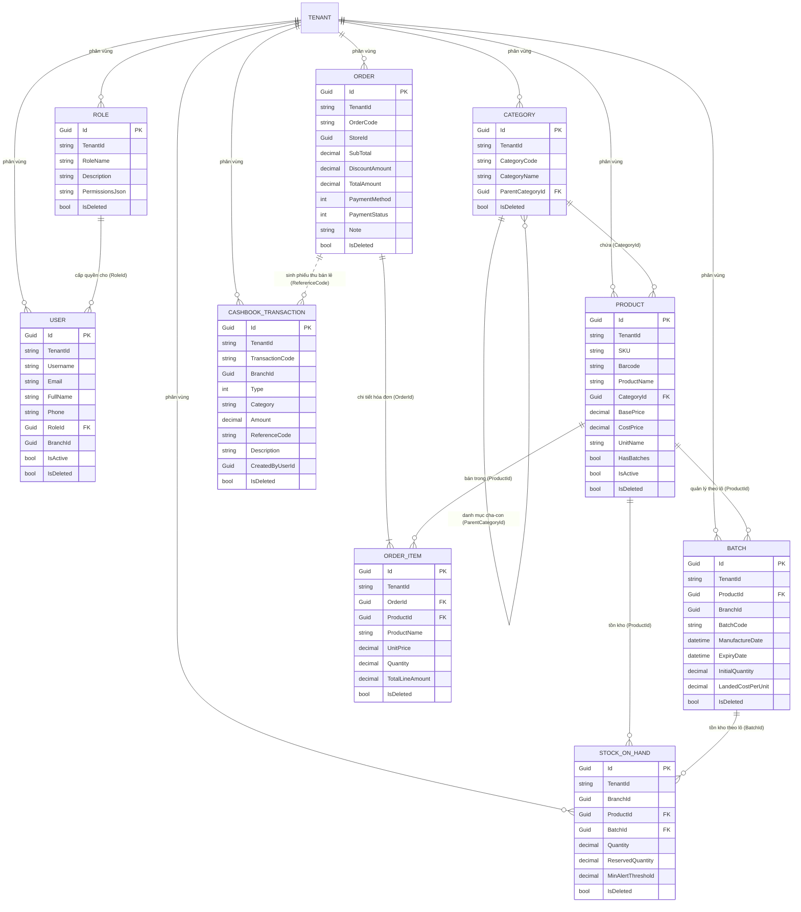

# MT-GRMS — Sơ Đồ Thực Thể Quan Hệ (ERD Diagram)

> **Dự án**: Multi-Tenant Grocery Retail Management System (MT-GRMS / SGMS)  
> **Cập nhật lần cuối**: 2026-10-11  
> **Lệnh đồng bộ**: `npm run sep -- db-sync`

---

## 1. Sơ Đồ ERD Tổng Quan Toàn Hệ Thống

---

## 2. Các Ràng Buộc Khóa & Quan Hệ Cốt Lõi

1. **Multi-Tenancy Hierarchy**:
   - Mọi entity đều độc lập theo `TenantId`. Dữ liệu của Tenant A không bao giờ giao thoa với Tenant B.
2. **FEFO Allocation Chain (Luồng kiểm soát hạn sử dụng)**:
   - `Product` $\rightarrow$ `Batch` (sắp xếp `ExpiryDate ASC`) $\rightarrow$ `StockOnHand` $\rightarrow$ `OrderItem`.
   - Khi xuất kho tại quầy POS, hệ thống ưu tiên phân bổ `Batch` có `ExpiryDate` gần nhất (`AvailableQuantity > 0`).
3. **Audit & Soft Delete**:
   - Toàn bộ các bảng đều có `IsDeleted` và `CreatedAt` kế thừa từ `BaseTenantEntity`.
