# 📊 ĐẶC TẢ THỰC THỂ CƠ SỞ DỮ LIỆU PHÂN HỆ TÀI CHÍNH MT-GRMS
## Phân Hệ Trọng Tâm: FE-07, FE-08, FE-10, FE-17, FE-19 & Toàn Bộ Integration Boundaries (Kèm Catalog & Kho)

---

## 1. SƠ ĐỒ MERMAID ERD CHI TIẾT THUỘC TÍNH (COMPREHENSIVE FINANCIAL & INTEGRATION ERD)

```mermaid
erDiagram
    %% ========================================================
    %% NHÓM 1: PHÂN HỆ TÀI CHÍNH TRỌNG TÂM (CORE FINANCIAL TABLES)
    %% ========================================================

    CashAccounts {
        uuid Id PK
        varchar TenantId FK
        uuid BranchId FK
        nvarchar Name
        varchar AccountType
        nvarchar BankName
        varchar AccountNumber
        decimal CurrentBalance
        varchar Status
        timestamp CreatedAt
        uuid CreatedBy
        timestamp UpdatedAt
        uuid UpdatedBy
        boolean IsDeleted
    }

    LedgerTransactions {
        uuid Id PK
        varchar TenantId FK
        uuid AccountId FK
        timestamp Date
        varchar TransactionType
        decimal Amount
        decimal BalanceAfter
        varchar ReferenceDocId
        varchar ReferenceDocType
        varchar SourceModuleName
        uuid LinkedTransactionId FK
        boolean IsAutomated
        varchar CounterpartyType
        nvarchar CounterpartyName
        nvarchar Description
        varchar Status
        timestamp CreatedAt
        uuid CreatedBy
        boolean IsDeleted
    }

    ServiceExpenses {
        uuid Id PK
        varchar TenantId FK
        uuid BranchId FK
        nvarchar Category
        decimal Amount
        varchar Status
        date ExpenseDate
        date DueDate
        nvarchar VendorName
        uuid PaidFromAccountId FK
        uuid CashBookEntryId FK
        boolean IsRecurring
        varchar RecurringCycle
        int RecurringDayOfMonth
        nvarchar AttachedBillUrl
        nvarchar Note
        timestamp CreatedAt
        uuid CreatedBy
        boolean IsDeleted
    }

    Customers {
        uuid Id PK
        varchar TenantId FK
        varchar PhoneNumber
        nvarchar FullName
        varchar Email
        nvarchar Address
        int LoyaltyPoints
        varchar MembershipTier
        decimal CurrentDebtAR
        decimal DebtLimit
        timestamp CreatedAt
        boolean IsDeleted
    }

    CustomerDebtLedgers {
        uuid Id PK
        varchar TenantId FK
        uuid CustomerId FK
        varchar TransactionType
        decimal Amount
        decimal BalanceAfter
        varchar ReferenceDocId
        uuid CashTransactionId FK
        uuid TargetAccountId FK
        varchar PaymentMethod
        nvarchar Note
        uuid RecordedBy FK
        timestamp CreatedAt
        boolean IsDeleted
    }

    TaxSnapshots {
        uuid Id PK
        varchar TenantId FK
        int TaxYear
        int TaxQuarter
        decimal TotalRevenue
        decimal TaxRateVat
        decimal VatAmount
        decimal TaxRatePit
        decimal PitPayable
        varchar TaxMethod
        uuid PaidFromAccountId FK
        uuid CashTransactionId FK
        varchar Status
        timestamp SubmittedAt
        timestamp PaidAt
        timestamp GeneratedAt
        boolean IsLocked
        timestamp CreatedAt
        boolean IsDeleted
    }

    DailySalesSummaries {
        uuid Id PK
        varchar TenantId FK
        uuid BranchId FK
        date ReportDate
        int TotalOrders
        decimal GrossRevenue
        decimal TotalDiscount
        decimal TotalRefund
        decimal NetRevenue
        decimal TotalCOGS
        decimal GrossProfit
        decimal OperatingExpenses
        decimal PayrollExpenses
        decimal WastageLoss
        decimal OperatingProfitEbt
        decimal TaxEstimatedAmount
        decimal VatEstimatedAmount
        decimal PitEstimatedAmount
        decimal NetProfitAfterTax
        decimal NetProfitAfterTaxMarginPct
        decimal AverageOrderValue
        timestamp LastAggregatedAt
        timestamp CreatedAt
        boolean IsDeleted
    }

    %% ========================================================
    %% NHÓM 2: INTEGRATION BOUNDARIES — DANH MỤC & HÀNG HÓA (CATALOG)
    %% Căn cứ định giá, tính thuế VAT, cơ cấu doanh số P&L theo ngành hàng
    %% ========================================================

    Categories {
        uuid CategoryID PK
        varchar CategoryCode UK
        nvarchar Name
        uuid ParentCategoryID FK
    }

    Products {
        uuid ProductID PK
        uuid CategoryID FK
        varchar ProductCode UK
        varchar Barcode UK
        nvarchar Name
        nvarchar BaseUnit
        decimal CostPrice
        decimal SellingPrice
        decimal VatRate
        boolean HasBatches
    }

    ProductUnits {
        uuid UnitID PK
        uuid ProductID FK
        nvarchar UnitName
        decimal ConversionRate
        decimal Price
    }

    %% ========================================================
    %% NHÓM 3: INTEGRATION BOUNDARIES — KHO BÃI & LÔ HẠN FEFO
    %% Căn cứ tính Giá vốn hàng bán (COGS) và Tổn thất hủy hàng (Wastage)
    %% ========================================================

    BranchStocks {
        uuid Id PK
        uuid BranchId FK
        uuid ProductId FK
        varchar BatchCode
        date ExpiryDate
        decimal QuantityOnHand
        decimal LandedCostPerUnit
    }

    GoodsDisposals {
        uuid Id PK
        uuid BranchId FK
        varchar DisposalCode UK
        varchar Status
        decimal TotalLossValue
        timestamp DisposedAt
    }

    GoodsDisposalItems {
        uuid Id PK
        uuid DisposalId FK
        uuid ProductId FK
        uuid BranchStockId FK
        decimal Quantity
        decimal CostPrice
        decimal LineTotal
    }

    %% ========================================================
    %% NHÓM 4: INTEGRATION BOUNDARIES — BÁN HÀNG POS & GIAO DỊCH
    %% Nguồn phát sinh dòng tiền vào, công nợ AR và doanh thu thuần
    %% ========================================================

    Orders {
        uuid Id PK
        uuid BranchId FK
        uuid CustomerId FK
        uuid ShiftId FK
        varchar OrderCode UK
        decimal TotalAmount
        decimal DiscountAmount
        decimal FinalAmount
        decimal PaidAmount
        decimal DebtAmount
        uuid CashAccountId FK
        uuid CashTransactionId FK
        varchar PaymentMethod
        varchar PaymentStatus
        timestamp OrderDate
    }

    OrderItems {
        uuid Id PK
        uuid OrderId FK
        uuid ProductId FK
        uuid BatchId FK
        decimal BaseQuantity
        decimal UnitPrice
        decimal CostPrice
        decimal LineTotal
    }

    PaymentTransactions {
        uuid Id PK
        uuid OrderId FK
        varchar TransactionReference UK
        decimal Amount
        varchar BankAccountNumber
        timestamp ConfirmedAt
    }

    ReturnOrders {
        uuid Id PK
        uuid OriginalOrderId FK
        uuid BranchId FK
        varchar ReturnCode UK
        decimal TotalRefundAmount
        varchar RefundMethod
        timestamp ReturnDate
    }

    ReturnOrderItems {
        uuid Id PK
        uuid ReturnOrderId FK
        uuid ProductId FK
        uuid BatchId FK
        decimal Quantity
        decimal RefundLineTotal
        decimal RestockedCostPrice
    }

    %% ========================================================
    %% NHÓM 5: INTEGRATION BOUNDARIES — VẬN HÀNH, CA KÍP & NHÂN SỰ
    %% Đối soát kiểm két và chi phí tiền lương P&L
    %% ========================================================

    Tenants {
        varchar Id PK
        varchar TaxNumber
    }

    Branches {
        uuid Id PK
        nvarchar BranchName
    }

    Employees {
        uuid Id PK
        nvarchar FullName
        varchar Role
    }

    CashierShifts {
        uuid Id PK
        uuid BranchId FK
        uuid CashierId FK
        timestamp OpenedAt
        decimal StartingCash
        timestamp ClosedAt
        decimal ExpectedCash
        decimal ActualCash
        decimal CashDifference
    }

    PayrollPeriods {
        uuid Id PK
        uuid BranchId FK
        varchar PeriodCode UK
        date StartDate
        date EndDate
        decimal TotalNetSalary
        uuid PaidFromAccountId FK
        uuid CashTransactionId FK
        varchar Status
    }

    Payslips {
        uuid Id PK
        uuid PayrollPeriodId FK
        uuid EmployeeId FK
        decimal NetSalary
        uuid PaidFromAccountId FK
        uuid CashTransactionId FK
        timestamp PaidAt
        varchar Status
    }

    Suppliers {
        uuid Id PK
        nvarchar SupplierName
        decimal CurrentDebtAP
    }

    GoodsReceipts {
        uuid Id PK
        uuid SupplierId FK
        uuid BranchId FK
        decimal TotalAmount
    }

    %% ========================================================
    %% CÁC QUAN HỆ TOÀN VẸN THAM CHIẾU (FOREIGN KEY INTEGRITY)
    %% ========================================================
    %% Catalog & Inventory
    Categories ||--o{ Categories : "ParentCategoryID"
    Categories ||--o{ Products : "CategoryID"
    Products ||--o{ ProductUnits : "ProductID"
    Products ||--o{ BranchStocks : "ProductId"
    Branches ||--o{ BranchStocks : "BranchId"

    %% Sổ quỹ Core
    BRANCHES ||--o{ CASH_ACCOUNTS : "BranchId"
    CASH_ACCOUNTS ||--o{ LEDGER_TRANSACTIONS : "AccountId"
    LEDGER_TRANSACTIONS ||--o| LEDGER_TRANSACTIONS : "LinkedTransactionId"
    
    BRANCHES ||--o{ SERVICE_EXPENSES : "BranchId"
    SERVICE_EXPENSES }o--|| CASH_ACCOUNTS : "PaidFromAccountId"
    SERVICE_EXPENSES ||..o| LEDGER_TRANSACTIONS : "CashBookEntryId"

    CUSTOMERS ||--o{ CUSTOMER_DEBT_LEDGERS : "CustomerId"
    CUSTOMER_DEBT_LEDGERS }o--|| CASH_ACCOUNTS : "TargetAccountId"
    CUSTOMER_DEBT_LEDGERS ||..o| LEDGER_TRANSACTIONS : "CashTransactionId"

    TENANTS ||--o{ TAX_SNAPSHOTS : "TenantId"
    TAX_SNAPSHOTS }o--|| CASH_ACCOUNTS : "PaidFromAccountId"
    TAX_SNAPSHOTS ||..o| LEDGER_TRANSACTIONS : "CashTransactionId"

    BRANCHES ||--o{ DAILY_SALES_SUMMARIES : "BranchId"

    %% Bán hàng POS & Sản phẩm
    CUSTOMERS ||--o{ ORDERS : "CustomerId"
    BRANCHES ||--o{ ORDERS : "BranchId"
    CASHIER_SHIFTS ||--o{ ORDERS : "ShiftId"
    ORDERS ||--|{ ORDER_ITEMS : "OrderId"
    PRODUCTS ||--o{ ORDER_ITEMS : "ProductId"
    ORDERS ||--o{ PAYMENT_TRANSACTIONS : "OrderId"
    ORDERS }o--|| CASH_ACCOUNTS : "CashAccountId"
    ORDERS ||..o| LEDGER_TRANSACTIONS : "CashTransactionId"
    ORDERS ||..o{ CUSTOMER_DEBT_LEDGERS : "DebtAmount"

    %% Ca kíp & Quỹ lương
    BRANCHES ||--o{ CASHIER_SHIFTS : "BranchId"
    BRANCHES ||--o{ PAYROLL_PERIODS : "BranchId"
    PAYROLL_PERIODS ||--|{ PAYSLIPS : "PayrollPeriodId"
    PAYSLIPS }o--|| CASH_ACCOUNTS : "PaidFromAccountId"
    PAYSLIPS ||..o| LEDGER_TRANSACTIONS : "CashTransactionId"

    %% Đổi trả & Xuất hủy
    ORDERS ||--o{ RETURN_ORDERS : "OriginalOrderId"
    RETURN_ORDERS ||--|{ RETURN_ORDER_ITEMS : "ReturnOrderId"
    PRODUCTS ||--o{ RETURN_ORDER_ITEMS : "ProductId"

    BRANCHES ||--o{ GOODS_DISPOSALS : "BranchId"
    GOODS_DISPOSALS ||--|{ GOODS_DISPOSAL_ITEMS : "DisposalId"
    PRODUCTS ||--o{ GOODS_DISPOSAL_ITEMS : "ProductId"
    BRANCH_STOCKS ||--o{ GOODS_DISPOSAL_ITEMS : "BranchStockId"

    %% Mua hàng NCC
    SUPPLIERS ||--o{ GOODS_RECEIPTS : "SupplierId"
    BRANCHES ||--o{ GOODS_RECEIPTS : "BranchId"
```

---

## 2. TẠI SAO BẮT BUỘC PHẢI CÓ CÁC BẢNG CATALOG & KHO TRONG PHÂN HỆ TÀI CHÍNH?

| Bảng Bổ Sung | Khóa Ngoại Liên Kết | Vai Trò & Tác Động Tài Chính Quyết Định | Hậu Quả Nghiêm Trọng Nếu Bỏ Qua |
|---|---|---|---|
| **`Products`** | Trỏ từ `OrderItems`, `ReturnOrderItems`, `GoodsDisposalItems` | • **Xác định Doanh thu & Thuế suất**: Chứa `SellingPrice`, `CostPrice`, và `VatRate` (0%, 5%, 8%, 10%) làm căn cứ phân bổ thuế GTGT đầu ra trên Tờ khai thuế Form 01/CNKD (FE-19). • **Báo cáo P&L phân tích**: Phân tích Top sản phẩm sinh lời và biên lãi gộp từng mặt hàng trong FE-10. | • `OrderItems.ProductId` bị mồ côi (vi phạm khóa ngoại). • Không thể tính toán doanh thu chịu thuế theo mặt hàng. |
| **`Categories`** | Trỏ từ `Products.CategoryId` | • **Báo cáo cơ cấu Doanh thu & Lợi nhuận P&L theo Ngành hàng**: Cho phép Chủ tiệm biết nhóm hàng nào đang nuôi sống cửa hàng (Đồ uống, Sữa, Bánh kẹo) trên Dashboard FE-10. | • Mất khả năng phân tích danh mục sinh lời; P&L chỉ thấy con số tổng mà không thấy cấu phần ngành hàng. |
| **`ProductUnits`** | Trỏ từ `Products.ProductId` | • **Quy đổi Đơn giá & Doanh thu theo Đơn vị bán lẻ**: Bán theo Thùng / Lốc / Lon với các mức chiết khấu và giá bán khác nhau (`ConversionRate`, `Price`). | • Sai lệch số tiền thực thu khi khách mua nguyên thùng thay vì mua lẻ từng lon. |
| **`BranchStocks`** | Trỏ từ `OrderItems`, `GoodsDisposalItems` | • **Trái tim tính Giá vốn hàng bán (COGS FEFO)**: Lưu vết `LandedCostPerUnit` (giá nhập gốc + chi phí vận chuyển phân bổ) của từng Lô (`BatchCode`) và Hạn sử dụng (`ExpiryDate`). Khi xuất kho bán hàng hoặc xuất hủy, hệ thống trừ đúng giá vốn thực tế của lô đó. | • Báo cáo P&L bị tính sai hoàn toàn chỉ số Lợi nhuận gộp (`GrossProfit = NetRevenue - COGS`) do dùng giá vốn bình quân ảo thay vì giá vốn thực tế theo lô hạn FEFO. |
| **`GoodsDisposalItems`** | Trỏ từ `GoodsDisposals` và `BranchStocks` | • **Chi tiết mặt hàng xuất hủy**: Ghi nhận số lượng và đơn giá vốn của từng mặt hàng bị tiêu hủy (hết date, hư hỏng) để trừ chính xác tồn kho và đưa vào dòng `WastageLoss` trên P&L. | • Kho ảo bị lệch vĩnh viễn (hàng mốc vẫn còn trên máy tính), thuật toán FEFO tiếp tục gợi ý bán hàng hết hạn tại quầy POS. |

---

## 3. TỔNG HỢP 8 QUYẾT ĐỊNH NGHIỆP VỤ & KIẾN TRÚC ĐÃ XÁC NHẬN (/GRILL-ME)

1. **Bất biến Sổ quỹ FE-17**: Khóa cứng mọi bút toán tự động (`IsAutomated = 1`). `CurrentBalance` cập nhật đồng thời trong DB Transaction. Lệch kiểm kê chỉ điều chỉnh qua bút toán `ADJUSTMENT`.
2. **Chuyển tiền nội bộ FE-17**: Xử lý theo cơ chế **Atomic Transaction** (Phiếu Chi và Phiếu Thu đối ứng kép đều hoàn tất `COMPLETED` cùng lúc qua `LinkedTransactionId`).
3. **Quản lý công nợ FE-08**: Lưu vết theo cơ chế **Dư nợ lũy kế (`Running Balance`)** trong `CustomerDebtLedgers`, tự động sinh Phiếu Thu trong Sổ quỹ FE-17 khi khách trả nợ.
4. **Kiểm soát hạn mức nợ tại POS**: **Chặn cứng** đối với Thu ngân khi khách vượt `DebtLimit`; chỉ được xuất hóa đơn khi có Quản lý/Chủ tiệm xác thực ghi đè (`Manager Override`) tại quầy.
5. **Chi phí định kỳ FE-07**: Background Job tự sinh hóa đơn `Pending` vào ngày hẹn (`RecurringDayOfMonth`); trích tiền từ quỹ đã chọn và sinh Phiếu Chi FE-17 khi Chủ tiệm duyệt chi.
6. **Đóng băng hồ sơ thuế FE-19**: Khi tờ khai đạt `Locked`/`Submitted`/`Paid`, kích hoạt cờ **Freeze** chặn sửa/hủy/hoàn tiền hóa đơn POS trong Quý.
7. **Snapshot P&L FE-10**: Vận hành theo mô hình **Hybrid** (cập nhật tăng dần realtime trong ngày và Job 00:05 đêm chốt cứng ngày hôm trước).
8. **Phân bổ chi phí lương vào P&L**: Ghi nhận chi phí lương dồn vào **đúng 1 ngày trong tháng** khi Chủ tiệm bấm duyệt thanh toán bảng lương (`Payslips.PaidAt`).
