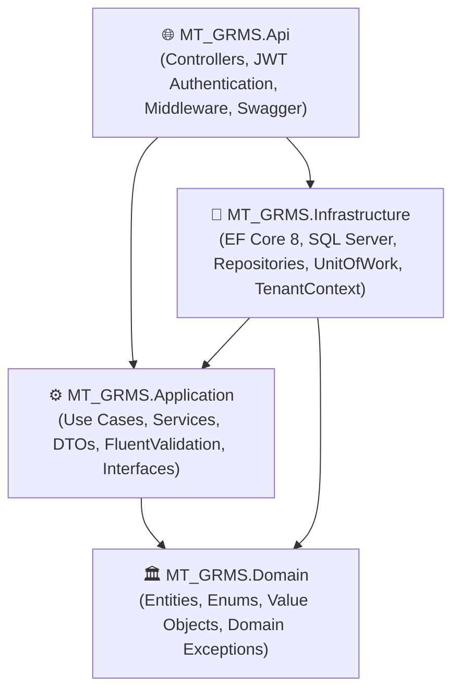
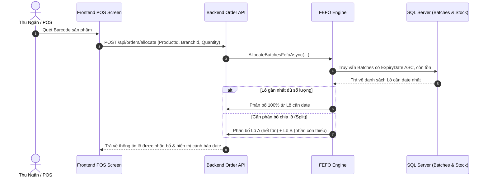

# MT-GRMS — Kiến Trúc Hệ Thống & Luồng Nghiệp Vụ Toàn Cảnh

> **Dự án**: Multi-Tenant Grocery Retail Management System (MT-GRMS)  
> **Cập nhật lần cuối**: 2026-10-11

---

## 1. Kiến Trúc Phân Tầng Clean Architecture (Backend)

Hệ thống Backend được tổ chức nghiêm ngặt theo **Clean Architecture 4 tầng**:

### Nguyên tắc bất biến:
1. **Domain độc lập hoàn toàn**: Không phụ thuộc vào bất kỳ framework hoặc thư viện bên ngoài nào.
2. **Application chỉ làm việc với DTO**: Controller chuyển Request DTO vào Application Service; Service trả về Response DTO. Entity tuyệt đối không lộ ra tầng Controller.
3. **Đa người thuê ở tầng Persistence**: `AppDbContext` đăng ký `ITenantContext` và tự động áp dụng `HasQueryFilter(e => !e.IsDeleted && e.TenantId == CurrentTenantId)`.

---

## 2. Kiến Trúc Frontend (React 19 / Vite)

Frontend áp dụng cấu trúc thư mục Feature-based hiện đại:
- `src/features/<feature-name>/`:
  - `components/`: UI components chuyên biệt của tính năng.
  - `pages/`: Màn hình trang.
  - `lib/`: Hook, Zustand store, TanStack Query hooks.
  - `types/`: Interface TypeScript đồng bộ với DTO của Backend.
- **UI Design System**: Tailwind CSS v4, Ant Design v6, phông chữ `Be Vietnam Pro`, màu chủ đạo Electric Blue `#0066FF`, bo góc Full Pill (`rounded-full`).

---

## 3. Luồng Nghiệp Vụ Trọng Tâm

### 3.1 Luồng Quản Lý Lô Hàng Cận Date (FEFO Engine - FE-02)

### 3.2 Luồng Bán Hàng & Tự Động Ghi Sổ Quỹ (Cashbook Integration)
Khi hoàn tất đơn hàng POS:
1. Trừ tồn kho tức thời tại `StockOnHand` (theo đúng `BatchId` nếu có).
2. Tạo bản ghi `Order` và các `OrderItem`.
3. Tự động sinh bản ghi `CashbookTransaction` loại `Receipt` (Phiếu thu) với `ReferenceCode = OrderCode` để đồng bộ doanh thu vào sổ quỹ.
