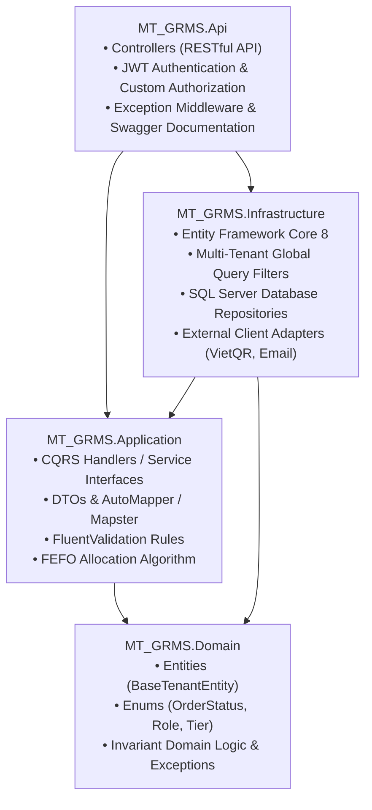

# 🏛️ MT-GRMS — Sơ Đồ Ngữ Cảnh, Kiến Trúc Hệ Thống & Tích Hợp Ngoại Vi

> **Dự án**: Multi-Tenant Grocery Retail Management System (MT-GRMS)  
> **Nguồn trích xuất**: Sơ đồ Draw.io XML (`Diagram_XML_style.txt`) và Báo cáo SRS (Report-3)  

---

## 1. Sơ Đồ Ngữ Cảnh Hệ Thống (System Context Diagram - Level 0)

Sơ đồ thể hiện toàn bộ luồng thông tin vào/ra giữa hệ thống trung tâm MT-GRMS với các đối tượng người dùng và hệ thống ngoại vi:

```mermaid
graph TD
    %% Trung tâm
    SYS(("🛒 MT-GRMS<br/><b>Multi-Tenant Grocery Retail<br/>Management System</b>"))

    %% Tác tử con người
    ADMIN["👤 SaaS Master Admin"]
    OWNER["👑 Store Owner<br/>(Chủ chuỗi)"]
    STAFF["👨‍💼 Employee<br/>(Quản lý / Thu ngân / Kho)"]
    CUST["🛍️ Customer<br/>(Khách hàng)"]

    %% Hệ thống ngoại vi & Phần cứng
    BANK["🏦 Banking & Payment Gateway<br/>(VietQR / Webhook)"]
    HW["📠 Hardware Peripherals<br/>(Barcode Scanner, POS Printer, Cash Drawer)"]
    GOOGLE["🌐 Google Identity Service<br/>(OAuth 2.0 Token)"]
    EMAIL["📧 Email Notification Service<br/>(SendGrid / SMTP API)"]

    %% Luồng tương tác Admin
    ADMIN -->|"Cấu hình Gói cước SaaS<br/>Lệnh khóa/mở Tenant"| SYS
    SYS -->|"Master KPIs Dashboard<br/>Báo cáo MRR & Doanh thu"| ADMIN

    %% Luồng tương tác Store Owner
    OWNER -->|"Cấu hình Cửa hàng & RBAC<br/>Duyệt PO, Chốt ca, Báo cáo thuế"| SYS
    SYS -->|"Báo cáo P&L, Doanh thu, Tồn kho<br/>Cảnh báo hàng cận date FEFO"| OWNER

    %% Luồng tương tác Employee
    STAFF -->|"Quét mã vạch bán hàng POS<br/>Kiểm kê, Nhập kho, Bàn giao ca"| SYS
    SYS -->|"Gợi ý Lô xuất FEFO<br/>Lịch phân ca & Phiếu lương"| STAFF

    %% Luồng tương tác Customer
    CUST -->|"Yêu cầu mua hàng & Tích điểm<br/>Quét mã thanh toán VietQR"| SYS
    SYS -->|"Hóa đơn bán lẻ, Điểm thưởng<br/>Thông báo hạn thành viên"| CUST

    %% Luồng tích hợp Ngân hàng VietQR
    SYS -->|"Sinh mã Dynamic QR Code<br/>Truy vấn trạng thái giao dịch"| BANK
    BANK -->|"Instant Payment Webhook<br/>Xác nhận tiền về tài khoản"| SYS

    %% Luồng tích hợp Phần cứng POS
    HW -->|"Tín hiệu Barcode SKU / Lô Hạn<br/>Tín hiệu trạng thái thiết bị"| SYS
    SYS -->|"Lệnh in hóa đơn bill / Z-Report<br/>Lệnh mở két tiền & Bíp âm thanh"| HW

    %% Luồng tích hợp Google & Email
    SYS -->|"Yêu cầu xác thực OAuth 2.0"| GOOGLE
    GOOGLE -->|"Token hồ sơ (Email, Name, ID)"| SYS
    SYS -->|"Yêu cầu gửi OTP, Link khôi phục mật khẩu"| EMAIL
    EMAIL -->|"Trạng thái gửi (Sent / Bounced)"| SYS
```

---

## 2. Kiến Trúc Kỹ Thuật Chi Tiết (Technical Architecture)

### 2.1 Backend: .NET 8 Clean Architecture (4 Tầng Phân Lập)

### 2.2 Frontend: React 19 + TypeScript + Vite

- **Kiến trúc Feature-Based**:
  - `src/features/pos/`: Màn hình bán hàng siêu tốc, hỗ trợ phím tắt (`F1` - `F12`), quét mã vạch liên tục không cần chạm chuột.
  - `src/features/inventory/`: Quản lý kho, kiểm kê, danh sách cảnh báo FEFO.
  - `src/features/cashbook/`: Quản lý dòng tiền và kết ca.
- **Design System Electric Blue**:
  - CSS: Tailwind CSS v4.
  - UI Library: Ant Design v6.
  - Phông chữ chuẩn: `Be Vietnam Pro` (tối ưu tiếng Việt có dấu).
  - Màu thương hiệu chính: Electric Blue `#0066FF`, bo góc hiện đại `rounded-full`.

---

## 3. Danh Mục Các Tích Hợp Ngoại Vi (External API Inventory)

| Tên Dịch Vụ | Giao Thức | Chi Tiết Tích Hợp | Mục Đích Nghiệp Vụ |
|---|:---:|---|---|
| **VietQR Dynamic Payment** | HTTP REST & Webhook | API sinh mã VietQR chuẩn NAPAS + Webhook ngân hàng bắn khi nhận tiền. | Thanh toán không tiền mặt tại quầy POS; tự động chốt hóa đơn không cần nhân viên chụp màn hình. |
| **Google Identity Services** | OAuth 2.0 / OIDC | Trao đổi Authorization Code lấy Access Token và User Profile. | Đăng nhập nhanh cho Store Owner và nhân viên bằng tài khoản Google. |
| **SendGrid / SMTP Mailer** | REST API / SMTP | Gửi email mẫu HTML kèm Token bảo mật có thời hạn (15 phút). | Kích hoạt tài khoản Tenant mới, cấp lại mật khẩu và gửi cảnh báo hết hạn gói SaaS. |
| **Thiết bị ngoại vi POS** | WebHID / ESC/POS Raw | Giao tiếp máy quét mã vạch (Barcode Scanner) và máy in nhiệt qua cổng USB/LAN. | Quét mã hàng hóa siêu tốc, in hóa đơn 80mm/58mm và tự động bật mở ngăn kéo tiền mặt. |

---

## 4. Danh Mục Các Tác Vụ Ngầm Định Kỳ (Background Jobs Inventory)

Hệ thống sử dụng **Hangfire / Quartz.NET** để lập lịch chạy các background jobs tự động:

1. **FEFO Expiry Monitor Job (Chạy mỗi 01:00 AM hàng ngày)**:
   - Quét toàn bộ bảng `Batches` và `Inventory` trên tất cả các Tenant.
   - So sánh `ExpiryDate` với ngưỡng `NearExpiryDaysThreshold`.
   - Nếu sắp hết hạn: Gắn cờ cảnh báo cận date, gửi thông báo Dashboard cho Store Owner và đề xuất tạo chương trình giảm giá thanh lý.
2. **Subscription Quota & Expiry Check Job (Chạy mỗi 02:00 AM hàng ngày)**:
   - Kiểm tra hạn dùng gói cước `SubscriptionExpiredAt` của các Tenant.
   - Tenant còn 7 ngày / 3 ngày: Tự động gửi email thông báo gia hạn.
   - Tenant quá hạn > 3 ngày: Tự động khóa tài khoản (chuyển `IsActive = 0`) và thông báo chuyển về chế độ Read-only.
3. **Shift Auto-Close Guard Job (Chạy mỗi 23:59 PM hàng ngày)**:
   - Quét các ca làm việc `CashierShifts` mở quá 16 tiếng mà nhân viên quên bấm kết ca.
   - Đánh dấu trạng thái `FORCE_CLOSED`, ghi log kiểm toán và thông báo cho Store Manager kiểm tra tiền két vào sáng hôm sau.
